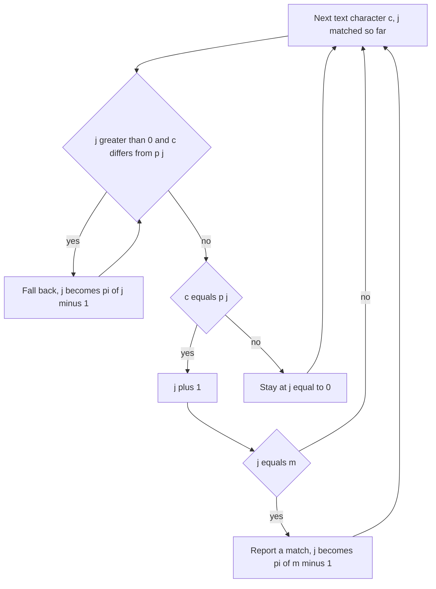

## The hook

Someone reads a long document aloud while you listen for a particular phrase. Halfway through a near-match, the reader says a word that breaks it. A naive listener rewinds the tape and starts again one word later. An experienced listener thinks: "the last few words I heard are themselves the start of the phrase, so I am already partway into a new match", and keeps listening without rewinding.

That experienced listener is the Knuth-Morris-Pratt algorithm, published in 1977. It finds every occurrence of a pattern in a text in O(n + m), never reading a text character twice in a row of comparisons, and its core table has a surprising number of other uses.

## The intuition

:::analogy
The listener has a cheat sheet prepared from the phrase alone, before the reading starts. For every point in the phrase, it says: "if a mismatch happens after this many words matched, the last words you heard still match the first k words of the phrase". So on a slip, the listener does not rewind the tape; they just jump to position k in the phrase and compare the current word again. The cheat sheet never depends on the document, only on the phrase.
:::

The cheat sheet is the [[prefix function]]. π[i] is the length of the longest [[border]] of p[0..i]: a proper prefix that is also a suffix. If j characters of the pattern have matched and the next one fails, the last j text characters are p[0..j), so their longest border, of length π[j - 1], still matches a prefix of the pattern. That [[fallback]] keeps the text pointer where it is.

## How it works

### Building the prefix function in O(m)

Keep k = the current border length, starting at 0. For each i from 1:

- while k > 0 and p[i] ≠ p[k], fall back: k = π[k - 1];
- if p[i] = p[k], extend: k = k + 1;
- π[i] = k.

The pattern is matching against itself. Each step increases k by at most 1, and each fallback decreases it, so the total work is O(m).

### Matching in O(n + m)

Keep j = the number of pattern characters currently matched. For each text character c:

- while j > 0 and c ≠ p[j], j = π[j - 1];
- if c = p[j], j = j + 1;
- if j = m, record a match ending here, then set j = π[m - 1] to allow overlapping matches.

The text index only moves forward. Each character increases j by at most 1, and fallbacks only decrease it, so the total work is O(n).

A common shortcut computes π on p + '#' + t, with '#' a character in neither string: every position where π equals m marks a match.

### Repeated Substring Pattern

Let L = π[n - 1] for the whole string s. Then n - L is the [[period]] of s. If L > 0 and n is divisible by n - L, s is a block of length n - L repeated n / (n - L) times. Otherwise it is not a repetition of any smaller block.

### Shortest Palindrome

Add characters only at the front of s to make the shortest palindrome. The kept part must be the longest palindromic prefix of s. Compute π on s + '#' + reverse(s): the final value is the length of the longest prefix of s that equals a suffix of reverse(s), which is exactly the longest palindromic prefix. Prepend the reverse of the rest.

| Problem | Run π on | Read off |
|---|---|---|
| Find all occurrences | the pattern, then scan the text | positions where j reaches m |
| Repeated Substring Pattern | s | L = π[n - 1], check n % (n - L) == 0 |
| Shortest Palindrome | s + '#' + reverse(s) | longest palindromic prefix length |
| Smallest period | s | n - π[n - 1] |



:::insight
After a mismatch, the text you just read is a prefix of the pattern, so the pattern itself tells you how much of a new match you already have. Precomputing that, the prefix function, lets the matcher move only forward through the text, which makes it linear.
:::

## Walk through an example

### Prefix function of "abacabab"

| i | 0 | 1 | 2 | 3 | 4 | 5 | 6 | 7 |
|---|---|---|---|---|---|---|---|---|
| p[i] | a | b | a | c | a | b | a | b |
| π[i] | 0 | 0 | 1 | 0 | 1 | 2 | 3 | 2 |

Two fallbacks happen while building it:

- at i = 3, 'c' ≠ p[1] = 'b', so k falls from 1 to π[0] = 0, and 'c' ≠ 'a', so π[3] = 0;
- at i = 7, 'b' ≠ p[3] = 'c', so k falls from 3 to π[2] = 1; now 'b' = p[1], so k = 2 and π[7] = 2.

### Matching "abacabab" in "abacabacababa"

| Text index | Character | j before | Action | j after |
|---|---|---|---|---|
| 0 to 6 | a b a c a b a | 0 → 7 | each matches | 7 |
| 7 | c | 7 | p[7] = b ≠ c: fall back to π[6] = 3; p[3] = c matches | 4 |
| 8 to 11 | a b a b | 4 → 8 | each matches | 8 = m: match at 11 - 8 + 1 = 4 |
| 12 | a | π[7] = 2 | p[2] = a matches | 3 |

One match, starting at index 4. At index 7, the naive method would restart from text index 1; KMP kept "aba", the last three characters read, as a head start, and never revisited indices 1 to 6.

### Repeated patterns

| s | π[n - 1] | n - L | Divides n? | Repetition? |
|---|---|---|---|---|
| abcabcabc | 6 | 3 | yes | "abc" × 3 |
| abcab | 2 | 3 | no | no |
| aaaa | 3 | 1 | yes | "a" × 4 |
| abab | 2 | 2 | yes | "ab" × 2 |

### Shortest palindromes

| s | Longest palindromic prefix | Result |
|---|---|---|
| abcbad | abcba (5) | d + abcbad = dabcbad |
| aabba | aa (2) | abb + aabba = abbaabba |

:::try-this
Compute π for "aabaaab" and find its smallest period. (π = 0, 1, 0, 1, 2, 2, 3. At i = 5, the border "aa" of "aabaa" tries to grow with 'a' but p[2] = 'b', so it falls back to π[1] = 1 and grows to 2. The smallest period is 7 - 3 = 4, so s[i] = s[i + 4] wherever both exist, but 4 does not divide 7, so it is not a repetition.)
:::

:::warning
Common misconception: "On a mismatch, reset j to 0 and continue." That throws away exactly the information KMP exists to keep. In the example, resetting at text index 7 would miss the match at index 4, because the characters "aba" just read are the start of it. The fallback must follow the prefix function, possibly several times, before giving up on a partial match.
:::

## The code

```pseudo
prefix_function(p):
    pi[0] = 0; k = 0
    for i in 1..m-1:
        while k > 0 and p[i] != p[k]: k = pi[k-1]
        if p[i] == p[k]: k += 1
        pi[i] = k

kmp_search(t, p):
    j = 0
    for i, c in t:
        while j > 0 and c != p[j]: j = pi[j-1]
        if c == p[j]: j += 1
        if j == m: report i - m + 1; j = pi[m-1]
```

```cpp
#include <bits/stdc++.h>
using namespace std;

vector<int> prefixFunction(const string& p) {
    int m = p.size();
    vector<int> pi(m, 0);
    for (int i = 1, k = 0; i < m; i++) {
        while (k > 0 && p[i] != p[k]) k = pi[k - 1];        // fall back along borders
        if (p[i] == p[k]) k++;
        pi[i] = k;
    }
    return pi;
}

vector<int> kmpSearch(const string& t, const string& p) {
    vector<int> pi = prefixFunction(p), found;
    int m = p.size();
    for (int i = 0, j = 0; i < (int)t.size(); i++) {
        while (j > 0 && t[i] != p[j]) j = pi[j - 1];        // text index never moves back
        if (t[i] == p[j]) j++;
        if (j == m) found.push_back(i - m + 1), j = pi[m - 1];
    }
    return found;
}

bool repeatedSubstringPattern(const string& s) {
    int n = s.size(), L = prefixFunction(s)[n - 1];
    return L > 0 && n % (n - L) == 0;
}

string shortestPalindrome(const string& s) {
    string r(s.rbegin(), s.rend());
    int L = prefixFunction(s + "#" + r).back();             // longest palindromic prefix
    return r.substr(0, s.size() - L) + s;
}

int main() {
    for (int x : prefixFunction("abacabab")) cout << x;
    cout << ' ';
    for (int x : kmpSearch("abacabacababa", "abacabab")) cout << x;
    cout << ' ';
    for (int x : kmpSearch("aaaaa", "aa")) cout << x;
    cout << '\n';                                            // 00101232 4 0123
    for (string s : {"abcabcabc", "abcab", "aaaa", "abab"}) cout << repeatedSubstringPattern(s);
    cout << ' ' << shortestPalindrome("abcbad") << ' ' << shortestPalindrome("aabba") << '\n';   // 1011 dabcbad abbaabba
    for (int x : prefixFunction("aabaaab")) cout << x;
    cout << '\n';                                            // 0101223
}
```

`kmpSearch("aaaaa", "aa")` finds the overlapping matches at 0, 1, 2 and 3, because after each match j falls back to π[1] = 1 instead of 0.

## Complexity

- **Prefix function: O(m) time and space.**
- **Search: O(n + m) time,** O(m) extra space, compared with O(n × m) for the naive matcher in the worst case.
- **Repeated Substring Pattern and Shortest Palindrome: O(n),** one prefix function each.
- **Versus Rabin-Karp:** KMP has a worst-case guarantee and no collisions; rolling hashes are easier to extend to many patterns or 2D grids.

## Common mistakes

- **Using `if` instead of `while` for the fallback,** which stops after one step and misses shorter borders.
- **Indexing π off by one:** after j matched characters, fall back to π[j - 1], not π[j].
- **Resetting j to 0 after a full match,** which misses overlapping occurrences.
- **Forgetting the separator** in s + '#' + reverse(s), so the border can run across the two halves.
- **Checking only n % (n - L) == 0** in Repeated Substring Pattern without L > 0, which accepts every string, since n % n is 0.

## Practice problems

*Find the Index of the First Occurrence in a String* and CSES *String Matching* are the search itself. *Repeated Substring Pattern* uses the period n - π[n - 1]. *Shortest Palindrome* runs the prefix function on s + '#' + reverse(s). The hashing alternative and its trade-offs are in [Sliding a Stencil Across a Page](article:dsa-string-matching-basics).

## Key takeaways

- The prefix function π[i] is the length of the longest proper prefix of p[0..i] that is also a suffix of it.
- On a mismatch after j matched characters, KMP continues from π[j - 1] matched characters without moving back in the text.
- Building π and searching the text are both linear, so matching costs O(n + m) in the worst case.
- n - π[n - 1] is the smallest period of a string, which decides whether it is a repetition of a smaller block.
- Running the prefix function on s + '#' + reverse(s) gives the longest palindromic prefix, which solves Shortest Palindrome.
