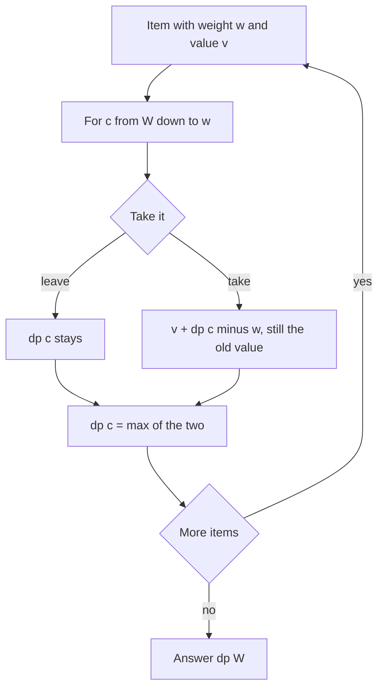

## The hook

You are packing for a trek and your backpack holds 7 kg. On the floor: a stove, a camera, a tent, a sleeping bag, each with a weight and a usefulness score. Every item goes in whole or stays behind. Which combination is most useful without breaking the weight limit?

That is the 0/1 knapsack problem, and it is a placement favourite because a whole family of problems hides inside it. "Can this array be split into two equal halves?", "how many ways can signs be assigned to reach a target?", "what is the smallest possible difference between two piles?" are all knapsacks wearing disguises. Learn the one table and the one loop direction, and you can solve them all.

## The intuition

:::analogy
Imagine laying your items in a line and deciding about them one at a time, keeping a notebook of "the best usefulness I can carry for every possible weight limit from 0 to 7 kg, using only the items considered so far". When you pick up the next item, for each weight limit you ask one question: am I better off leaving this item, or putting it in and filling the remaining space as well as I could before this item came along? Once every item has been considered, the notebook's last line answers the original question.
:::

That notebook is the DP table for the [[0/1 knapsack]]. Its rows are "items considered so far", its columns are every [[capacity]] from 0 to W, and each decision is take or leave.

## How it works

### The 2D table

- **State**: dp[i][c] = the best total value using only the first i items with capacity c.
- **Transition**: for item i with weight w and value v:
  - leave it: dp[i − 1][c]
  - take it (only if w ≤ c): v + dp[i − 1][c − w]
  - dp[i][c] = the larger of the two.
- **Base case**: dp[0][c] = 0 for every c, because with no items there is no value.
- **Answer**: dp[n][W].

"Take it" looks at row i − 1, the world before this item existed. That is what makes it 0/1: the item can be used at most once.

### Shrinking to one row

Each row only reads the row directly above it. So keep a single array dp[c] and overwrite it in place, item by item. The catch is the loop direction:

- Loop **c from W down to w**. When you compute dp[c], the entry dp[c − w] (a smaller index) has not been updated yet for this item, so it still holds the "before this item" value. Correct.
- If you loop **upwards**, dp[c − w] may already include this item, so dp[c] could add it a second time. That silently solves the [[unbounded knapsack]] instead.

### Subset sum: the yes/no version

[[Subset sum]] asks whether some subset adds up to exactly T. Replace values with booleans: can[0] = true, and for each number x, for s from T down to x, can[s] = can[s] or can[s − x]. It is the same backwards loop with "or" in place of "max".

Three classic disguises:

- **Partition Equal Subset Sum**: total must be even, then ask for subset sum total / 2.
- **Target Sum** (assign + or − to each number to reach T): if P is the sum of the plus group, then P − (total − P) = T, so P = (total + T) / 2. Count subsets summing to P with "+=" instead of "or".
- **Last Stone Weight II**: smashing stones splits them into two groups; minimise the difference by finding the largest reachable subset sum ≤ total / 2. The answer is total − 2 × that sum.



:::insight
The whole difference between "each item once" and "each item any number of times" is which version of dp[c − w] you read: the one from before this item (loop backwards) or the one that may already include it (loop forwards). Ask yourself which world the "take" choice should look into.
:::

### Why it is called pseudo-polynomial

O(n × W) looks polynomial, but W is a number, not a length. If W is 10⁹, the table is too big. Running time that depends on a numeric value like this is [[pseudo-polynomial time]]. Knapsack DP is the right tool when W (or the target sum) is up to around 10⁵ to 10⁶; for huge W with few items, other techniques such as meet in the middle apply.

## Walk through an example

Items (weight, value): A (1, 1), B (3, 4), C (4, 5), D (5, 7). Capacity 7.

| after item | c=0 | 1 | 2 | 3 | 4 | 5 | 6 | 7 |
|---|---|---|---|---|---|---|---|---|
| none | 0 | 0 | 0 | 0 | 0 | 0 | 0 | 0 |
| A (1, 1) | 0 | 1 | 1 | 1 | 1 | 1 | 1 | 1 |
| B (3, 4) | 0 | 1 | 1 | 4 | 5 | 5 | 5 | 5 |
| C (4, 5) | 0 | 1 | 1 | 4 | 5 | 6 | 6 | 9 |
| D (5, 7) | 0 | 1 | 1 | 4 | 5 | 7 | 8 | 9 |

Answer **9**: B and C (weight 7, value 4 + 5). Read one cell: after C at c = 7, "take C" gives 5 + dp_old[3] = 5 + 4 = 9, beating "leave" at 5.

**The loop-direction bug, shown:** one item of weight 3 and value 4, capacity 6. Looping backwards gives dp[6] = 4 (one copy). Looping forwards gives dp[3] = 4 and then dp[6] = 4 + dp[3] = 8, using the item twice.

**Subset sum:** can [2, 3, 7, 8, 4] be split into two equal halves? The total is 24, so look for 12. The backwards boolean loop marks 12 reachable (8 + 4, or 2 + 3 + 7), so yes.

:::try-this
Target Sum: numbers [1, 2, 1, 2], target 2. How many sign assignments work? (Total 6, so the plus group must sum to P = (6 + 2) / 2 = 4. Subsets summing to 4: {2, 2}, and {1, 2, 1} using either 2, for 3 ways.)
:::

## The code

```pseudo
knapsack(items, W):
    dp = [0] * (W + 1)
    for (w, v) in items:
        for c from W down to w:              // backwards: each item once
            dp[c] = max(dp[c], dp[c - w] + v)
    return dp[W]

can_partition(nums):
    if sum(nums) is odd: return false
    T = sum(nums) / 2
    can = [true] + [false] * T
    for x in nums:
        for s from T down to x: can[s] = can[s] or can[s - x]
    return can[T]
```

```cpp
#include <bits/stdc++.h>
using namespace std;

int knapsack(const vector<pair<int, int>>& items, int W) {
    vector<int> dp(W + 1, 0);
    for (auto [w, v] : items)
        for (int c = W; c >= w; c--) dp[c] = max(dp[c], dp[c - w] + v);
    return dp[W];
}

bool canPartition(const vector<int>& nums) {
    int total = accumulate(nums.begin(), nums.end(), 0);
    if (total % 2) return false;
    int T = total / 2;
    vector<char> can(T + 1, 0);
    can[0] = 1;
    for (int x : nums)
        for (int s = T; s >= x; s--) can[s] = can[s] || can[s - x];
    return can[T];
}

int countSubsets(const vector<int>& nums, int P) {     // Target Sum core
    vector<long long> ways(P + 1, 0);
    ways[0] = 1;
    for (int x : nums)
        for (int s = P; s >= x; s--) ways[s] += ways[s - x];
    return ways[P];
}

int main() {
    cout << knapsack({{1, 1}, {3, 4}, {4, 5}, {5, 7}}, 7) << '\n';   // 9
    cout << canPartition({2, 3, 7, 8, 4}) << '\n';                   // 1
    cout << countSubsets({1, 2, 1, 2}, 4) << '\n';                   // 3
}
```

## Complexity

- **Time:** O(n × W): every item visits every capacity once.
- **Space:** O(n × W) for the 2D table, O(W) for the 1D version. Keep the 2D table if you must reconstruct which items were chosen, or store choices separately.

## Common mistakes

:::warning
Common misconception: "the loop direction over capacity does not matter." In the 1D table it decides the problem. Backwards means each item is used at most once (0/1 knapsack); forwards means items can be reused (unbounded knapsack). Many wrong answers on *Partition Equal Subset Sum* come from looping upward and silently counting a number twice.
:::

- **Forgetting the parity check** in partition problems: an odd total can never be split evenly.
- **Target Sum edge cases**: if total + T is odd or |T| > total, the answer is 0; P must be a non-negative integer.
- **Zeros in Target Sum**: a 0 can take either sign, so it doubles the count. The counting DP handles it automatically because can[s] += can[s − 0] runs once per zero.
- **Using knapsack when W is huge**: a table of 10⁹ entries will not fit. Check the constraints before choosing this approach.
- **Reconstructing items from the 1D table**: the 1D array has lost the history; keep the 2D table or a parent array.

## Practice problems

*Partition Equal Subset Sum* is subset sum with target total / 2. *Target Sum* converts signs into a counting subset sum. *Last Stone Weight II* finds the largest reachable sum not exceeding half the total; for stones [3, 5, 6, 8] it reaches 11, so the smallest possible last stone is 22 − 2 × 11 = 0. *Book Shop* (CSES) is the plain 0/1 knapsack with prices as weights and pages as values. All build on the state-transition habit from [Stairs, Robbers and Secret Codes](article:dsa-dp-1d).

## Key takeaways

- 0/1 knapsack defines dp[i][c] as the best value using the first i items within capacity c, choosing to take or leave each item.
- The take option reads the row before the current item, which is what limits each item to a single use.
- In a 1D table, loop the capacity downward so dp[c − w] still holds the old value; looping upward turns it into unbounded knapsack.
- Subset sum is the boolean version, and Partition Equal Subset Sum, Target Sum and Last Stone Weight II all reduce to it.
- The O(n × W) running time is pseudo-polynomial, so the method suits capacities up to about a million, not huge values.
