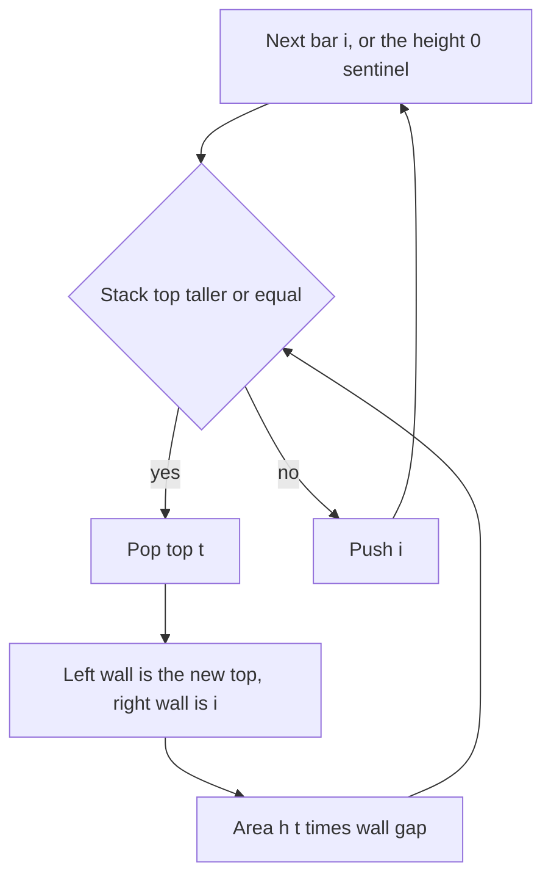

## The hook

A city skyline is a row of buildings of width 1. You want to slide the largest possible flat box under the skyline, resting on the ground, with its top below the roofs it covers. Try every pair of left and right edges and take the lowest roof between them, and you have an O(n²) or even O(n³) algorithm. For 10⁵ buildings, that is far too slow.

One pass with a stack solves it in O(n). The same trick then finds the largest block of 1s in a binary matrix, and, turned around, sums the minimum of every subarray. It is one of the most reused hard patterns in interviews.

## The problem

Given the heights of a [[histogram]], with every bar of width 1, return the area of the largest rectangle that fits inside it.

| Heights | Largest rectangle | Area |
|---|---|---|
| [3, 1, 3, 2, 2] | height 2 across the last three bars, or height 1 across all five | 6 |
| [2, 4, 3, 5, 1] | height 3 across 4, 3, 5 | 9 |
| [5] | the single bar | 5 |

## The obvious approach

Every rectangle's height is set by its lowest bar. So for each bar i, imagine it is the lowest: extend left while bars are at least h[i], extend right the same way, and the area is h[i] × width. Walking outwards from every bar is O(n²) in the worst case, for example on an increasing histogram.

The question to speed up is: for each bar, where is the first shorter bar on its left and on its right?

## The key insight

:::analogy
Push a box of height h[i] under the skyline, starting at building i. Slide it left until it hits a building shorter than h[i]: that roof is too low for the box. Do the same to the right. The box fits exactly between those two shorter buildings, and its width is the gap between them. Do this for every building and keep the biggest box.
:::

The two blocking buildings are the [[previous smaller element]] and the [[next smaller element]]. With L[i] and R[i] as those indices, bar i's box has width R[i] − L[i] − 1 and area h[i] × (R[i] − L[i] − 1). The answer is the maximum over all i.

Both arrays come from a monotonic stack in one pass each, as in [Who Can See Over the Crowd](article:dsa-monotonic-stack).

Even better, one pass gives both at once. Keep a stack of indices with increasing heights. When bar i arrives and is shorter than the top, the top has just found its next smaller element, i. Its previous smaller element is whatever lies below it on the stack, because the stack is increasing. So pop it and compute its area right then.

Append a [[sentinel bar]] of height 0 at the end: it is shorter than everything, so it pops every remaining bar and nothing needs a separate clean-up loop.



:::insight
Every rectangle is limited by its shortest bar, so look for each bar's widest box: from the first shorter bar on the left to the first shorter bar on the right. An increasing stack discovers both walls at the moment a bar is popped.
:::

## Walk through an example

Heights [3, 1, 3, 2, 2] with a sentinel 0 at index 5. The stack holds indices; popping uses `>=`.

| i | h[i] | Popped bar (height) | Left wall | Width i − left − 1 | Area | Best |
|---|---|---|---|---|---|---|
| 1 | 1 | index 0 (3) | none, −1 | 1 | 3 | 3 |
| 3 | 2 | index 2 (3) | index 1 | 1 | 3 | 3 |
| 4 | 2 | index 3 (2) | index 1 | 2 | 4 | 4 |
| 5 | 0 | index 4 (2) | index 1 | 3 | 6 | 6 |
| 5 | 0 | index 1 (1) | none, −1 | 5 | 5 | 6 |

The answer is 6: height 2 across indices 2 to 4. Notice the duplicate 2s. When the second 2 arrived, the first 2 was popped with width 2, which is too small for it. That is fine: the second 2, popped later, gets the full width 3. With equal heights, at least one of them always sees the full box, so popping on `>=` is safe for the maximum.

### The two-pass view

The same answer from explicit arrays, where L[i] and R[i] are the nearest strictly shorter bars on each side:

| i | h[i] | L[i] | R[i] | Width | Area |
|---|---|---|---|---|---|
| 0 | 3 | −1 | 1 | 1 | 3 |
| 1 | 1 | −1 | 5 | 5 | 5 |
| 2 | 3 | 1 | 3 | 1 | 3 |
| 3 | 2 | 1 | 5 | 3 | 6 |
| 4 | 2 | 1 | 5 | 3 | 6 |

The two-pass version is easier to explain; the one-pass version is shorter to write.

### Maximal Rectangle: one histogram per row

*Maximal Rectangle* asks for the largest rectangle of 1s in a binary matrix. Treat each row as the ground: the height of column j is the number of consecutive 1s ending at that row. Then run the histogram algorithm on each row's heights.

| Row | Cells | Heights | Largest rectangle in this histogram |
|---|---|---|---|
| 0 | 0 1 1 0 | 0 1 1 0 | 2 |
| 1 | 1 1 1 1 | 1 2 2 1 | 4 |
| 2 | 1 1 0 1 | 2 3 0 2 | 4 |

The answer is 4. A 0 resets its column's height to 0, which is how the skyline drops to the ground. With R rows and C columns, the total cost is O(R × C).

### Sum of Subarray Minimums: the box turned around

Instead of the biggest box, *Sum of Subarray Minimums* adds the minimum of every subarray. Use the [[contribution technique]]: a[i] is the minimum of exactly those subarrays that start after its previous smaller element and end before its next smaller element, so it contributes a[i] × (i − L[i]) × (R[i] − i). For [2, 3, 1, 4]:

| i | a[i] | Choices of start | Choices of end | Contribution |
|---|---|---|---|---|
| 0 | 2 | 1 | 2 | 4 |
| 1 | 3 | 1 | 1 | 3 |
| 2 | 1 | 3 | 2 | 6 |
| 3 | 4 | 1 | 1 | 4 |

The total is 17, which matches adding the minimum of all 10 subarrays by hand. With equal values, use a strict comparison on one side and a non-strict one on the other, so each subarray is credited to exactly one of its equal minimums.

:::try-this
Find the largest rectangle in [2, 4, 3, 5, 1]. Which pop gives the best area? (Popping 3 when the 1 arrives: its left wall is the 2 at index 0 and its right wall is index 4, so the width is 3 and the area is 9.)
:::

:::warning
Common misconception: "The answer is the tallest bar times one, or the shortest bar times n." Those are only two of the candidates. The best rectangle can use a middle height across a middle range, as in [2, 4, 3, 5, 1], where height 3 across three bars beats both 5 × 1 and 1 × 5.
:::

## The code

```pseudo
largest_rectangle(h):
    append 0 to h                      # sentinel
    stack = empty; best = 0
    for i in 0 .. n:
        while stack not empty and h[stack.top] >= h[i]:
            t = stack.pop()
            left = stack.top if stack not empty else -1
            best = max(best, h[t] * (i - left - 1))
        stack.push(i)
    return best

maximal_rectangle(matrix):
    heights = zeros(cols); best = 0
    for each row:
        heights[j] = heights[j] + 1 if cell is 1 else 0
        best = max(best, largest_rectangle(heights))
```

```cpp
#include <bits/stdc++.h>
using namespace std;

long long largestRectangle(vector<int> h) {
    h.push_back(0);                                    // sentinel pops everything at the end
    vector<int> st;                                    // indices, heights increasing
    long long best = 0;
    for (int i = 0; i < (int)h.size(); i++) {
        while (!st.empty() && h[st.back()] >= h[i]) {
            int t = st.back();
            st.pop_back();
            int left = st.empty() ? -1 : st.back();    // previous smaller wall
            best = max(best, (long long)h[t] * (i - left - 1));   // i is the next smaller wall
        }
        st.push_back(i);
    }
    return best;
}

long long maximalRectangle(const vector<string>& g) {
    vector<int> heights(g[0].size(), 0);
    long long best = 0;
    for (const string& row : g) {
        for (size_t j = 0; j < row.size(); j++) heights[j] = row[j] == '1' ? heights[j] + 1 : 0;
        best = max(best, largestRectangle(heights));
    }
    return best;
}

long long sumSubarrayMins(const vector<int>& a) {
    int n = a.size();
    vector<int> L(n), R(n), st;
    for (int i = 0; i < n; i++) {                      // previous strictly smaller
        while (!st.empty() && a[st.back()] >= a[i]) st.pop_back();
        L[i] = st.empty() ? -1 : st.back();
        st.push_back(i);
    }
    st.clear();
    for (int i = n - 1; i >= 0; i--) {                 // next smaller or equal: breaks ties once
        while (!st.empty() && a[st.back()] > a[i]) st.pop_back();
        R[i] = st.empty() ? n : st.back();
        st.push_back(i);
    }
    long long total = 0;
    for (int i = 0; i < n; i++) total += (long long)a[i] * (i - L[i]) * (R[i] - i);
    return total;                                      // LeetCode wants this mod 1e9 + 7
}

int main() {
    cout << largestRectangle({3, 1, 3, 2, 2}) << ' ' << largestRectangle({2, 4, 3, 5, 1}) << ' '
         << largestRectangle({5}) << '\n';                                  // 6 9 5
    cout << maximalRectangle({"0110", "1111", "1101"}) << '\n';             // 4
    cout << sumSubarrayMins({2, 3, 1, 4}) << ' ' << sumSubarrayMins({2, 2}) << '\n';   // 17 6
}
```

The second `sumSubarrayMins` test checks tie handling: [2, 2] has subarrays [2], [2] and [2, 2], whose minimums add up to 6. With strict comparisons on both sides, the pair [2, 2] would be counted twice and the result would be 8.

## Complexity

- **Largest rectangle: O(n) time, O(n) space.** Every index is pushed once and popped once.
- **Maximal Rectangle: O(R × C) time, O(C) space,** one O(C) histogram per row.
- **Sum of Subarray Minimums: O(n) time and space,** two stack passes and one sum.

## Common mistakes

- **Forgetting the sentinel,** so bars left on the stack never get their areas computed.
- **Using the popped bar's own index as the left wall.** The left wall is the new stack top after popping, or −1 if the stack is empty.
- **Overflow:** height up to 10⁴ times width up to 10⁵ is 10⁹, close to the 32-bit limit, and sums of subarray minimums grow much faster; use 64-bit.
- **Double counting ties** in Sum of Subarray Minimums by using the same comparison on both sides.
- **Not resetting heights to 0** at a 0 cell in Maximal Rectangle.
- **Confusing the two problems' rules.** For the maximum, popping on ≥ is fine; for counting contributions, one side must be strict and the other not.

## Practice problems

*Largest Rectangle in Histogram* is the walkthrough; write it once with two passes and once with the one-pass sentinel. *Maximal Rectangle* runs it on every row of the matrix. *Sum of Subarray Minimums* uses the same previous and next smaller elements to count contributions. *Maximal Square* looks similar but has a simpler DP answer, a good contrast to recognise which tool a problem needs.

## Key takeaways

- The largest rectangle under a histogram uses each bar as the lowest bar of some box, spanning from the first shorter bar on its left to the first shorter bar on its right.
- An increasing stack of indices finds both walls at once: when a bar is popped, the current index is its right wall and the new top is its left wall.
- A sentinel bar of height 0 at the end empties the stack and avoids a separate clean-up loop.
- The largest rectangle of 1s in a binary matrix runs the histogram algorithm once per row, with column heights counting consecutive 1s.
- Summing subarray minimums credits each element with (i − L) × (R − i) subarrays, using a strict comparison on one side so ties are counted once.
