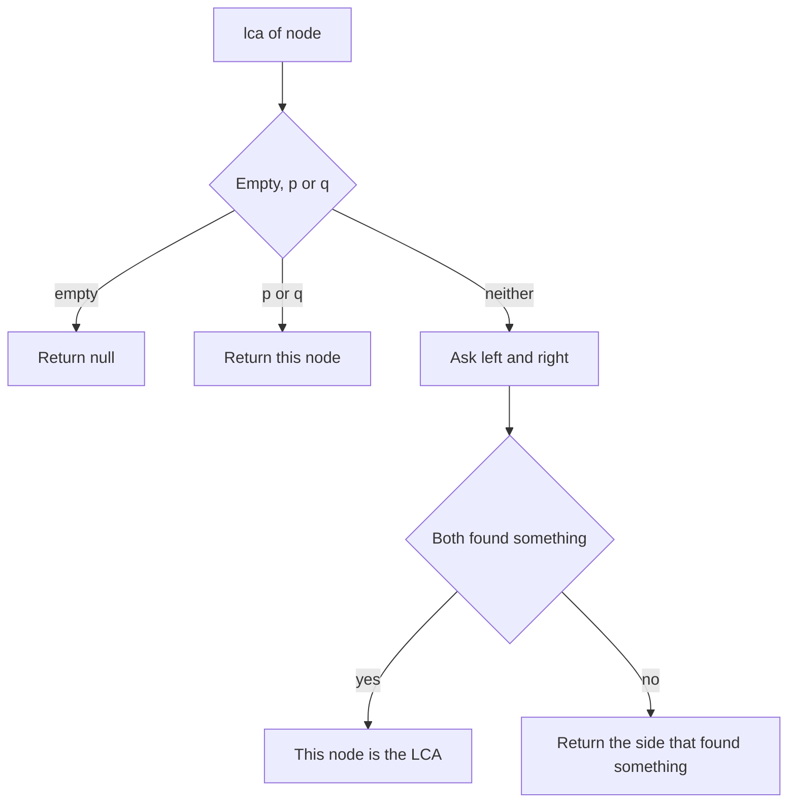

## The hook

Two cousins want to know their closest shared ancestor. Each could list all their ancestors, parents, grandparents, great-grandparents, and compare the lists. Or they could both start climbing the family tree and see where their paths meet. Either way, the answer is one specific person: the deepest one who is an ancestor of both.

The [[lowest common ancestor]] question shows up constantly: in trees directly, in distances between nodes, in version-control merge bases and in many contest problems with thousands of queries. For a single query, a ten-line recursion solves it. For many queries, a table of power-of-two ancestors answers each in O(log n).

## The intuition

:::analogy
Picture asking every person in a family tree the same question: "Is cousin P or cousin Q in your part of the family?" A person who is P or Q answers "yes, me". Anyone else asks their two children's branches and listens. If one cousin turns up in each branch, that person is the closest shared ancestor. If only one branch reports a cousin, the person simply passes that report upwards.
:::

That is the one-pass recursion. Each node returns either nothing, or the node it found, or the answer. Because the report travels upwards from the bottom, the first node to hear a "yes" from both sides is the deepest one that has both cousins below it: the lowest common ancestor. Every node is an [[ancestor]] of itself, so if P is above Q, P itself is the answer.

## How it works

### The recursion

For a node and targets p and q:

- if the node is empty, return null;
- if the node is p or q, return the node;
- ask the left and right subtrees;
- if both return non-null, the node is the answer;
- otherwise return whichever is non-null.

It visits each node at most once: O(n).

### The trap: what if a node is missing?

The recursion assumes both p and q are in the tree. If only p exists, it returns p, which looks like a valid answer but is not. When existence is not guaranteed, count how many of the two targets the search actually found, and return null unless it found both.

### Parent pointers and paths

If each node has a [[parent pointer]], or you can build one with a traversal, there is a second method:

- walk up from p, marking every ancestor;
- walk up from q until you reach a marked node: that is the LCA.

Or compare [[depth]]s: lift the deeper node until both are at the same depth, then lift both together until they meet. Equivalently, list the root-to-p and root-to-q paths and take the last node they share. These are the same "two walkers" idea as finding where two linked lists meet.

### Many queries: binary lifting

For thousands of queries on the same tree, precompute up[k][v], the 2^k-th ancestor of v, from up[k][v] = up[k − 1][up[k − 1][v]]. To answer a query, lift the deeper node by the depth difference, using the binary digits of the difference, then for k from high to low, lift both nodes whenever their 2^k-th ancestors differ. They end just below the LCA. That is [[binary lifting]]: O(n log n) setup and O(log n) per query, the method *Company Queries II* needs.



:::insight
Let each subtree report whether it contains p or q. The first node, on the way back up, that hears a report from both sides is the lowest common ancestor, and a node that is itself p or q reports itself.
:::

## Walk through an example

```text
          1
        /   \
       2     3
      / \     \
     4   5     6
        / \
       7   8
```

Query: LCA of 7 and 8.

| Node | Left reports | Right reports | Returns |
|---|---|---|---|
| 4 | null | null | null |
| 7 | | | 7, it is a target |
| 8 | | | 8, it is a target |
| 5 | 7 | 8 | 5, both sides found something |
| 2 | null (from 4) | 5 | 5, passed up |
| 3, 6 | null | null | null |
| 1 | 5 | null | 5 |

The LCA is 5. More queries on the same tree:

| p, q | LCA | Why |
|---|---|---|
| 4, 8 | 2 | 4 is on the left of 2, 8 is on the right |
| 7, 6 | 1 | they are on different sides of the root |
| 5, 8 | 5 | 5 is an ancestor of 8, and of itself |

### Deepest leaves

*Lowest Common Ancestor of Deepest Leaves* asks for the LCA of all leaves at the greatest depth. Return two things from each subtree: its height and the LCA of its deepest leaves. If the two children have equal heights, the current node is the answer for its subtree; otherwise take the taller child's answer. In the tree above, the deepest leaves are 7 and 8, at depth 3, so the answer is 5.

### Binary lifting on the same tree

The parents are 2 → 1, 3 → 1, 4 → 2, 5 → 2, 6 → 3, 7 → 5 and 8 → 5. For the query (7, 6): 7 has depth 3 and 6 has depth 2, so lift 7 by 1 to 5. Now 5 and 6 are both at depth 2 and differ; their 2nd ancestors are both 1, the same node, so do not jump that far; their 1st ancestors are 2 and 3, which differ, so jump both to 2 and 3. Their parents are both 1, the answer.

:::try-this
In the tree above, what are the LCAs of (4, 7) and of (3, 6)? (For 4 and 7, 4 is in 2's left subtree and 7 in 2's right subtree, so the LCA is 2. For 3 and 6, 3 is an ancestor of 6, so the LCA is 3.)
:::

:::warning
Common misconception: "If the function returns a node, both targets are in the tree." The recursion returns p as soon as it finds p, even if q never appears. When the problem does not guarantee both nodes exist, count the targets you actually find and return null if it is fewer than two.
:::

## The code

```pseudo
lca(node, p, q):
    if node is empty or node is p or node is q: return node
    left = lca(node.left, p, q)
    right = lca(node.right, p, q)
    if left and right: return node
    return left if left else right

lca_lifting(u, v):                 # up[k][x] is the 2^k-th ancestor of x
    if depth[u] < depth[v]: swap u, v
    lift u by depth[u] - depth[v] using the set bits of the difference
    if u == v: return u
    for k from high to 0:
        if up[k][u] != up[k][v]: u = up[k][u]; v = up[k][v]
    return parent of u
```

```cpp
#include <bits/stdc++.h>
using namespace std;

struct Node {
    int val;
    Node *left = nullptr, *right = nullptr;
    Node(int v, Node* l = nullptr, Node* r = nullptr) : val(v), left(l), right(r) {}
};

Node* lca(Node* n, Node* p, Node* q) {
    if (!n || n == p || n == q) return n;          // report myself if I am a target
    Node* l = lca(n->left, p, q);
    Node* r = lca(n->right, p, q);
    if (l && r) return n;                          // one target on each side
    return l ? l : r;
}

Node* lcaChecked(Node* root, Node* p, Node* q) {   // when a target may be missing
    int found = 0;
    function<Node*(Node*)> go = [&](Node* n) -> Node* {
        if (!n) return nullptr;
        Node* l = go(n->left);
        Node* r = go(n->right);
        if (n == p || n == q) { found++; return n; }
        if (l && r) return n;
        return l ? l : r;
    };
    Node* ans = go(root);
    return found == 2 ? ans : nullptr;
}

pair<int, Node*> deepest(Node* n) {                // (height, LCA of the deepest leaves)
    if (!n) return {0, nullptr};
    auto [hl, al] = deepest(n->left);
    auto [hr, ar] = deepest(n->right);
    if (hl == hr) return {hl + 1, n};
    return hl > hr ? make_pair(hl + 1, al) : make_pair(hr + 1, ar);
}

struct Lifting {                                   // many queries on a parent array
    int LOG;
    vector<vector<int>> up;
    vector<int> depth;
    Lifting(const vector<int>& parent, int root) {   // parent[root] = root
        int n = parent.size();
        LOG = 1;
        while ((1 << LOG) < n) LOG++;
        up.assign(LOG, parent);
        for (int k = 1; k < LOG; k++)
            for (int v = 0; v < n; v++) up[k][v] = up[k - 1][up[k - 1][v]];
        depth.assign(n, -1);
        function<int(int)> d = [&](int v) { return depth[v] != -1 ? depth[v] : depth[v] = (v == root ? 0 : d(parent[v]) + 1); };
        for (int v = 0; v < n; v++) d(v);
    }
    int query(int u, int v) {
        if (depth[u] < depth[v]) swap(u, v);
        for (int k = 0, diff = depth[u] - depth[v]; diff; k++, diff >>= 1)
            if (diff & 1) u = up[k][u];            // climb the depth difference
        if (u == v) return u;
        for (int k = LOG - 1; k >= 0; k--)
            if (up[k][u] != up[k][v]) u = up[k][u], v = up[k][v];
        return up[0][u];
    }
};

int main() {
    Node *n7 = new Node(7), *n8 = new Node(8), *n4 = new Node(4), *n6 = new Node(6);
    Node* n5 = new Node(5, n7, n8);
    Node* n2 = new Node(2, n4, n5);
    Node* n3 = new Node(3, nullptr, n6);
    Node* root = new Node(1, n2, n3);
    cout << lca(root, n7, n8)->val << ' ' << lca(root, n4, n8)->val << ' ' << lca(root, n7, n6)->val << ' '
         << lca(root, n5, n8)->val << '\n';                                  // 5 2 1 5
    Node* stranger = new Node(99);
    cout << lca(root, n7, stranger)->val << ' ' << (lcaChecked(root, n7, stranger) == nullptr) << '\n';   // 7 1
    cout << deepest(root).second->val << '\n';                               // 5

    vector<int> parent = {0, 0, 1, 1, 2, 2, 3, 5, 5};   // node 0 is a dummy root above 1
    Lifting L(parent, 0);
    cout << L.query(7, 8) << ' ' << L.query(4, 8) << ' ' << L.query(7, 6) << ' ' << L.query(3, 6) << '\n';   // 5 2 1 3
}
```

The second line shows the trap: the plain recursion returns 7 for a query whose other node is not in the tree, while the checked version correctly returns null. In the lifting test, node 0 is a dummy parent of the real root 1, so every real node has an ancestor chain that ends at 0.

## Complexity

- **Recursive LCA: O(n) time per query,** O(h) recursion space.
- **Parent pointers and marking: O(h) time per query** once parents are known, with O(h) space for the marks.
- **Binary lifting: O(n log n) time and space to build,** then **O(log n) per query.**
- **Deepest-leaves LCA: O(n),** one post-order pass.

## Common mistakes

- **Assuming both nodes exist** when the problem does not promise it.
- **Comparing values instead of nodes,** which breaks when values repeat.
- **Forgetting that a node is its own ancestor,** so LCA(5, 8) is 5, not 2.
- **Running the O(n) recursion for each of many queries,** which is O(n × q); use binary lifting.
- **Wrong lifting order:** climb the depth difference first, then lift both from the highest power down.
- **Using the BST shortcut on a general binary tree;** without the ordering, "both smaller, go left" means nothing.

## Practice problems

Start with *Lowest Common Ancestor of a Binary Search Tree*, where the ordering guides the walk, as in [A Library Where Every Left Shelf Holds Smaller Numbers](article:dsa-bst-operations). *Lowest Common Ancestor of a Binary Tree* is the general recursion. *Lowest Common Ancestor of Deepest Leaves* returns a height together with an answer, the pattern from [Managers Summarising Their Teams' Reports](article:dsa-tree-recursion). *Company Queries II* on CSES asks many LCA queries on a large company tree and needs binary lifting.

## Key takeaways

- The lowest common ancestor of p and q is the deepest node that has both below it, counting a node as its own ancestor.
- The one-pass recursion returns a node when it is p or q, returns the current node when both subtrees report a target, and otherwise passes up whichever report it has.
- That recursion assumes both nodes exist; when they might not, count how many targets were actually found.
- With parent pointers, lift the deeper node to the same depth and then climb both together until they meet.
- For many queries, binary lifting stores each node's 2^k-th ancestors and answers each query in O(log n) after O(n log n) preprocessing.
