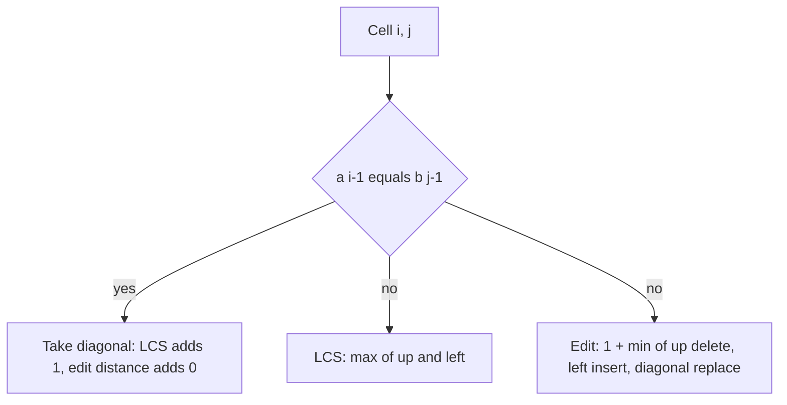

## The hook

Your phone suggests "receive" when you type "recieve", `git diff` shows exactly which lines changed between two versions of a file, and a biologist compares a mouse gene with the same human gene. All three ask the same question: how do two sequences line up?

Two classic DPs answer it. The longest common subsequence measures what two strings share. Edit distance measures how many changes separate them. They use the same table, the same way of thinking, and together they unlock a whole family of interview problems: minimum deletions, shortest common supersequence, longest palindromic subsequence and distinct subsequences.

## The intuition

:::analogy
Imagine lining up two DNA strands side by side to compare them. You walk along both strands from the end. If the two last letters match, you pair them up and step back on both strands. If they differ, you have a choice: skip a letter on the first strand, or skip one on the second, and you take whichever choice leads to the better overall line-up. Every decision only depends on the remaining beginnings of the two strands.
:::

The remaining beginnings are [[prefix]]es, and the line-up is an [[alignment]]. A table with one row per prefix of the first string and one column per prefix of the second holds the best answer for every pair of beginnings, building on the subproblem idea from [Dynamic Programming Is Just Careful Recursion](article:dsa-dp-intro).

## How it works

### Longest common subsequence

| Part | Definition |
|---|---|
| State | dp[i][j] = LCS length of a's first i characters and b's first j characters |
| Transition | if a[i−1] = b[j−1]: dp[i][j] = dp[i−1][j−1] + 1; else dp[i][j] = max(dp[i−1][j], dp[i][j−1]) |
| Base case | dp[0][j] = dp[i][0] = 0: nothing is shared with an empty string |
| Answer | dp[n][m] |

When the last characters match, it is always safe to pair them: any best alignment can be changed to use that pair without getting shorter. When they differ, at least one of them is not in the common subsequence, so drop one and keep the better result.

### Edit distance

| Part | Definition |
|---|---|
| State | dp[i][j] = minimum edits to turn a's first i characters into b's first j characters |
| Transition | if a[i−1] = b[j−1]: dp[i][j] = dp[i−1][j−1]; else 1 + min(dp[i−1][j] delete, dp[i][j−1] insert, dp[i−1][j−1] replace) |
| Base case | dp[i][0] = i (delete everything), dp[0][j] = j (insert everything) |
| Answer | dp[n][m] |

[[Edit distance]] is often called Levenshtein distance after Vladimir Levenshtein, who studied it in the mid-1960s.



:::insight
Every cell asks one question about the last characters of two prefixes: pair them, or drop one. Each cell looks only up, left and diagonally up-left, so filling rows top to bottom always has the needed answers ready.
:::

### Rebuilding the answer

Start at (n, m) and walk back. For LCS: if the characters match, record the character and move diagonally; otherwise move toward the larger of up and left. Reverse the recorded characters. For edit distance, move to whichever neighbour produced the cell's value, and that move names the operation.

### Saving space

Each row needs only the row above, so [[rolling rows]] cut memory to O(m). Use a single extra variable to remember the old diagonal value. This gives the length or distance only; rebuilding the actual string needs the full table, or a cleverer divide-and-conquer method (Hirschberg's algorithm).

### The family

- **Minimum deletions to make two strings equal**: n + m − 2·LCS.
- **Shortest common supersequence** length: n + m − LCS.
- **Longest palindromic subsequence** of s: LCS(s, reverse(s)).
- **Longest common substring** (contiguous): on a mismatch, dp[i][j] = 0 instead of a max, and the answer is the largest cell.
- **Distinct subsequences** (count ways b appears in a): on a match, dp[i][j] = dp[i−1][j−1] + dp[i−1][j]; otherwise dp[i−1][j].

## Walk through an example

**LCS of a = ACGTC and b = CGATC.**

| | ∅ | C | G | A | T | C |
|---|---|---|---|---|---|---|
| ∅ | 0 | 0 | 0 | 0 | 0 | 0 |
| A | 0 | 0 | 0 | 1 | 1 | 1 |
| C | 0 | 1 | 1 | 1 | 1 | 2 |
| G | 0 | 1 | 2 | 2 | 2 | 2 |
| T | 0 | 1 | 2 | 2 | 3 | 3 |
| C | 0 | 1 | 2 | 2 | 3 | 4 |

Length **4**. Walking back from the bottom-right: C = C (diagonal), T = T (diagonal), then G = G and C = C after skipping A. The LCS is **CGTC**.

**Edit distance from LOVE to MOVIE.**

| | ∅ | M | O | V | I | E |
|---|---|---|---|---|---|---|
| ∅ | 0 | 1 | 2 | 3 | 4 | 5 |
| L | 1 | 1 | 2 | 3 | 4 | 5 |
| O | 2 | 2 | 1 | 2 | 3 | 4 |
| V | 3 | 3 | 2 | 1 | 2 | 3 |
| E | 4 | 4 | 3 | 2 | 2 | 2 |

Distance **2**: replace L with M (the 1 at row L, column M), match O and V along the diagonal, insert I (moving left from 2 to 1), and match E.

:::try-this
What is the edit distance from CAT to CUT, and what is the LCS length? (One replacement, A → U, so distance 1. The LCS is CT, length 2.)
:::

## The code

```pseudo
lcs(a, b):
    dp = (n+1) x (m+1) zeros
    for i in 1..n: for j in 1..m:
        if a[i-1] == b[j-1]: dp[i][j] = dp[i-1][j-1] + 1
        else: dp[i][j] = max(dp[i-1][j], dp[i][j-1])
    // rebuild
    i = n; j = m; out = ""
    while i > 0 and j > 0:
        if a[i-1] == b[j-1]: out = a[i-1] + out; i--; j--
        else if dp[i-1][j] >= dp[i][j-1]: i--
        else: j--
    return dp[n][m], out

edit_distance(a, b):
    dp[i][0] = i; dp[0][j] = j
    for i in 1..n: for j in 1..m:
        if a[i-1] == b[j-1]: dp[i][j] = dp[i-1][j-1]
        else: dp[i][j] = 1 + min(dp[i-1][j], dp[i][j-1], dp[i-1][j-1])
    return dp[n][m]
```

```cpp
#include <bits/stdc++.h>
using namespace std;

string lcs(const string& a, const string& b) {
    int n = a.size(), m = b.size();
    vector<vector<int>> dp(n + 1, vector<int>(m + 1, 0));
    for (int i = 1; i <= n; i++)
        for (int j = 1; j <= m; j++)
            dp[i][j] = a[i - 1] == b[j - 1] ? dp[i - 1][j - 1] + 1 : max(dp[i - 1][j], dp[i][j - 1]);
    string out;
    for (int i = n, j = m; i > 0 && j > 0;) {
        if (a[i - 1] == b[j - 1]) { out += a[i - 1]; i--; j--; }
        else if (dp[i - 1][j] >= dp[i][j - 1]) i--;
        else j--;
    }
    reverse(out.begin(), out.end());
    return out;
}

int editDistance(const string& a, const string& b) {   // two rolling rows
    int n = a.size(), m = b.size();
    vector<int> prev(m + 1), cur(m + 1);
    iota(prev.begin(), prev.end(), 0);
    for (int i = 1; i <= n; i++) {
        cur[0] = i;
        for (int j = 1; j <= m; j++)
            cur[j] = a[i - 1] == b[j - 1] ? prev[j - 1] : 1 + min({prev[j], cur[j - 1], prev[j - 1]});
        swap(prev, cur);
    }
    return prev[m];
}

int main() {
    cout << lcs("ACGTC", "CGATC") << '\n';                // CGTC
    cout << editDistance("LOVE", "MOVIE") << ' '
         << editDistance("CAT", "CUT") << '\n';            // 2 1
}
```

## Complexity

- **Time:** O(n × m): each of the (n + 1)(m + 1) cells takes constant work.
- **Space:** O(n × m) for the full table, needed to rebuild the string; O(min(n, m)) with rolling rows when only the number is needed.

## Common mistakes

:::warning
Common misconception: "dp[i][j] compares a[i] with b[j]." With the empty-prefix row and column, dp[i][j] covers the first i and j characters, so it compares a[i − 1] with b[j − 1]. Mixing the two indexings is the most common bug in these problems; decide once and write it in a comment.
:::

- **Forgetting the base row and column** in edit distance: they are i and j, not 0.
- **Using max on a match in LCS** instead of taking the diagonal plus one: it gives the right number but hides the reasoning and breaks the rebuild.
- **Confusing subsequence with substring**: the substring version resets to 0 on a mismatch.
- **Rolling rows and the diagonal**: when updating a single array in place, the old diagonal value is overwritten; save it in a variable first.

### Interview follow-ups

**"Can you reduce the space to O(min(m, n))?"** Yes: each row needs only the previous row (and, in edit distance, the diagonal value saved in a variable). Iterate over the longer string in the outer loop. You lose the ability to rebuild the alignment unless you use Hirschberg's divide-and-conquer trick.

**"How is this used in real tools?"** Diff tools and version control show line-level differences with LCS-style algorithms, and spell checkers rank suggestions by edit distance.

**"What if only insertions and deletions are allowed?"** Then the edit distance is m + n − 2·LCS(a, b), because the characters you keep form a common subsequence.

## Practice problems

*Longest Common Subsequence* and *Edit Distance* are the two templates; *Edit Distance* on CSES is the same with larger strings. *Delete Operation for Two Strings* is n + m − 2·LCS, or a small variant of edit distance with only deletions. *Distinct Subsequences* switches from max or min to counting.

## Key takeaways

- Both LCS and edit distance use a table over prefixes, with an extra row and column for the empty prefix.
- In LCS, a match extends the diagonal by one, and a mismatch takes the better of dropping a character from either string.
- In edit distance, a mismatch costs one plus the cheapest of delete (up), insert (left) and replace (diagonal).
- Walking back from the bottom-right cell rebuilds the subsequence or the list of edits, and rolling rows cut memory when only the number is needed.
- Minimum deletions, shortest common supersequence, longest palindromic subsequence and distinct subsequences are all small variations of this table.
