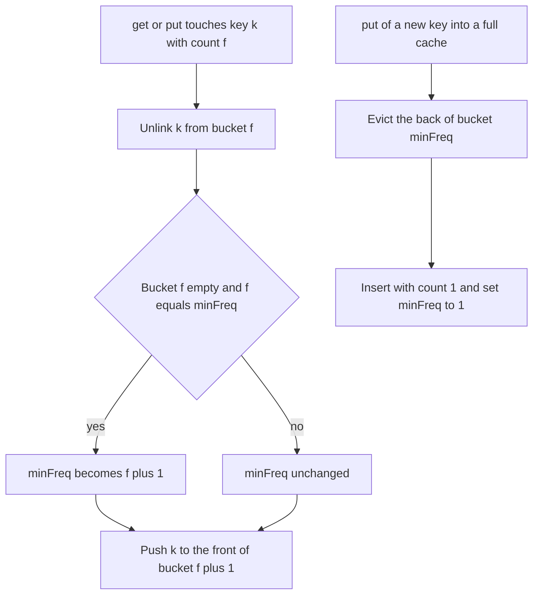

## The hook

A small corner shop has one shelf with room for only three products. When a new product arrives and the shelf is full, the owner removes the item that has sold the fewest times. If two items have sold equally rarely, the one that has gone longest without a sale goes first.

That is a least frequently used cache, and the interview version demands O(1) per operation. The LRU cache needed one linked list; LFU needs one per sales count, plus one variable that is surprisingly easy to get wrong.

## The problem

Design a cache with a fixed capacity supporting:

- get(key): return the value if present, else -1; this counts as a use;
- put(key, value): insert or update; this counts as a use. If inserting a new key into a full cache, first evict by [[LFU eviction]]: the key with the smallest [[use count]], and among ties, the least recently used.

Both operations must run in O(1) on average.

With capacity 3, after put(1), put(2), put(3), get(1), get(1), get(2), the next put(4) evicts key 3, the only key used once.

## The obvious approach

Store each key with its use count and last-used time, and on eviction scan every key for the smallest (count, time). That is O(capacity) per eviction. A min-heap keyed by (count, time) gives O(log n), but every get changes a key's count, which needs a decrease-key or lazy deletion, and still is not O(1).

## The key insight

:::analogy
The shop owner keeps a separate small tray for every sales count: a tray for items sold once, a tray for items sold twice, and so on. Within each tray, items are lined up with the most recently sold at the front. When an item sells, it moves from its tray to the front of the next tray. The owner also keeps a note of the lowest-numbered tray that is not empty. When the shelf is full, the item to remove is simply the one at the back of that tray.
:::

Each tray is a [[frequency bucket]]: a doubly linked list of keys with one use count, most recent at the front. The note is the [[minimum frequency]], minFreq. Three maps hold it together:

- key → (value, use count, position in its bucket's list), so any key is found and unlinked in O(1);
- use count → bucket list;
- minFreq, an integer.

### Touching a key (on get, or put to an existing key)

- Remove the key from bucket f using its stored position.
- If bucket f is now empty and f = minFreq, set minFreq = f + 1.
- Push the key to the front of bucket f + 1, and record its new count and position.

### Inserting a new key

- If the cache is full, evict the back of bucket minFreq, and erase it from the key map.
- Add the key with count 1 to the front of bucket 1.
- Set minFreq = 1, since a brand-new key always has the smallest possible count.

The only subtle rule is minFreq. It changes in exactly two places: it rises by one when a touch empties the minimum bucket, and it resets to 1 on every insertion of a new key. It never needs a search, because a touch moves a key up by exactly one level.

| Operation | Steps | Cost |
|---|---|---|
| get, key present | look up, touch | O(1) |
| get, key absent | look up | O(1) |
| put, key present | update value, touch | O(1) |
| put, new key, cache full | evict back of bucket minFreq, insert at count 1 | O(1) |
| put with capacity 0 | do nothing | O(1) |

### The cousin: All O\`one Data Structure

*All O\`one Data Structure* asks for inc(key), dec(key), getMaxKey() and getMinKey(), all O(1). The shape is the same: a doubly linked list of count buckets in increasing order, each holding a set of keys, and a map from key to its bucket. inc and dec move a key to the neighbouring bucket, creating or deleting buckets as needed; the first and last buckets give the min and max keys.



:::insight
Group keys by use count and order each group by recency, and both parts of the LFU rule become positions: the eviction victim is always the back of the lowest non-empty group. Because a use moves a key up exactly one group, the lowest group can be tracked with one integer instead of a search.
:::

## Walk through an example

Capacity 3. Buckets are listed as count: [most recent, ..., least recent].

| Operation | Result | Buckets after | minFreq |
|---|---|---|---|
| put(1, 10) | | 1: [1] | 1 |
| put(2, 20) | | 1: [2, 1] | 1 |
| put(3, 30) | | 1: [3, 2, 1] | 1 |
| get(1) | 10 | 1: [3, 2], 2: [1] | 1 |
| get(1) | 10 | 1: [3, 2], 3: [1] | 1 |
| get(2) | 20 | 1: [3], 2: [2], 3: [1] | 1 |
| put(4, 40) | evicts 3 | 1: [4], 2: [2], 3: [1] | 1 |
| get(3) | -1 | unchanged | 1 |
| get(4) | 40 | 2: [4, 2], 3: [1] | **2** |
| put(5, 50) | evicts 2 | 1: [5], 2: [4], 3: [1] | 1 |
| get(4) | 40 | 1: [5], 3: [4, 1] | 1 |
| get(5) | 50 | 2: [5], 3: [4, 1] | 2 |
| get(1) | 10 | 2: [5], 3: [4], 4: [1] | 2 |

Three moments are worth a second look:

- **get(4)** emptied bucket 1, which was the minimum, so minFreq rose to 2.
- **put(5)** then evicted from bucket 2, where keys 4 and 2 were tied on count 2. Key 2 was used less recently, so it went, even though key 4 had been in the cache for a shorter time.
- **put(5)** reset minFreq to 1, because the new key has count 1.

:::try-this
Continue with put(6, 60) on the final state above. Which key is evicted, and what is minFreq afterwards? (minFreq is 2, so evict from bucket 2, which holds only key 5. Key 6 enters bucket 1, and minFreq becomes 1. Buckets: 1: [6], 3: [4], 4: [1].)
:::

:::warning
Common misconception: "After evicting from the minimum bucket, increase minFreq if that bucket is now empty." Eviction only happens just before inserting a new key, and that key always lands in bucket 1, so minFreq becomes 1 regardless. Adjusting it after the eviction is unnecessary; forgetting to reset it to 1 after the insertion is the real bug, and it makes the next eviction pick from the wrong bucket.
:::

## The code

```pseudo
touch(k):
    f = count[k]; bucket[f].remove(k)
    if bucket[f] is empty and minFreq == f: minFreq = f + 1
    count[k] = f + 1; bucket[f + 1].push_front(k)

get(k): if k not in cache: return -1; touch(k); return value[k]

put(k, v):
    if capacity == 0: return
    if k in cache: value[k] = v; touch(k); return
    if size == capacity: victim = bucket[minFreq].back(); remove victim everywhere
    value[k] = v; count[k] = 1; bucket[1].push_front(k); minFreq = 1
```

```cpp
#include <bits/stdc++.h>
using namespace std;

class LFUCache {
    struct Entry { int value, freq; list<int>::iterator pos; };
    int cap, minFreq = 0;
    unordered_map<int, Entry> entries;                       // key -> value, count, place in its bucket
    unordered_map<int, list<int>> buckets;                   // count -> keys, most recent first

    void touch(int key) {
        Entry& e = entries[key];
        auto& from = buckets[e.freq];
        from.erase(e.pos);
        if (from.empty()) {
            buckets.erase(e.freq);
            if (minFreq == e.freq) minFreq++;                 // the minimum bucket emptied
        }
        e.freq++;
        auto& to = buckets[e.freq];
        to.push_front(key);
        e.pos = to.begin();
    }
public:
    explicit LFUCache(int capacity) : cap(capacity) {}
    int get(int key) {
        auto it = entries.find(key);
        if (it == entries.end()) return -1;
        touch(key);
        return it->second.value;
    }
    int put(int key, int value) {                            // returns the evicted key, or -1
        if (cap == 0) return -1;
        auto it = entries.find(key);
        if (it != entries.end()) { it->second.value = value; touch(key); return -1; }
        int evicted = -1;
        if ((int)entries.size() == cap) {
            auto& victims = buckets[minFreq];
            evicted = victims.back();                         // least recent among the least used
            victims.pop_back();
            if (victims.empty()) buckets.erase(minFreq);
            entries.erase(evicted);
        }
        auto& one = buckets[1];
        one.push_front(key);
        entries[key] = {value, 1, one.begin()};
        minFreq = 1;                                          // a new key always has count 1
        return evicted;
    }
};

int main() {
    LFUCache c(3);
    c.put(1, 10), c.put(2, 20), c.put(3, 30);
    cout << c.get(1) << ' ' << c.get(1) << ' ' << c.get(2) << ' ';
    cout << c.put(4, 40) << ' ' << c.get(3) << ' ' << c.get(4) << ' ';
    cout << c.put(5, 50) << ' ' << c.get(4) << ' ' << c.get(5) << ' ' << c.get(1) << ' ';
    cout << c.put(6, 60) << '\n';                            // 10 10 20 3 -1 40 2 40 50 10 5
    LFUCache zero(0);
    zero.put(1, 1);
    cout << zero.get(1) << '\n';                             // -1
}
```

`put` returns the evicted key here only so the program can show it; LeetCode's version returns nothing. Empty buckets are erased so the map holds only counts that are in use.

## Complexity

- **get and put: O(1) average,** a constant number of hash map operations and linked-list splices.
- **Space: O(capacity)** for the entries and the bucket lists.
- **Compared with a heap,** O(log n) per operation, or a scan, O(n) per eviction.

## Common mistakes

- **Forgetting to reset minFreq to 1** after inserting a new key.
- **Updating minFreq when any bucket empties,** instead of only when the emptied bucket was the minimum.
- **Breaking ties by insertion time** instead of most recent use.
- **Storing keys in a vector per bucket,** which makes removal from the middle O(n); use a linked list and keep iterators.
- **Not counting put on an existing key as a use.**
- **Ignoring capacity 0,** where put must do nothing and get always returns -1.

## Practice problems

*LFU Cache* is this design. *All O\`one Data Structure* uses the same idea of count buckets, linked in order, to give the minimum and maximum keys in O(1). *LRU Cache*, the one-list version, is covered in [The Desk That Keeps Your Latest Books on Top](article:dsa-lru-cache), and the general approach to such questions in [A Custom Toolbox for One Job](article:dsa-design-data-structures).

## Key takeaways

- An LFU cache evicts the key with the smallest use count, breaking ties by least recent use.
- Keeping one recency-ordered list per use count makes the victim the back of the lowest non-empty list.
- A map from key to its value, count and list position lets every key be found and moved in O(1).
- A use moves a key up exactly one count, so the minimum count rises only when its list empties.
- Every new key enters with count 1, so the minimum count is reset to 1 after each insertion.
