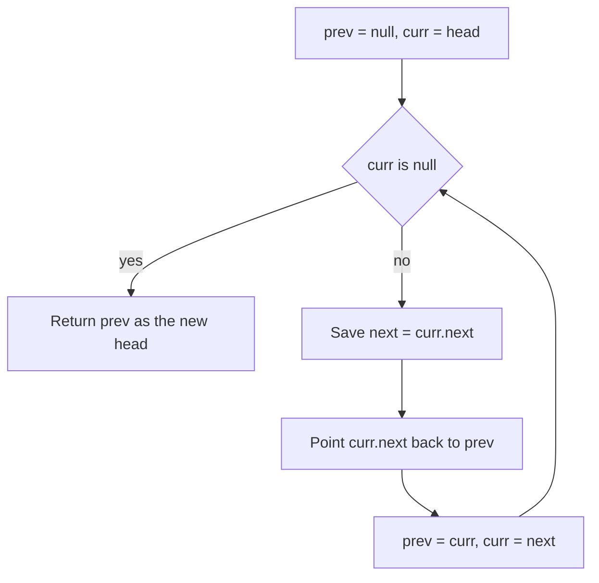

## The hook

Linked list questions are short to state and easy to get wrong. "Reverse this list." Five lines of code, and half of candidates either lose the rest of the list, create a cycle, or crash on an empty input.

The problems are not hard. They are fragile. A few habits make them safe every time: draw the pointers, save what you are about to break, and use a dummy node so the head is never a special case.

## The intuition

:::analogy
Think of a treasure hunt where each clue tells you where the next clue is hidden. You can only reach clue 7 by following clues 1 to 6. If you rewrite clue 3 before noting where it pointed, everything after it is lost forever. Pointer surgery on linked lists is rewriting clues: always note where a clue points before you change it.
:::

Each clue is a [[node]]: a value plus a pointer to the next node. The first clue is the [[head]]. The last clue points to nothing, a [[null pointer]]. You cannot jump to the middle; you must walk.

## How it works

### Habit 1: draw before you code

Sketch three or four boxes with arrows, then write each pointer change as an arrow you redraw. Most bugs are visible on paper: an arrow that disappears, two arrows forming a loop, a node left pointing at itself. Interviewers also like seeing the drawing: it shows you are reasoning about the structure, not guessing at code until it compiles.

### Habit 2: the three-pointer reversal

To reverse [[in-place]], walk the list with three pointers: `prev` (the already-reversed part), `curr` (the node being moved), and `next` (saved before breaking the link).

1. `next = curr->next` (note where the clue points)
2. `curr->next = prev` (rewrite the clue to point backwards)
3. `prev = curr`, `curr = next` (step forward)

When `curr` becomes null, `prev` is the new head.



### Habit 3: a dummy node

A [[dummy node]] sits before the head. With it, deleting the first node, inserting at the front, or building a new list all use the same code as the middle, and at the end you return `dummy->next`. It removes a whole category of special cases.

### Habit 4: two pointers with a gap

Many list problems need a position measured from the end. Move a `fast` pointer n steps ahead, then move `fast` and `slow` together. When `fast` reaches the end, `slow` is n nodes behind it. Fast-and-slow pointers moving at different speeds get their own article next.

:::insight
Every linked list bug is a lost or tangled pointer. Before overwriting any `next`, make sure something else still points to whatever it pointed at. A dummy node and a saved `next` cover most cases.
:::

## Walk through an example

Reverse `1 → 2 → 3 → null`.

| Step | prev | curr | next saved | Change | List so far |
|---|---|---|---|---|---|
| start | null | 1 | — | — | 1 → 2 → 3 |
| 1 | null | 1 | 2 | 1 → null | 1 (reversed part) |
| 2 | 1 | 2 | 3 | 2 → 1 | 2 → 1 |
| 3 | 2 | 3 | null | 3 → 2 | 3 → 2 → 1 |
| end | 3 | null | — | return prev | 3 → 2 → 1 → null |

**Merging** `1 → 3 → 5` and `2 → 4` with a dummy: compare heads, attach the smaller to the tail, advance that list, repeat, then attach whatever remains. Result: `1 → 2 → 3 → 4 → 5`.

:::try-this
Using the gap technique, which node does `slow` stop before when removing the 2nd node from the end of `1 → 2 → 3 → 4 → 5` (start both at a dummy, move fast 2 steps ahead first)? (Fast moves until it reaches the last node; slow stops at node 3, so slow->next, node 4, is removed, giving 1 → 2 → 3 → 5.)
:::

## The code

```pseudo
reverse(head):
    prev = null, curr = head
    while curr != null:
        next = curr.next
        curr.next = prev
        prev = curr
        curr = next
    return prev

merge(a, b):
    dummy = new node; tail = dummy
    while a and b:
        if a.val <= b.val: tail.next = a; a = a.next
        else: tail.next = b; b = b.next
        tail = tail.next
    tail.next = a if a else b
    return dummy.next
```

```cpp
#include <bits/stdc++.h>
using namespace std;

struct Node { int val; Node* next; Node(int v, Node* n = nullptr) : val(v), next(n) {} };

Node* reverseList(Node* head) {
    Node* prev = nullptr;
    while (head) { Node* next = head->next; head->next = prev; prev = head; head = next; }
    return prev;
}

Node* mergeLists(Node* a, Node* b) {
    Node dummy(0);
    Node* tail = &dummy;
    while (a && b) {
        if (a->val <= b->val) { tail->next = a; a = a->next; }
        else { tail->next = b; b = b->next; }
        tail = tail->next;
    }
    tail->next = a ? a : b;
    return dummy.next;
}

int main() {
    Node* r = reverseList(new Node(1, new Node(2, new Node(3))));
    for (Node* p = r; p; p = p->next) cout << p->val << ' ';  // 3 2 1
    cout << '\n';
    Node* m = mergeLists(new Node(1, new Node(3, new Node(5))), new Node(2, new Node(4)));
    for (Node* p = m; p; p = p->next) cout << p->val << ' ';  // 1 2 3 4 5
    cout << '\n';
}
```

## Complexity

- **Reverse, merge, remove-from-end:** O(n) time, one pass each.
- **Space:** O(1) for these iterative versions. Recursive reversal is elegant but uses O(n) stack, which can overflow on long lists.

## Common mistakes

:::warning
Common misconception: "linked lists are fast because insertion is O(1)." Insertion is O(1) only once you are at the right node. Finding that node is O(n), and walking pointers is slower than scanning an array because nodes are scattered in memory. In practice, arrays and vectors win most of the time; linked lists matter for interviews and for specific structures like LRU caches.
:::

- **Overwriting `next` before saving it**, which loses the rest of the list.
- **Dereferencing null**: check `curr` and `curr->next` before following them, especially on empty or one-node lists.
- **Forgetting to cut links**, which leaves a cycle, for example in Reorder List when splitting the list in half.
- **Special-casing the head** instead of using a dummy node.

## Practice problems

*Reverse Linked List* and *Merge Two Sorted Lists* are the core moves. *Remove Nth Node From End* uses the gap technique with a dummy. *Reverse Linked List II* reverses only a middle section, testing careful reconnection. *Reorder List* combines all of it: find the middle, reverse the second half, then merge alternately.

## Key takeaways

- Linked lists are chains of nodes, each pointing to the next, and you can only reach a node by walking from the head.
- Draw the pointers before coding, and always save a node's next before overwriting it.
- Reverse in place with three pointers, prev, curr and next, returning prev as the new head.
- A dummy node before the head removes special cases for edits at the front.
- Two pointers with a fixed gap find positions measured from the end in a single pass.
