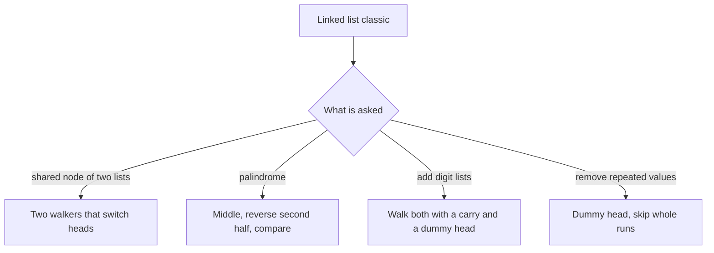

## The hook

Two railway lines start in different towns and merge at a junction, after which they share the same track. Two trains leave their towns at the same moment and the same speed. Where do they first meet? If the lines have different lengths before the junction, they arrive at different times, and it seems you must measure both lines first.

There is a neater answer, and it is one of a handful of linked list classics that interviewers return to again and again. Each one uses the same small kit, two pointers, a reversal, a [[dummy head]] and a [[carry]], and each has one trap.

## The problem

Four problems, all on singly linked lists, all in O(m + n) time with O(1) extra space:

| Problem | Example | Answer |
|---|---|---|
| Intersection of two lists | A = 1 → 2 → 7 → 8, B = 5 → 7 → 8, sharing 7 → 8 | node 7 |
| Is the list a palindrome? | 1 → 2 → 3 → 2 → 1 | yes |
| Add two numbers stored in reverse | 5 → 7 → 3 plus 8 → 4, that is 375 + 48 | 3 → 2 → 4, that is 423 |
| Remove every value that repeats, in a sorted list | 1 → 1 → 2 → 3 → 3 → 4 | 2 → 4 |

## The obvious approach

Each has an easy answer with extra memory:

- **Intersection:** put every node of A in a hash set, then walk B until a node is in the set. O(m + n) time, O(m) space.
- **Palindrome:** copy the values into an array and compare from both ends. O(n) space.
- **Add two numbers:** convert both lists to integers and add. This overflows once the numbers have more than about 18 digits, and the lists can have 100.
- **Remove duplicates:** count values in a map, then rebuild. O(n) space.

The follow-up is always "with O(1) extra space", and for the addition, "without converting to an integer".

## The key insight

:::analogy
Picture two walkers on the two railway lines. Each walks along their own line, and when they reach the end, they jump to the start of the other walker's line and keep walking. Walker A covers A's private stretch, the shared stretch, then B's private stretch. Walker B covers B's private stretch, the shared stretch, then A's private stretch. Both have walked the same total distance at the moment they step onto the junction together.
:::

That is [[head switching]]. With a private nodes on A, b on B and c shared:

- walker A reaches the [[intersection node]] for the second time after a + c + b steps;
- walker B reaches it after b + c + a steps.

The totals are equal, so they arrive together. If the lists do not intersect, both reach the end (null) at the same moment after a + b steps, and the loop stops there too.

The other three classics use the rest of the kit:

- **Palindrome:** find the middle with fast and slow pointers, as in [The Tortoise and the Hare on a Circular Track](article:dsa-fast-slow-pointers), reverse the second half, and walk both halves together comparing values. That is [[second-half reversal]].
- **Add two numbers:** the digits are stored least significant first, which is exactly the order you add in by hand. Walk both lists, add the two digits and the carry, write sum mod 10, carry sum / 10, and add one more node if a carry is left at the end.
- **Remove duplicate runs:** with a dummy head before the list, keep a pointer prev to the last node known to stay. If the node after prev starts a run of equal values, skip the whole run; otherwise move prev forward.



:::insight
Equalise the distances and two pointers meet without measuring anything. More generally, every classic here is a combination of four small moves: walking two pointers, reversing a stretch, carrying a value forward and using a dummy head to avoid first-node special cases.
:::

## Walk through an example

### Intersection by switching heads

A = 1 → 2 → 7 → 8 and B = 5 → 7 → 8, where the 7 and 8 nodes are shared. Here a = 2, b = 1 and c = 2.

| Step | Walker A | Walker B | Same node? |
|---|---|---|---|
| 0 | 1 | 5 | no |
| 1 | 2 | 7 | no |
| 2 | 7 | 8 | no |
| 3 | 8 | end, jump to A | no |
| 4 | end, jump to B | 1 | no |
| 5 | 5 | 2 | no |
| 6 | 7 | 7 | yes |

They meet at node 7 after a + b + c + 1 = 6 moves, counting each walker's single step onto the end. On the railway, walker A covered 1, 2, the shared 7, 8, then 5; walker B covered 5, the shared 7, 8, then 1, 2; and both stepped onto 7 together.

### Palindrome by reversing half

For 1 → 2 → 3 → 2 → 1, the slow pointer stops at the middle 3. Reverse from the middle on: 3 → 2 → 1 becomes 1 → 2 → 3. Walk from both heads until the reversed part ends: 1 = 1, 2 = 2, 3 = 3, so it is a palindrome. For 1 → 2 → 2 → 3, the halves are 1, 2 and the reversed 3, 2; the first comparison, 1 against 3, fails.

### Adding 375 and 48

The lists are 5 → 7 → 3 and 8 → 4.

| Position | Digit of A | Digit of B | Carry in | Sum | Write | Carry out |
|---|---|---|---|---|---|---|
| ones | 5 | 8 | 0 | 13 | 3 | 1 |
| tens | 7 | 4 | 1 | 12 | 2 | 1 |
| hundreds | 3 | none | 1 | 4 | 4 | 0 |

The result is 3 → 2 → 4, which is 423. For 99 + 1, the last carry adds a new node: 0 → 0 → 1.

### Removing duplicate runs

For 1 → 1 → 2 → 3 → 3 → 4 with a dummy D in front, prev starts at D.

The node after D starts a run of 1s, so skip both and link D to 2. After 2 comes a single 2, so prev moves to it.

Next comes a run of 3s, skipped, so 2 links to 4. The single 4 stays. The result is 2 → 4. Without the dummy, removing the leading run of 1s would need its own special case.

:::try-this
Add the lists 9 → 9 → 9 and 1. Write the table. (9 + 1 = 10: write 0, carry 1. 9 + 0 + 1 = 10: write 0, carry 1. 9 + 0 + 1 = 10: write 0, carry 1. The final carry adds a node: 0 → 0 → 0 → 1, which is 1000.)
:::

:::warning
Common misconception: "Compare node values to find the intersection." Two different nodes can hold the same value. The intersection is the first node that is the same object in both lists, so compare pointers, never values. In the example, both lists may well contain other 7s; only the shared node counts.
:::

## The code

```pseudo
intersection(headA, headB):
    a = headA; b = headB
    while a != b:
        a = a.next if a else headB
        b = b.next if b else headA
    return a                         # the shared node, or null

is_palindrome(head):
    find the middle with slow and fast pointers
    second = reverse(list after the middle)
    compare head and second node by node while second exists
    reverse second back and reattach it

add(l1, l2):
    dummy; tail = dummy; carry = 0
    while l1 or l2 or carry:
        s = (l1.val if l1) + (l2.val if l2) + carry
        tail.next = node(s mod 10); tail = tail.next; carry = s / 10
        advance l1 and l2
    return dummy.next
```

```cpp
#include <bits/stdc++.h>
using namespace std;

struct Node {
    int val;
    Node* next;
    Node(int v, Node* n = nullptr) : val(v), next(n) {}
};

Node* build(const vector<int>& v, Node* tail = nullptr) {
    Node* head = tail;
    for (int i = (int)v.size() - 1; i >= 0; i--) head = new Node(v[i], head);
    return head;
}

void print(Node* h) {
    for (; h; h = h->next) cout << h->val << (h->next ? " " : "");
    cout << '\n';
}

Node* intersection(Node* A, Node* B) {
    Node *a = A, *b = B;
    while (a != b) {                       // compares pointers, not values
        a = a ? a->next : B;               // reached the end: switch to the other line
        b = b ? b->next : A;
    }
    return a;
}

Node* reverseList(Node* h) {
    Node* prev = nullptr;
    while (h) { Node* nx = h->next; h->next = prev; prev = h; h = nx; }
    return prev;
}

bool isPalindrome(Node* head) {
    Node *slow = head, *fast = head;
    while (fast && fast->next) slow = slow->next, fast = fast->next->next;
    Node* second = reverseList(slow);      // reverse from the middle on
    bool ok = true;
    for (Node *p = head, *q = second; q; p = p->next, q = q->next)
        if (p->val != q->val) { ok = false; break; }
    reverseList(second);                   // restore the input
    return ok;
}

Node* addTwoNumbers(Node* l1, Node* l2) {
    Node dummy(0);
    Node* tail = &dummy;
    int carry = 0;
    while (l1 || l2 || carry) {            // the final carry adds a node
        int s = carry + (l1 ? l1->val : 0) + (l2 ? l2->val : 0);
        tail = tail->next = new Node(s % 10);
        carry = s / 10;
        if (l1) l1 = l1->next;
        if (l2) l2 = l2->next;
    }
    return dummy.next;
}

Node* deleteDuplicateRuns(Node* head) {    // sorted list: drop every value that repeats
    Node dummy(0, head);
    Node* prev = &dummy;
    while (prev->next) {
        Node* cur = prev->next;
        if (cur->next && cur->next->val == cur->val) {
            int v = cur->val;
            while (cur && cur->val == v) cur = cur->next;   // skip the whole run
            prev->next = cur;
        } else prev = cur;
    }
    return dummy.next;
}

int main() {
    Node* shared = build({7, 8});
    Node* A = build({1, 2}, shared);
    Node* B = build({5}, shared);
    cout << intersection(A, B)->val << ' ' << (intersection(build({1}), build({2})) == nullptr) << '\n';   // 7 1
    Node* p = build({1, 2, 3, 2, 1});
    cout << isPalindrome(p) << isPalindrome(build({1, 2, 2, 3})) << ' ';
    print(p);                                                  // 10 1 2 3 2 1
    print(addTwoNumbers(build({5, 7, 3}), build({8, 4})));     // 3 2 4
    print(addTwoNumbers(build({9, 9}), build({1})));           // 0 0 1
    print(deleteDuplicateRuns(build({1, 1, 2, 3, 3, 4})));     // 2 4
}
```

The palindrome test prints the list afterwards to show it was restored to 1 2 3 2 1. *Add Two Numbers II* stores digits most significant first; reverse both lists, add as above and reverse the result, or push the digits onto two stacks.

## Complexity

- **Intersection: O(m + n) time, O(1) space.** Each walker covers at most m + n nodes.
- **Palindrome: O(n) time, O(1) extra space,** including the restoring reversal.
- **Add two numbers: O(max(m, n)) time;** the output list has at most max(m, n) + 1 nodes, and no other memory is used.
- **Remove duplicate runs: O(n) time, O(1) space.**

## Common mistakes

- **Comparing values instead of pointers** when looking for an intersection.
- **Looping forever** when the lists do not intersect; with head switching, both walkers reach null together after m + n steps, so `while (a != b)` still ends.
- **Forgetting the final carry,** which drops the leading 1 of results like 100.
- **Converting lists to integers,** which overflows for long numbers.
- **Comparing past the middle** in the palindrome check; stop when the reversed half runs out.
- **Not restoring the list** after the palindrome check, silently changing the caller's data.
- **Removing only the extra copies** in Remove Duplicates II, which is a different problem; every node of a repeated value must go.

## Practice problems

*Intersection of Two Linked Lists* is head switching. *Palindrome Linked List* combines fast and slow pointers with a reversal. *Add Two Numbers* is digit-by-digit addition with a carry and a dummy head, and *Add Two Numbers II* adds the most-significant-first twist. *Remove Duplicates from Sorted List II* is the dummy-head skip. The reversal loop itself is covered in [Flipping Pancakes k at a Time](article:dsa-reverse-k-group).

## Key takeaways

- Two pointers that switch to the other list's head at the end each walk a + b + c nodes, so they meet at the intersection without measuring either list.
- A palindrome check on a linked list finds the middle with fast and slow pointers, reverses the second half, compares, and reverses it back.
- Numbers stored least significant digit first are added in one pass with a carry, and a leftover carry at the end needs one more node.
- A dummy head turns removals and insertions at the front of a list into the same case as everywhere else.
- Compare nodes by identity, not value, whenever the question is whether two lists share a node.
