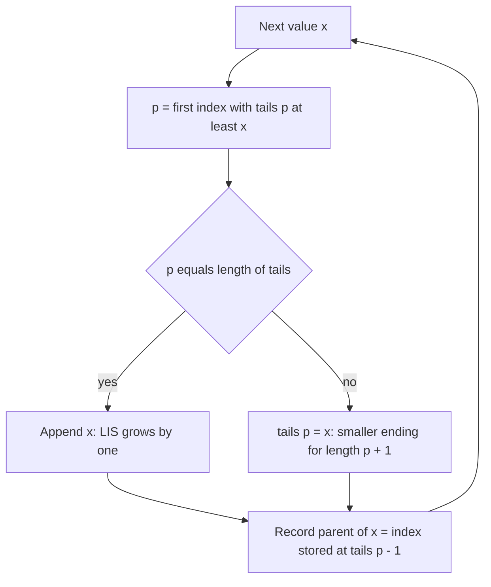

## The hook

A stock's price over eight days is [3, 1, 8, 2, 5, 9, 4, 7]. What is the longest run of days, not necessarily consecutive, where each chosen price is higher than the previous one? You may skip days but not reorder them. Checking all 2⁸ subsets works for eight days and is hopeless for 10⁵.

The longest increasing subsequence is one of the most asked DP problems, and it has a twist interviewers love: after you give the O(n²) solution, they ask "can you do better?" The O(n log n) answer comes from an old card game, and understanding why it works is what separates a memorised trick from real understanding.

## The intuition

:::analogy
Imagine dealing cards from a deck, one at a time, onto piles in a row. The rule: put each card on the leftmost pile whose top card is greater than or equal to it; if there is no such pile, start a new pile on the right. Each pile's top is the smallest card that has ended up there, and the tops always increase from left to right. When the deck runs out, the number of piles is the length of the longest increasing run of cards you could have picked in order.
:::

The cards are array elements in order, and the pile tops form the [[tails array]]. This card game is called [[patience sorting]]. We will reach it in two steps, starting with a plain DP.

## How it works

### Step 1: the O(n²) DP

Define the subproblem by the element where the [[subsequence]] **ends**:

| Part | Definition |
|---|---|
| State | dp[i] = length of the longest increasing subsequence ending exactly at index i |
| Transition | dp[i] = 1 + max(dp[j]) over j < i with a[j] < a[i], or 1 if there is no such j |
| Base case | every dp[i] starts at 1: the element alone |
| Answer | max over all i of dp[i] |

Fixing the last element is the key move from [Stairs, Robbers and Secret Codes](article:dsa-dp-1d): once you know where a subsequence ends, you know exactly which earlier elements may come before it.

### Step 2: the tails array

Instead of asking "what is the best length ending here?", ask "for each length, what is the smallest value a subsequence of that length can end with?" Smaller endings are better, because they leave more room for future elements to extend them.

For each new value x:

1. Find the first position p in tails with tails[p] ≥ x (lower_bound).
2. If p equals the length of tails, x extends the longest subsequence: append it.
3. Otherwise set tails[p] = x: there is now a subsequence of length p + 1 ending in a smaller value.

tails stays sorted, so step 1 is a binary search, as in [Binary Search Without the Off-by-One Fear](article:dsa-binary-search). The final length of tails is the [[longest increasing subsequence (LIS)]] length.



:::insight
Replacing a tail never changes how long a subsequence can be; it only makes its ending smaller, which can only help later elements. Each length keeps only its best ending, so one sorted array of n entries replaces the n² comparisons.
:::

### Step 3: rebuilding the actual sequence

tails gives the length, not the sequence. Keep a second array tailIdx with the index stored at each position, and for every element record a [[parent pointer]]: the index at tailIdx[p − 1] when it was placed, or −1 if p = 0. At the end, start from tailIdx[last] and follow parents back, then reverse. In the O(n²) DP, record par[i] = the j that gave the best dp[i].

### Variants

- **Non-decreasing** subsequences: use upper_bound instead of lower_bound.
- **Longest decreasing**: negate the values, or reverse the comparisons.
- **Russian dolls (2D)**: sort envelopes by width ascending and, for equal widths, height **descending**, then run LIS on heights. The descending tie-break stops two envelopes of equal width from nesting.
- **Counting LIS**: keep, alongside dp[i], the number of ways cnt[i] to achieve it; this stays O(n²) in the simple form.

## Walk through an example

Array **[3, 1, 8, 2, 5, 9, 4, 7]**.

**O(n²) DP:**

| i | 0 | 1 | 2 | 3 | 4 | 5 | 6 | 7 |
|---|---|---|---|---|---|---|---|---|
| a[i] | 3 | 1 | 8 | 2 | 5 | 9 | 4 | 7 |
| dp[i] | 1 | 1 | 2 | 2 | 3 | 4 | 3 | 4 |
| par[i] | – | – | 0 | 1 | 3 | 4 | 3 | 4 |

The maximum is 4 at index 5. Following parents 5 → 4 → 3 → 1 gives **[1, 2, 5, 9]**.

**Tails method:**

| i | x | position p | tails after |
|---|---|---|---|
| 0 | 3 | 0 (append) | [3] |
| 1 | 1 | 0 | [1] |
| 2 | 8 | 1 (append) | [1, 8] |
| 3 | 2 | 1 | [1, 2] |
| 4 | 5 | 2 (append) | [1, 2, 5] |
| 5 | 9 | 3 (append) | [1, 2, 5, 9] |
| 6 | 4 | 2 | [1, 2, 4, 9] |
| 7 | 7 | 3 | [1, 2, 4, 7] |

Length **4**. Notice the state after i = 6: [1, 2, 4, 9] is not a subsequence of the array, because 9 comes before 4. It only says "length 3 can end in 4, length 4 can end in 9". Rebuilding with parent pointers from the last tail (7 at index 7) gives [1, 2, 4, 7], another valid LIS.

:::try-this
Run the tails method on [5, 6, 1, 2, 3]. What is the length, and what does tails look like at the end? (5 → [5]; 6 → [5, 6]; 1 → [1, 6]; 2 → [1, 2]; 3 → [1, 2, 3]. Length 3, and here tails happens to be the LIS 1, 2, 3.)
:::

## The code

```pseudo
lis_quadratic(a):
    dp = [1] * n; par = [-1] * n
    for i in 0 .. n-1:
        for j in 0 .. i-1:
            if a[j] < a[i] and dp[j] + 1 > dp[i]:
                dp[i] = dp[j] + 1; par[i] = j
    return max(dp)                       // rebuild by following par from the argmax

lis_fast(a):
    tails = []; tailIdx = []; parent = [-1] * n
    for i, x in a:
        p = lower_bound(tails, x)
        if p == len(tails): tails.append(x); tailIdx.append(i)
        else: tails[p] = x; tailIdx[p] = i
        parent[i] = tailIdx[p - 1] if p > 0 else -1
    rebuild from tailIdx[last] following parent, then reverse
```

```cpp
#include <bits/stdc++.h>
using namespace std;

vector<int> lis(const vector<int>& a) {
    vector<int> tails, tailIdx, parent(a.size(), -1);
    for (int i = 0; i < (int)a.size(); i++) {
        int p = lower_bound(tails.begin(), tails.end(), a[i]) - tails.begin();
        if (p == (int)tails.size()) { tails.push_back(a[i]); tailIdx.push_back(i); }
        else { tails[p] = a[i]; tailIdx[p] = i; }
        parent[i] = p > 0 ? tailIdx[p - 1] : -1;
    }
    vector<int> seq;
    for (int k = tailIdx.empty() ? -1 : tailIdx.back(); k != -1; k = parent[k]) seq.push_back(a[k]);
    reverse(seq.begin(), seq.end());
    return seq;
}

int main() {
    vector<int> seq = lis({3, 1, 8, 2, 5, 9, 4, 7});
    cout << seq.size() << ':';                 // 4:
    for (int x : seq) cout << ' ' << x;        // 1 2 4 7
    cout << '\n';
}
```

## Complexity

- **Basic DP:** O(n²) time, O(n) space. Fine for n up to a few thousand.
- **Tails method:** O(n log n) time, one binary search per element, O(n) space including parent pointers. Needed for n around 10⁵ or more.

## Common mistakes

:::warning
Common misconception: "the tails array is the longest increasing subsequence." Only its length is guaranteed. For [3, 4, 5, 1] the final tails is [1, 4, 5], but 1 comes after 4 and 5 in the array. To output the sequence, store indices and parent pointers as in the code.
:::

- **lower_bound vs upper_bound**: strictly increasing uses lower_bound; non-decreasing uses upper_bound. Test with repeated values like [2, 2, 2].
- **Returning dp[n − 1]** in the O(n²) version instead of the maximum over all i: the LIS need not end at the last element.
- **Russian dolls tie-break**: sorting equal widths by ascending height lets envelopes of equal width "nest", giving too large an answer.
- **Confusing subsequence with subarray**: subarrays must be contiguous; subsequences need not be.

## Practice problems

*Longest Increasing Subsequence* accepts both methods; write both. *Increasing Subsequence* (CSES) needs the O(n log n) version. *Towers* (CSES) is patience sorting in disguise, with upper_bound. *Russian Doll Envelopes* tests the sort-then-LIS reduction and its tie-break. *Number of Longest Increasing Subsequence* extends the O(n²) DP with a count array.

## Key takeaways

- dp[i] as the longest increasing subsequence ending at index i gives a simple O(n²) solution.
- The tails array keeps, for every length, the smallest possible ending value, and it is always sorted.
- Binary searching each element's position in tails gives the LIS length in O(n log n).
- The tails array is not itself a valid subsequence, so rebuild the answer with stored indices and parent pointers.
- Use upper_bound for non-decreasing variants, and sort by width ascending with height descending to reduce Russian dolls to LIS.
