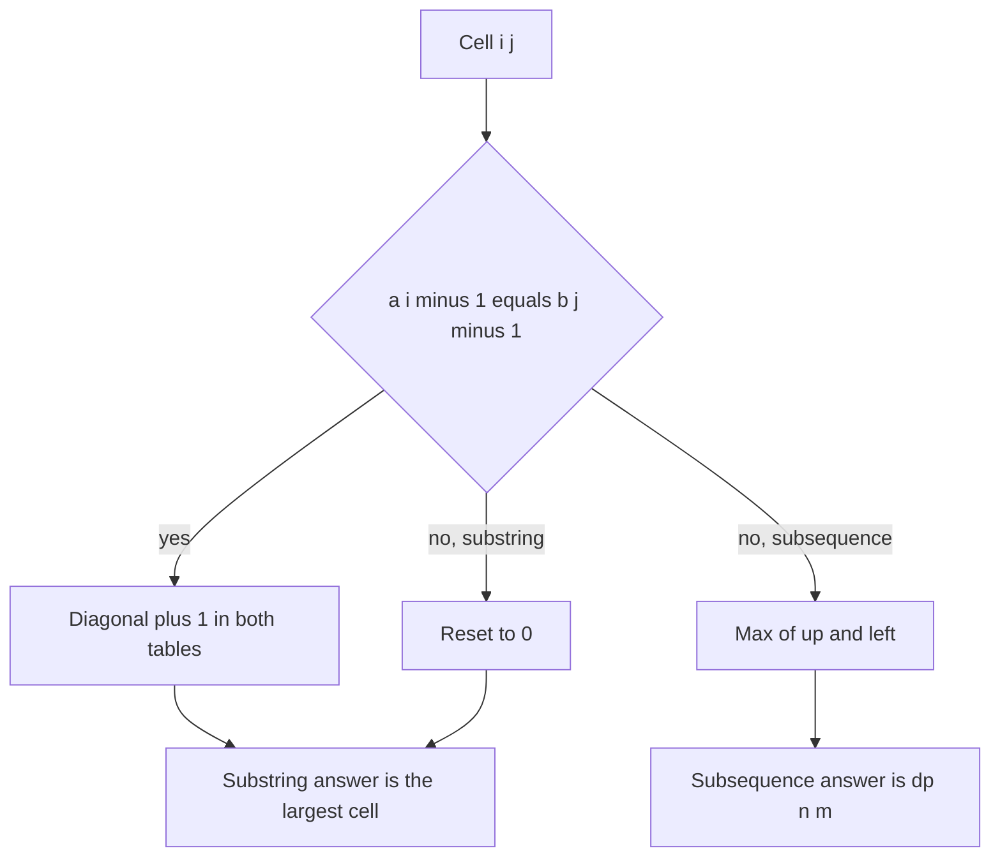

## The hook

Two strips of coloured tape lie side by side. You may slide one along the other, and you want the longest stretch where the colours line up exactly, with no gaps. That is a common substring. Now change the rules: you may skip squares on either strip, as long as the matched squares stay in order. That is a common subsequence, and the answer is usually longer.

The two problems use the same table and differ by one line. Mixing up that line is one of the most common bugs in string DP, and getting it right unlocks deletion counts and the shortest string that contains both.

## The problem

Given strings a and b, find:

- the longest [[common substring]], a contiguous block present in both;
- and, from the [[common subsequence]] table, the fewest deletions that make a and b equal, and the [[shortest common supersequence]].

For a = "xabcdy" and b = "zabcxbcdy", the longest common substring is "bcdy" (length 4), while the longest common subsequence is "abcdy" (length 5).

*Maximum Length of Repeated Subarray* is the substring problem on integer arrays.

## The obvious approach

For the substring, try every start in a and every start in b and extend while characters match: O(n × m × min(n, m)). For strings of a few thousand characters, that is billions of steps.

Reusing the LCS table directly is the other tempting idea, and it gives the wrong answer: on the example it reports 5, from "abcdy", which is not contiguous in b ("abc" and "dy" are separated by "xbc" there).

## The key insight

:::analogy
Slide your finger along both strips at once, one pair of positions at a time, and keep a counter of "how many matching squares in a row end right here". If the two squares under your fingers match, the counter is one more than it was one square back on both strips. If they do not match, the run is broken, and the counter drops to zero. The longest run you ever see is the answer. For subsequences, a mismatch does not break anything: you simply carry forward the best you had from skipping a square on one strip or the other.
:::

Both are tables over prefixes, as in [Lining Up Two DNA Strands](article:dsa-lcs-edit-distance), but the cells mean different things:

| | Longest common substring | Longest common subsequence |
|---|---|---|
| dp[i][j] means | common block ending exactly at a[i-1] and b[j-1] | best common subsequence of a[0..i) and b[0..j) |
| match | dp[i-1][j-1] + 1 | dp[i-1][j-1] + 1 |
| mismatch | **0** | **max(dp[i-1][j], dp[i][j-1])** |
| answer | largest cell anywhere | dp[n][m] |

The substring cell is a [[run length cell]]: it only extends along the diagonal and resets on a mismatch. Because the best block can end anywhere, the answer is the maximum over the whole table, and remembering where it occurs lets you print the substring.

### Fewest deletions

*Delete Operation for Two Strings* asks for the fewest character deletions, from either string, that make them equal. What survives must be a common subsequence, so keep a longest one: the answer is n + m - 2 × LCS.

### Shortest common supersequence

The shortest string containing both a and b as subsequences writes the LCS once and every other character once: its length is n + m - LCS. To build it, walk back through the LCS table from (n, m):

- if a[i-1] = b[j-1], output that character once and move diagonally;
- otherwise move towards the larger neighbour, outputting the character you step past;
- when one string runs out, output the rest of the other.

Reverse the collected characters at the end.



:::insight
A substring must be unbroken, so its table resets to zero on every mismatch and the answer can end anywhere. A subsequence may skip characters, so its table carries the best value forward and the answer sits in the corner. One line of code separates the two.
:::

## Walk through an example

a = "xabcdy" (rows), b = "zabcxbcdy" (columns).

### Substring table: run lengths

| | z | a | b | c | x | b | c | d | y |
|---|---|---|---|---|---|---|---|---|---|
| x | 0 | 0 | 0 | 0 | 1 | 0 | 0 | 0 | 0 |
| a | 0 | 1 | 0 | 0 | 0 | 0 | 0 | 0 | 0 |
| b | 0 | 0 | 2 | 0 | 0 | 1 | 0 | 0 | 0 |
| c | 0 | 0 | 0 | 3 | 0 | 0 | 2 | 0 | 0 |
| d | 0 | 0 | 0 | 0 | 0 | 0 | 0 | 3 | 0 |
| y | 0 | 0 | 0 | 0 | 0 | 0 | 0 | 0 | **4** |

Two diagonals of matches stand out. "abc" in both strings builds 1, 2, 3 and then breaks, because the next characters, d and x, differ. The second diagonal starts at b's second "b": "bcdy" builds 1, 2, 3, 4. The largest cell is 4, ending at the last characters, so the answer is "bcdy".

### Subsequence table

| | z | a | b | c | x | b | c | d | y |
|---|---|---|---|---|---|---|---|---|---|
| x | 0 | 0 | 0 | 0 | 1 | 1 | 1 | 1 | 1 |
| a | 0 | 1 | 1 | 1 | 1 | 1 | 1 | 1 | 1 |
| b | 0 | 1 | 2 | 2 | 2 | 2 | 2 | 2 | 2 |
| c | 0 | 1 | 2 | 3 | 3 | 3 | 3 | 3 | 3 |
| d | 0 | 1 | 2 | 3 | 3 | 3 | 3 | 4 | 4 |
| y | 0 | 1 | 2 | 3 | 3 | 3 | 3 | 4 | **5** |

Here nothing resets: after "abc", the subsequence skips "xbc" in b and continues with "dy", for "abcdy", length 5.

### Deletions and supersequences

| Strings | LCS | Fewest deletions | Shortest common supersequence |
|---|---|---|---|
| "heart", "earth" | 4 ("eart") | 5 + 5 - 8 = 2 | length 6, such as "hearth" |
| "geek", "eke" | 2 ("ek") | 4 + 3 - 4 = 3 | length 5, such as "gekek" |
| "xabcdy", "zabcxbcdy" | 5 | 6 + 9 - 10 = 5 | length 10 |

For "heart" and "earth": delete the h from "heart" and the h from "earth", leaving "eart" in both.

:::try-this
What is the longest common substring of "banana" and "ananas"? (The run along the diagonal "anana" reaches 5: a, n, a, n, a match one after another, starting at index 1 of "banana" and index 0 of "ananas". The answer is "anana".)
:::

:::warning
Common misconception: "Longest common substring is the LCS table with the answer read from dp[n][m]." Both halves are wrong for substrings. The mismatch case must reset to 0, and the answer is the largest cell, not the corner, because the best block may end long before the strings do. Using the LCS rule on the example gives 5 instead of 4.
:::

## The code

```pseudo
longest_common_substring(a, b):
    best = 0; end = 0
    for i in 1..n: for j in 1..m:
        if a[i-1] == b[j-1]:
            dp[i][j] = dp[i-1][j-1] + 1
            if dp[i][j] > best: best = dp[i][j]; end = i
        else: dp[i][j] = 0                    # the run is broken
    return a[end-best .. end)

shortest_common_supersequence(a, b):
    L = lcs table; i = n; j = m; out = []
    while i > 0 and j > 0:
        if a[i-1] == b[j-1]: out.add(a[i-1]); i -= 1; j -= 1
        else if L[i-1][j] >= L[i][j-1]: out.add(a[i-1]); i -= 1
        else: out.add(b[j-1]); j -= 1
    add the rest of a and b; return reverse(out)
```

```cpp
#include <bits/stdc++.h>
using namespace std;

string longestCommonSubstring(const string& a, const string& b) {
    int n = a.size(), m = b.size(), best = 0, end = 0;
    vector<int> prev(m + 1, 0), cur(m + 1, 0);                 // two rows are enough
    for (int i = 1; i <= n; i++) {
        for (int j = 1; j <= m; j++) {
            cur[j] = a[i - 1] == b[j - 1] ? prev[j - 1] + 1 : 0;   // reset on mismatch
            if (cur[j] > best) best = cur[j], end = i;
        }
        swap(prev, cur);
    }
    return a.substr(end - best, best);
}

vector<vector<int>> lcsTable(const string& a, const string& b) {
    int n = a.size(), m = b.size();
    vector<vector<int>> L(n + 1, vector<int>(m + 1, 0));
    for (int i = 1; i <= n; i++)
        for (int j = 1; j <= m; j++)
            L[i][j] = a[i - 1] == b[j - 1] ? L[i - 1][j - 1] + 1 : max(L[i - 1][j], L[i][j - 1]);
    return L;
}

int minDeletions(const string& a, const string& b) {
    return a.size() + b.size() - 2 * lcsTable(a, b)[a.size()][b.size()];
}

string shortestCommonSupersequence(const string& a, const string& b) {
    auto L = lcsTable(a, b);
    int i = a.size(), j = b.size();
    string out;
    while (i > 0 && j > 0) {
        if (a[i - 1] == b[j - 1]) out += a[i - 1], i--, j--;          // shared, write once
        else if (L[i - 1][j] >= L[i][j - 1]) out += a[i - 1], i--;
        else out += b[j - 1], j--;
    }
    while (i > 0) out += a[--i];
    while (j > 0) out += b[--j];
    reverse(out.begin(), out.end());
    return out;
}

int main() {
    cout << longestCommonSubstring("xabcdy", "zabcxbcdy") << ' '
         << lcsTable("xabcdy", "zabcxbcdy")[6][9] << '\n';                 // bcdy 5
    cout << longestCommonSubstring("banana", "ananas") << '\n';             // anana
    cout << minDeletions("heart", "earth") << ' ' << minDeletions("geek", "eke") << '\n';   // 2 3
    string s = shortestCommonSupersequence("geek", "eke");
    cout << s << ' ' << s.size() << ' ' << shortestCommonSupersequence("heart", "earth").size() << '\n';   // gekek 5 6
}
```

## Complexity

- **Longest common substring: O(n × m) time,** O(m) space with two rows, since each cell needs only the diagonal.
- **LCS, deletions and supersequence length: O(n × m)** time; the supersequence itself needs the full table to walk back, so O(n × m) space.
- **Faster substring methods,** such as suffix automata or binary search with hashing, reach O((n + m) log) time, but the DP is the interview answer.

## Common mistakes

- **Carrying the max forward on a mismatch** in the substring table, which turns it into LCS.
- **Reading the substring answer from dp[n][m]** instead of the maximum cell.
- **Printing the substring from the wrong string or index;** record the end position in one string along with the length.
- **Writing shared characters twice** when building the supersequence.
- **Forgetting the leftovers** of one string when the walk-back reaches the edge of the table.

## Practice problems

*Maximum Length of Repeated Subarray* is the substring table on integers. *Delete Operation for Two Strings* is n + m - 2 × LCS. *Shortest Common Supersequence* builds the string by walking back through the LCS table. The LCS and edit distance foundations are in [Lining Up Two DNA Strands](article:dsa-lcs-edit-distance).

## Key takeaways

- Longest common substring uses dp[i][j] as the length of the common block ending exactly at both positions, resetting to 0 on every mismatch.
- The substring answer is the largest cell anywhere in the table, because the best block can end before either string does.
- Longest common subsequence carries the better of up and left on a mismatch, and its answer is the bottom-right cell.
- The fewest deletions to make two strings equal is n + m - 2 × LCS.
- The shortest common supersequence has length n + m - LCS and is built by walking back through the LCS table, writing shared characters once.
