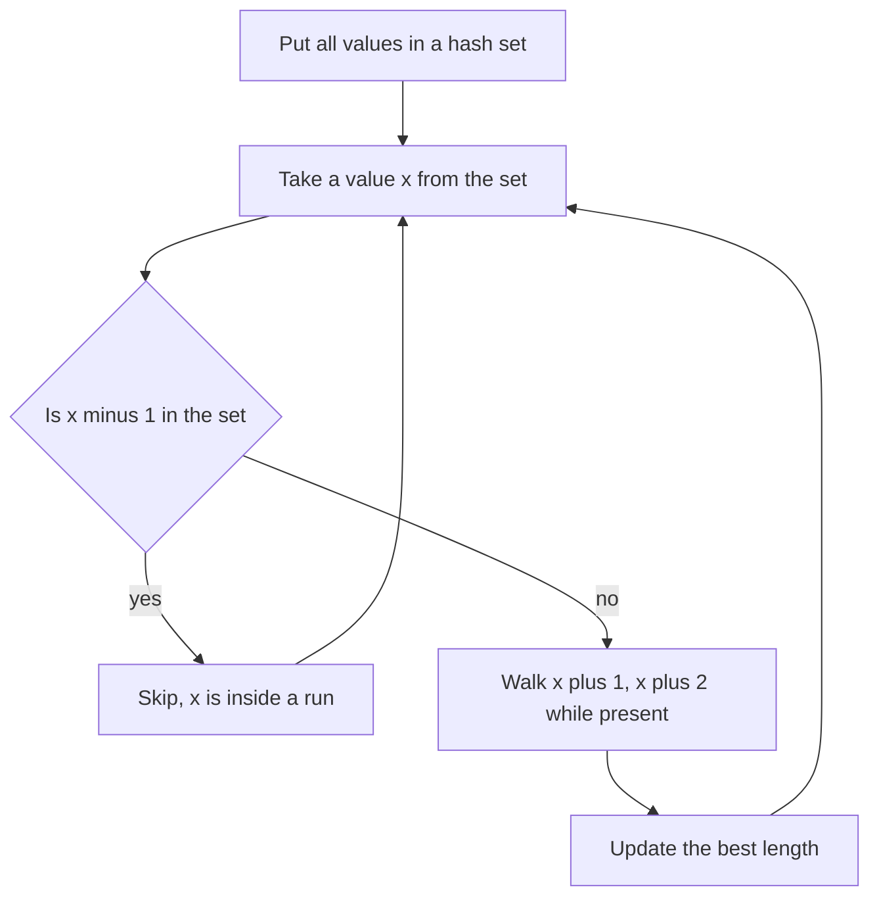

## The hook

You are handed the numbers 100, 4, 200, 1, 3, 2 and asked for the longest run of consecutive integers, here 1, 2, 3, 4. Sorting finds it immediately. Then the interviewer adds one line: "Do it in O(n)."

That rules out sorting. Yet the solution is only a few lines with a hash set. The trick is not the hash set itself but one small check that stops you from counting the same run over and over. It is a lesson in avoiding repeated work that reappears in many problems.

## The problem

Given an unsorted array of integers, return the length of the longest [[consecutive sequence]]: values x, x + 1, ..., x + L − 1 that all appear in the array. Their positions do not matter, and duplicates count once. The target is O(n) time.

| Input | Longest run | Answer |
|---|---|---|
| [100, 4, 200, 1, 3, 2] | 1 2 3 4 | 4 |
| [0, 3, 7, 2, 5, 8, 4, 6, 0, 1] | 0 to 8 | 9 |
| [] | none | 0 |

## The obvious approach

**Sort, then scan.** After sorting, consecutive values sit next to each other. Walk once, extending the run when the next value is one more, ignoring equal values, and restarting otherwise. This is O(n log n) and a perfectly good first answer.

**Hash set, count from everywhere.** Put all values in a [[hash set]]. For every x, walk x + 1, x + 2, ... while they are in the set, and record the longest walk. That is correct, but it is O(n²) in the worst case: on the input 1, 2, ..., n, the walk from 1 has length n, from 2 has length n − 1, and so on.

| Approach | Time | Space | Problem |
|---|---|---|---|
| Sort and scan | O(n log n) | O(1) to O(n) | not linear |
| Walk from every value | O(n²) worst case | O(n) | recounts every run many times |
| Walk only from run starts | O(n) expected | O(n) | the answer |

## The key insight

:::analogy
Picture people standing in several queues at a railway station, but scattered so you cannot see which queue anyone is in. Each person knows only their ticket number, and a queue is a group of consecutive numbers. If everybody counted the people behind them, the people at the back would count almost nobody and the people at the front would count everyone, and most of the counting would be repeated. Instead, ask each person one question first: "Is the person with the number just below yours here?" Only someone who says no is at the front of a queue, and only they start counting.
:::

That one question is the whole fix. A value x is a [[run start]] exactly when x − 1 is not in the set. Every run has exactly one start, so if you only walk from starts, every run is walked exactly once.



Why is this linear? Count the work in two parts. The start check runs once per value: n lookups.

The walks run only from starts, and the walk from a start covers exactly its own run. Runs do not overlap, so all the walks together step over each value at most once: at most n more lookups. That is [[amortised analysis]]: the inner loop looks expensive, but its total over the whole run is bounded by n.

:::insight
Doing work only at the beginning of each group is a general way to avoid recounting. Here the cheap check "is x − 1 present?" picks out exactly one starting point per run, so every run is counted once and the total is O(n).
:::

## Walk through an example

Take [100, 4, 200, 1, 3, 2]. The set is {1, 2, 3, 4, 100, 200}.

| x | Is x − 1 in the set? | Action | Walk | Length | Best |
|---|---|---|---|---|---|
| 100 | 99: no | start a walk | 100, then 101 is missing | 1 | 1 |
| 4 | 3: yes | skip | | | 1 |
| 200 | 199: no | start a walk | 200, then 201 is missing | 1 | 1 |
| 1 | 0: no | start a walk | 1, 2, 3, 4, then 5 is missing | 4 | 4 |
| 3 | 2: yes | skip | | | 4 |
| 2 | 1: yes | skip | | | 4 |

Total lookups: 6 start checks plus 2 + 2 + 5 = 9 walk lookups, including the failed ones. The answer is 4. Compare the version that walks from everywhere: on the run 1 to 4 alone it would walk 4 + 3 + 2 + 1 steps instead of 4.

### Duplicates and negative numbers

Duplicates are harmless because the set stores each value once. Negative numbers and zero work unchanged, since the check is just x − 1. One subtle cost remains: if you loop over the original array instead of the set and the array contains the same run start a million times, each copy would repeat the same walk. Loop over the set, or skip values you have already processed.

:::try-this
For [0, 3, 7, 2, 5, 8, 4, 6, 0, 1], which values start a walk, and what is the answer? (Only 0 starts a walk, because −1 is missing and every other value has its predecessor. The walk covers 0 through 8, so the answer is 9.)
:::

:::warning
Common misconception: "A while loop inside a for loop is always O(n²)." The bound depends on how many times the inner loop runs in total, not per outer iteration. Here walks happen only from run starts and never overlap, so the inner loop runs at most n times across the whole algorithm. Remove the x − 1 check and the same code really is O(n²).
:::

## The code

```pseudo
longest_consecutive(a):
    S = set of all values in a
    best = 0
    for x in S:
        if x - 1 in S: continue          # not the front of its queue
        y = x
        while y + 1 in S: y += 1         # walk the run
        best = max(best, y - x + 1)
    return best
```

```cpp
#include <bits/stdc++.h>
using namespace std;

int longestConsecutive(const vector<int>& a) {
    unordered_set<long long> s(a.begin(), a.end());   // long long so x + 1 never overflows
    int best = 0;
    for (long long x : s) {
        if (s.count(x - 1)) continue;                  // not a run start
        long long y = x;
        while (s.count(y + 1)) y++;                    // walk the run once
        best = max(best, (int)(y - x + 1));
    }
    return best;
}

// Related hash-set patterns from the same family.
bool containsNearbyDuplicate(const vector<int>& a, int k) {
    unordered_map<int, int> last;                      // value -> latest index
    for (int i = 0; i < (int)a.size(); i++) {
        auto it = last.find(a[i]);
        if (it != last.end() && i - it->second <= k) return true;
        last[a[i]] = i;
    }
    return false;
}

bool isHappy(int n) {
    auto next = [](int x) { int s = 0; for (; x; x /= 10) s += (x % 10) * (x % 10); return s; };
    unordered_set<int> seen;
    while (n != 1 && !seen.count(n)) { seen.insert(n); n = next(n); }
    return n == 1;                                     // a repeat means a cycle without 1
}

int main() {
    cout << longestConsecutive({100, 4, 200, 1, 3, 2}) << ' '
         << longestConsecutive({0, 3, 7, 2, 5, 8, 4, 6, 0, 1}) << ' '
         << longestConsecutive({}) << '\n';                        // 4 9 0
    cout << containsNearbyDuplicate({1, 2, 3, 1}, 3) << ' '
         << containsNearbyDuplicate({1, 2, 3, 1, 2, 3}, 2) << '\n';  // 1 0
    cout << isHappy(19) << ' ' << isHappy(2) << '\n';              // 1 0
}
```

### The neighbours in this family

The other practice problems use the same "set as a fast membership notebook" idea from [The Notebook That Turns O(n²) Into O(n)](article:dsa-hashing-patterns):

- **Contains Duplicate II** keeps the latest index of each value in a hash map. When a value reappears, check whether the gap is at most k. For [1, 2, 3, 1] with k = 3, the two 1s are 3 apart: true. For [1, 2, 3, 1, 2, 3] with k = 2, every repeat is 3 apart: false.
- **Happy Number** repeatedly replaces n with the sum of the squares of its digits. A hash set of seen values detects a loop. Starting from 19: 82, 68, 100, 1, so 19 is happy. Starting from 2: 4, 16, 37, 58, 89, 145, 42, 20, then 4 again, a cycle that never reaches 1. Floyd's two-pointer cycle detection from [The Tortoise and the Hare on a Circular Track](article:dsa-fast-slow-pointers) solves it with O(1) space.

### Other ways to solve the main problem

- **Hash map of run lengths.** When x arrives, look up the lengths of the runs ending at x − 1 and starting at x + 1, join them, and store the new length at both ends. It is O(n) and works online as values stream in.
- **Union-find.** Union x with x + 1 whenever both are present, then return the largest component, as in [Friend Groups That Merge at a Party](article:dsa-union-find). It is close to O(n) but heavier than needed.

## Complexity

- **Time: O(n) [[expected time]].** Building the set is n insertions. The start checks are n lookups. The walks cover each value at most once, so at most n more lookups, each expected O(1).
- **Space: O(n)** for the hash set.
- **Worst case:** hash lookups can degrade with adversarial collisions, so the strict worst case is not O(n). In interviews "O(n) expected" is the accepted answer; mention it if asked about hashing guarantees.
- **Sort-based alternative:** O(n log n) time and no hash set, a reasonable fallback when memory is tight.

## Common mistakes

- **Dropping the x − 1 check,** which makes it O(n²) on inputs like 1, 2, ..., n.
- **Looping over the array instead of the set** when duplicates are frequent, which repeats walks from the same start.
- **Counting duplicates in the sorted solution** as part of the run. Equal neighbours neither extend nor break a run.
- **Returning 1 for an empty array.** The answer is 0.
- **Overflow at the extremes.** With INT_MAX in the array, `x + 1` overflows a 32-bit int; store values as 64-bit or guard the check.
- **Assuming hash iteration order is sorted.** `unordered_set` iterates in an arbitrary order, which is fine because the start check does not care about order.

## Practice problems

Solve *Longest Consecutive Sequence* first by sorting, then with the run-start hash set, and explain out loud why the second is linear. *Contains Duplicate* and *Contains Duplicate II* are quick warm-ups for hash-set and hash-map membership, the second adding a distance condition. *Happy Number* uses a set to detect a cycle; solve it again with Floyd's algorithm to see the O(1)-space version.

## Key takeaways

- The longest run of consecutive integers can be found in O(n) expected time by putting all values in a hash set.
- Start walking only from values x where x − 1 is absent, because each run has exactly one such start.
- Since walks start only at run starts and runs never overlap, all the walks together touch each value once, which is why the nested loop is linear.
- Without the start check, the same code recounts every run from every member and becomes O(n²).
- Hash sets also detect repeats within a distance, using a map of latest indices, and cycles in sequences such as Happy Number.
