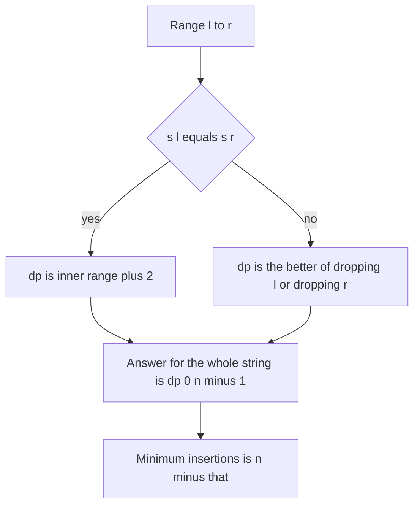

## The hook

Write "agbdba" on a strip of paper and try to fold it in half so matching letters touch. The a at each end can meet. Inside, the b's can meet. Between them, either g or d can sit on the fold, but not both. You have found a palindrome hidden inside the word: a, b, d, b, a.

Finding the longest such hidden palindrome, with letters kept in order but allowed to skip, is the *Longest Palindromic Subsequence*. It is a short interval DP, and it unlocks two other problems almost for free.

## The problem

Given a string s, return the length of its longest [[palindromic subsequence]]: a [[subsequence]] that reads the same both ways. For "agbdba" the answer is 5, from "abdba".

This is different from the longest palindromic [[substring]], which must be contiguous: in "agbdba" that is only "bdb", of length 3.

## The obvious approach

Generate every subsequence, 2ⁿ of them, and keep the longest palindrome. For n = 1,000 that is out of the question. A slightly better idea, expanding around each centre, works for substrings but not subsequences, because a subsequence can skip characters anywhere.

## The key insight

:::analogy
Fold the paper strip from the outside in. Look at the two letters at the very ends. If they match, they will touch at the fold's outermost layer, so count them both and fold the inside. If they do not match, at least one of them cannot be part of the folded palindrome, so tear it off: try tearing the left end, try tearing the right end, and keep whichever leaves the better fold.
:::

That is the [[ends rule]], and it is interval DP from [Choosing Which Balloon to Pop Last](article:dsa-interval-dp). Let dp[l][r] be the LPS length of s[l..r]:

- dp[i][i] = 1, since one letter is a palindrome;
- if s[l] = s[r], dp[l][r] = dp[l+1][r-1] + 2 (with dp of an empty range being 0);
- otherwise dp[l][r] = max(dp[l+1][r], dp[l][r-1]).

Fill with l going down from n - 1 and r going up from l, so the inner ranges are ready. The answer is dp[0][n-1], in O(n²) time.

### The LCS connection

A palindromic subsequence reads the same in s and in reverse(s), so it is a common subsequence of both. The converse also holds for the longest ones, so LPS(s) = LCS(s, reverse(s)), and the two-string table from [Lining Up Two DNA Strands](article:dsa-lcs-edit-distance) gives the same number. The interval form is usually clearer and makes reconstruction easy.

### Free problem 1: minimum insertions

*Minimum Insertion Steps to Make a String Palindrome* asks for the fewest characters to insert anywhere. Keep the longest palindromic subsequence as the skeleton; every other character needs a mirror partner inserted on the other side. So the answer is n - LPS(s).

### A related problem: minimum palindrome cuts

*Palindrome Partitioning II* asks for the fewest [[palindrome cut]]s so every piece is a palindrome substring. Two tables:

- isPal[l][r], the substring palindrome check, with the same ends shape;
- cuts[j], the fewest cuts for s[0..j]: 0 if s[0..j] is a palindrome, else the minimum over i of cuts[i - 1] + 1 for every palindrome s[i..j].

That is O(n²) overall: the palindrome table is n², and each j scans at most j split points.

| Problem | Table | Answer |
|---|---|---|
| Longest Palindromic Subsequence | dp[l][r] by the ends rule | dp[0][n-1] |
| Minimum insertions | same table | n - dp[0][n-1] |
| Longest palindromic substring | isPal[l][r] | longest true range |
| Minimum palindrome cuts | isPal[l][r] then cuts[j] | cuts[n-1] |



:::insight
Look at the two ends: equal ends always belong together on the outside of the palindrome, and unequal ends mean one of them must go. That single choice per range gives an O(n²) interval DP, and the leftover characters are exactly the ones that need inserted partners.
:::

## Walk through an example

s = "agbdba", indices 0 to 5.

| dp[l][r] | r=0 a | r=1 g | r=2 b | r=3 d | r=4 b | r=5 a |
|---|---|---|---|---|---|---|
| l=0 a | 1 | 1 | 1 | 1 | 3 | **5** |
| l=1 g | | 1 | 1 | 1 | 3 | 3 |
| l=2 b | | | 1 | 1 | 3 | 3 |
| l=3 d | | | | 1 | 1 | 1 |
| l=4 b | | | | | 1 | 1 |
| l=5 a | | | | | | 1 |

Reading key cells:

- dp[2][4], "bdb": ends match, so dp[3][3] + 2 = 3.
- dp[1][4], "gbdb": g ≠ b, so max(dp[2][4], dp[1][3]) = max(3, 1) = 3.
- dp[0][5], "agbdba": a = a, so dp[1][4] + 2 = 5.

Reconstruction walks the same choices: the a's match, then at "gbdb" drop the g, then the b's match, then "d" sits in the middle. The palindrome is a, b, d, b, a.

Minimum insertions: 6 - 5 = 1. Insert a g to mirror the unused g: "agbdbga".

### Minimum cuts

| String | Best split | Cuts |
|---|---|---|
| "abacdc" | aba \| cdc | 1 |
| "banana" | b \| anana | 1 |
| "aabba" | a \| abba | 1 |

For "abacdc", cuts[5] tries every palindrome ending at index 5: "c" gives cuts[4] + 1 = 3, "cdc" gives cuts[2] + 1 = 0 + 1 = 1, since "aba" needs no cuts.

:::try-this
What are the LPS and the minimum insertions for "character"? (The ends c and r differ. The best palindrome found by the table has length 5, for example "carac": c, a, r, a, c, using the first c, an a, the r, the second a and the second c. Minimum insertions: 9 - 5 = 4.)
:::

:::warning
Common misconception: "The longest palindromic subsequence is found by expanding around each centre." Expanding around centres finds the longest palindromic substring, where characters must be adjacent. In "agbdba", centre expansion finds "bdb" of length 3, while the subsequence answer is 5. Read whether the problem says subsequence or substring before choosing the method.
:::

## The code

```pseudo
lps(s):
    for l in n-1 down to 0:
        dp[l][l] = 1
        for r in l+1 .. n-1:
            if s[l] == s[r]: dp[l][r] = dp[l+1][r-1] + 2     # empty inside counts as 0
            else: dp[l][r] = max(dp[l+1][r], dp[l][r-1])
    return dp[0][n-1]

min_cuts(s):
    isPal by the same ends shape
    for j in 0 .. n-1:
        if isPal[0][j]: cuts[j] = 0
        else: cuts[j] = min(cuts[i-1] + 1 for i in 1..j if isPal[i][j])
    return cuts[n-1]
```

```cpp
#include <bits/stdc++.h>
using namespace std;

pair<int, string> longestPalSubseq(const string& s) {
    int n = s.size();
    vector<vector<int>> dp(n, vector<int>(n, 0));
    for (int l = n - 1; l >= 0; l--) {
        dp[l][l] = 1;
        for (int r = l + 1; r < n; r++)
            dp[l][r] = s[l] == s[r] ? (l + 1 <= r - 1 ? dp[l + 1][r - 1] : 0) + 2
                                    : max(dp[l + 1][r], dp[l][r - 1]);
    }
    string left, right;                                        // rebuild one answer
    for (int l = 0, r = n - 1; l <= r;) {
        if (l == r) { left += s[l]; break; }
        if (s[l] == s[r]) left += s[l], right += s[r], l++, r--;
        else if (dp[l + 1][r] >= dp[l][r - 1]) l++;
        else r--;
    }
    reverse(right.begin(), right.end());
    return {dp[0][n - 1], left + right};
}

int lcsWithReverse(const string& s) {
    string t(s.rbegin(), s.rend());
    int n = s.size();
    vector<vector<int>> L(n + 1, vector<int>(n + 1, 0));
    for (int i = 1; i <= n; i++)
        for (int j = 1; j <= n; j++)
            L[i][j] = s[i - 1] == t[j - 1] ? L[i - 1][j - 1] + 1 : max(L[i - 1][j], L[i][j - 1]);
    return L[n][n];
}

int minCuts(const string& s) {
    int n = s.size();
    vector<vector<bool>> pal(n, vector<bool>(n, false));
    for (int l = n - 1; l >= 0; l--)
        for (int r = l; r < n; r++)
            pal[l][r] = s[l] == s[r] && (r - l < 2 || pal[l + 1][r - 1]);
    vector<int> cuts(n, INT_MAX);
    for (int j = 0; j < n; j++) {
        if (pal[0][j]) { cuts[j] = 0; continue; }
        for (int i = 1; i <= j; i++)
            if (pal[i][j]) cuts[j] = min(cuts[j], cuts[i - 1] + 1);
    }
    return cuts[n - 1];
}

int main() {
    auto [len, pal] = longestPalSubseq("agbdba");
    cout << len << ' ' << pal << ' ' << lcsWithReverse("agbdba") << ' ' << 6 - len << '\n';   // 5 abdba 5 1
    auto [len2, pal2] = longestPalSubseq("character");
    cout << len2 << ' ' << pal2 << ' ' << 9 - len2 << '\n';                                    // 5 carac 4
    cout << minCuts("abacdc") << ' ' << minCuts("banana") << ' ' << minCuts("aabba") << '\n'; // 1 1 1
}
```

## Complexity

- **LPS: O(n²) time and space.** Rows only depend on the next row, so O(n) space is possible if reconstruction is not needed.
- **Minimum insertions:** the same O(n²).
- **Minimum cuts: O(n²) time and space** for the palindrome table plus the cuts array.
- **LCS with the reverse:** also O(n²), with a slightly larger constant.

## Common mistakes

- **Confusing subsequence with substring,** and using centre expansion for the subsequence problem.
- **Wrong fill order:** l must go downward so dp[l+1][...] is ready.
- **Reading dp[l+1][r-1] when the range is empty** (r = l + 1); treat it as 0.
- **Counting the middle letter twice** in reconstruction when l and r meet.
- **Minimum cuts with an O(n³) palindrome check** inside the cuts loop, instead of precomputing the table.

## Practice problems

*Longest Palindromic Subsequence* is the ends rule. *Minimum Insertion Steps to Make a String Palindrome* is n minus that answer. *Palindrome Partitioning II* switches to substrings and adds a one-dimensional cuts DP on top. The interval DP template is in [Choosing Which Balloon to Pop Last](article:dsa-interval-dp).

## Key takeaways

- The longest palindromic subsequence uses dp[l][r]: equal ends add 2 to the inside, unequal ends take the better of dropping one end.
- The table must be filled so that every inner range is ready, with l decreasing and r increasing.
- The answer equals the longest common subsequence of the string and its reverse.
- The minimum number of insertions to make a string a palindrome is its length minus the longest palindromic subsequence.
- Minimum palindrome cuts are a different problem over substrings, solved with a palindrome table and a one-dimensional cuts DP.
