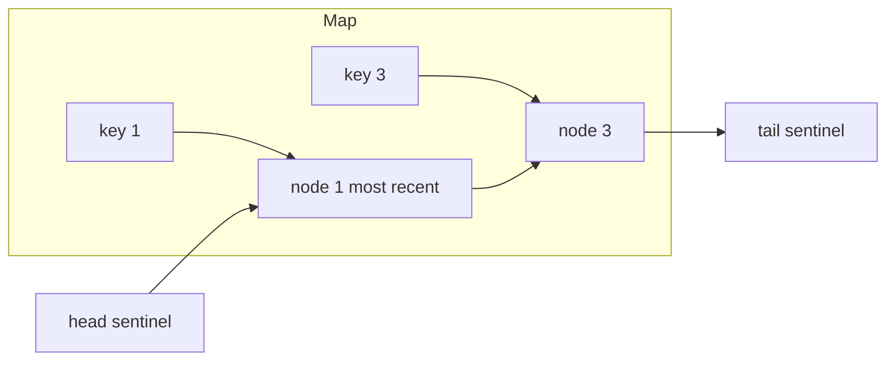

## The hook

"Design an LRU cache" is one of the most frequently asked interview questions at product companies, and for good reason. It is short to state, it has a clean optimal answer, and getting there tests whether you can combine two data structures so that each covers the other's weakness.

It is also real engineering. Operating systems decide which memory pages to keep with policies close to LRU, databases manage their buffer pools similarly, and caches like Memcached evict with LRU variants. The version you write in an interview is a small, exact model of all of them.

## The problem

Design a cache with a fixed capacity supporting:

- `get(key)`: return the value if the key is present, otherwise −1. This counts as a use of the key.
- `put(key, value)`: insert or update the key. This also counts as a use. If inserting makes the cache exceed its capacity, evict the [[LRU (least recently used)]] key first.

Both operations must run in O(1) average time.

## The obvious approach

Keep a hash map for values plus a timestamp per key, and on [[eviction]] scan for the smallest timestamp: get is O(1) but eviction is O(n). Or keep keys in an array ordered by recency: finding and moving a key is O(n). A balanced tree keyed by timestamp gets everything to O(log n), which is good but still not O(1).

Each structure solves half the problem. A hash map finds any key in O(1) but has no notion of order. A list keeps order, and can move or remove ends cheaply, but finding a key in it is O(n).

## The key insight

:::analogy
Picture a stack of books on your desk. Every time you read a book, you pull it out and put it on top. When the desk is full and you bring a new book, you take the one at the bottom, the book you have not touched for longest, back to the shelf. Pulling a book out of the middle is easy because you can see exactly where it is. That visibility is what the hash map adds: it tells you where in the stack each book sits.
:::

Combine the two:

- A [[doubly linked list]] holds entries in [[recency order]]: most recently used at the front, least recently used at the back.
- A hash map from key to the **list node**, not just the value.

Then every operation is a constant number of steps:

- **get**: look up the node in the map; if found, unlink it and re-insert it at the front; return its value.
- **put existing key**: update the value, move the node to the front.
- **put new key**: if full, remove the node at the back and erase its key from the map; then create a node at the front and add it to the map.

Unlinking a node in O(1) needs its previous pointer, which is why the list must be doubly linked. Using [[sentinel node]]s for head and tail means insertion and removal never deal with null neighbours.

:::insight
The map answers "where is this key?" and the list answers "which key is oldest?". Neither alone can do both in O(1), but a map whose values point into the list gives you random access into an ordered structure.
:::



## Walk through an example

Capacity 2. The list is shown from most to least recent.

| Operation | Result | List after | Notes |
|---|---|---|---|
| put(1, A) | | 1 | |
| put(2, B) | | 2, 1 | |
| get(1) | A | 1, 2 | 1 moves to front |
| put(3, C) | | 3, 1 | full: evict tail 2 |
| get(2) | −1 | 3, 1 | 2 was evicted |
| put(4, D) | | 4, 3 | evict tail 1 |
| get(1) | −1 | 4, 3 | |
| get(3) | C | 3, 4 | 3 moves to front |

:::try-this
Capacity 2. Run put(1, A), put(2, B), put(1, Z), put(3, C), get(2), get(1). (Updating key 1 makes it most recent, so put(3, C) evicts 2. get(2) is −1 and get(1) returns Z.)
:::

## The code

```pseudo
class LRUCache(capacity):
    map = {}                                 // key -> node
    head, tail = sentinels; head.next = tail; tail.prev = head

    remove(node):  node.prev.next = node.next; node.next.prev = node.prev
    add_front(node): node.next = head.next; node.prev = head
                     head.next.prev = node; head.next = node

    get(key):
        if key not in map: return -1
        node = map[key]; remove(node); add_front(node)
        return node.value

    put(key, value):
        if key in map:
            node = map[key]; node.value = value
            remove(node); add_front(node); return
        if size(map) == capacity:
            lru = tail.prev; remove(lru); delete map[lru.key]
        node = new Node(key, value); add_front(node); map[key] = node
```

```cpp
#include <bits/stdc++.h>
using namespace std;

class LRUCache {
    int cap;
    list<pair<int, int>> order;                                 // front = most recent, (key, value)
    unordered_map<int, list<pair<int, int>>::iterator> where;   // key -> node in list
public:
    LRUCache(int capacity) : cap(capacity) {}

    int get(int key) {
        auto it = where.find(key);
        if (it == where.end()) return -1;
        order.splice(order.begin(), order, it->second);          // move node to front in O(1)
        return it->second->second;
    }

    void put(int key, int value) {
        auto it = where.find(key);
        if (it != where.end()) {
            it->second->second = value;
            order.splice(order.begin(), order, it->second);
            return;
        }
        if ((int)order.size() == cap) {
            where.erase(order.back().first);                     // erase from map too
            order.pop_back();
        }
        order.emplace_front(key, value);
        where[key] = order.begin();
    }
};

int main() {
    LRUCache c(2);
    c.put(1, 10); c.put(2, 20);
    cout << c.get(1) << ' ';      // 10
    c.put(3, 30);                 // evicts 2
    cout << c.get(2) << ' ';      // -1
    c.put(4, 40);                 // evicts 1
    cout << c.get(1) << ' ' << c.get(3) << ' ' << c.get(4) << '\n';  // -1 30 40
}
```

`std::list` is a doubly linked list, and `splice` moves a node to another position without copying it or invalidating iterators, so the iterators stored in the map stay valid.

### Writing the list by hand

Some interviewers ask you not to use a library list. Then you write the two helpers yourself, with sentinel head and tail nodes so every real node always has both neighbours. Moving node X to the front, like pulling a book out of the stack on your desk and putting it back on top, changes exactly six pointers:

| Step | Pointer change | Why |
|---|---|---|
| unlink | X.prev.next = X.next | the node before X skips over it |
| unlink | X.next.prev = X.prev | the node after X points back past it |
| link | X.next = head.next | X points to the old first node |
| link | X.prev = head | X points back to the sentinel |
| link | head.next.prev = X | the old first node points back to X |
| link | head.next = X | the sentinel points to X |

The order of the last two matters: update `head.next.prev` before overwriting `head.next`, or you lose the old first node.

```cpp
#include <bits/stdc++.h>
using namespace std;

class LRU {
    struct N { int key, val; N *prev = nullptr, *next = nullptr; };
    int cap;
    N head, tail;                                   // sentinels
    unordered_map<int, N*> where;
    void unlink(N* x) { x->prev->next = x->next; x->next->prev = x->prev; }
    void toFront(N* x) {
        x->next = head.next, x->prev = &head;
        head.next->prev = x, head.next = x;         // this order keeps the old first node
    }
public:
    LRU(int c) : cap(c) { head.next = &tail, tail.prev = &head; }
    int get(int k) {
        auto it = where.find(k);
        if (it == where.end()) return -1;
        unlink(it->second), toFront(it->second);    // a read is a use
        return it->second->val;
    }
    void put(int k, int v) {
        if (where.count(k)) { where[k]->val = v; unlink(where[k]); toFront(where[k]); return; }
        if ((int)where.size() == cap) {
            N* lru = tail.prev;                     // least recently used is just before the tail
            unlink(lru), where.erase(lru->key);
            delete lru;
        }
        N* x = new N{k, v};
        toFront(x), where[k] = x;
    }
};

int main() {
    LRU c(2);
    c.put(1, 10), c.put(2, 20);
    cout << c.get(1) << ' ';                        // 10
    c.put(3, 30);                                   // evicts 2
    cout << c.get(2) << ' ';                        // -1
    c.put(1, 11);                                   // update makes 1 most recent
    c.put(4, 40);                                   // evicts 3
    cout << c.get(3) << ' ' << c.get(1) << ' ' << c.get(4) << '\n';   // -1 11 40
}
```

### Follow-up questions interviewers ask

- **What about a least frequently used cache?** LFU evicts the key used the fewest times, with ties broken by recency. It needs a map from key to node and a map from each frequency to its own LRU-ordered list, plus the current minimum frequency. *LFU Cache* is the hard follow-up.
- **What if entries expire after a time limit?** Store an expiry time in each node and treat an expired entry as missing on get; a periodic sweep or a min-heap of expiry times removes them in bulk.
- **What if many threads use it?** The simplest answer is one lock around get and put. Real caches split the key space into shards, each with its own lock, so threads rarely wait for each other.
- **Is exact LRU used in practice?** Exact LRU needs a list update on every read, which is costly at very high request rates, so systems often approximate it; the clock algorithm used for page replacement in operating systems is a well-known example.

## Complexity

- **Time:** O(1) average for get and put: one hash lookup plus a constant number of pointer changes.
- **Space:** O(capacity) for the map and list nodes.

## Common mistakes

:::warning
Common misconception: "get only reads, so it should not change anything." In an LRU cache, a read is a use, so get must move the node to the front. Forgetting this makes the cache evict keys that were just read, and is the most common reason for a wrong answer.
:::

- **Forgetting to erase the evicted key from the map**: store the key inside each node so eviction can find it.
- **Storing values in the map instead of node pointers**: then you cannot find the node in the list in O(1).
- **Treating put on an existing key as a new insert**: this can evict an unrelated key even though the size does not grow.
- **Capacity edge cases**: with capacity 1, every new key evicts the previous one; test it.

## Practice problems

*LRU Cache* is the walkthrough. *LFU Cache* evicts by lowest use count, with ties broken by recency: keep a map from frequency to its own LRU list and track the minimum frequency. *Design Twitter* combines hash maps with lists and a heap for merging feeds. *All O`one Data Structure* uses the same map-into-linked-list idea, with buckets of keys grouped by count. The map-plus-ordered-list pattern builds on [Pointer Surgery Without Losing the Patient](article:dsa-linked-list-basics) and [The Notebook That Turns O(n²) Into O(n)](article:dsa-hashing-patterns).

## Key takeaways

- An LRU cache evicts the entry that was used longest ago, and both get and put count as uses.
- A doubly linked list keeps entries in recency order and allows O(1) removal of any node you hold a pointer to.
- A hash map from key to list node gives O(1) access to that node, so the two structures together give O(1) operations.
- On eviction, remove the tail node and also erase its key from the map, which is why each node stores its key.
- The same map-into-list idea extends to LFU caches and other designs that need fast lookup plus ordering.
