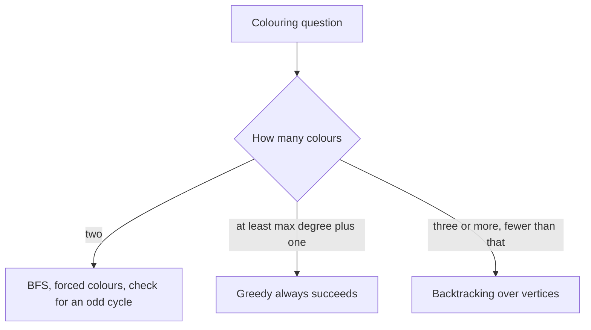

## The hook

A wedding planner must give every guest a table colour so that no two rivals share one. With enough colours it is easy. With exactly three, it might be impossible, and checking can take a long time.

That is graph colouring: guests are vertices and rivalries are edges. It shows up in exam timetables, radio frequencies and compilers' register allocation. With three or more colours there is no known fast general method, so backtracking is the standard exact approach, and spotting the easy special cases is half the skill.

## The problem

Given an undirected graph and a number m, decide whether its vertices can be given colours 1 to m so that no edge joins two vertices of the same colour: the [[m-colouring problem]]. If yes, produce such a [[proper colouring]].

| Graph | m = 2 | m = 3 |
|---|---|---|
| a cycle of 5 vertices, 0 – 1 – 2 – 3 – 4 – 0 | impossible | possible, for example 1, 2, 1, 2, 3 |
| a cycle of 6 vertices | possible, alternate the colours | possible |
| a triangle | impossible | possible |

## The obvious approach

Try all m^V colour assignments and check each one: 3^20 is about 3.5 billion for 20 vertices. Almost every assignment fails on its very first edges, so checking complete assignments wastes nearly all the work.

## The key insight

:::analogy
Picture the planner seating guests one at a time in a fixed order. For each guest she looks only at the rivals already seated and picks the first table colour none of them has. If every colour is taken by some seated rival, she has made a mistake earlier: she goes back to the previous guest, moves them to their next possible colour, and carries on.
:::

That is backtracking over vertices:

- **Order:** colour vertices 0, 1, 2, ... in turn.
- **Choose:** for vertex v, try colours 1 to m that no already-coloured neighbour has.
- **Explore:** recurse to v + 1. If every vertex gets a colour, done.
- **Undo:** if no colour works further down, clear v's colour and try the next one.

The check is cheap, because it looks only at v's neighbours, and it prunes early, because a clash ends a branch the moment it appears rather than after all vertices are coloured.

### Two cases that need no backtracking

- **Two colours.** In a connected graph, once one vertex is coloured, each neighbour's colour is forced, then theirs, and so on. A breadth-first search colours everything or finds an edge whose ends got the same colour. The graph is 2-colourable exactly when it is a [[bipartite graph]], which means it has no odd cycle. This is polynomial, O(V + E).
- **Many colours relative to the degree.** [[Greedy colouring]], giving each vertex the first colour its coloured neighbours do not use, always succeeds with maximum [[degree]] plus one colours, because a vertex with d neighbours can be blocked from at most d colours. *Flower Planting With No Adjacent* gives every garden at most 3 neighbours and 4 flower types, so greedy always works.



:::insight
Colour one vertex at a time, checking only its already-coloured neighbours, and undo as soon as a vertex has no colour left. And before searching, check the easy cases: two colours is a BFS, and degree plus one colours always works greedily.
:::

## Walk through an example

The 5-cycle 0 – 1 – 2 – 3 – 4 – 0, with m = 3.

| Vertex | Coloured neighbours | First free colour | Colouring so far |
|---|---|---|---|
| 0 | none | 1 | 1 |
| 1 | 0 has 1 | 2 | 1, 2 |
| 2 | 1 has 2 | 1 | 1, 2, 1 |
| 3 | 2 has 1 | 2 | 1, 2, 1, 2 |
| 4 | 3 has 2, 0 has 1 | 3 | 1, 2, 1, 2, 3 |

It succeeded on the first try, with 6 recursive calls including the final "all coloured" check. The planner never had to go back.

Now the same cycle with m = 2. Vertices 0 to 3 alternate 1, 2, 1, 2, and vertex 4 is next to both a 2 (vertex 3) and a 1 (vertex 0), so it has no colour. The search backs up and tries other choices, but every one fails, and after 9 calls it reports "impossible". That matches the theory: the cycle has odd length, so it is not bipartite.

How many proper 3-colourings does the 5-cycle have in total? Counting all 3⁵ = 243 assignments gives 30, which matches the known formula for cycles, (m − 1)^n + (−1)^n (m − 1) = 2⁵ − 2 = 30.

:::try-this
Add the edge 0 – 2 to the 5-cycle. Is it still 3-colourable, and what does the planner's greedy order give? (Yes. Vertex 0 gets 1, vertex 1 gets 2, vertex 2 is next to 0 and 1 so it gets 3, vertex 3 is next to 2 so it gets 1, and vertex 4 is next to 3 and 0, both 1, so it gets 2. Counting all assignments, 18 proper 3-colourings remain.)
:::

:::warning
Common misconception: "Greedy colouring finds the fewest colours." Greedy uses at most maximum degree plus one colours, but often more than necessary, and the result depends on the vertex order. A bipartite graph needs only 2 colours, yet a bad order can make greedy use many more. Use greedy when the problem guarantees enough colours, and backtracking or BFS when the exact limit matters.
:::

## The code

```pseudo
color(v):
    if v == V: return true
    for c in 1 .. m:
        if no neighbour of v already has colour c:
            col[v] = c
            if color(v + 1): return true
            col[v] = 0                        # undo
    return false

bipartite():                                  # two colours by BFS
    for each uncoloured vertex s: colour it 0 and BFS
        each neighbour gets the other colour; same colour on both ends of an edge means not bipartite
```

```cpp
#include <bits/stdc++.h>
using namespace std;

struct Colouring {
    int n, m, calls = 0;
    vector<vector<int>> adj;
    vector<int> col;
    Colouring(int n, int m, const vector<pair<int, int>>& edges) : n(n), m(m), adj(n), col(n, 0) {
        for (auto [a, b] : edges) adj[a].push_back(b), adj[b].push_back(a);
    }
    bool ok(int v, int c) const {
        for (int u : adj[v]) if (col[u] == c) return false;   // only neighbours matter
        return true;
    }
    bool solve(int v = 0) {
        calls++;
        if (v == n) return true;
        for (int c = 1; c <= m; c++) {
            if (!ok(v, c)) continue;
            col[v] = c;
            if (solve(v + 1)) return true;
            col[v] = 0;                                       // undo
        }
        return false;
    }
};

bool isBipartite(const vector<vector<int>>& g) {
    vector<int> side(g.size(), -1);
    for (int s = 0; s < (int)g.size(); s++) {
        if (side[s] != -1) continue;
        queue<int> q;
        q.push(s), side[s] = 0;
        while (!q.empty()) {
            int v = q.front(); q.pop();
            for (int u : g[v]) {
                if (side[u] == -1) side[u] = side[v] ^ 1, q.push(u);   // forced colour
                else if (side[u] == side[v]) return false;             // odd cycle
            }
        }
    }
    return true;
}

vector<int> gardenNoAdj(int n, const vector<pair<int, int>>& paths) {   // greedy, 4 types
    vector<vector<int>> adj(n + 1);
    for (auto [a, b] : paths) adj[a].push_back(b), adj[b].push_back(a);
    vector<int> type(n + 1, 0);
    for (int v = 1; v <= n; v++) {
        bool used[5] = {};
        for (int u : adj[v]) used[type[u]] = true;
        for (int t = 1; t <= 4; t++) if (!used[t]) { type[v] = t; break; }   // at most 3 are blocked
    }
    return vector<int>(type.begin() + 1, type.end());
}

int main() {
    vector<pair<int, int>> cycle5 = {{0, 1}, {1, 2}, {2, 3}, {3, 4}, {4, 0}};
    Colouring three(5, 3, cycle5), two(5, 2, cycle5);
    cout << three.solve() << ' ';
    for (int c : three.col) cout << c;
    cout << " calls " << three.calls << " | " << two.solve() << " calls " << two.calls << '\n';   // 1 12123 calls 6 | 0 calls 9

    vector<vector<int>> even6 = {{1, 5}, {0, 2}, {1, 3}, {2, 4}, {3, 5}, {4, 0}};
    vector<vector<int>> odd5 = {{1, 4}, {0, 2}, {1, 3}, {2, 4}, {3, 0}};
    cout << isBipartite(even6) << isBipartite(odd5) << '\n';                                     // 10

    for (int t : gardenNoAdj(4, {{1, 2}, {2, 3}, {3, 4}, {4, 1}, {1, 3}})) cout << t;
    cout << '\n';                                                                                // 1232
}
```

The garden test connects garden 1 to 2, 3 and 4, and garden 3 to 1, 2 and 4, so each has 3 neighbours, and the greedy pass still finds four types with no clash. Graph storage is covered in [Every Problem Is a Map of Roads](article:dsa-graph-representation).

## Complexity

- **Backtracking m-colouring: O(m^V × degree) in the worst case,** since each vertex tries up to m colours and each check scans its neighbours. Early clashes prune most branches in practice, but no general polynomial algorithm is known for three or more colours.
- **Bipartite check: O(V + E)** with BFS or DFS.
- **Greedy colouring: O(V + E),** and correct whenever the problem guarantees at least maximum degree plus one colours.

## Common mistakes

- **Checking every vertex instead of only neighbours,** which is slower and easy to get wrong.
- **Forgetting to undo** a colour before trying the next one.
- **Starting BFS only from vertex 0** in a disconnected graph; every component needs its own start.
- **Using greedy when the colour limit is tight,** where it can fail even though a colouring exists.
- **Assuming a 2-colouring exists** without checking for odd cycles.
- **Off-by-one between 0-based and 1-based vertex labels,** common in Flower Planting.

## Practice problems

*Flower Planting With No Adjacent* is greedy colouring made safe by the degree bound. *Is Graph Bipartite?* and *Possible Bipartition* are 2-colouring with BFS or DFS; in the second, "dislikes" are the edges. For a true m-colouring search with m ≥ 3, use the backtracking template from [Chalk Marks You Rub Out on the Way Back](article:dsa-backtracking-template) on small graphs, as in the code above.

## Key takeaways

- Graph colouring gives each vertex one of m colours so that no edge joins two vertices of the same colour.
- Backtracking colours vertices in order, tries only colours no already-coloured neighbour uses, and undoes a colour when the vertices after it cannot be coloured.
- Two colours never need backtracking: a BFS forces every colour, and the graph is 2-colourable exactly when it has no odd cycle.
- Greedy colouring always succeeds with maximum degree plus one colours, which is why it solves Flower Planting With No Adjacent.
- For three or more colours below that bound, no fast general method is known, so backtracking with early clash checks is the standard exact approach for small graphs.
