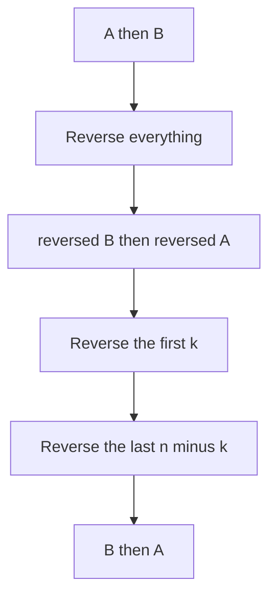

## The hook

Seven friends sit in a cinema row, and the last three must move to the front. There is no spare chair, and people can only swap places. How do you reorder them quickly without a single extra seat?

Interviewers love this kind of constraint. "Rotate the array", "move all zeros to the end", "put positives and negatives in alternate slots", "find which numbers never appeared". Each has an easy answer with a second array. The follow-up is always "now do it in place", and that needs a small set of tricks worth knowing cold.

## The problem

This walkthrough covers four in-place rearrangement tasks that come up again and again:

| Task | Input to output example |
|---|---|
| Rotate right by k | [1, 2, 3, 4, 5, 6, 7], k = 3 → [5, 6, 7, 1, 2, 3, 4] |
| Move zeroes to the end, keeping order | [0, 1, 0, 3, 12] → [1, 3, 12, 0, 0] |
| Alternate signs, keeping order, equal counts | [3, 1, −2, −5, 2, −4] → [3, −2, 1, −5, 2, −4] |
| Find the numbers in 1 to n that never appear | [4, 3, 2, 7, 8, 2, 3, 1] → [5, 6] |

The goal for each is O(n) time, and O(1) extra space wherever that is possible.

## The obvious approach

Build a second array and place everything where it belongs. For rotation, element i goes to index (i + k) mod n. For zeroes, copy the non-zeros, then fill zeros. For signs, put positives at even indices and negatives at odd ones. For missing numbers, use a boolean array or a hash set.

All four are O(n) time but O(n) space. That is often accepted, and for the sign problem it is the expected answer, but the in-place versions show you can reason about where every element goes.

## The key insight

:::analogy
Picture the cinema row again. Instead of moving people one by one, ask the whole row to reverse: the person at the end walks to the start, and so on, by pairs swapping from the outside in. Then ask just the first three seats to reverse among themselves, and then the other four. Three rounds of pair swaps, no spare chair, and everyone is in the rotated order.
:::

Three tools cover almost every in-place rearrangement:

- **Reversal.** Reversing a range needs only swaps from both ends, so it is in-place. Clever combinations of reversals move whole blocks, which is how [[rotation]] works.
- **A [[write pointer]].** One pointer reads every element; another marks where the next kept element goes. Writing in the order you read keeps the result [[stable]].
- **The array as its own notebook.** When values lie in 1 to n, each value names an index. You can either move values to their homes, as in [Every Number Has a Seat With Its Name on It](article:dsa-cyclic-sort), or flip a sign at that index to record "seen", which is [[sign marking]].

### Why three reversals rotate

Split the array into A, the first n − k elements, and B, the last k. Rotating right by k turns AB into BA. Reversing the whole array gives rev(B) rev(A): both blocks are in the right place but each is backwards. Reversing each block on its own fixes them, giving BA.



:::insight
Reversing a whole array and then each part separately swaps the order of the parts while keeping each part's inside order. That is all a rotation is, so three reversals rotate any array in place.
:::

## Walk through an example

### Rotate [1, 2, 3, 4, 5, 6, 7] right by k = 3

Here n = 7, so k mod n = 3, A = [1, 2, 3, 4] and B = [5, 6, 7].

| Step | Range reversed | Array after |
|---|---|---|
| Start | | 1 2 3 4 5 6 7 |
| 1 | all, indices 0 to 6 | 7 6 5 4 3 2 1 |
| 2 | first k, indices 0 to 2 | 5 6 7 4 3 2 1 |
| 3 | the rest, indices 3 to 6 | 5 6 7 1 2 3 4 |

Each element was moved by at most two swaps, so the total work is about n swaps. The cinema row never needed a spare seat.

There is a second in-place method, cyclic replacement: pick up the element at index 0, drop it at (0 + k) mod n, pick up the one that was there, and keep going until you return to the start. The positions split into gcd(n, k) separate cycles. For n = 6 and k = 2 there are two cycles, indices 0 → 2 → 4 → 0 and 1 → 3 → 5 → 1. It is also O(n), but the cycle bookkeeping is easy to get wrong, which is why reversal is the usual interview answer.

### Move zeroes in [0, 1, 0, 3, 12]

The write pointer w starts at 0. Each non-zero value is swapped to index w and w moves on.

| Read index | Value | Action | Array after | w |
|---|---|---|---|---|
| 0 | 0 | skip | 0 1 0 3 12 | 0 |
| 1 | 1 | swap with index 0 | 1 0 0 3 12 | 1 |
| 2 | 0 | skip | 1 0 0 3 12 | 1 |
| 3 | 3 | swap with index 1 | 1 3 0 0 12 | 2 |
| 4 | 12 | swap with index 2 | 1 3 12 0 0 | 3 |

The non-zeros keep their order because they are written in the order they were read. This is the same two-pointer idea as removing duplicates from a sorted array in [Two Fingers on a Sorted List](article:dsa-two-pointers).

### Alternate signs in [3, 1, −2, −5, 2, −4]

*Rearrange Array Elements by Sign* has equal numbers of positives and negatives, wants a positive first, and wants each group in its original order. Keep two write pointers into a result array: positives go to even indices 0, 2, 4, and negatives to odd indices 1, 3, 5.

| Value | Goes to | Result so far |
|---|---|---|
| 3 | index 0 | 3 _ _ _ _ _ |
| 1 | index 2 | 3 _ 1 _ _ _ |
| −2 | index 1 | 3 −2 1 _ _ _ |
| −5 | index 3 | 3 −2 1 −5 _ _ |
| 2 | index 4 | 3 −2 1 −5 2 _ |
| −4 | index 5 | 3 −2 1 −5 2 −4 |

This one uses an O(n) output array, and that is the intended solution. Doing it in place while also keeping both groups stable is much harder: simple swapping breaks the order, and the known in-place methods are far more involved than an interview expects.

### Missing numbers in [4, 3, 2, 7, 8, 2, 3, 1] by sign marking

For each value v (read as abs, since it may already be marked), make a[v − 1] negative. Afterwards, any index that is still positive was never named.

| Read value | Mark index | Array after |
|---|---|---|
| 4 | 3 | 4 3 2 −7 8 2 3 1 |
| 3 | 2 | 4 3 −2 −7 8 2 3 1 |
| 2 | 1 | 4 −3 −2 −7 8 2 3 1 |
| 7 | 6 | 4 −3 −2 −7 8 2 −3 1 |
| 8 | 7 | 4 −3 −2 −7 8 2 −3 −1 |
| 2 | 1, already negative | unchanged |
| 3 | 2, already negative | unchanged |
| 1 | 0 | −4 −3 −2 −7 8 2 −3 −1 |

Indices 4 and 5 stay positive, so 5 and 6 are missing. Unlike cyclic sort, nothing moved, and taking absolute values restores the original array.

:::try-this
Rotate [1, 2, 3, 4, 5, 6] right by k = 8 with three reversals. What is k mod n, and what is the result? (k mod 6 = 2. Reverse all: 6 5 4 3 2 1. Reverse the first 2: 5 6 4 3 2 1. Reverse the last 4: 5 6 1 2 3 4.)
:::

:::warning
Common misconception: "[[In-place]] means no second variable at all." It means O(1) extra memory: a few indices and a temporary for swaps are fine. What is not allowed is memory that grows with n, such as a copy of the array, a hash set of seen values or a recursion stack that is n deep.
:::

## The code

```pseudo
rotate_right(a, k):
    k = k mod n
    reverse a[0 .. n-1]; reverse a[0 .. k-1]; reverse a[k .. n-1]

move_zeroes(a):
    w = 0
    for r in 0 .. n-1:
        if a[r] != 0: swap a[w], a[r]; w += 1

alternate_signs(a):          # equal counts, positive first
    res = array of n; p = 0; q = 1
    for x in a:
        if x > 0: res[p] = x; p += 2
        else: res[q] = x; q += 2
    return res

disappeared(a):              # values in 1..n
    for x in a: v = abs(x); a[v-1] = -abs(a[v-1])
    return every i + 1 with a[i] > 0
```

```cpp
#include <bits/stdc++.h>
using namespace std;

// Rotate right by k with three reversals: AB -> rev(B)rev(A) -> BA.
void rotateRight(vector<int>& a, int k) {
    int n = a.size();
    if (n == 0) return;
    k %= n;
    reverse(a.begin(), a.end());
    reverse(a.begin(), a.begin() + k);
    reverse(a.begin() + k, a.end());
}

// Stable partition of non-zeros to the front with a write pointer.
void moveZeroes(vector<int>& a) {
    int w = 0;
    for (int r = 0; r < (int)a.size(); r++)
        if (a[r] != 0) swap(a[w++], a[r]);
}

// Equal numbers of positives and negatives, positive first, both groups stable.
vector<int> alternateSigns(const vector<int>& a) {
    vector<int> res(a.size());
    int p = 0, q = 1;
    for (int x : a) {
        if (x > 0) res[p] = x, p += 2;
        else res[q] = x, q += 2;
    }
    return res;
}

// Values in 1..n: flip the sign at index v - 1 to record that v was seen.
vector<int> disappeared(vector<int> a) {
    for (int x : a) {
        int v = abs(x);
        a[v - 1] = -abs(a[v - 1]);
    }
    vector<int> missing;
    for (int i = 0; i < (int)a.size(); i++)
        if (a[i] > 0) missing.push_back(i + 1);
    return missing;
}

void print(const vector<int>& v) {
    for (int x : v) cout << x << ' ';
    cout << '\n';
}

int main() {
    vector<int> a = {1, 2, 3, 4, 5, 6, 7};
    rotateRight(a, 3);
    print(a);                                   // 5 6 7 1 2 3 4
    vector<int> b = {1, 2, 3, 4, 5, 6};
    rotateRight(b, 8);
    print(b);                                   // 5 6 1 2 3 4
    vector<int> z = {0, 1, 0, 3, 12};
    moveZeroes(z);
    print(z);                                   // 1 3 12 0 0
    print(alternateSigns({3, 1, -2, -5, 2, -4}));   // 3 -2 1 -5 2 -4
    print(disappeared({4, 3, 2, 7, 8, 2, 3, 1}));   // 5 6
}
```

### Variants you should recognise

- **Rotate left by k** is rotate right by n − k, or reverse the first k, reverse the rest, then reverse all.
- **Unequal counts of positives and negatives** (a common follow-up): alternate while both groups last, then append the leftovers in order. It still uses two lists or two read pointers.
- **Partition by parity** (*Sort Array By Parity*): the move-zeroes loop with the test "is even". If stability does not matter, two pointers moving inward are slightly faster.
- **Reverse the words of a sentence in place:** reverse the whole string, then reverse each word. It is the rotation trick again, with words as blocks.

## Complexity

- **Rotation: O(n) time, O(1) space.** The three reversals together make about n swaps.
- **Move zeroes and parity partition: O(n) time, O(1) space.** One pass with two indices; each element is swapped at most once.
- **Alternating signs: O(n) time, O(n) space** for the output array, which the problem returns anyway.
- **Sign marking: O(n) time, O(1) extra space.** Two passes, and the array can be restored with a third.

## Common mistakes

- **Forgetting k mod n**, which reads past the end when k > n and wastes work when k = n.
- **Reversing in the wrong order or with off-by-one ranges.** Right rotation is reverse all, then [0, k), then [k, n). Draw the AB to BA picture if in doubt.
- **Overwriting before saving** in cyclic replacement, and missing the gcd(n, k) separate cycles, so some elements never move.
- **Breaking stability** by using inward two pointers when the problem asks to keep order, as move zeroes does.
- **Reading a marked value without abs** in sign marking, which turns a negative into an invalid index.
- **Sign marking with zeros or out-of-range values.** −0 is still 0, so marking fails for a value of 0. Use it only when values are 1 to n, or shift them first.
- **Claiming O(1) space while using an output array.** Say clearly which tasks are truly in-place.

## Practice problems

Start with *Rotate Array* using reversal, then write cyclic replacement as a second solution and check it on n = 6, k = 2. *Move Zeroes* and *Sort Array By Parity* are the write-pointer pattern, one stable and one not. *Rearrange Array Elements by Sign* is the two-write-pointer layout into an output array. *Find All Numbers Disappeared in an Array* is sign marking; solve it a second time with cyclic sort and compare. *Reverse Words in a String* applies the reversal trick to words.

## Key takeaways

- Rotating an array right by k is three reversals: the whole array, then the first k elements, then the rest, after reducing k modulo n.
- A read pointer plus a write pointer moves kept elements forward in one pass, and writing in reading order keeps the rearrangement stable.
- When values lie in 1 to n, flipping the sign at index v − 1 records that v was seen without extra memory, and positive entries afterwards mark the missing values.
- Some layouts, such as stable alternating signs, are expected to use an output array, so state clearly which parts of a solution are truly in place.
- In-place means O(1) extra memory, not zero variables, and every in-place trick is a careful plan for where each element goes.
