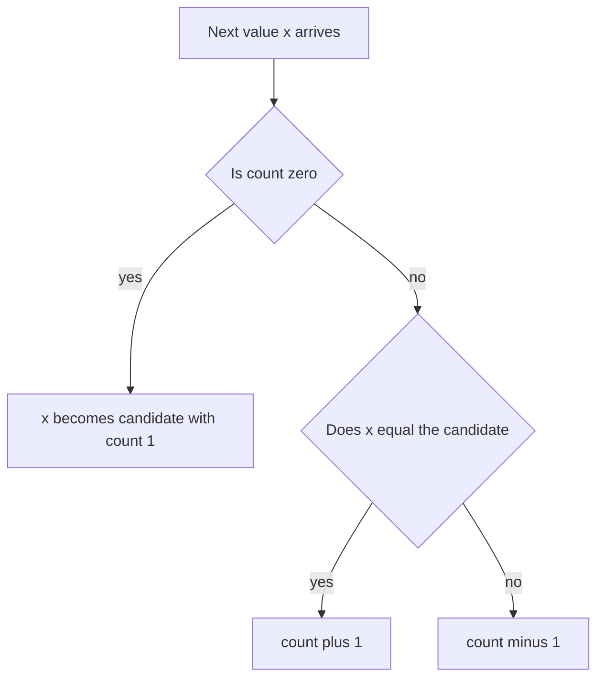

## The hook

A village holds an election and the ballots arrive one at a time on a long paper roll. You may read the roll once, and you have room to remember only one name and one number. Can you still say which name won more than half the votes?

It sounds impossible: surely you need a tally for every name. Yet a two-line rule answers it, and it has a nice extra property: it works on a stream you can never rewind. Robert Boyer and J Strother Moore described this method in 1981. It is now a standard interview question, mainly because the follow-ups test whether you understand why it works.

## The problem

Given an array of n integers, return the [[majority element]]: the value that appears strictly more than n / 2 times. In the classic version the majority is guaranteed to exist. In harder versions it may not, or you must find every value appearing more than n / 3 times.

Cues in a problem that point here:

- "appears more than half the time" or "more than ⌊n/2⌋ times";
- "more than n / 3" or, in general, "more than n / k";
- a follow-up asking for O(1) extra space or a single pass over a stream.

## The obvious approach

| Approach | Idea | Time | Extra space |
|---|---|---|---|
| Count with a hash map | tally every value, return the one above n / 2 | O(n) | O(n) |
| Sort | the majority must cover the middle position, so return a[n / 2] | O(n log n) | O(1) or O(log n) |
| Check every value | count each candidate with another scan | O(n²) | O(1) |

The hash map from [The Notebook That Turns O(n²) Into O(n)](article:dsa-hashing-patterns) is fine in practice and a good first answer. The sorting trick is neat: anything that fills more than half the array must cover the middle slot. But the follow-up is always the same: can you do it in one pass with O(1) extra space?

## The key insight

:::analogy
Picture the election as a rally. Supporters of different candidates walk onto a field one at a time. Whenever two people who support different candidates meet, they shake hands and both leave the field. When the arrivals stop, look at who is still standing. If one candidate had more than half of all the people, their supporters cannot all have been cancelled: each cancellation removes only one of them, and they outnumber everyone else combined.
:::

That is [[pair cancellation]], and it is the whole idea. Removing two different values together never destroys a true majority. If value m appears more than half the time and you remove one m and one non-m, m is still more than half of what is left. If you remove two non-m values, m's share only grows.

You do not even need to track the whole field. Keep one [[candidate]] and a count of their supporters still standing:

- If the count is 0, the field is empty: the arriving value becomes the candidate with count 1.
- If the arriving value equals the candidate, a supporter joins: count + 1.
- Otherwise a rival arrives and cancels one supporter: count − 1.



When the pass ends, the candidate is the only possible majority. But "only possible" is the key phrase: if the array has no majority, someone is still left standing anyway. So when a majority is not guaranteed, you need a [[verification pass]] that simply counts the candidate.

:::insight
A true majority outnumbers all other values combined, so cancelling it one-for-one against rivals can never use it up. The voting pass finds the only value that could be a majority; a second count confirms whether it is.
:::

## Walk through an example

### A majority exists: [2, 2, 1, 1, 1, 2, 2]

The value 2 appears 4 times out of 7, which is more than 3.5.

| Index | Value | Action | Candidate | Count |
|---|---|---|---|---|
| 0 | 2 | field empty, 2 stands up | 2 | 1 |
| 1 | 2 | supporter joins | 2 | 2 |
| 2 | 1 | rival cancels one | 2 | 1 |
| 3 | 1 | rival cancels one | 2 | 0 |
| 4 | 1 | field empty, 1 stands up | 1 | 1 |
| 5 | 2 | rival cancels one | 1 | 0 |
| 6 | 2 | field empty, 2 stands up | 2 | 1 |

The candidate is 2, and counting confirms 4 > 3.5. Notice that the candidate changed twice along the way, and at index 4 the leader was 1. That is fine. The count is not how often the candidate has appeared, it is its surplus over the rivals that cancelled it. The majority wins in the end because it has more people than everyone else put together.

### No majority: [1, 2, 3, 1, 2]

| Index | Value | Action | Candidate | Count |
|---|---|---|---|---|
| 0 | 1 | field empty, 1 stands up | 1 | 1 |
| 1 | 2 | rival cancels one | 1 | 0 |
| 2 | 3 | field empty, 3 stands up | 3 | 1 |
| 3 | 1 | rival cancels one | 3 | 0 |
| 4 | 2 | field empty, 2 stands up | 2 | 1 |

The pass ends with candidate 2, but 2 appears only twice in five. The verification pass rejects it, and the answer is "no majority". At the rally, somebody is always the last one standing, even when nobody had a real crowd.

### Extending to more than n / 3: [1, 1, 2, 3, 2, 1, 2]

At most two values can each take more than n / 3 positions, because three of them would need more than n positions in total. So keep two candidate slots with two counts. A value that matches neither slot, when both slots are occupied, cancels one supporter from each, like a third party shaking hands with one person from each of the two leading camps.

| Value | Action | Slot 1 (value, count) | Slot 2 (value, count) |
|---|---|---|---|
| 1 | slot 1 empty, take it | 1, 1 | empty |
| 1 | supports slot 1 | 1, 2 | empty |
| 2 | slot 2 empty, take it | 1, 2 | 2, 1 |
| 3 | matches neither, cancel one of each | 1, 1 | 2, 0 |
| 2 | matches slot 2's value | 1, 1 | 2, 1 |
| 1 | supports slot 1 | 1, 2 | 2, 1 |
| 2 | supports slot 2 | 1, 2 | 2, 2 |

Both candidates survive. Verification: 1 appears 3 times and 2 appears 3 times, and n / 3 is about 2.33, so both are answers. The general version keeps k − 1 slots to find every value above n / k. It is the Misra-Gries summary used for [[heavy hitter|heavy hitters]] in data streams.

:::try-this
Run the single-candidate pass on [3, 3, 4, 2, 4, 4, 2, 4, 4]. What is the candidate, and is it a majority? (Counts go 1, 2, 1, 0, then 4 takes over: 1, 2, 1, 2, 3. The candidate is 4, which appears 5 times out of 9, more than 4.5, so it is the majority.)
:::

:::warning
Common misconception: "The candidate is the majority." It is only the answer when a majority is guaranteed, as in the basic LeetCode problem. Whenever the statement says the answer might not exist, or asks for values above n / 3, skip the verification and you will return wrong answers on inputs like [1, 2, 3, 1, 2].
:::

## The code

```pseudo
majority_candidate(a):
    cand = none; count = 0
    for x in a:
        if count == 0: cand = x; count = 1
        else if x == cand: count += 1
        else: count -= 1
    return cand

is_majority(a, c): return (number of c in a) * 2 > n

majority_over_third(a):
    slots c1, c2 empty; n1 = n2 = 0
    for x in a:
        if x == c1: n1 += 1
        else if x == c2: n2 += 1
        else if n1 == 0: c1 = x; n1 = 1
        else if n2 == 0: c2 = x; n2 = 1
        else: n1 -= 1; n2 -= 1
    return the slots whose count in a is greater than n / 3
```

```cpp
#include <bits/stdc++.h>
using namespace std;

// Phase 1: pair off different values; a true majority always survives as the candidate.
int candidate(const vector<int>& a) {
    int cand = 0, count = 0;
    for (int x : a) {
        if (count == 0) cand = x, count = 1;   // empty podium: x stands up
        else if (x == cand) count++;           // a supporter joins
        else count--;                          // a rival cancels one supporter
    }
    return cand;
}

// Phase 2: count the candidate, because a candidate always exists but a majority may not.
bool isMajority(const vector<int>& a, int c) {
    return count(a.begin(), a.end(), c) * 2 > (long long)a.size();
}

// More than n/3: keep two candidates with their own counts.
vector<int> majorityThird(const vector<int>& a) {
    int c1 = INT_MIN, c2 = INT_MIN, n1 = 0, n2 = 0;   // INT_MIN: an empty slot, never a real value here
    for (int x : a) {
        if (x == c1) n1++;
        else if (x == c2) n2++;
        else if (n1 == 0) c1 = x, n1 = 1;
        else if (n2 == 0) c2 = x, n2 = 1;
        else n1--, n2--;                          // x cancels one of each
    }
    vector<int> res;
    for (int c : {c1, c2})
        if (count(a.begin(), a.end(), c) * 3 > (long long)a.size()) res.push_back(c);
    return res;
}

int main() {
    vector<int> a = {2, 2, 1, 1, 1, 2, 2};
    int c = candidate(a);
    cout << c << ' ' << isMajority(a, c) << '\n';      // 2 1
    vector<int> b = {1, 2, 3, 1, 2};
    c = candidate(b);
    cout << c << ' ' << isMajority(b, c) << '\n';      // 2 0
    for (int x : majorityThird({1, 1, 2, 3, 2, 1, 2})) cout << x << ' ';
    cout << '\n';                                       // 1 2
    for (int x : majorityThird({3, 2, 3})) cout << x << ' ';
    cout << '\n';                                       // 3
}
```

The order of the checks in `majorityThird` matters: test "matches a slot" before "a slot is empty". Otherwise a value that already owns slot 1 could also grab an empty slot 2, and the same value would occupy both slots.

### Another O(1)-space answer: vote bit by bit

For 32-bit integers, look at each bit position separately. The majority element's bit wins the vote at every position, because it alone supplies more than half the elements. So set bit b of the answer to whichever of 0 or 1 is more common at position b. That is O(32 n) time and O(1) space, and it is a good alternative to mention, though Boyer-Moore is simpler.

## Complexity

- **Voting pass: O(n) time, O(1) space.** One scan with a single candidate and counter.
- **Verification: O(n) time, O(1) space.** One more scan, so the total stays O(n).
- **n / k version: O(n · k) time with a simple scan of k − 1 slots per element, O(k) space.** For k = 3 that is two slots, constant work per element.
- **Why it is correct:** each decrement cancels one candidate supporter against one different value, so the pass is equivalent to repeatedly deleting pairs of different values. A true majority can never be fully deleted that way, so it must be the survivor.

## Common mistakes

- **Skipping verification** when the majority is not guaranteed, as shown by [1, 2, 3, 1, 2].
- **Using ≥ instead of >.** The definition is strictly more than n / 2, so in [1, 1, 2, 2] neither value is a majority.
- **Misreading the count.** It is a surplus, not a frequency, so you cannot report "the majority appears count times" without the verification scan.
- **Wrong check order in the n / 3 version,** letting one value occupy both slots.
- **Integer division traps.** Compare `count * 2 > n` and `count * 3 > n` in integers instead of `count > n / 3` with floating point or truncated division.
- **Forgetting that two answers are possible** for n / 3, and that zero, one or two values may qualify.

## Practice problems

Solve *Majority Element* three ways: hash map, sorting and Boyer-Moore, and say aloud why the middle element works after sorting. *Majority Element II* is the two-slot version with verification. *Minimum Index of a Valid Split* asks for the first place to cut an array so that both halves share the same dominant element: find the overall majority with the voting pass, then sweep once while keeping its count on the left. *Online Majority Element In Subarray* asks the question for many ranges; it needs more machinery, such as random sampling or per-value position lists with binary search, and is a good stretch once the basic pass feels natural.

## Key takeaways

- A majority element appears more than n / 2 times, so it outnumbers all other values combined and survives any one-for-one cancellation.
- Boyer-Moore keeps one candidate and a count: an empty count adopts the new value, a match adds one and a different value subtracts one.
- The pass always produces a candidate, so a second counting pass is needed whenever the majority is not guaranteed to exist.
- For values above n / 3, keep two candidate slots and cancel one supporter from each when a third value arrives; at most two values can qualify.
- The same idea with k − 1 slots finds every value above n / k in a single pass, which is how heavy hitters are tracked in data streams.
