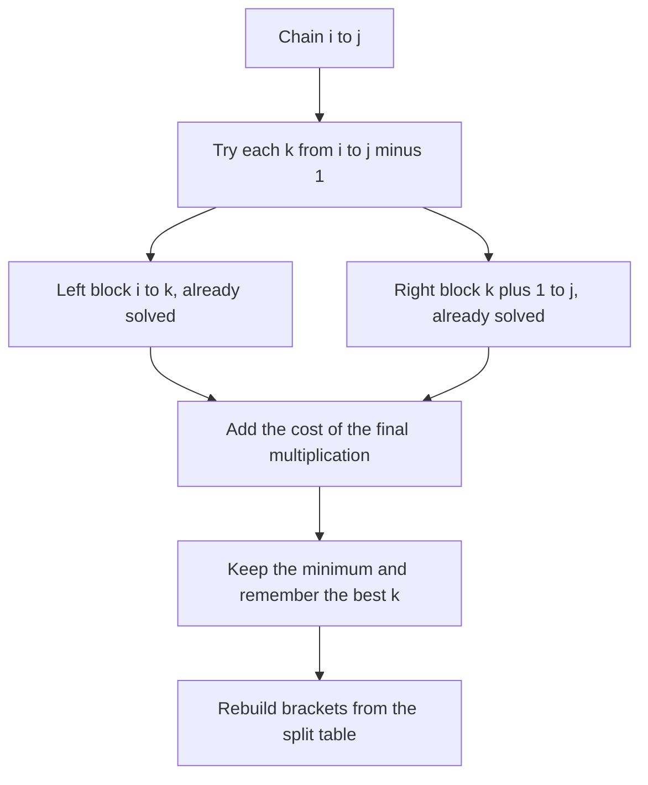

## The hook

A plumber has a row of pipe sections to glue into one long pipe. Gluing two pieces costs an amount that depends on both pieces' end sizes, and the pieces in the row must stay in order. Glue left to right, right to left, or middle first? The final pipe is identical every time, but the bill is not.

Matrix multiplication has exactly this shape. The product of a chain of matrices is the same however you bracket it, yet one bracketing can cost several times more arithmetic than another. Finding the cheapest bracketing is the textbook example of the partition DP, a template that solves a surprising number of interview problems.

## The problem

You are given a [[matrix chain]] of n matrices M1, ..., Mn as a [[dimension array]] d of length n + 1, where Mi is d[i - 1] × d[i]. Multiplying a p × q matrix by a q × r matrix costs p × q × r scalar multiplications. Find the bracketing with the fewest total multiplications.

For d = [4, 10, 3, 12, 20], that is M1 (4 × 10), M2 (10 × 3), M3 (3 × 12), M4 (12 × 20), the answer is 1,080, using ((M1 M2) (M3 M4)).

## The obvious approach

Try every bracketing. The five bracketings of four matrices:

| Bracketing | Cost |
|---|---|
| ((M1 M2) (M3 M4)) | 120 + 720 + 240 = **1,080** |
| (((M1 M2) M3) M4) | 120 + 144 + 960 = 1,224 |
| ((M1 (M2 M3)) M4) | 360 + 480 + 960 = 1,800 |
| (M1 (M2 (M3 M4))) | 720 + 600 + 800 = 2,120 |
| (M1 ((M2 M3) M4)) | 360 + 2,400 + 800 = 3,560 |

The worst costs more than three times the best. But the number of bracketings grows like the Catalan numbers, exponentially, so listing them stops working after about 15 matrices.

## The key insight

:::analogy
Think about the very last glue joint the plumber makes. Whatever happened before, at the end there is one left piece and one right piece, and the joint splits the row at some position k. The left piece was itself built as cheaply as possible from sections i to k, and the right piece from k + 1 to j, and neither knows anything about the other. So try every position for the last joint, add the two cheapest halves and the cost of that final joint, and keep the best.
:::

That is [[partition DP]], the template from [Choosing Which Balloon to Pop Last](article:dsa-interval-dp). [[Associativity]] guarantees every bracketing gives the same matrix, so only the cost matters. Let cost[i][j] be the cheapest way to multiply Mi..Mj:

- cost[i][i] = 0, since a single matrix needs no work;
- cost[i][j] = min over k in [i, j) of cost[i][k] + cost[k+1][j] + d[i - 1] × d[k] × d[j].

The final multiplication joins a d[i - 1] × d[k] block with a d[k] × d[j] block. Fill by increasing chain length, and record the best k in a [[split table]] to rebuild the brackets.

### The same template elsewhere

| Problem | Range | Last operation at k | Its cost |
|---|---|---|---|
| Matrix chain | matrices i..j | multiply (i..k) by (k+1..j) | d[i-1] × d[k] × d[j] |
| Minimum Cost to Cut a Stick | between cut positions p[i] and p[j] | first cut in this piece at p[k] | p[j] - p[i] |
| Polygon triangulation | vertices i..j | triangle (i, k, j) | v[i] × v[k] × v[j] |
| Burst Balloons | open range (l, r) | last balloon k | v[l] × v[k] × v[r] |

In *Minimum Cost to Cut a Stick*, add positions 0 and n to the sorted cuts. The piece between p[i] and p[j] costs its length whichever cut inside it is made first, and the two sides are then independent. In *Minimum Score Triangulation of Polygon*, the edge from vertex i to vertex j belongs to exactly one triangle, (i, k, j), which splits the polygon into two smaller polygons.



:::insight
Every bracketing has a last operation that splits the chain into two independent parts. Trying each split for that last step, with each part already solved optimally, turns an exponential search over bracketings into an O(n³) table.
:::

## Walk through an example

d = [4, 10, 3, 12, 20]: M1 is 4 × 10, M2 10 × 3, M3 3 × 12, M4 12 × 20.

| Chain | Candidates by split | Best |
|---|---|---|
| M1 M2 | 4 × 10 × 3 | 120 |
| M2 M3 | 10 × 3 × 12 | 360 |
| M3 M4 | 3 × 12 × 20 | 720 |
| M1..M3 | k=1: 0 + 360 + 4 × 10 × 12 = 840; k=2: 120 + 0 + 4 × 3 × 12 = 264 | 264, split after M2 |
| M2..M4 | k=2: 0 + 720 + 10 × 3 × 20 = 1,320; k=3: 360 + 0 + 10 × 12 × 20 = 2,760 | 1,320, split after M2 |
| M1..M4 | k=1: 0 + 1,320 + 800 = 2,120; k=2: 120 + 720 + 240 = 1,080; k=3: 264 + 0 + 960 = 1,224 | **1,080**, split after M2 |

The cost table:

| cost[i][j] | j=1 | j=2 | j=3 | j=4 |
|---|---|---|---|---|
| i=1 | 0 | 120 | 264 | 1,080 |
| i=2 | | 0 | 360 | 1,320 |
| i=3 | | | 0 | 720 |
| i=4 | | | | 0 |

Rebuilding: the best split for M1..M4 is after M2, giving (M1 M2) and (M3 M4), each a single multiplication. The answer is ((M1 M2) (M3 M4)), matching the brute-force table.

The 3 in the middle of the dimensions is the reason: splitting after M2 makes the final multiplication 4 × 3 × 20, with the small 3 in the middle.

### Cutting a stick

Length 10, cuts at 2, 4 and 7. With the ends added, positions are 0, 2, 4, 7, 10. The best first cut is at 4 (cost 10), then 2 in the left piece (cost 4) and 7 in the right piece (cost 6), for a total of 20.

### Triangulating a quadrilateral

Vertex values 2, 5, 3, 4. The two triangulations use the diagonal 0–2, giving triangles (0, 1, 2) and (0, 2, 3) with scores 30 + 24 = 54, or the diagonal 1–3, giving (1, 2, 3) and (0, 1, 3) with 60 + 40 = 100. The DP picks 54.

:::try-this
Cut the length-10 stick at 2, 4 and 7, but this time make the first cut at 7. What does it cost, and why is it worse? (Cutting at 7 costs 10. The left piece [0, 7] still needs cuts at 2 and 4: best is 4 first (7), then 2 (4), so 11. The right piece [7, 10] needs nothing. Total 21, one more than cutting at 4 first, because the middle cut leaves two pieces of more equal length.)
:::

:::warning
Common misconception: "Always multiply the pair with the smallest cost first." Greedy fails: in the example, the cheapest single product is M1 M2 at 120. Greedy then multiplies that 4 × 3 result by M3 for 144, which is cheaper than M3 M4 at 720, and is left with a final 4 × 12 × 20 = 960, for 1,224 in total. The best plan, 1,080, pays the expensive-looking 720 up front. A cheap early step can force an expensive later one, which is why every split must be tried.
:::

## The code

```pseudo
matrix_chain(d):                              # n = len(d) - 1 matrices
    cost[i][i] = 0
    for len in 2 .. n:
        for i in 1 .. n - len + 1:
            j = i + len - 1; cost[i][j] = inf
            for k in i .. j-1:
                c = cost[i][k] + cost[k+1][j] + d[i-1] * d[k] * d[j]
                if c < cost[i][j]: cost[i][j] = c; split[i][j] = k
    return cost[1][n]

brackets(i, j):
    if i == j: return "M" + i
    k = split[i][j]
    return "(" + brackets(i, k) + " " + brackets(k+1, j) + ")"
```

```cpp
#include <bits/stdc++.h>
using namespace std;
using ll = long long;

struct MatrixChain {
    vector<vector<ll>> cost;
    vector<vector<int>> split;
    explicit MatrixChain(const vector<ll>& d) {
        int n = d.size() - 1;
        cost.assign(n + 1, vector<ll>(n + 1, 0));
        split.assign(n + 1, vector<int>(n + 1, 0));
        for (int len = 2; len <= n; len++)
            for (int i = 1; i + len - 1 <= n; i++) {
                int j = i + len - 1;
                cost[i][j] = LLONG_MAX;
                for (int k = i; k < j; k++) {                    // last multiplication splits after k
                    ll c = cost[i][k] + cost[k + 1][j] + d[i - 1] * d[k] * d[j];
                    if (c < cost[i][j]) cost[i][j] = c, split[i][j] = k;
                }
            }
    }
    string brackets(int i, int j) const {
        if (i == j) return "M" + to_string(i);
        int k = split[i][j];
        return "(" + brackets(i, k) + " " + brackets(k + 1, j) + ")";
    }
};

int minCostCut(int n, vector<int> cuts) {
    cuts.push_back(0), cuts.push_back(n);
    sort(cuts.begin(), cuts.end());
    int m = cuts.size();
    vector<vector<int>> dp(m, vector<int>(m, 0));
    for (int len = 2; len < m; len++)
        for (int i = 0; i + len < m; i++) {
            int j = i + len;
            dp[i][j] = INT_MAX;
            for (int k = i + 1; k < j; k++) dp[i][j] = min(dp[i][j], dp[i][k] + dp[k][j]);
            dp[i][j] += cuts[j] - cuts[i];                     // the first cut in this piece
        }
    return dp[0][m - 1];
}

int minTriangulation(const vector<int>& v) {
    int n = v.size();
    vector<vector<int>> dp(n, vector<int>(n, 0));
    for (int len = 2; len < n; len++)
        for (int i = 0; i + len < n; i++) {
            int j = i + len;
            dp[i][j] = INT_MAX;
            for (int k = i + 1; k < j; k++)                     // triangle (i, k, j) owns edge i-j
                dp[i][j] = min(dp[i][j], dp[i][k] + dp[k][j] + v[i] * v[k] * v[j]);
        }
    return dp[0][n - 1];
}

int main() {
    MatrixChain mc({4, 10, 3, 12, 20});
    cout << mc.cost[1][4] << ' ' << mc.brackets(1, 4) << '\n';          // 1080 ((M1 M2) (M3 M4))
    cout << minCostCut(10, {2, 4, 7}) << ' ' << minTriangulation({2, 5, 3, 4}) << '\n';   // 20 54
}
```

## Complexity

- **Time: O(n³)** for all three problems: about n²/2 ranges, each trying up to n splits.
- **Space: O(n²)** for the cost and split tables.
- **Minimum Cost to Cut a Stick:** n here is the number of cuts plus two, not the stick length, which can be huge.
- **Faster special cases exist,** such as the Knuth optimisation for some partition DPs, but O(n³) is the expected interview answer.

## Common mistakes

- **Filling by i and j directly** instead of by increasing length, which reads unfinished cells.
- **Off-by-one in the dimension array:** Mi is d[i - 1] × d[i], and the final multiplication for split k costs d[i - 1] × d[k] × d[j].
- **Forgetting to add 0 and n** to the cut positions, or forgetting to sort them.
- **Using int for costs** of large matrices; products of three dimensions overflow quickly.
- **Greedy choices,** such as multiplying the cheapest pair first, which miss the optimum.
- **Sizing Minimum Cost to Cut a Stick by the stick length,** which can be up to 10⁶, instead of by the number of cuts.

## Practice problems

*Minimum Cost to Cut a Stick* is the template with cut positions as boundaries. *Minimum Score Triangulation of Polygon* is the template on a polygon, where the edge i–j picks its triangle. *Burst Balloons* is the same shape with the last-action twist, explained in [Choosing Which Balloon to Pop Last](article:dsa-interval-dp).

## Key takeaways

- The order of multiplying a chain of matrices changes the cost but not the result, because matrix multiplication is associative.
- Every bracketing ends with one final multiplication that splits the chain into two independent parts.
- cost[i][j] is the minimum over k of cost[i][k] + cost[k+1][j] + d[i-1] × d[k] × d[j], filled by increasing chain length in O(n³).
- Storing the best split for each range lets you rebuild the optimal bracketing recursively.
- Cutting a stick, triangulating a polygon and bursting balloons use the same partition template with a different cost for the final step.
