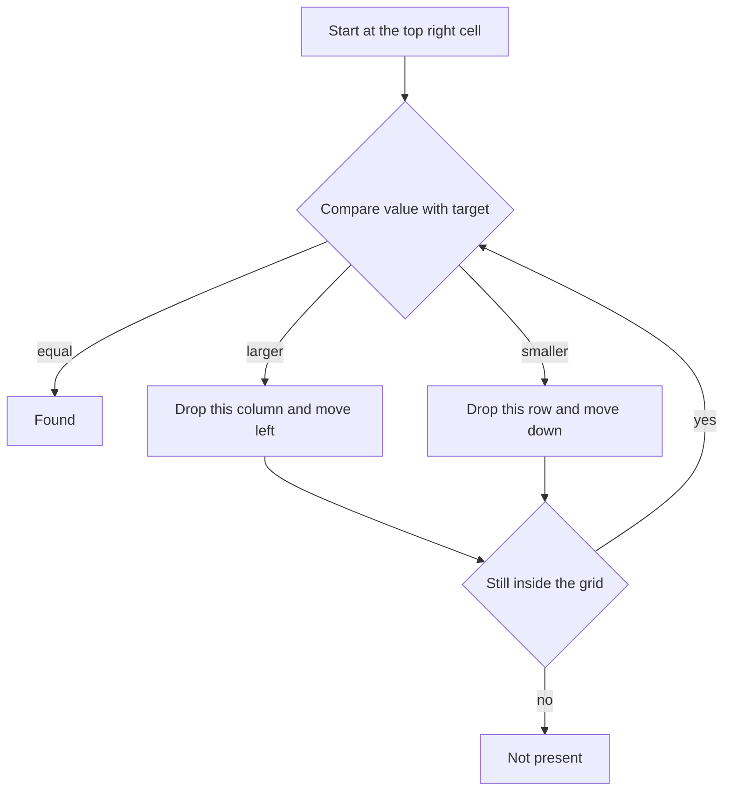

## The hook

"Print this matrix in spiral order" sounds like a warm-up. Then you write it and the output for a 3 by 4 grid repeats a 6, or a single-row matrix comes out doubled, or the code walks off the edge. Grid problems are rarely about a clever algorithm. They are about keeping four boundaries straight while the grid shrinks under you.

Interviewers like them for exactly that reason: they show whether you can control indices under pressure. Learn a handful of moves, such as shrinking bounds, transpose plus reverse, using the grid as its own scratch space and the staircase walk, and most matrix questions become a matter of picking the right move.

## The intuition

:::analogy
Think of peeling an onion. You remove the outer skin all the way round, and what is left is a smaller onion of the same shape. You peel that, and so on, until nothing or a single thin piece is left. You never touch the inner layers while peeling the outer one, and you always know where the current outer skin is.
:::

A matrix works the same way. Its outer ring is a [[layer]]: the top row, the right column, the bottom row and the left column. Once you have walked it, the remaining matrix is smaller by one row at the top and bottom and one column at each side. Keep four numbers, `top`, `bottom`, `left` and `right`, that describe the current onion, and every layer problem becomes "do something to the skin, then move the four walls inward".

The other moves below use the same discipline: know exactly which rows and columns are still in play, and update that knowledge right after you use it.

## How it works

### Move 1: spiral order with four walls

Start with `top = 0`, `bottom = m − 1`, `left = 0`, `right = n − 1`. While `top ≤ bottom` and `left ≤ right`, peel one layer:

| Step | Walk | Then |
|---|---|---|
| Top row | columns left to right on row `top` | `top++` |
| Right column | rows top to bottom on column `right` | `right--` |
| Bottom row, only if `top ≤ bottom` | columns right to left on row `bottom` | `bottom--` |
| Left column, only if `left ≤ right` | rows bottom to top on column `left` | `left++` |

The two "only if" checks are the whole difficulty. After the first two walks, the layer may have been just one row or one column thick. Walking the bottom row or left column again would visit cells a second time.

### Move 2: rotate a square matrix in place

Rotating 90 degrees clockwise sends the value at row i, column j to row j, column n − 1 − i. Doing that directly needs care with four-way swaps around each layer. A cleaner way splits it into two simple in-place steps:

- **Step 1, [[transpose]]:** swap (i, j) with (j, i) for every i < j, so rows become columns.
- **Step 2, reverse every row:** the first column ends up on the right.

| Rotation | Steps |
|---|---|
| 90° clockwise | transpose, then reverse each row |
| 90° counter-clockwise | transpose, then reverse the order of the rows |
| 180° | reverse each row, then reverse the order of the rows |

Only swap for j > i during the transpose. Looping over all j swaps each pair twice and puts everything back.

### Move 3: the grid as its own notebook

*Set Matrix Zeroes* asks: wherever a cell is 0, set its whole row and column to 0. The easy version records which rows and columns to clear in two extra arrays, O(m + n) space. The follow-up asks for O(1).

The trick is an [[in-place marker]]: use row 0 and column 0 as those two arrays. If cell (i, j) is 0, write 0 into (i, 0) and (0, j). The catch is that cell (0, 0) would have to mark both row 0 and column 0, so keep one extra boolean for "column 0 itself must be cleared". Then clear cells using the marks, working from the bottom-right so the marks in row 0 are read before row 0 itself is overwritten.

### Move 4: the staircase search

*Search a 2D Matrix II* has every row sorted left to right and every column sorted top to bottom. Binary search on each row costs O(m log n). The [[staircase search]] does better by starting at the top-right corner, where one direction gets smaller and the other gets larger:

- If the value equals the target, you are done.
- If it is larger, every value below it in this column is larger still, so drop the column: move left.
- If it is smaller, every value to its left in this row is smaller still, so drop the row: move down.



Each step removes a whole row or column, so it takes at most m + n steps. Starting at the top-left fails, because both directions increase and you cannot tell which way to go.

### Move 5: neighbours with direction arrays

Flood fills, island counts and simulations like *Game of Life* look at the neighbours of a cell. A [[direction array]] avoids four or eight copies of the same code:

```cpp partial
int dr[] = {-1, 0, 1, 0}, dc[] = {0, 1, 0, -1};   // up, right, down, left
for (int d = 0; d < 4; d++) {
    int nr = r + dr[d], nc = c + dc[d];
    if (nr < 0 || nr >= m || nc < 0 || nc >= n) continue;   // off the grid
    // use (nr, nc)
}
```

For eight neighbours, add the four diagonals. The same arrays drive the "turn right when blocked" style of spiral used in *Spiral Matrix II*, where you fill the matrix by walking and turning.

:::insight
Most matrix bugs are not about the idea but about stale bounds. Update a boundary the moment you finish using it, and re-check that the region is still non-empty before every walk.
:::

## Walk through an example

### Spiral of a 3 by 4 matrix

```text
 1  2  3  4
 5  6  7  8
 9 10 11 12
```

| Pass | Walk | Cells output | Walls afterwards (top, bottom, left, right) |
|---|---|---|---|
| 1 | top row 0, columns 0 to 3 | 1 2 3 4 | 1, 2, 0, 3 |
| 1 | right column 3, rows 1 to 2 | 8 12 | 1, 2, 0, 2 |
| 1 | bottom row 2, columns 2 to 0 (top ≤ bottom holds) | 11 10 9 | 1, 1, 0, 2 |
| 1 | left column 0, rows 1 to 1 (left ≤ right holds) | 5 | 1, 1, 1, 2 |
| 2 | top row 1, columns 1 to 2 | 6 7 | 2, 1, 1, 2 |
| 2 | right column 2, rows 2 to 1 | nothing | 2, 1, 1, 1 |
| 2 | bottom row: top ≤ bottom fails, skipped | nothing | 2, 0, 1, 1 |
| 2 | left column: rows 0 down to 2 | nothing | 2, 0, 2, 1 |

Output: 1 2 3 4 8 12 11 10 9 5 6 7. Now look at the skipped step. Without the check, the bottom-row walk would use row 1, columns 1 to 1, and print 6 a second time. In onion terms, the inner layer was a single thin strip; once you peeled it from the top, there was no separate bottom skin left.

### Rotating a 3 by 3 matrix

| Stage | Matrix, row by row |
|---|---|
| Start | 1 2 3 / 4 5 6 / 7 8 9 |
| After transpose | 1 4 7 / 2 5 8 / 3 6 9 |
| After reversing each row | 7 4 1 / 8 5 2 / 9 6 3 |

Check one cell against the formula: 1 started at (0, 0) and should land at (0, 2). It does.

### Set zeroes on a 3 by 4 matrix

```text
1 1 1 1
1 0 1 1
1 1 1 0
```

The 0 at (1, 1) marks row 1 (cell (1, 0)) and column 1 (cell (0, 1)). The 0 at (2, 3) marks row 2 and column 3. No 0 sits in column 0, so the extra flag stays false. Clearing from the bottom-right using the marks gives:

```text
1 0 1 0
0 0 0 0
0 0 0 0
```

Row 0 keeps its 1s in columns 0 and 2, because no original 0 was in row 0 or in those columns.

### Staircase search for 9, then for 15

```text
 1  4  7 11
 2  5  8 12
 3  6  9 16
10 13 14 17
```

| Step | Cell | Value | Compare with 9 | Move |
|---|---|---|---|---|
| 1 | (0, 3) | 11 | larger | left |
| 2 | (0, 2) | 7 | smaller | down |
| 3 | (1, 2) | 8 | smaller | down |
| 4 | (2, 2) | 9 | equal | found at (2, 2) |

For 15 the walk goes 11, 12, 16, 9, 14 and then steps below the last row: not found, after five steps on a 4 by 4 grid.

:::try-this
Run the spiral walls on a single column [[1], [2], [3]]. Which of the four walks print something, and which "only if" check saves you? (Top row prints 1, right column prints 2 and 3, and the walls become top = 1, bottom = 2, left = 0, right = −1. The bottom-row check passes, but its loop from right = −1 down to left = 0 is empty. The left-column check, left ≤ right, fails, which stops 3 and 2 being printed again.)
:::

:::warning
Common misconception: "If it works on a square matrix, it works." Square inputs hide most boundary bugs. Always test a single row, a single column, a 1 by 1 matrix and a rectangle with an odd number of rows, such as 3 by 4. Those are exactly the cases interviewers try first.
:::

## The code

```pseudo
spiral(g):
    top, bottom, left, right = 0, m - 1, 0, n - 1
    while top <= bottom and left <= right:
        output row top from left to right;        top += 1
        output column right from top to bottom;   right -= 1
        if top <= bottom: output row bottom from right to left
        bottom -= 1
        if left <= right: output column left from bottom to top
        left += 1

rotate_clockwise(g):
    for i, for j > i: swap g[i][j], g[j][i]     # transpose
    reverse every row

set_zeroes(g):
    first_col = any g[i][0] == 0
    for every cell (i, j) with j >= 1 and g[i][j] == 0: g[i][0] = g[0][j] = 0
    for i from m - 1 down to 0:
        for j from n - 1 down to 1: if g[i][0] == 0 or g[0][j] == 0: g[i][j] = 0
        if first_col: g[i][0] = 0

staircase(g, target):
    r, c = 0, n - 1
    while r < m and c >= 0:
        if g[r][c] == target: return (r, c)
        if g[r][c] > target: c -= 1 else: r += 1
    return not found
```

```cpp
#include <bits/stdc++.h>
using namespace std;
using Grid = vector<vector<int>>;

// Spiral: peel the outer layer, then shrink the four walls.
vector<int> spiral(const Grid& g) {
    vector<int> out;
    if (g.empty()) return out;
    int top = 0, bottom = g.size() - 1, left = 0, right = g[0].size() - 1;
    while (top <= bottom && left <= right) {
        for (int c = left; c <= right; c++) out.push_back(g[top][c]);          // top row
        top++;
        for (int r = top; r <= bottom; r++) out.push_back(g[r][right]);        // right column
        right--;
        if (top <= bottom)                                                     // a bottom row is left
            for (int c = right; c >= left; c--) out.push_back(g[bottom][c]);
        bottom--;
        if (left <= right)                                                     // a left column is left
            for (int r = bottom; r >= top; r--) out.push_back(g[r][left]);
        left++;
    }
    return out;
}

// Rotate 90 degrees clockwise in place: transpose, then reverse every row.
void rotateClockwise(Grid& g) {
    int n = g.size();
    for (int i = 0; i < n; i++)
        for (int j = i + 1; j < n; j++) swap(g[i][j], g[j][i]);
    for (auto& row : g) reverse(row.begin(), row.end());
}

// Set zeroes with O(1) extra space: row 0 and column 0 hold the marks.
void setZeroes(Grid& g) {
    int m = g.size(), n = g[0].size();
    bool firstCol = false;
    for (int i = 0; i < m; i++) {
        if (g[i][0] == 0) firstCol = true;
        for (int j = 1; j < n; j++)
            if (g[i][j] == 0) g[i][0] = g[0][j] = 0;
    }
    for (int i = m - 1; i >= 0; i--) {             // bottom-up so row 0 marks are read before row 0 changes
        for (int j = n - 1; j >= 1; j--)
            if (g[i][0] == 0 || g[0][j] == 0) g[i][j] = 0;
        if (firstCol) g[i][0] = 0;
    }
}

// Rows and columns both sorted: start top-right, each step drops a row or a column.
pair<int, int> staircase(const Grid& g, int target) {
    int r = 0, c = g[0].size() - 1;
    while (r < (int)g.size() && c >= 0) {
        if (g[r][c] == target) return {r, c};
        if (g[r][c] > target) c--;     // everything below in this column is even bigger
        else r++;                      // everything left in this row is even smaller
    }
    return {-1, -1};
}

void print(const Grid& g) {
    for (auto& row : g) { for (int x : row) cout << x << ' '; cout << "| "; }
    cout << '\n';
}

int main() {
    Grid a = {{1, 2, 3, 4}, {5, 6, 7, 8}, {9, 10, 11, 12}};
    for (int x : spiral(a)) cout << x << ' ';
    cout << '\n';                                    // 1 2 3 4 8 12 11 10 9 5 6 7
    for (int x : spiral({{1, 2, 3}})) cout << x << ' ';
    cout << '\n';                                    // 1 2 3
    for (int x : spiral({{1}, {2}, {3}})) cout << x << ' ';
    cout << '\n';                                    // 1 2 3

    Grid b = {{1, 2, 3}, {4, 5, 6}, {7, 8, 9}};
    rotateClockwise(b);
    print(b);                                        // 7 4 1 | 8 5 2 | 9 6 3 |

    Grid z = {{1, 1, 1, 1}, {1, 0, 1, 1}, {1, 1, 1, 0}};
    setZeroes(z);
    print(z);                                        // 1 0 1 0 | 0 0 0 0 | 0 0 0 0 |

    Grid s = {{1, 4, 7, 11}, {2, 5, 8, 12}, {3, 6, 9, 16}, {10, 13, 14, 17}};
    auto [r, c] = staircase(s, 9);
    cout << r << ' ' << c << '\n';                   // 2 2
    auto [r2, c2] = staircase(s, 15);
    cout << r2 << ' ' << c2 << '\n';                 // -1 -1

    int dr[] = {-1, 0, 1, 0}, dc[] = {0, 1, 0, -1};  // up, right, down, left
    int cnt = 0;
    for (int d = 0; d < 4; d++) {                    // in-bounds neighbours of corner (0, 0)
        int nr = 0 + dr[d], nc = 0 + dc[d];
        if (nr >= 0 && nr < 3 && nc >= 0 && nc < 4) cnt++;
    }
    cout << cnt << '\n';                             // 2
}
```

### Two related ideas worth knowing

- **Flattening.** A grid stored in [[row-major order]] maps cell (r, c) to index r · n + c and back with r = k / n, c = k % n. That is how *Search a 2D Matrix* (the version where each row starts after the previous row ends) becomes one plain binary search over m · n positions; see [Binary Search Without the Off-by-One Fear](article:dsa-binary-search).
- **Diagonals.** Cells on the same diagonal share r − c; cells on the same anti-diagonal share r + c. Grouping by those keys solves diagonal traversals and the "attacked by a queen" checks of N-Queens.

## Complexity

- **Spiral, rotation, set zeroes:** O(m · n) time, because each cell is visited a constant number of times. Rotation does about n²/2 swaps for the transpose and n²/2 for the reversals.
- **Extra space:** O(1) for all three, not counting the output list for the spiral. Set zeroes reaches O(1) only through the in-place markers.
- **Staircase search:** O(m + n) time, O(1) space. Each step removes a row or a column, and there are only m + n of them.
- **Neighbour scans:** O(1) per cell with direction arrays, so a whole-grid scan is O(m · n).

## Common mistakes

- **Updating the walls in the wrong order.** Increment `top` right after the top row and before the right column, or the corner cell is printed twice.
- **Missing the two "only if" checks** in spiral order, which repeats the middle row or column of a thin layer.
- **Transposing over the whole matrix.** Swapping for all j instead of j > i undoes every swap.
- **Rotating a non-square matrix in place.** An m by n rotation produces an n by m result, so in-place rotation only works for squares.
- **Clearing row 0 too early** in set zeroes, which destroys the column marks before they are read. Process row 0 and column 0 last.
- **Mixing up rows and columns** in bounds checks: `nr < m` and `nc < n`, not the other way round. Rectangles expose this immediately.
- **Starting the staircase at the wrong corner.** Top-left and bottom-right give no decision; only top-right or bottom-left work.

## Practice problems

Start with *Spiral Matrix* and test it on a single row, a single column and a 3 by 4 rectangle.

*Spiral Matrix II* fills a matrix in spiral order, which you can write with the four walls or with direction arrays and a turn when the next cell is filled. *Rotate Image* is transpose plus reverse; try the four-way layer swap too, to see why the two-step method is easier. *Set Matrix Zeroes* is the in-place marker trick.

*Search a 2D Matrix II* is the staircase. *Game of Life* combines direction arrays with in-place updates: encode "was alive, now dead" in spare bits of each cell so you can update the board without a copy.

## Key takeaways

- Most matrix traversals keep four boundaries, top, bottom, left and right, and shrink them right after each edge is used, like peeling an onion one layer at a time.
- In spiral order, re-check that rows and columns remain before walking the bottom row and the left column, or thin layers are visited twice.
- A square matrix rotates 90 degrees clockwise in place by transposing it and then reversing each row.
- When O(1) space is required, the first row and column can store the markers, with one extra flag for the cell they share.
- In a matrix sorted along rows and columns, starting at the top-right corner lets every comparison discard a full row or column, giving an O(m + n) search.
