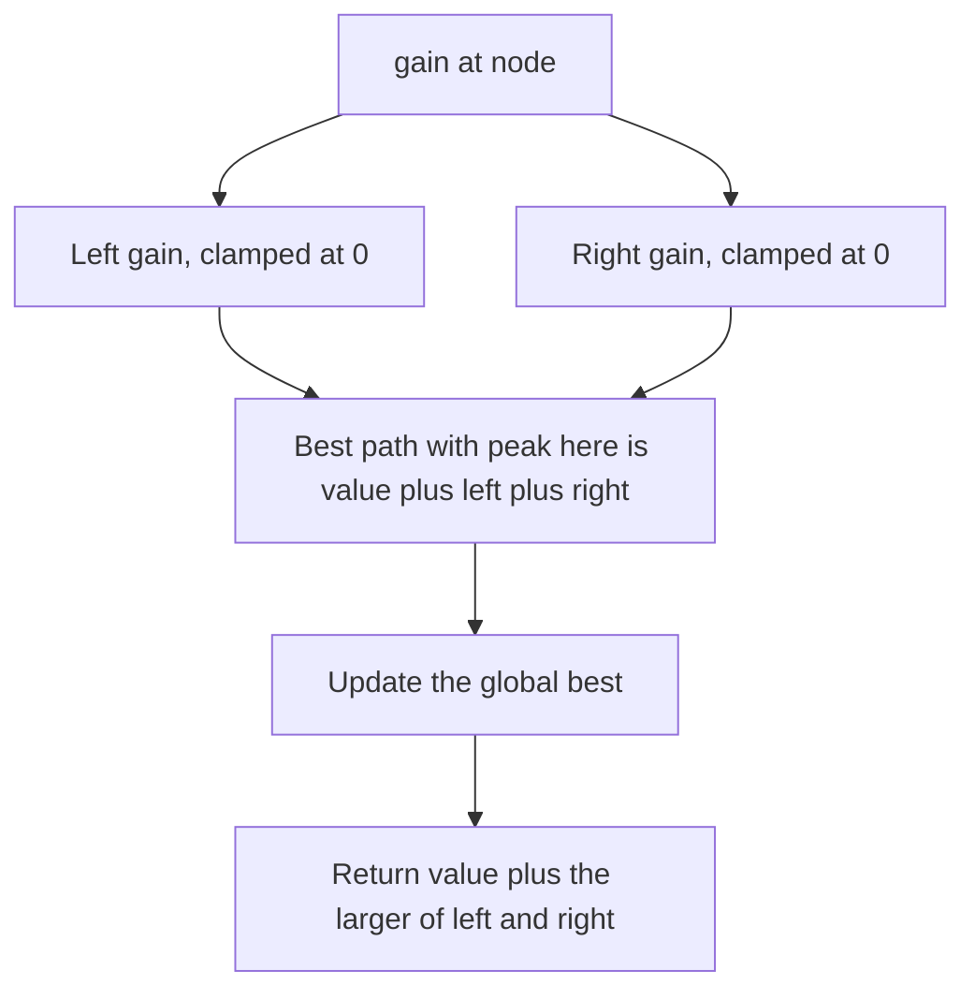

## The hook

A hiker looks at a mountain range drawn as a tree of ridges, each point marked with how pleasant it is to walk past, some negative where the ridge is rocky. She wants the single best walk: start anywhere, end anywhere, never retrace a step. The best walk might climb up one ridge to a peak and come down another, or it might be a short stretch that avoids every rocky point.

*Binary Tree Maximum Path Sum* is that walk, and it is one of the best-known hard tree questions because it combines three traps: the answer can bend through any node, negative values must sometimes be skipped, and a node must return something different from the answer it records.

## The problem

Given a binary tree with integer values, positive or negative, find the maximum sum of any [[path]]. A path is any sequence of connected nodes with no repeats; it need not pass through the root, and it must contain at least one node.

```text
         2
        / \
      -1   3
      / \   \
     4  -6   5
    /
  -8
```

The best path is 4 → −1 → 2 → 3 → 5, with sum 13.

## The obvious approach

Try every pair of nodes as path endpoints, find the path between them and add it up: O(n²) pairs, each path up to O(n), so O(n³). Even computing, for every node, the best path that turns there with separate searches is O(n²). One post-order pass can do it all.

## The key insight

:::analogy
Picture every path as a hike with exactly one highest point, its [[peak]], where it stops climbing and starts descending. Stand at a node and ask two questions. First: if this node were the peak, what is the best walk? It is this node plus the best descent on the left plus the best descent on the right. Second: if a hike comes up from my parent and continues down through me, what is the best I can offer? Only one direction, the better of my two descents, because a hike cannot split in two.
:::

Those two questions give the whole algorithm:

- **The [[gain]] returned to the parent:** value + max(left gain, right gain). This is a one-sided path starting here and going down.
- **The [[two-sided path]] recorded in a global best:** value + left gain + right gain. This is the best path whose peak is this node.
- **[[Clamping at zero]]:** use max(0, child gain). If the best descent into a child is negative, the path is better off stopping here.

Every path has exactly one peak, so trying every node as the peak, in one post-order pass, considers every possible path. This is the same split between "what I return" and "what I record" as the diameter in [Managers Summarising Their Teams' Reports](article:dsa-tree-recursion), with values instead of edge counts.



:::insight
Every path has one highest node. So compute, at each node, the best path that peaks there using both sides, record it, and return only the best one-sided descent to the parent, because a path cannot branch.
:::

## Walk through an example

Post-order on the tree above. L and R are the clamped gains from the children.

| Node | L | R | Two-sided candidate (value + L + R) | Returns (value + max(L, R)) | Global best |
|---|---|---|---|---|---|
| −8 | 0 | 0 | −8 | −8 | −8 |
| 4 | 0 (−8 clamped) | 0 | 4 | 4 | 4 |
| −6 | 0 | 0 | −6 | −6 | 4 |
| −1 | 4 | 0 (−6 clamped) | 3 | 3 | 4 |
| 5 | 0 | 0 | 5 | 5 | 5 |
| 3 | 0 | 5 | 8 | 8 | 8 |
| 2 | 3 | 8 | 13 | 10 | 13 |

The answer is 13, recorded when node 2 was the peak: up from 4 through −1, then down through 3 to 5. Notice the two clamps. The −8 below 4 was skipped because walking there only loses points, and the −6 beside 4 was skipped for the same reason. On the ridge, the hiker simply never walks onto those rocky stretches.

### Edge cases

| Tree | Answer | Why |
|---|---|---|
| a single node −3 | −3 | a path needs at least one node, so start the global best at −∞, not 0 |
| root −2 with child −1 | −1 | the best path is the single node −1 |
| all values positive | sum of the best root-to-leaf-to-leaf bend | clamping never fires |

### The same shape: Longest Univalue Path

*Longest Univalue Path* asks for the longest path, in edges, whose nodes all share one value. The gain from a child counts only if the child has the same value as the node: the arm is child's arm + 1, otherwise 0. Record left arm + right arm, return the longer arm. For a tree 2 with children 2 and 2, where the left 2 has children 2 and 3 and the right 2 has a right child 2, the answer is 4 edges: down-left two steps and down-right two steps through the root.

:::try-this
Change the −6 in the example to 7. What is the new answer? (Node −1 now has gains 4 and 7: it returns −1 + 7 = 6 and records −1 + 4 + 7 = 10. The root records 2 + 6 + 8 = 16, so the answer becomes 16: 7 → −1 → 2 → 3 → 5.)
:::

:::warning
Common misconception: "Return the best path found in the subtree." A parent can only use a path that ends at its child and goes straight down. A two-sided path through the child would make the walk branch at the child, which a path cannot do. Return the one-sided gain and keep the two-sided candidates in a separate global best.
:::

## The code

```pseudo
best = -infinity
gain(node):
    if node is empty: return 0
    l = max(0, gain(node.left))
    r = max(0, gain(node.right))
    best = max(best, node.value + l + r)       # this node as the peak
    return node.value + max(l, r)              # one side only, for the parent
```

```cpp
#include <bits/stdc++.h>
using namespace std;

struct Node {
    int val;
    Node *left = nullptr, *right = nullptr;
    Node(int v, Node* l = nullptr, Node* r = nullptr) : val(v), left(l), right(r) {}
};

long long best;

long long gain(Node* n) {
    if (!n) return 0;
    long long l = max(0LL, gain(n->left));       // skip a negative descent
    long long r = max(0LL, gain(n->right));
    best = max(best, n->val + l + r);            // the path that peaks here
    return n->val + max(l, r);                   // what the parent can extend
}

long long maxPathSum(Node* root) {
    best = LLONG_MIN;                            // at least one node, so not 0
    gain(root);
    return best;
}

int bestUni;
int arm(Node* n) {                               // Longest Univalue Path, in edges
    if (!n) return 0;
    int a = arm(n->left), b = arm(n->right);
    int left = (n->left && n->left->val == n->val) ? a + 1 : 0;
    int right = (n->right && n->right->val == n->val) ? b + 1 : 0;
    bestUni = max(bestUni, left + right);
    return max(left, right);
}

int main() {
    Node* t = new Node(2, new Node(-1, new Node(4, new Node(-8)), new Node(-6)), new Node(3, nullptr, new Node(5)));
    cout << maxPathSum(t) << '\n';                                       // 13
    cout << maxPathSum(new Node(-3)) << ' ' << maxPathSum(new Node(-2, new Node(-1))) << '\n';   // -3 -1
    t->left->right->val = 7;                                             // the try-this change
    cout << maxPathSum(t) << '\n';                                       // 16
    Node* u = new Node(2, new Node(2, new Node(2), new Node(3)), new Node(2, nullptr, new Node(2)));
    bestUni = 0;
    arm(u);
    cout << bestUni << '\n';                                             // 4
}
```

The global best starts at `LLONG_MIN`, which is what makes the single-node −3 case correct. Sums are 64-bit because many large values along a path can exceed 32 bits.

## Complexity

- **Time: O(n).** Each node is visited once in post-order, with O(1) work besides its two recursive calls.
- **Space: O(h)** for the recursion, where h is the tree's height.
- **The brute force,** trying every pair of endpoints, is O(n²) to O(n³).

## Common mistakes

- **Returning the two-sided sum to the parent,** which lets paths branch.
- **Not clamping negative gains,** which forces the path through bad branches.
- **Starting the global best at 0,** which gives 0 for all-negative trees instead of the largest single value.
- **Clamping the returned value instead of the children's gains,** which loses the case where the node itself is negative but its best descent is not needed.
- **Assuming the best path passes through the root.**
- **Overflow** in sums of many large values.

### Interview follow-ups

**"What if the path must start at the root?"** Then no branching is allowed at all: return the best root-to-node descent, which is the same gain function without the global two-sided update.

**"What if the path must go from leaf to leaf?"** Only update the answer at nodes that have both children, and do not clamp gains to 0, because the path must reach real leaves on both sides.

**"Why is this O(n)?"** Each node is visited once and does O(1) work combining its two children's gains; the recursion depth is the tree height.

## Practice problems

*Diameter of Binary Tree* is the same structure with edge counts and no negatives, a good warm-up. *Longest Univalue Path* adds a condition for extending an arm. *Binary Tree Maximum Path Sum* is the full problem with negative values and the all-negative edge case. Once these feel natural, the "return one thing, record another" idea carries over to many tree DP problems, such as the house robber variant on trees in [The Thief Who Never Robs Two Neighbours](article:dsa-house-robber-variants).

## Key takeaways

- Every path in a tree has exactly one highest node, so trying each node as the peak covers every path.
- At each node, the best path peaking there is its value plus the clamped left and right gains, recorded in a global best.
- The node returns only its value plus the larger clamped gain, because a path continuing to the parent cannot use both sides.
- Clamping a child's gain at zero means the path simply does not enter a subtree whose best descent is negative.
- Start the global best at minus infinity, because a path must contain at least one node even when every value is negative.
