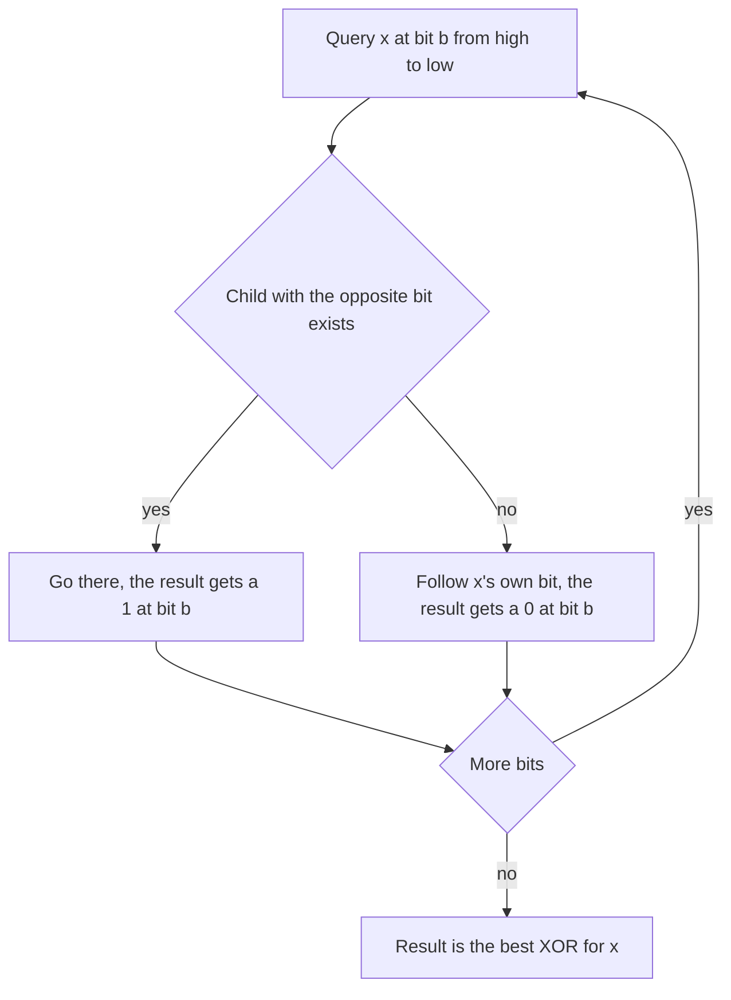

## The hook

You stand at the start of a maze where every junction splits into a left path and a right path, and your goal is to end up as far as possible from a friend who has already walked through. At every fork, the smart move is to go the opposite way from your friend, if that path exists. A difference made early, at the first fork, separates you more than any number of differences made later.

Finding the pair of numbers with the largest XOR is exactly that walk, through a trie of bits. The obvious solution checks every pair, O(n²); the trie does it in O(n × 31).

## The problem

*Maximum XOR of Two Numbers in an Array*: given non-negative integers, return the largest a ^ b over all pairs. For [6, 9, 14, 3, 12], the answer is 15, from 6 ^ 9 or 3 ^ 12.

A harder version, *Maximum XOR With an Element From Array*, gives queries (x, m) and asks for the largest x ^ v over values v ≤ m in the array, or -1 if none.

## The obvious approach

Try every pair: n(n - 1) / 2 XORs. For n = 2 × 10⁵ that is 2 × 10¹⁰ operations, far too slow. Sorting does not help directly: the best partner for a number is not its neighbour in sorted order.

## The key insight

:::analogy
Write each number as a path through a maze of forks: at the first fork go left for a 0 in the highest bit and right for a 1, then the same for the next bit, and so on. Every number already in the array has walked its path. Now a new number x wants the partner farthest away from it. At each fork, it looks for a path going the opposite way from its own bit. If that path exists, it takes it, because being different at a high fork is worth more than being different at every fork below. If not, it has to follow its own direction.
:::

The maze is a [[bitwise trie]]. Querying with x is the [[opposite-bit greedy]]: from the highest bit down, prefer the child with the bit that differs from x's bit. The greedy is safe because a 1 in position b is worth 2^b, while all positions below add up to at most 2^b - 1.

Every number must use the same [[bit width]], so that the same depth always means the same bit position. For values below 2³¹, use bits 30 down to 0.

The full solution for the pair problem:

- insert every number into the trie;
- for each number, walk the trie greedily and record the XOR it achieves;
- the largest of those is the answer.

Inserting first and querying after is fine, because a number's best partner is never itself unless all numbers are equal, in which case the answer is 0 anyway.

### Adding a value limit with offline queries

For queries (x, m) that may only use values ≤ m, deleting from a trie is awkward. Instead, answer [[offline queries]]: sort the array ascending and the queries by m. Sweep the queries in order of m, inserting array values while they are ≤ m, then query the trie with x. If nothing has been inserted yet, the answer is -1. Each value is inserted once.

### The same trie on prefix XORs

CSES *Maximum Xor Subarray* asks for the largest XOR of any contiguous subarray. A subarray's XOR is P[j] ^ P[i] for prefix XORs P, so the answer is the maximum XOR of two prefix values, including P[0] = 0: the same trie walk.

| Problem | Insert | Query with | Answer |
|---|---|---|---|
| Max XOR of two numbers | every number | every number | largest result |
| Max XOR with a limit | numbers ≤ m, in sorted order | x | per query, or -1 |
| Max XOR subarray | prefix XORs as they are computed | the current prefix XOR | largest result |



:::insight
A difference in a higher bit outweighs all lower bits together, so the best XOR partner can be found one bit at a time from the top, always choosing the opposite bit when the trie offers it. That turns a search over all partners into a walk of B steps.
:::

## Walk through an example

Numbers [6, 9, 14, 3, 12] in 4 bits:

| Number | Bits |
|---|---|
| 6 | 0110 |
| 9 | 1001 |
| 14 | 1110 |
| 3 | 0011 |
| 12 | 1100 |

### Query with 6 (0110)

| Bit | 6 has | Want | Available? | Go | Result bit |
|---|---|---|---|---|---|
| 3 | 0 | 1 | yes (9, 14, 12) | 1 | 1 |
| 2 | 1 | 0 | yes (9) | 0 | 1 |
| 1 | 1 | 0 | yes (9) | 0 | 1 |
| 0 | 0 | 1 | yes (9) | 1 | 1 |

Result 1111 = 15, partner 9. Nothing can beat 15 with 4 bits.

### Query with 14 (1110)

| Bit | 14 has | Want | Available? | Go | Result bit |
|---|---|---|---|---|---|
| 3 | 1 | 0 | yes (6, 3) | 0 | 1 |
| 2 | 1 | 0 | yes (3) | 0 | 1 |
| 1 | 1 | 0 | no, 3 has a 1 here | 1 | 0 |
| 0 | 0 | 1 | yes (3) | 1 | 1 |

Result 1101 = 13, partner 3. So 14's best is 13, less than the overall best of 15.

### Queries with limits

Array [2, 7, 11, 4, 9]; queries (x, m): (5, 6), (12, 10), (3, 1), (8, 20).

| Query (sorted by m) | Values inserted so far | Best x ^ v | Answer |
|---|---|---|---|
| (3, 1) | none | | -1 |
| (5, 6) | 2, 4 | 5 ^ 2 = 7 | 7 |
| (12, 10) | 2, 4, 7, 9 | 12 ^ 2 = 14 | 14 |
| (8, 20) | 2, 4, 7, 9, 11 | 8 ^ 7 = 15 | 15 |

Answers in the original order: 7, 14, -1, 15.

:::try-this
For [6, 9, 14, 3, 12], walk the query for 3 (0011). What partner and value does it find? (Bit 3: want 1, available in 9, 14 and 12, so go 1. Bit 2: 3 has 0, want 1: 14 (1110) and 12 (1100) have it, go 1. Bit 1: 3 has 1, want 0: 12 has 0 here, go 0. Bit 0: 3 has 1, want 0: 12 has 0, go 0. Result 1111 = 15 with partner 12.)
:::

:::warning
Common misconception: "The best XOR partner is the number most different in value, such as the largest for a small number." For 3, the largest number, 14, gives 3 ^ 14 = 13, while 12 gives 15. XOR rewards differing bits from the top, not distance in value, which is why the trie walks bit by bit.
:::

## The code

```pseudo
insert(x):
    node = root
    for b in B-1 down to 0:
        bit = (x >> b) & 1
        if child[node][bit] missing: create it
        node = child[node][bit]

best_xor(x):
    node = root; res = 0
    for b in B-1 down to 0:
        bit = (x >> b) & 1
        if child[node][1 - bit] exists: res |= 1 << b; node = child[node][1 - bit]
        else: node = child[node][bit]
    return res
```

```cpp
#include <bits/stdc++.h>
using namespace std;

struct XorTrie {
    static const int B = 31;                           // bits 30..0 cover values below 2^31
    vector<array<int, 2>> ch{{0, 0}};                  // node 0 is the root; 0 also means "none"
    void insert(int x) {
        int v = 0;
        for (int b = B - 1; b >= 0; b--) {
            int bit = (x >> b) & 1;
            if (!ch[v][bit]) ch[v][bit] = ch.size(), ch.push_back({0, 0});
            v = ch[v][bit];
        }
    }
    int bestXor(int x) const {                         // trie must be non-empty
        int v = 0, res = 0;
        for (int b = B - 1; b >= 0; b--) {
            int bit = (x >> b) & 1;
            if (ch[v][bit ^ 1]) res |= 1 << b, v = ch[v][bit ^ 1];   // take the opposite turn
            else v = ch[v][bit];
        }
        return res;
    }
};

int maxXorPair(const vector<int>& a) {
    XorTrie t;
    for (int x : a) t.insert(x);
    int best = 0;
    for (int x : a) best = max(best, t.bestXor(x));
    return best;
}

vector<int> maxXorWithLimit(vector<int> nums, const vector<array<int, 2>>& queries) {
    sort(nums.begin(), nums.end());
    vector<int> order(queries.size()), ans(queries.size(), -1);
    iota(order.begin(), order.end(), 0);
    sort(order.begin(), order.end(), [&](int a, int b) { return queries[a][1] < queries[b][1]; });
    XorTrie t;
    size_t next = 0;
    for (int q : order) {
        auto [x, m] = queries[q];
        while (next < nums.size() && nums[next] <= m) t.insert(nums[next++]);   // offline growth
        if (next > 0) ans[q] = t.bestXor(x);
    }
    return ans;
}

int maxXorSubarray(const vector<int>& a) {
    XorTrie t;
    t.insert(0);                                       // the empty prefix
    int pre = 0, best = 0;
    for (int x : a) pre ^= x, best = max(best, t.bestXor(pre)), t.insert(pre);
    return best;
}

int main() {
    cout << maxXorPair({6, 9, 14, 3, 12}) << '\n';                                 // 15
    for (int r : maxXorWithLimit({2, 7, 11, 4, 9}, {{5, 6}, {12, 10}, {3, 1}, {8, 20}})) cout << r << ' ';
    cout << '\n';                                                                  // 7 14 -1 15
    cout << maxXorSubarray({1, 3, 4, 2}) << '\n';                                  // 7
}
```

The last line uses prefix XORs 0, 1, 2, 6, 4: the best pair is 1 ^ 6 = 7, the subarray [3, 4] whose XOR is 3 ^ 4 = 7.

## Complexity

- **Insert and query: O(B)** each, with B = 31 for values below 2³¹.
- **Max XOR pair: O(n × B) time,** O(n × B) space for up to n × B trie nodes.
- **Queries with limits: O((n + q) log) for sorting plus O((n + q) × B)** for the trie.
- **Max XOR subarray: O(n × B).**

## Common mistakes

- **Mixing bit widths** between insertion and query.
- **Walking bits from low to high,** which breaks the greedy, since lower bits are worth less.
- **Querying an empty trie,** which follows missing children; check that at least one number is present.
- **Deleting from the trie** for value limits, when sorting queries offline is simpler.
- **Forgetting the empty prefix** 0 in the subarray version, which misses subarrays that start at index 0.

## Practice problems

*Maximum XOR of Two Numbers in an Array* is the basic trie walk. *Maximum XOR With an Element From Array* adds the limit, solved by sorting queries offline. CSES *Maximum Xor Subarray* runs the same walk on prefix XORs. The trie itself is in [Autocomplete in Your Pocket](article:dsa-tries), and XOR's properties in [Flip a Switch Twice and Nothing Happened](article:dsa-bit-manipulation-tricks).

## Key takeaways

- A bitwise trie stores each number as a path of its bits from the most significant to the least.
- To maximise x ^ v, walk from the top bit and take the child with the opposite bit whenever it exists.
- The greedy is correct because a 1 in bit b is worth more than all lower bits combined.
- Every number must use the same fixed bit width, so each trie level always means the same bit position.
- Value limits are handled offline by sorting queries by their limit and inserting numbers in increasing order.
