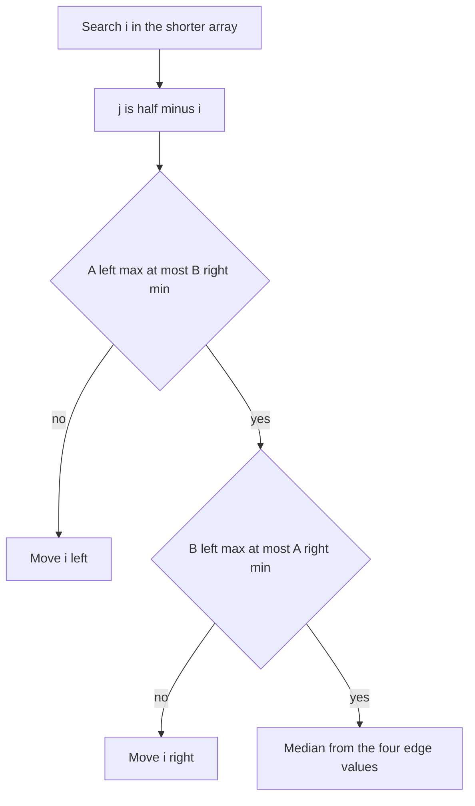

## The hook

You have two sorted lists, one with a million numbers and one with a few hundred, and you want the median of everything combined. Merging them first takes about a million steps. The famous version of this problem demands O(log(m + n)), which for these sizes is a few dozen steps.

It is one of the best-known hard interview questions, and most people's first attempt at a binary search goes wrong. The idea that makes it click is simple: do not search for the median **value**. Search for **where to cut** the two lists.

## The problem

Given two sorted arrays A (length m) and B (length n), return the [[median]] of all m + n elements together. Run in logarithmic time.

| A | B | All values sorted | Median |
|---|---|---|---|
| [1, 3] | [2] | 1 2 3 | 2 |
| [1, 2] | [3, 4] | 1 2 3 4 | (2 + 3) / 2 = 2.5 |
| [1, 3, 8, 9, 15] | [7, 11, 18, 19, 21, 25] | 1 3 7 8 9 11 15 18 19 21 25 | 11 |

## The obvious approach

**Merge, then pick the middle.** Merge the two arrays as in merge sort and read the middle, O(m + n) time. You can stop the merge halfway and keep only two variables, so the space is O(1), but the time is still linear.

**Binary search the value.** Guess a value, count how many elements are below it in each array with two binary searches, adjust. This can be made to work, but it searches over values that may not even be in the arrays, and the even-length case and duplicates make it fiddly.

Both miss the cleaner structure hiding in the problem.

## The key insight

:::analogy
Picture two decks of cards, each already sorted from low to high. You will cut each deck into a left pile and a right pile. Together the two left piles must hold exactly half the cards, and every card in the left piles must be no higher than every card in the right piles. Once you have such a cut, the median is right at the boundary: the highest card on the left, or the average of that and the lowest card on the right.
:::

A [[cut]] of A is just a number i: the first i elements go left. Then the cut of B is forced. If the left side must hold half = (m + n + 1) / 2 elements, B contributes j = half − i. So there is really only **one** unknown, i, and it ranges over 0 to m.

When is a cut correct? Within A, everything left of the cut is already at most everything right of it, because A is sorted; the same holds for B. So only the two cross comparisons can fail. The [[partition condition]] is:

$$A[i-1] \le B[j] \quad \text{and} \quad B[j-1] \le A[i]$$

Here $A[i-1]$ is the largest of A's left part, $A[i]$ the smallest of A's right part, and similarly for B. And the condition tells you which way to move when it fails:

- If $A[i-1] > B[j]$, A has put a card that is too high on the left. Move the cut in A left.
- If $B[j-1] > A[i]$, A has put too few cards on the left, so B's left pile reaches too high. Move the cut in A right.

That is a binary search over i, the cut position, not over values. It is a form of [[binary search on the answer space]].



### Edges and sentinels

When i = 0, A contributes nothing to the left, so $A[i-1]$ does not exist. When i = m, $A[i]$ does not exist. Treat a missing left value as minus infinity and a missing right value as plus infinity. These [[sentinel|sentinels]] make the comparisons automatically true at the edges, so one set of formulas covers every case.

### Why search the shorter array

Choose i in the **shorter** array. Then j = half − i always lands between 0 and the longer array's length, so the cut in the longer deck is always real. Searching the longer array can produce a j outside the shorter array, and the code breaks. It also makes the time O(log min(m, n)).

### Reading off the median

With half = (m + n + 1) / 2, the left side holds the extra element when the total is odd.

- **Odd total:** the median is max(A[i − 1], B[j − 1]), the highest card on the left.
- **Even total:** it is the average of that and min(A[i], B[j]), the lowest card on the right.

:::insight
Turn "find the median" into "find a cut that puts half the elements on the left with nothing on the left larger than anything on the right". Once the cut in one array is chosen, the other is forced, and checking two cross comparisons tells you which way to move.
:::

## Walk through an example

A = [1, 3, 8, 9, 15] (m = 5) and B = [7, 11, 18, 19, 21, 25] (n = 6). A is shorter, so search i from 0 to 5. The total is 11, so half = (11 + 1) / 2 = 6.

| Round | lo, hi | i | j = 6 − i | A[i−1], A[i] | B[j−1], B[j] | Check | Move |
|---|---|---|---|---|---|---|---|
| 1 | 0, 5 | 2 | 4 | 3, 8 | 19, 21 | B[j−1] = 19 > A[i] = 8 | too few from A: lo = 3 |
| 2 | 3, 5 | 4 | 2 | 9, 15 | 11, 18 | 9 ≤ 18 and 11 ≤ 15 | valid cut |

The left piles are [1, 3, 8, 9] from A and [7, 11] from B: six cards, all at most 15 and 18. The total is odd, so the median is max(9, 11) = 11, which matches the sorted list.

Round 1 shows the reasoning. Taking only 2 cards from A forced 4 from B, and B's fourth card, 19, is larger than A's next card, 8. So 19 cannot be on the left while 8 is on the right: A must give more cards to the left.

:::try-this
Find the median of A = [1, 2] and B = [3, 4]. (m = n = 2, half = 2. Try i = 1: j = 1, A's edges are 1 and 2, B's are 3 and 4. B[j−1] = 3 > A[i] = 2, so move right: i = 2, j = 0. Now A's left max is 2 and its right is +∞; B's left is −∞ and its right min is 3. Valid. The total is even, so the median is (max(2, −∞) + min(+∞, 3)) / 2 = 2.5.)
:::

:::warning
Common misconception: "Binary search the median value directly in each array." The median of the combined list need not be the median of either array, and the arrays can have very different lengths. What you can search is a cut position in one array, because it determines the other cut and the check is just two comparisons.
:::

### The general version: the k-th smallest of two sorted arrays

The same cut idea finds the k-th smallest element for any k: require the left side to hold k elements instead of half, so j = k − i, and limit i to the range where j is valid. Another classic approach compares A[k/2 − 1] with B[k/2 − 1] and discards k/2 elements from the array with the smaller value, halving k each round. Both are logarithmic.

The hard follow-up *Kth Smallest Product of Two Sorted Arrays* changes tactics: binary search on the product value, and count how many products are at most that value with a two-pointer pass, taking care with negative numbers. It is the "binary search on the answer, count with a linear pass" pattern from [Guessing the Answer, Then Checking It](article:dsa-binary-search-answer).

## The code

```pseudo
median(A, B):
    if len(A) > len(B): swap A, B             # search the shorter array
    m, n = len(A), len(B); half = (m + n + 1) / 2
    lo, hi = 0, m
    while lo <= hi:
        i = (lo + hi) / 2; j = half - i
        Al = A[i-1] or -inf;  Ar = A[i] or +inf
        Bl = B[j-1] or -inf;  Br = B[j] or +inf
        if Al <= Br and Bl <= Ar:
            if (m + n) is odd: return max(Al, Bl)
            return (max(Al, Bl) + min(Ar, Br)) / 2
        if Al > Br: hi = i - 1                 # too many from A
        else: lo = i + 1                       # too few from A
```

```cpp
#include <bits/stdc++.h>
using namespace std;

double medianSortedArrays(vector<int> A, vector<int> B) {
    if (A.size() > B.size()) swap(A, B);                   // binary search the shorter one
    int m = A.size(), n = B.size(), half = (m + n + 1) / 2;
    const long long NEG = LLONG_MIN, POS = LLONG_MAX;      // sentinels
    int lo = 0, hi = m;
    while (lo <= hi) {
        int i = (lo + hi) / 2, j = half - i;
        long long Al = i > 0 ? A[i - 1] : NEG, Ar = i < m ? A[i] : POS;
        long long Bl = j > 0 ? B[j - 1] : NEG, Br = j < n ? B[j] : POS;
        if (Al <= Br && Bl <= Ar) {
            long long leftMax = max(Al, Bl);
            if ((m + n) % 2) return leftMax;
            return (leftMax + min(Ar, Br)) / 2.0;
        }
        if (Al > Br) hi = i - 1;                           // too many elements from A
        else lo = i + 1;                                   // too few elements from A
    }
    return 0;                                              // not reached for sorted input
}

// k-th smallest (1-based) of two sorted arrays with the same cut idea.
int kthOfTwo(vector<int> A, vector<int> B, int k) {
    if (A.size() > B.size()) swap(A, B);
    int m = A.size(), n = B.size();
    int lo = max(0, k - n), hi = min(k, m);                 // keep j = k - i inside B
    while (lo <= hi) {
        int i = (lo + hi) / 2, j = k - i;
        long long Al = i > 0 ? A[i - 1] : LLONG_MIN, Ar = i < m ? A[i] : LLONG_MAX;
        long long Bl = j > 0 ? B[j - 1] : LLONG_MIN, Br = j < n ? B[j] : LLONG_MAX;
        if (Al <= Br && Bl <= Ar) return max(Al, Bl);
        if (Al > Br) hi = i - 1;
        else lo = i + 1;
    }
    return -1;
}

int main() {
    cout << medianSortedArrays({1, 3}, {2}) << ' '
         << medianSortedArrays({1, 2}, {3, 4}) << ' '
         << medianSortedArrays({1, 3, 8, 9, 15}, {7, 11, 18, 19, 21, 25}) << '\n';   // 2 2.5 11
    cout << medianSortedArrays({}, {5}) << '\n';                                     // 5
    cout << kthOfTwo({1, 3, 8, 9, 15}, {7, 11, 18, 19, 21, 25}, 7) << '\n';          // 15
}
```

The sentinels are 64-bit, below and above every possible 32-bit value, and the even case adds the two middle values in 64-bit before dividing, so two large inputs cannot overflow. An empty array is handled by the same code: with m = 0, the only cut is i = 0, and both of A's edges are sentinels.

## Complexity

- **Time: O(log min(m, n)).** Each round halves the range of possible cuts in the shorter array, which has min(m, n) + 1 positions.
- **Space: O(1).** A few indices and four edge values. The code above copies its arguments for simplicity; passing by reference and swapping roles avoids that.
- **The merge approach** is O(m + n) time and O(1) space, a good first answer to state before optimising.

## Common mistakes

- **Searching the longer array,** which lets j fall outside the shorter one.
- **Missing sentinels** at i = 0, i = m, j = 0 or j = n, which reads out of bounds.
- **Adding two large ints in the even case,** which can overflow 32 bits before the division. Add in 64-bit, as the code does.
- **Moving the cut the wrong way.** If A's left max is too big, move left; if B's left max is too big, move right.
- **Wrong half for odd totals.** With half = (m + n + 1) / 2, the extra element is on the left, so the odd median is the left maximum, not the right minimum.
- **Integer division in the even case,** which truncates 2.5 to 2. Divide by 2.0.

## Practice problems

Warm up with *Merge Sorted Array* and the linear merge, which is a correct O(m + n) median algorithm on its own. Then solve *Median of Two Sorted Arrays* with the cut search, testing an empty array, arrays of very different lengths and arrays with all of A below all of B. *Kth Smallest Element in a Sorted Matrix* and *Kth Smallest Product of Two Sorted Arrays* both use binary search over the answer with a counting pass, the natural next step after this problem.

## Key takeaways

- The median of two sorted arrays is found by choosing a cut in each so the left sides together hold half the elements and nothing on the left exceeds anything on the right.
- Choosing the cut i in one array forces the other, j = half − i, so the search has only one unknown.
- Only two cross comparisons decide whether a cut is valid, and the one that fails says which way to move the cut.
- Binary search over the shorter array keeps j in range and takes O(log min(m, n)) time, with infinities as sentinels at the edges.
- The same cut idea finds the k-th smallest element of two sorted arrays for any k.
