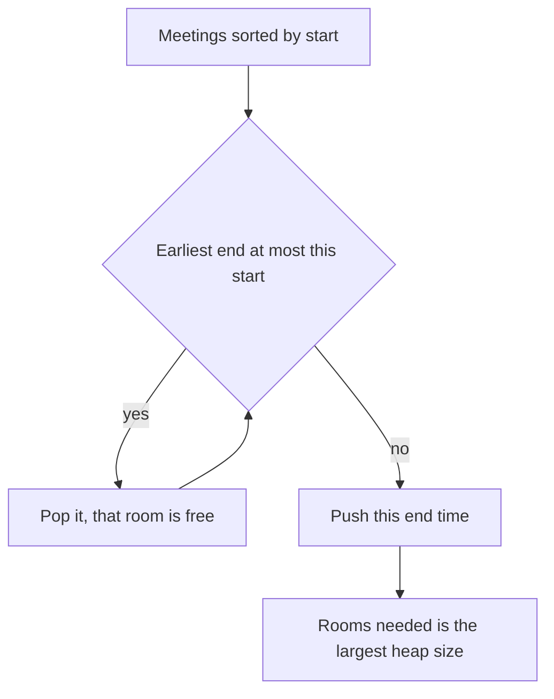

## The hook

A hotel manager has a list of tonight's bookings: when each guest arrives and when they leave. Rooms cost money to prepare, so the manager wants to know the fewest rooms that will hold everyone. Guests do not care which room they get, only that nobody else is in it while they are.

This is one of the most asked interval questions in interviews, usually as "how many meeting rooms do we need?". It has two clean solutions that look nothing alike and always agree.

## The problem

You are given meetings as start and end times. A room holds one meeting at a time, and a meeting that ends at time t frees its room for a meeting starting at t. Return the fewest rooms that can host every meeting.

For meetings [1, 4], [2, 6], [4, 7], [5, 9], [8, 10], [3, 5], the answer is 3.

LeetCode's version, *Meeting Rooms II*, is a premium problem. *Divide Intervals Into Minimum Number of Groups* is the free equivalent, with one twist: its intervals include both endpoints, so touching intervals do clash.

## The obvious approach

Assign meetings one at a time, and for each meeting scan every room to find one that is free. That is O(n × rooms) and needs care about which free room to pick.

A different obvious idea is to check every moment. Count, for each start time, how many meetings are running, and take the largest count. With n meetings that is n checks of n meetings each, O(n²). It gives the right answer, which hints at the key fact, but it is too slow for 100,000 meetings.

## The key insight

:::analogy
The hotel manager keeps a board showing, for every occupied room, the checkout time of its guest. When a new guest arrives, the manager looks only at the earliest checkout on the board. If that guest has already left, the new guest takes that room. If not, nobody has left yet, so every room is busy and a new room must be opened.
:::

The board is an [[end-time heap]]: a min-heap of end times, one per occupied room. Process meetings in order of start time:

- While the earliest end time is at most the new start, pop it: that room is free.
- Push the new meeting's end time: it now occupies a room.
- The heap's size is the number of rooms in use; the answer is the largest size seen.

A slightly leaner version pops at most one room per meeting, because the meeting needs only one room. Its heap size never shrinks, and its final size is the answer. Both versions give the same number.

### Why this is the fewest possible

The answer is the [[maximum overlap]]: the most meetings in progress at a single moment.

- **No schedule can do better.** If k meetings are in progress at one moment, they need k different rooms.
- **The heap never does worse.** The heap opens a new room only when every occupied room's guest is still there at this start time. At that moment, all those meetings and the new one are in progress together, so the overlap is at least the new room count.

### The second view: a sweep of events

Forget rooms and watch the clock. Each meeting becomes two events: +1 at its start, -1 at its end. Sort the events by time and keep a running count; its maximum is the answer. This [[event sweep]] is the method from [A Receptionist Watching the Door](article:dsa-intervals-sweep).

At equal times, the order of events encodes the touching rule. For [[half-open interval]]s, where a meeting ending at 5 frees its room for one starting at 5, process -1 before +1. For closed intervals that clash when they touch, process +1 first.

| View | What it tracks | Answers |
|---|---|---|
| End-time heap | Which rooms are busy and when each frees up | Room count, and which room each meeting gets |
| Event sweep | Only how many meetings are running | Room count, and the busiest moment |



:::insight
The fewest rooms equals the most meetings happening at one moment. The heap proves it constructively by building a schedule that never opens a room it does not need, and the sweep simply measures that moment.
:::

### Which room? Room Allocation

Sometimes you must name the room for each meeting, as in CSES *Room Allocation*. Keep the end-time heap as pairs (end, room id), and a second min-heap of free room ids, the [[free-id heap]]. When rooms free up, move their ids to the free-id heap; give each new meeting the smallest free id, or open a new room if none is free. In the hotel, this is the manager writing each room number next to its guest's checkout time on the board, and keeping a stack of keys for rooms whose guests have already left.

## Walk through an example

Meetings [1, 4], [2, 6], [4, 7], [5, 9], [8, 10], [3, 5], half-open.

### The heap

| Meeting (by start) | Rooms freed (end ≤ start) | End-time heap after | Rooms in use |
|---|---|---|---|
| [1, 4] | none | 4 | 1 |
| [2, 6] | none | 4, 6 | 2 |
| [3, 5] | none | 4, 5, 6 | 3 |
| [4, 7] | the one ending at 4 | 5, 6, 7 | 3 |
| [5, 9] | the one ending at 5 | 6, 7, 9 | 3 |
| [8, 10] | ending at 6 and 7 | 9, 10 | 2 |

The largest size is 3. At time 3.5, meetings [1, 4], [2, 6] and [3, 5] are all running, which confirms 3 is necessary.

### The sweep

| Time | Events, ends first | Running count |
|---|---|---|
| 1 | +1 | 1 |
| 2 | +1 | 2 |
| 3 | +1 | **3** |
| 4 | -1, +1 | 2, then **3** |
| 5 | -1, +1 | 2, then **3** |
| 6 | -1 | 2 |
| 7 | -1 | 1 |
| 8 | +1 | 2 |
| 9 | -1 | 1 |
| 10 | -1 | 0 |

Maximum 3, matching the heap.

### Naming the rooms

| Meeting (by start) | Rooms freed | Room given |
|---|---|---|
| [1, 4] | | 1, new |
| [2, 6] | | 2, new |
| [3, 5] | | 3, new |
| [4, 7] | room 1 | 1 |
| [5, 9] | room 3 | 3 |
| [8, 10] | rooms 2 and 1 | 1, the smallest free id |

:::try-this
Treat the same meetings as closed intervals, so touching counts as a clash, as in *Divide Intervals Into Minimum Number of Groups*. How many groups do you need now? (At time 4, [1, 4] is still in progress when [4, 7] starts, and [2, 6] and [3, 5] are running too: four meetings contain time 4. In the sweep, process +1 before -1 at equal times, and the count reaches 4. The heap version pops only ends strictly less than the start.)
:::

:::warning
Common misconception: "Find the meeting that clashes with the most others; the answer is that count plus one." Clashing with a meeting is not the same as running at the same moment. In [1, 10], [2, 3], [4, 5], [6, 7], the long meeting clashes with three others, which suggests four rooms, but the short ones never overlap each other and two rooms are enough. Only meetings in progress at one shared moment force separate rooms, which is what the heap and the sweep measure.
:::

## The code

```pseudo
min_rooms(meetings):                          # half-open: ends free the room at that time
    sort meetings by start
    ends = min-heap; best = 0
    for [s, e] in meetings:
        while ends not empty and ends.top <= s: ends.pop()
        ends.push(e); best = max(best, size(ends))
    return best

min_rooms_sweep(meetings):
    events = (s, +1) and (e, -1) for each meeting
    sort events by time, -1 before +1 at equal times
    running = 0; best = 0
    for (t, d) in events: running += d; best = max(best, running)
    return best

assign_rooms(meetings):
    busy = min-heap of (end, room); free = min-heap of room ids; next_id = 1
    for [s, e] in meetings sorted by start:
        while busy.top.end <= s: free.push(busy.pop().room)
        room = free.pop() if free else next_id++
        busy.push((e, room))
```

```cpp
#include <bits/stdc++.h>
using namespace std;
using I = array<int, 2>;

int minRoomsHeap(vector<I> m) {
    sort(m.begin(), m.end());                                  // by start
    priority_queue<int, vector<int>, greater<int>> ends;
    int best = 0;
    for (auto& [s, e] : m) {
        while (!ends.empty() && ends.top() <= s) ends.pop();   // rooms freed by now
        ends.push(e);
        best = max(best, (int)ends.size());
    }
    return best;
}

int minRoomsSweep(const vector<I>& m, bool touchingClashes) {
    vector<pair<int, int>> ev;
    for (auto& [s, e] : m) ev.push_back({s, +1}), ev.push_back({e, -1});
    sort(ev.begin(), ev.end(), [&](auto& a, auto& b) {
        if (a.first != b.first) return a.first < b.first;
        return touchingClashes ? a.second > b.second : a.second < b.second;
    });
    int run = 0, best = 0;
    for (auto& [t, d] : ev) run += d, best = max(best, run);
    return best;
}

vector<int> assignRooms(const vector<I>& m) {
    int n = m.size();
    vector<int> order(n), room(n);
    iota(order.begin(), order.end(), 0);
    sort(order.begin(), order.end(), [&](int a, int b) { return m[a] < m[b]; });
    priority_queue<pair<int, int>, vector<pair<int, int>>, greater<>> busy;   // (end, room)
    priority_queue<int, vector<int>, greater<int>> freeIds;
    int nextId = 1;
    for (int i : order) {
        while (!busy.empty() && busy.top().first <= m[i][0])
            freeIds.push(busy.top().second), busy.pop();
        if (freeIds.empty()) room[i] = nextId++;
        else room[i] = freeIds.top(), freeIds.pop();
        busy.push({m[i][1], room[i]});
    }
    return room;
}

int main() {
    vector<I> m = {{1, 4}, {2, 6}, {4, 7}, {5, 9}, {8, 10}, {3, 5}};
    cout << minRoomsHeap(m) << ' ' << minRoomsSweep(m, false) << '\n';    // 3 3
    cout << minRoomsSweep(m, true) << '\n';                                // 4
    for (int r : assignRooms(m)) cout << r << ' ';
    cout << '\n';                                                          // 1 2 1 3 1 3
}
```

The room list is printed in the original input order: [1, 4] got room 1, [2, 6] room 2, [4, 7] room 1, [5, 9] room 3, [8, 10] room 1 and [3, 5] room 3.

## Complexity

- **Heap: O(n log n)** for the sort plus one push and at most one pop per meeting; O(n) space in the worst case, when every meeting overlaps.
- **Sweep: O(n log n)** to sort 2n events, O(n) space.
- **Room assignment: O(n log n)** with two heaps, O(n) space.
- **When times are small integers,** a difference array over the timeline replaces the sort and gives O(n + T) for a timeline of length T.

## Common mistakes

- **Getting the touching rule backwards.** Decide whether [3, 5] and [5, 9] clash, then pick `<=` or `<` in the heap and the matching event order in the sweep.
- **Sorting by end time for the heap method,** which places meetings out of the order they begin.
- **Counting clashes with one meeting** instead of meetings running at one shared moment, which overcounts when a long meeting spans several short ones.
- **Returning the final heap size** in the version that pops all freed rooms; track the maximum size instead, or pop at most one room per meeting.
- **Forgetting stable room ids** when the question asks which room each meeting gets; keep a separate heap of free ids.

## Practice problems

*Divide Intervals Into Minimum Number of Groups* is the free version of the meeting rooms count, with touching intervals clashing. *Car Pooling* is the sweep with passenger counts as weights, and *Restaurant Customers* is the plain maximum overlap. *Room Allocation* asks you to name the rooms. *Meeting Rooms III* adds delays: a meeting with no free room waits for the earliest one, which is the same two-heap idea with time moving forward. For choosing which meetings to attend instead of how many rooms to open, see [Choosing Talks at a Busy Conference](article:dsa-interval-scheduling).

## Key takeaways

- The fewest rooms for a set of meetings equals the maximum number of meetings in progress at one moment.
- A min-heap of end times, processed in order of start, frees every room whose meeting has ended and opens a new room only when none has.
- A sweep of +1 at each start and -1 at each end, sorted by time, measures the same maximum without tracking rooms.
- The touching rule decides the comparison in the heap and the order of equal-time events in the sweep, so settle it before coding.
- A second heap of free room ids turns the count into an assignment that names each meeting's room.
