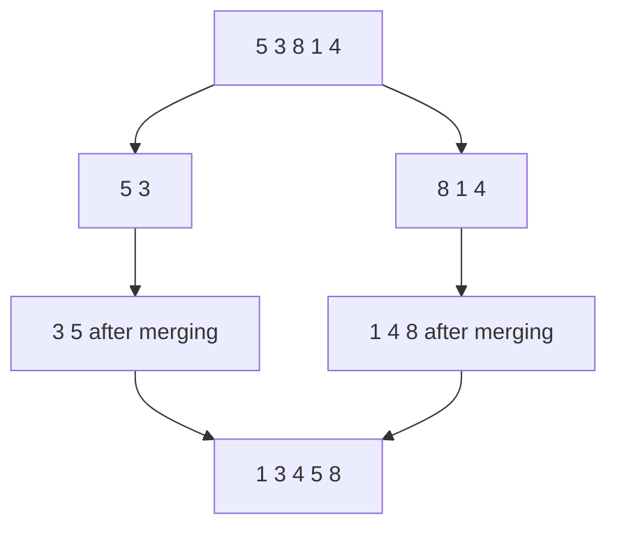

## The hook

Two teachers have each sorted their stack of exam papers by roll number, and now the office needs one sorted stack. Nobody re-sorts from scratch. You put both stacks face up, look at the two top papers, take the smaller one, and repeat. A few seconds later the combined stack is sorted.

That one move, merging two sorted piles, is the heart of merge sort. It also hides a surprise: while merging, you can count how "unsorted" the original array was, which answers interview questions such as "for each number, how many smaller numbers come after it?" in O(n log n) instead of O(n²).

## The intuition

:::analogy
Picture the two sorted piles of exam papers side by side. You compare only the two papers on top. The smaller roll number goes onto the output stack. You never look further down either pile, because everything below the top paper is larger still. When one pile runs out, the rest of the other pile goes on as it is.
:::

That is the [[merge]] step, and it costs one comparison per paper. Merge sort builds a full sort out of it with [[divide and conquer]]:

- split the array in half;
- sort each half, by the same method;
- merge the two sorted halves.

A single paper is already a sorted pile, so the recursion stops there. Everything else is merging.



## How it works

### The merge

Keep one index into each sorted half. Repeatedly copy the smaller front element into a buffer and advance that index. When one half is used up, copy the rest of the other. On ties, take from the left half; that keeps equal elements in their original order and makes merge sort a [[stable sort]].

### Counting inversions while merging

An [[inversion]] is a pair i < j with a[i] > a[j]. A sorted array has none; a reversed array of n elements has n(n − 1)/2. Counting them directly checks every pair, O(n²).

Merge sort counts them almost for free. Every inversion is one of three kinds: both elements in the left half, both in the right half, or a [[cross inversion]] with the larger one on the left. The first two kinds are counted by the recursive calls. The third kind is counted during the merge:

- When the merge takes an element from the **right** half, every element still waiting in the **left** half is larger than it, and each of them came before it in the original array. So add the number of remaining left elements in one step.
- When the merge takes from the left, nothing is added.

In the exam-paper picture: when a paper from the second pile goes out first, every paper still sitting in the first pile "should have come later", and you can count them all by glancing at the pile's height.

:::insight
Sorted halves make counting easy. Once both halves are sorted, one comparison tells you how many left elements are bigger than a right element, so the cross inversions of a whole level are counted in linear time.
:::

### Counting smaller elements after each position

*Count of Smaller Numbers After Self* wants, for every index, how many later elements are smaller. That is the number of inversions each element starts. Sort pairs (value, original index), and when the merge takes a left element, add to its answer the number of right elements already taken: all of them were smaller and came after it.

### Reverse pairs: when the condition differs from the order

*Reverse Pairs* counts i < j with a[i] > 2 · a[j]. The merge compares a[i] with a[j], not with 2 · a[j], so it cannot count on its own. Instead, before merging two sorted halves, run a separate two-pointer pass: for each left element, move a pointer through the right half while the condition holds. Because both halves are sorted, that pointer never moves back, so the extra pass is linear. Then merge normally.

## Walk through an example

### Sorting and counting inversions in [5, 3, 8, 1, 4]

Split at the middle each time: [5, 3] and [8, 1, 4], then [8] and [1, 4].

| Merge | Left | Right | Steps (take, add) | Result | Inversions added |
|---|---|---|---|---|---|
| 1 | [5] | [3] | take 3 from right, 1 left element waiting: add 1 | [3, 5] | 1 |
| 2 | [1] | [4] | take 1, take 4 | [1, 4] | 0 |
| 3 | [8] | [1, 4] | take 1, add 1; take 4, add 1; take 8 | [1, 4, 8] | 2 |
| 4 | [3, 5] | [1, 4, 8] | take 1, add 2; take 3; take 4, add 1; take 5; take 8 | [1, 3, 4, 5, 8] | 3 |

The total is 1 + 0 + 2 + 3 = 6. Check by listing the pairs: (5, 3), (5, 1), (5, 4), (3, 1), (8, 1), (8, 4). Six.

Look at merge 4 closely. When 1 is taken from the right, both 3 and 5 are still waiting on the left, so 2 is added at once. When 4 is taken, only 5 is still waiting, so 1 is added. The merge never compared 1 with 5 or 4 with 5 individually; the pile heights told it.

### Smaller numbers after each element of [5, 2, 6, 1]

| Element | Later smaller elements | Count |
|---|---|---|
| 5 | 2, 1 | 2 |
| 2 | 1 | 1 |
| 6 | 1 | 1 |
| 1 | none | 0 |

The merge-based method produces [2, 1, 1, 0] by crediting each left element with the number of right elements that left before it.

:::try-this
How many inversions does [4, 3, 2, 1] have, and how many does the final merge of [3, 4] and [1, 2] count? (The total is 6, because every pair is inverted. The final merge takes 1 with two left elements waiting, adding 2, and takes 2 with two still waiting, adding 2, so it counts 4. The other 2 come from merging [4] with [3] and [2] with [1].)
:::

:::warning
Common misconception: "Counting inversions needs comparing every pair." Merge sort counts all n(n − 1)/2 possible inversions in O(n log n) because each merge step adds a whole block of them at once. Comparing pairs is only needed if you want to list every inversion, and there can be about n²/2 of those.
:::

## The code

```pseudo
sort_count(a, lo, hi):              # sorts a[lo, hi) and returns its inversions
    if hi - lo <= 1: return 0
    mid = (lo + hi) / 2
    inv = sort_count(a, lo, mid) + sort_count(a, mid, hi)
    i = lo; j = mid; buffer = empty
    while i < mid and j < hi:
        if a[i] <= a[j]: buffer.add(a[i]); i += 1
        else: buffer.add(a[j]); j += 1; inv += mid - i    # all waiting left elements
    add the rest of both halves to buffer
    copy buffer back into a[lo, hi)
    return inv

reverse_pairs_extra_pass(a, lo, mid, hi):   # halves already sorted
    j = mid
    for i in lo .. mid - 1:
        while j < hi and a[i] > 2 * a[j]: j += 1
        count += j - mid
```

```cpp
#include <bits/stdc++.h>
using namespace std;

vector<int> buf;                                       // one buffer, reused by every merge

long long sortCount(vector<int>& a, int lo, int hi) {  // sorts a[lo, hi), returns inversions
    if (hi - lo <= 1) return 0;
    int mid = (lo + hi) / 2;
    long long inv = sortCount(a, lo, mid) + sortCount(a, mid, hi);
    int i = lo, j = mid, k = lo;
    while (i < mid && j < hi) {
        if (a[i] <= a[j]) buf[k++] = a[i++];           // ties from the left keep it stable
        else { buf[k++] = a[j++]; inv += mid - i; }    // every waiting left element is bigger
    }
    while (i < mid) buf[k++] = a[i++];
    while (j < hi) buf[k++] = a[j++];
    copy(buf.begin() + lo, buf.begin() + hi, a.begin() + lo);
    return inv;
}

// Count of Smaller Numbers After Self: merge (value, index) pairs.
void smallerAfter(vector<pair<int, int>>& v, int lo, int hi, vector<int>& ans, vector<pair<int, int>>& tmp) {
    if (hi - lo <= 1) return;
    int mid = (lo + hi) / 2;
    smallerAfter(v, lo, mid, ans, tmp);
    smallerAfter(v, mid, hi, ans, tmp);
    int i = lo, j = mid, k = lo;
    while (i < mid || j < hi) {
        if (j == hi || (i < mid && v[i].first <= v[j].first)) {
            ans[v[i].second] += j - mid;               // right elements already out are smaller
            tmp[k++] = v[i++];
        } else tmp[k++] = v[j++];
    }
    copy(tmp.begin() + lo, tmp.begin() + hi, v.begin() + lo);
}

// Reverse Pairs: an extra two-pointer pass before each merge.
long long reversePairs(vector<long long>& a, int lo, int hi) {
    if (hi - lo <= 1) return 0;
    int mid = (lo + hi) / 2;
    long long cnt = reversePairs(a, lo, mid) + reversePairs(a, mid, hi);
    for (int i = lo, j = mid; i < mid; i++) {
        while (j < hi && a[i] > 2 * a[j]) j++;
        cnt += j - mid;
    }
    inplace_merge(a.begin() + lo, a.begin() + mid, a.begin() + hi);
    return cnt;
}

int main() {
    vector<int> a = {5, 3, 8, 1, 4};
    buf.assign(a.size(), 0);
    long long inv = sortCount(a, 0, a.size());
    for (int x : a) cout << x << ' ';
    cout << "| " << inv << '\n';                       // 1 3 4 5 8 | 6

    vector<int> b = {5, 2, 6, 1}, ans(4, 0);
    vector<pair<int, int>> v, tmp(4);
    for (int i = 0; i < 4; i++) v.push_back({b[i], i});
    smallerAfter(v, 0, 4, ans, tmp);
    for (int x : ans) cout << x << ' ';
    cout << '\n';                                      // 2 1 1 0

    vector<long long> c = {1, 3, 2, 3, 1}, d = {2, 4, 3, 5, 1};
    cout << reversePairs(c, 0, 5) << ' ' << reversePairs(d, 0, 5) << '\n';   // 2 3
}
```

The `smallerAfter` merge takes from the left on ties, so an equal value from the right is not counted as smaller. `reversePairs` stores values as `long long` because `2 * a[j]` can overflow a 32-bit int, and it uses the library's `inplace_merge` for the sorting half of the work.

### Merge sort on linked lists

Merge sort suits linked lists especially well (*Sort List*). Splitting uses the fast and slow pointers from [The Tortoise and the Hare on a Circular Track](article:dsa-fast-slow-pointers) to find the middle, and merging just relinks nodes, so no buffer is needed. It is the usual O(n log n) answer there, because quicksort's random access and heap sort's array layout do not fit lists.

## Complexity

- **Time: O(n log n).** The [[recurrence]] is T(n) = 2T(n/2) + O(n): two half-size problems plus a linear merge. The array is halved about log₂ n times, and each level of the recursion merges n elements in total.
- **Space: O(n)** for the merge buffer, plus O(log n) for the recursion stack. Allocate the buffer once and reuse it; allocating a new vector in every call adds a large hidden cost.
- **Inversion counting, smaller-after and reverse pairs:** still O(n log n), because the counting adds only O(1) per merge step, or one extra linear pass per merge.
- **Stability and predictability:** unlike quicksort, merge sort's O(n log n) is guaranteed for every input, and it is stable.

## Common mistakes

- **Overflow in the inversion count.** A reversed array of 10⁵ elements has about 5 × 10⁹ inversions, more than a 32-bit int holds. Use `long long`.
- **Adding the wrong amount.** When taking from the right, add `mid − i`, the number of left elements still waiting, not `j − mid` or 1.
- **Taking from the right on ties,** which counts equal elements as inversions and also breaks stability.
- **Allocating a new buffer in every call,** which makes the constant factor large and can time out.
- **Off-by-one in half-open ranges.** With [lo, hi), the base case is `hi − lo ≤ 1` and the halves are [lo, mid) and [mid, hi).
- **Counting reverse pairs inside the merge comparisons,** which mixes up two different conditions.

## Practice problems

Start with *Merge Sorted Array*, the merge step alone, then *Sort an Array* with a full merge sort. *Sort List* moves the same idea to linked lists with fast and slow pointers. *Count of Smaller Numbers After Self* is the per-element inversion count with (value, index) pairs. *Reverse Pairs* adds the separate two-pointer counting pass. For a different tool on the same counting question, the ordered set in [A Sorted Shelf That Knows Every Book's Position](article:cp-pbds-ordered-set) answers it online, one element at a time.

## Key takeaways

- Merge sort splits the array in half, sorts each half recursively and merges the two sorted halves by repeatedly taking the smaller front element.
- The recurrence T(n) = 2T(n/2) + n gives O(n log n) time on every input, and taking from the left on ties makes it stable.
- When the merge takes an element from the right half, every element still waiting on the left forms an inversion with it, so whole blocks of inversions are counted at once.
- The same idea gives each element's count of smaller later elements by merging (value, index) pairs.
- When the counting condition differs from the sort order, as in Reverse Pairs, count with a separate two-pointer pass over the sorted halves before merging.
