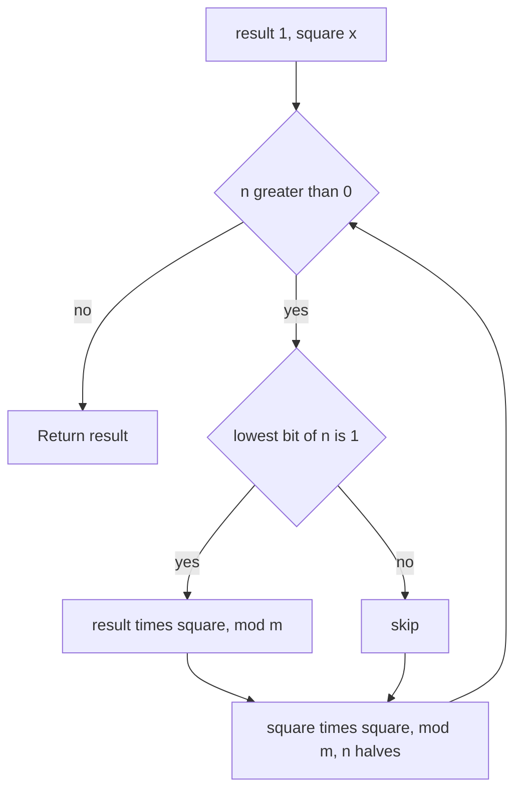

## The hook

"Return the answer modulo 10⁹ + 7" appears in hundreds of problems. The true answer may have thousands of digits, and computing it first overflows long before the end. Done properly, you never hold a number bigger than about 10¹⁸.

The same problems often need a power like 5 to the 10¹⁵. Repeated squaring gets there in about 100 multiplications instead of 10¹⁵. Keeping numbers small and powering by squares show up together constantly.

## The intuition

:::analogy
Picture a 12-hour clock. If it is 9 o'clock and you add 5 hours, the hand points at 2. You never need to know that "really" it is hour 14 since some starting point; the clock only remembers where the hand points. Add 100 hours and the hand moves to the same place as adding 4. A clock can count forever without ever needing a bigger number.
:::

Working [[modular arithmetic|modulo]] m is arithmetic on a clock with m hours. The [[modulus]] m is the number of hours, and every value is just where the hand points: a remainder from 0 to m − 1. The key fact is that adding or multiplying first and then reading the clock gives the same hand position as reading the clock after every step. So you can reduce after every operation and the final answer does not change.

Fast powering is a trick for moving the hand a huge number of steps without taking them one at a time. If you know where x² points, you know x⁴ by squaring that; then x⁸, x¹⁶ and so on. Any exponent is a sum of powers of two, so any power is a product of a few of these squares.

## How it works

### The rules

For non-negative a and b and modulus m:

| Operation | Safe form | Note |
|---|---|---|
| Add | (a + b) mod m | |
| Multiply | (a × b) mod m | a × b must fit before the mod, so use 64-bit |
| Subtract | (a − b + m) mod m | adding m keeps it non-negative |
| Divide by b | a × inverse(b) mod m | only when m is prime and b is not a multiple of m |

Division is the odd one out. You cannot divide remainders directly: 6 / 2 = 3, but on a 4-hour clock 6 points at 2, and 2 / 2 = 1 ≠ 3 mod 4. Instead, multiply by the [[modular inverse]], which exists when m is prime; by Fermat's little theorem it is b^(m − 2) mod m, computed with fast power. The competitive programming article [Doing Maths on a Clock Face](article:cp-modular-arithmetic) covers inverses in depth.

### Why 10⁹ + 7

It is prime, so every non-zero remainder has an inverse. It fits in a 32-bit signed int. And the product of two remainders, at most (10⁹ + 6)², is about 10¹⁸, which fits in a 64-bit signed integer, whose limit is about 9.2 × 10¹⁸. So "multiply two remainders in `long long`, then reduce" never [[overflow|overflows]].

### C++'s negative remainder

C++ division truncates towards zero, so the remainder has the sign of the left operand: −7 % 3 is −1, not 2. If a value can be negative, as after a subtraction, normalise with ((x % m) + m) % m. On the clock, −1 means "one hour before 12", which is the same hand position as 2 on a 3-hour clock.

### Binary exponentiation

To compute x^n mod m with [[binary exponentiation]], look at n in binary. Keep a "current square", starting at x, and a result, starting at 1. For each bit of n from the lowest:

- if the bit is 1, multiply the result by the current square;
- square the current square;
- move to the next bit.

The current square runs through x, x², x⁴, x⁸, ..., and the result collects exactly the squares whose bits are set in n. Since n has about log₂ n bits, it takes O(log n) multiplications.



:::insight
Reduce after every operation and the numbers stay smaller than m², however long the computation. Write the exponent in binary and the power is a product of repeated squares, so even an exponent of 10¹⁸ costs about 120 multiplications.
:::

## Walk through an example

### 3¹³ mod 1000

13 in binary is 1101, so 3¹³ = 3⁸ × 3⁴ × 3¹.

| Bit (lowest first) | Current square | Result after this bit |
|---|---|---|
| 1 | 3 | 1 × 3 = 3 |
| 0 | 9 | 3, unchanged |
| 1 | 81 | 3 × 81 = 243 |
| 1 | 6561 mod 1000 = 561 | 243 × 561 = 136323, mod 1000 = 323 |

The answer is 323. Check: 3¹³ = 1,594,323, which ends in 323. Four bits, at most eight multiplications, and no number above 561 × 561 was ever formed.

### Count Good Numbers

A "good" digit string of length n has an even digit (0, 2, 4, 6, 8) at every even index and a prime digit (2, 3, 5, 7) at every odd index. There are ⌈n / 2⌉ even indices and ⌊n / 2⌋ odd ones, so the count is 5^⌈n/2⌉ × 4^⌊n/2⌋ mod 10⁹ + 7. For n = 4 that is 5² × 4² = 400. For n = 50, two fast powers give 564908303. With n up to 10¹⁵, nothing but fast power can do it.

### Super Pow

*Super Pow* asks for a^b mod 1337 where b is given as an array of digits, possibly thousands long. Read b from the left: if the digits so far form x and the next digit is d, then a^(10x + d) = (a^x)^10 × a^d. So keep the running power, raise it to the 10th and multiply by a^d for each digit. For a = 2 and b = [1, 0], the result is 2¹⁰ mod 1337 = 1024.

:::try-this
Compute 2¹⁰ mod 1000 with binary exponentiation. Which squares are multiplied in? (10 is 1010 in binary, so the bits from the lowest are 0, 1, 0, 1. The squares are 2, 4, 16 and 256, and the result multiplies in 4 and 256: 4 × 256 = 1024, which is 24 mod 1000.)
:::

:::warning
Common misconception: "Taking the mod only at the end is fine as long as I use long long." Long long holds about 9.2 × 10¹⁸. The product of three remainders near 10⁹ is already 10²⁷, and a running product over a loop overflows within a few steps. Reduce after every multiplication, not just once at the end.
:::

## The code

```pseudo
power_mod(x, n, m):            # x^n mod m, n >= 0
    result = 1; x = x mod m
    while n > 0:
        if n is odd: result = result * x mod m
        x = x * x mod m
        n = n / 2
    return result

my_pow(x, n):                  # real x, integer n, possibly negative
    if n < 0: x = 1 / x; n = -n    # use a 64-bit n so -n cannot overflow
    same loop without the mod
```

```cpp
#include <bits/stdc++.h>
using namespace std;

const long long MOD = 1'000'000'007;

long long powMod(long long x, long long n, long long m) {   // x^n mod m, n >= 0
    long long result = 1 % m;
    x %= m;
    if (x < 0) x += m;                                       // normalise a negative base
    while (n > 0) {
        if (n & 1) result = result * x % m;                  // this bit is set: use this square
        x = x * x % m;                                       // next square
        n >>= 1;
    }
    return result;
}

double myPow(double x, long long n) {                        // LeetCode Pow(x, n)
    if (n < 0) x = 1 / x, n = -n;                            // n is 64-bit, so -INT_MIN is safe
    double result = 1;
    for (; n > 0; n >>= 1, x *= x)
        if (n & 1) result *= x;
    return result;
}

long long countGoodNumbers(long long n) {
    return powMod(5, (n + 1) / 2, MOD) * powMod(4, n / 2, MOD) % MOD;
}

int superPow(int a, const vector<int>& digits) {
    const int M = 1337;
    long long result = 1;
    for (int d : digits) result = powMod(result, 10, M) * powMod(a, d, M) % M;   // a^(10x + d)
    return result;
}

long long modSub(long long a, long long b, long long m) { return ((a - b) % m + m) % m; }

int main() {
    cout << powMod(3, 13, 1000) << ' ' << powMod(2, 10, 1000) << '\n';      // 323 24
    cout << myPow(2.0, -2) << ' ' << myPow(2.0, 10) << '\n';                // 0.25 1024
    cout << countGoodNumbers(4) << ' ' << countGoodNumbers(50) << '\n';    // 400 564908303
    cout << superPow(2, {1, 0}) << '\n';                                    // 1024
    cout << (-7 % 3) << ' ' << modSub(-7, 0, 3) << '\n';                    // -1 2
    long long inv2 = powMod(2, MOD - 2, MOD);                              // Fermat inverse of 2
    cout << 10 * inv2 % MOD << '\n';                                        // 5
}
```

The last line shows division on the clock: 10 / 2 mod 10⁹ + 7 is computed as 10 times the inverse of 2, and it gives 5, as it should. The CP article [Raising to the Power of a Billion in Thirty Steps](article:cp-binary-exponentiation) extends fast power to matrices and huge exponents.

## Complexity

- **Modular add, subtract, multiply: O(1).**
- **Binary exponentiation: O(log n) multiplications** and O(1) space in the iterative form. A recursive version uses O(log n) stack.
- **Count Good Numbers: O(log n),** two fast powers.
- **Super Pow: O(L)** fast powers with exponents at most 10, so O(L) overall for L digits.

## Common mistakes

- **Overflow before the mod.** `a * b % m` with `int` operands overflows when a and b are near 10⁹; make at least one operand `long long`.
- **Reducing only at the end** of a long product or sum.
- **Negative remainders** after subtraction in C++; add m before the final mod.
- **Pow(x, n) with n = INT_MIN.** Negating it overflows a 32-bit int; copy n into a 64-bit variable first.
- **Forgetting `1 % m`** for the initial result, which matters only when m = 1, where every answer is 0.
- **Dividing remainders directly** instead of multiplying by a modular inverse.
- **Using floating-point pow** for exact integer answers; it loses precision long before 10¹⁸.

## Practice problems

Start with *Exponentiation* on CSES, which is binary exponentiation mod 10⁹ + 7 for many queries. *Pow(x, n)* is the same loop on doubles, with negative exponents and the INT_MIN trap. *Count Good Numbers* combines a small counting argument with two fast powers and a huge n. *Super Pow* processes an exponent given as a digit array, one digit at a time.

## Key takeaways

- Working modulo m keeps only remainders, and reducing after every addition and multiplication gives the same final remainder as computing the exact number.
- 10⁹ + 7 is prime and fits in 32 bits, and the product of two remainders fits in 64 bits, so multiply in long long and reduce immediately.
- In C++, the remainder of a negative number is negative, so normalise with ((x % m) + m) % m.
- Binary exponentiation squares the base repeatedly and multiplies in the squares that match the 1 bits of the exponent, using O(log n) multiplications.
- Division modulo a prime is multiplication by the modular inverse, which Fermat's little theorem gives as b^(m − 2) mod m.
