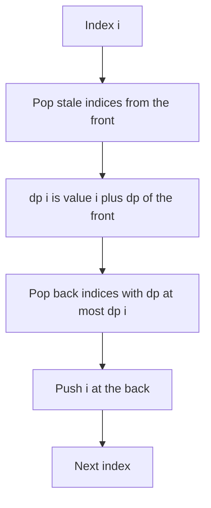

## The hook

A recruiter keeps a shortlist of candidates who applied in the last month and always wants to know the strongest one still eligible. When a new, stronger applicant arrives, every older, weaker candidate on the list is hopeless: they will expire sooner and never beat the newcomer. So the recruiter crosses them off on the spot.

Some DP recurrences ask exactly the recruiter's question at every step: "the best of the last k states". Done directly, that is O(k) per state and O(n × k) overall, which times out when both are 10⁵. Keeping a shortlist of only the candidates that could still win makes each step O(1) on average.

## The intuition

:::analogy
The shortlist is kept in order of arrival, and it is always sorted from strongest at the front to weakest at the back. Two rules keep it that way. When a candidate's month runs out, cross them off the front. When a new candidate arrives, cross off everyone at the back who is no stronger, then add the newcomer at the back. The strongest eligible candidate is then always the one at the front.
:::

The recurrence is a [[window transition]]: dp[i] = value[i] + max(dp[j] for i - k ≤ j < i). The shortlist is a [[monotonic deque]] of indices whose dp values decrease from front to back, the same structure that answers sliding window maximum in [The Queue Where Taller Latecomers Push In](article:dsa-queue-deque).

Two kinds of index leave the deque:

- a [[dominated candidate]] at the back, older and no better than the new index, which can never be the maximum again;
- a [[stale index]] at the front, which has fallen out of the window.

Each index enters once and leaves once, so the whole DP is O(n).

## How it works

### The template

For each i in order:

- pop the front while it is older than i - k;
- dp[i] = value[i] + dp[front] (or the base case if the deque is empty);
- pop the back while dp[back] ≤ dp[i];
- push i.

The order matters: read the front after removing stale indices and before pushing i, because i itself is not a valid predecessor of i.

### Jump Game VI

You start at index 0 of nums, may jump forward 1 to k steps, and your score is the sum of the values you land on, including the first and last. Maximise the score at the last index. dp[i] = nums[i] + max of dp[i-k..i-1]: exactly the template.

### Constrained Subsequence Sum

Pick a non-empty subsequence where consecutive chosen indices are at most k apart; maximise its sum. dp[i] is the best sum of such a subsequence ending at i: dp[i] = nums[i] + max(0, best dp in the last k). The max with 0 means "start fresh at i" when every recent option is negative. The answer is the largest dp[i].

### Shortest Subarray with Sum at Least K

With negative numbers allowed, two pointers fail, because widening a window can lower its sum. Use prefix sums P instead: a subarray (i, j] has sum P[j] - P[i], and we want the smallest j - i with P[j] - P[i] ≥ K.

Keep a deque of indices with increasing P values:

- **pop from the front while P[j] - P[front] ≥ K,** recording j - front: the front has found its best partner, since any later j would be farther away;
- **pop from the back while P[back] ≥ P[j],** because j is a later starting point with a smaller or equal prefix, which is better for every future end;
- push j.

| Problem | Deque holds | Order | Front means |
|---|---|---|---|
| Jump Game VI | indices of dp | decreasing dp | best predecessor in the window |
| Constrained Subsequence Sum | indices of dp | decreasing dp | best predecessor, or start fresh if negative |
| Shortest Subarray ≥ K | indices of prefix sums | increasing P | the oldest useful start |
| Sliding Window Maximum | indices of values | decreasing value | the window maximum |



:::insight
When a DP takes the best of the last k states, older states that are no better than a newer one can never be chosen again. Dropping them keeps a decreasing shortlist whose front is always the answer, and since each state is added and removed once, the transition costs O(1) on average.
:::

## Walk through an example

### Jump Game VI on nums = [2, -5, -1, 3, -4, 6], k = 2

| i | nums[i] | Front after removing stale | dp[i] | Deque after (indices, dp) |
|---|---|---|---|---|
| 0 | 2 | | 2 | [0 (2)] |
| 1 | -5 | 0 | -5 + 2 = -3 | [0 (2), 1 (-3)] |
| 2 | -1 | 0 | -1 + 2 = 1 | [0 (2), 2 (1)], popped 1 |
| 3 | 3 | 0 is stale (3 - 2 = 1 > 0), front 2 | 3 + 1 = 4 | [3 (4)], popped 2 |
| 4 | -4 | 3 | -4 + 4 = 0 | [3 (4), 4 (0)] |
| 5 | 6 | 3 | 6 + 4 = 10 | [5 (10)], popped 4 and 3 |

The best score is 10, along 0 → 2 → 3 → 5: 2 - 1 + 3 + 6. Index 1 (dp -3) was crossed off the shortlist as soon as index 2 (dp 1) applied: an older, weaker candidate that could never be the strongest eligible one again. At index 5, both remaining candidates were weaker than the newcomer, so the recruiter's list shrank to one name.

### Constrained Subsequence Sum on [3, -2, -6, 4, -1, 5], k = 2

dp values: 3, 1, -3, 5, 4, 10. At index 3, the best of dp[1] = 1 and dp[2] = -3 is 1, so dp[3] = 4 + 1 = 5. The answer is 10, choosing 3, -2, 4, 5: consecutive picks at indices 0, 1, 3, 5 are never more than 2 apart, and skipping -6 and -1 is allowed.

### Shortest Subarray with Sum at Least 7 in [4, -3, 2, 5, -1, 3]

Prefix sums P = [0, 4, 1, 3, 8, 7, 10] for j = 0..6.

| j | P[j] | Pops from the front while P[j] - P[front] ≥ 7 | Pops from the back while P[back] ≥ P[j] | Deque after |
|---|---|---|---|---|
| 0 | 0 | | | [0] |
| 1 | 4 | | | [0, 1] |
| 2 | 1 | | 1 (P = 4 ≥ 1) | [0, 2] |
| 3 | 3 | | | [0, 2, 3] |
| 4 | 8 | 0 (8 - 0 = 8): length 4; then 2 (8 - 1 = 7): length **2** | | [3, 4] |
| 5 | 7 | | 4 (8 ≥ 7) | [3, 5] |
| 6 | 10 | 3 (10 - 3 = 7): length 3 | | [5, 6] |

The shortest length is 2: prefix indices (2, 4], which are array positions 2 and 3, the values 2 and 5. Two decisions made it work. At j = 2, start 1 was dropped from the back, because start 2 has a smaller prefix (1 against 4) and is later, so it beats start 1 for every future end. At j = 4, the front loop kept going after the first success and found the closer start 2.

:::try-this
Why is it safe to pop a start from the front for good as soon as it satisfies P[j] - P[start] ≥ K? (Any later end j' > j would give a longer subarray from the same start, so that start has already found its shortest partner, and no future answer can improve on j - start using it.)
:::

:::warning
Common misconception: "Pop from the front once per step." The front loop must keep popping while its condition holds. In Jump Game VI, several stale indices can expire in one step if many were pushed earlier; in Shortest Subarray, several starts can satisfy the sum at once, as the last example shows when the loop correctly continues from start 0 to start 2 at j = 4 and finds length 2. One pop per step gives wrong answers.
:::

## The code

```pseudo
window_dp(value, k):                          # dp[i] = value[i] + max of the last k dp
    dq = empty deque
    for i in 0 .. n-1:
        while dq and dq.front < i - k: dq.pop_front()          # stale
        dp[i] = value[i] + (dq ? dp[dq.front] : 0)
        while dq and dp[dq.back] <= dp[i]: dq.pop_back()        # dominated
        dq.push_back(i)

shortest_at_least(a, K):
    P = prefix sums with P[0] = 0; dq = empty; best = inf
    for j in 0 .. n:
        while dq and P[j] - P[dq.front] >= K: best = min(best, j - dq.pop_front())
        while dq and P[dq.back] >= P[j]: dq.pop_back()
        dq.push_back(j)
    return best or -1
```

```cpp
#include <bits/stdc++.h>
using namespace std;
using ll = long long;

ll jumpGameVI(const vector<int>& a, int k) {
    int n = a.size();
    vector<ll> dp(n);
    deque<int> dq;
    for (int i = 0; i < n; i++) {
        while (!dq.empty() && dq.front() < i - k) dq.pop_front();       // stale
        dp[i] = a[i] + (dq.empty() ? 0 : dp[dq.front()]);
        while (!dq.empty() && dp[dq.back()] <= dp[i]) dq.pop_back();    // dominated
        dq.push_back(i);
    }
    return dp[n - 1];
}

ll constrainedSubsetSum(const vector<int>& a, int k) {
    int n = a.size();
    vector<ll> dp(n);
    deque<int> dq;
    ll best = LLONG_MIN;
    for (int i = 0; i < n; i++) {
        while (!dq.empty() && dq.front() < i - k) dq.pop_front();
        dp[i] = a[i] + max(0LL, dq.empty() ? 0 : dp[dq.front()]);      // or start fresh
        best = max(best, dp[i]);
        while (!dq.empty() && dp[dq.back()] <= dp[i]) dq.pop_back();
        dq.push_back(i);
    }
    return best;
}

int shortestSubarray(const vector<int>& a, ll K) {
    int n = a.size(), best = INT_MAX;
    vector<ll> P(n + 1, 0);
    for (int i = 0; i < n; i++) P[i + 1] = P[i] + a[i];
    deque<int> dq;
    for (int j = 0; j <= n; j++) {
        while (!dq.empty() && P[j] - P[dq.front()] >= K) best = min(best, j - dq.front()), dq.pop_front();
        while (!dq.empty() && P[dq.back()] >= P[j]) dq.pop_back();
        dq.push_back(j);
    }
    return best == INT_MAX ? -1 : best;
}

int main() {
    cout << jumpGameVI({2, -5, -1, 3, -4, 6}, 2) << ' ' << constrainedSubsetSum({3, -2, -6, 4, -1, 5}, 2) << '\n';   // 10 10
    cout << shortestSubarray({4, -3, 2, 5, -1, 3}, 7) << ' ' << shortestSubarray({1, 2}, 4) << '\n';                 // 2 -1
}
```

## Complexity

- **All three problems: O(n) time,** since each index is pushed once and popped at most once.
- **Space: O(n)** for dp or prefix sums, and O(k) or O(n) for the deque.
- **Compared with the direct transition:** O(n × k), which is 10¹⁰ for n = k = 10⁵.
- **A heap alternative** gives O(n log n) and is easier to get right, but needs lazy removal of stale entries.

## Common mistakes

- **Reading the front before removing stale indices,** which uses a predecessor outside the window.
- **Pushing i before computing dp[i],** which lets i be its own predecessor.
- **Popping from the front only once per step** instead of in a loop.
- **Using the wrong comparison when popping the back:** for a decreasing deque, pop while dp[back] ≤ dp[i]; using < keeps duplicates, which is safe but slower.
- **Using two pointers for Shortest Subarray with negatives,** which misses answers.
- **Storing values instead of indices,** which makes it impossible to tell when an entry is stale.

## Practice problems

*Jump Game VI* is the template with a simple sum. *Constrained Subsequence Sum* adds "start fresh" with max(0, ...). *Shortest Subarray with Sum at Least K* applies the same deque to prefix sums with negative values. The deque itself is introduced in [The Queue Where Taller Latecomers Push In](article:dsa-queue-deque), and the DP framing in [Stairs, Robbers and Secret Codes](article:dsa-dp-1d).

## Key takeaways

- DP transitions that take the best of the last k states cost O(n × k) directly, but a monotonic deque reduces them to O(n).
- The deque keeps indices whose DP values decrease from front to back, so the front is always the best predecessor in the window.
- Older indices that are no better than a new one are popped from the back, because they leave the window sooner and can never win.
- Indices that fall out of the window are popped from the front in a loop before the best value is read.
- With prefix sums and an increasing deque, the same idea finds the shortest subarray with sum at least K even when numbers are negative.
