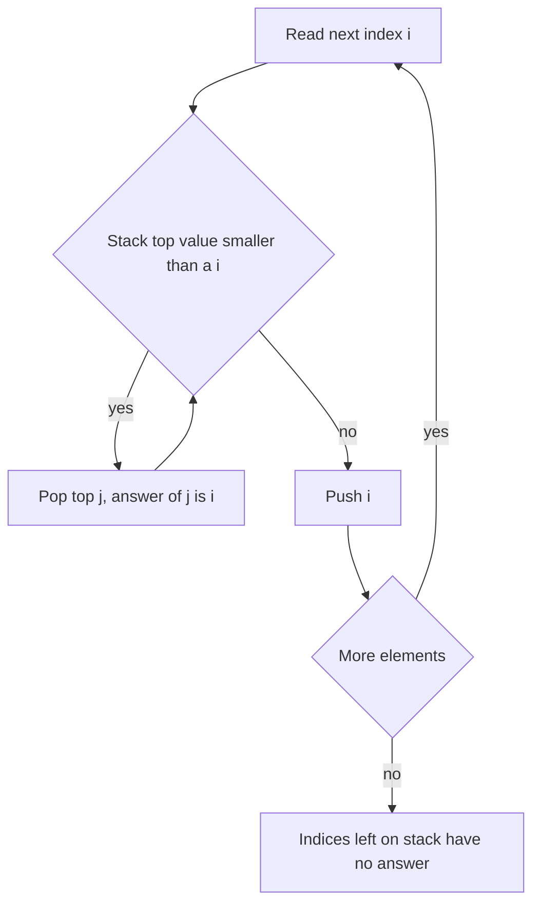

## The hook

You have a list of daily temperatures, and for each day you want to know how many days you must wait for a warmer one. The obvious method scans forward from every day, which is O(n²): fine for 100 days, hopeless for 100,000.

A surprising number of interview problems have this shape: for each element, find the nearest element to the left or right that is bigger or smaller. Next warmer day, next taller building, the span of a stock price, the widest rectangle under a bar, water trapped between walls. One small idea solves all of them in a single pass: keep a stack that stays sorted.

## The intuition

:::analogy
Picture people standing in a queue, all facing right toward a stage. A short person can see the stage only until someone taller stands in front. Now imagine people arriving one at a time at the front of the queue. When a tall person arrives, every shorter person directly behind them is now blocked for good: the newcomer is the first taller person in their line of sight. Those blocked people can leave the "still looking" group. Whoever remains in the group is always arranged tallest at the back, shortest at the front.
:::

The "still looking" group is a [[monotonic stack]]. Each person waits on the stack until someone taller arrives; that arrival is their [[next greater element]]. Because blocked people leave immediately, the stack is always sorted, decreasing from bottom to top.

## How it works

Scan the array left to right, keeping a stack of **indices** whose answers are not yet known.

1. For the current value x, while the stack is not empty and the value at the top is less than x, pop the top. The current index is the popped index's next greater element.
2. Push the current index.
3. Indices still on the stack at the end have no greater element to the right.

The values on the stack are always decreasing from bottom to top, because anything smaller than a newcomer was popped before the newcomer was pushed.

### The four variants

Two choices give four variants:

| Want | Scan direction | Keep on stack | Pop while top is |
|---|---|---|---|
| Next greater (to the right) | left to right | decreasing values | smaller than x |
| Next smaller (to the right) | left to right | increasing values | greater than x |
| Previous greater (to the left) | left to right | decreasing values | at most x, then the top is the answer |
| Previous smaller (to the left) | left to right | increasing values | at least x, then the top is the answer |

For "previous" queries, the answer is whatever remains on top *after* popping, just before you push. For "next" queries, the answer is assigned *when* an index is popped.



### Why it is linear

The inner while loop looks like it could make this O(n²), but count differently: every index is pushed exactly once and popped at most once. Across the whole run there are at most n pops, so the total work is O(n). This style of counting, over the whole run instead of per step, is called [[amortised analysis]].

:::insight
An element on the stack is waiting for its answer. The moment a "better" element arrives, every waiting element it beats gets its answer and leaves forever. Since nothing re-enters, the waiting list stays sorted and the total work is linear.
:::

### Largest rectangle in a histogram

This is the hardest classic, and it uses both directions at once. For each bar, the widest rectangle using that bar's full height stretches left and right until it meets a shorter bar: its [[span]]. Keep an increasing stack. When the current bar is shorter than the top, pop the top bar t:

- the current index i is the first shorter bar on t's right,
- the new stack top is the first shorter bar on t's left,
- so t's width is i − (new top) − 1, or i if the stack is now empty.

Add a sentinel bar of height 0 at the end so every bar gets popped.

### Trapping rain water

A decreasing stack also solves trapped water: when a taller wall arrives and pops a lower bar, the popped bar is the floor of a pocket bounded by the new top on the left and the current wall on the right. Water added is (min(left, right) − floor) × (distance between walls − 1).

## Walk through an example

Next greater element for **[3, 1, 4, 2, 5, 2, 6]** (stack shows values, bottom to top):

| i | value | popped (answer = i) | stack after |
|---|---|---|---|
| 0 | 3 | none | [3] |
| 1 | 1 | none | [3, 1] |
| 2 | 4 | 1, 3 | [4] |
| 3 | 2 | none | [4, 2] |
| 4 | 5 | 2, 4 | [5] |
| 5 | 2 | none | [5, 2] |
| 6 | 6 | 2, 5 | [6] |

Answer indices: [2, 2, 4, 4, 6, 6, −1]. Index 6 is never popped, so it has no greater element.

Largest rectangle for heights **[2, 4, 3, 5, 1]**: when height 3 arrives it pops 4 (width 1, area 4). Height 1 pops 5 (width 1, area 5), then 3 (its left boundary is the bar of height 2 at index 0, so width 3, area **9**), then 2 (width 4, area 8). The sentinel pops 1 (width 5, area 5). The best is 9: height 3 across bars 4, 3, 5.

:::try-this
Trace trapped water for walls [3, 0, 2, 0, 4] with a decreasing stack. (When 2 arrives it pops the 0 at index 1: pocket between 3 and 2, water (2 − 0) × 1 = 2. When 4 arrives it pops 0 at index 3: (2 − 0) × 1 = 2. Then it pops 2 at index 2 with left wall 3: (3 − 2) × 3 = 3. Total 7.)
:::

## The code

```pseudo
next_greater(a):
    ans = [-1] * n; stack = []                 // stack of indices
    for i in 0 .. n-1:
        while stack and a[stack.top] < a[i]:
            ans[stack.pop()] = i
        stack.push(i)
    return ans

largest_rectangle(h):
    append 0 to h; stack = []; best = 0
    for i in 0 .. len(h)-1:
        while stack and h[stack.top] >= h[i]:
            t = stack.pop()
            width = i if stack empty else i - stack.top - 1
            best = max(best, h[t] * width)
        stack.push(i)
    return best
```

```cpp
#include <bits/stdc++.h>
using namespace std;

vector<int> nextGreater(const vector<int>& a) {
    int n = a.size();
    vector<int> ans(n, -1), st;
    for (int i = 0; i < n; i++) {
        while (!st.empty() && a[st.back()] < a[i]) { ans[st.back()] = i; st.pop_back(); }
        st.push_back(i);
    }
    return ans;
}

long long largestRectangle(vector<int> h) {
    h.push_back(0);
    vector<int> st;
    long long best = 0;
    for (int i = 0; i < (int)h.size(); i++) {
        while (!st.empty() && h[st.back()] >= h[i]) {
            int t = st.back(); st.pop_back();
            long long width = st.empty() ? i : i - st.back() - 1;
            best = max(best, (long long)h[t] * width);
        }
        st.push_back(i);
    }
    return best;
}

int main() {
    for (int x : nextGreater({3, 1, 4, 2, 5, 2, 6})) cout << x << ' ';  // 2 2 4 4 6 6 -1
    cout << '\n' << largestRectangle({2, 4, 3, 5, 1}) << '\n';          // 9
}
```

## Complexity

- **Time:** O(n). Each index is pushed once and popped at most once.
- **Space:** O(n) for the stack in the worst case, such as a strictly decreasing array where nothing is ever popped.

## Common mistakes

:::warning
Common misconception: "strict or non-strict comparison does not matter." With duplicates it does. For next *greater*, use `<` when popping so equal values wait; for histograms, popping on `>=` makes equal bars share one computation without double counting. Decide what "greater" means for equal values and test with an input like [2, 2, 2].
:::

- **Storing values instead of indices**: you usually need positions to compute distances or widths.
- **Forgetting leftovers**: indices left on the stack need a default answer, such as −1 or n.
- **Circular arrays** (*Next Greater Element II*): loop i from 0 to 2n − 1 and use i mod n, pushing only during the first pass.
- **Missing the sentinel** in histogram problems, which leaves bars unpopped and their areas uncounted.

## Practice problems

*Daily Temperatures* is the template: answer is the popping index minus the popped index. *Next Greater Element II* adds the circular twist. *Online Stock Span* is "previous greater" in a streaming form: keep pairs of (price, span) and merge popped spans. *Largest Rectangle in Histogram* is the classic hard use, and *Trapping Rain Water* has this stack solution and also an O(1)-space solution with [Two Pointers](article:dsa-two-pointers) moving inward from both walls.

## Key takeaways

- A monotonic stack keeps indices in sorted order by popping everything a new element beats before pushing it.
- For next-greater or next-smaller queries, an element's answer is the index that pops it; leftovers have no answer.
- For previous-greater or previous-smaller queries, the answer is the stack top after popping, just before pushing.
- Each index is pushed once and popped at most once, so the whole pass is O(n) despite the inner loop.
- Histogram rectangles and trapped water use the popped element's two neighbours as its left and right boundaries.
