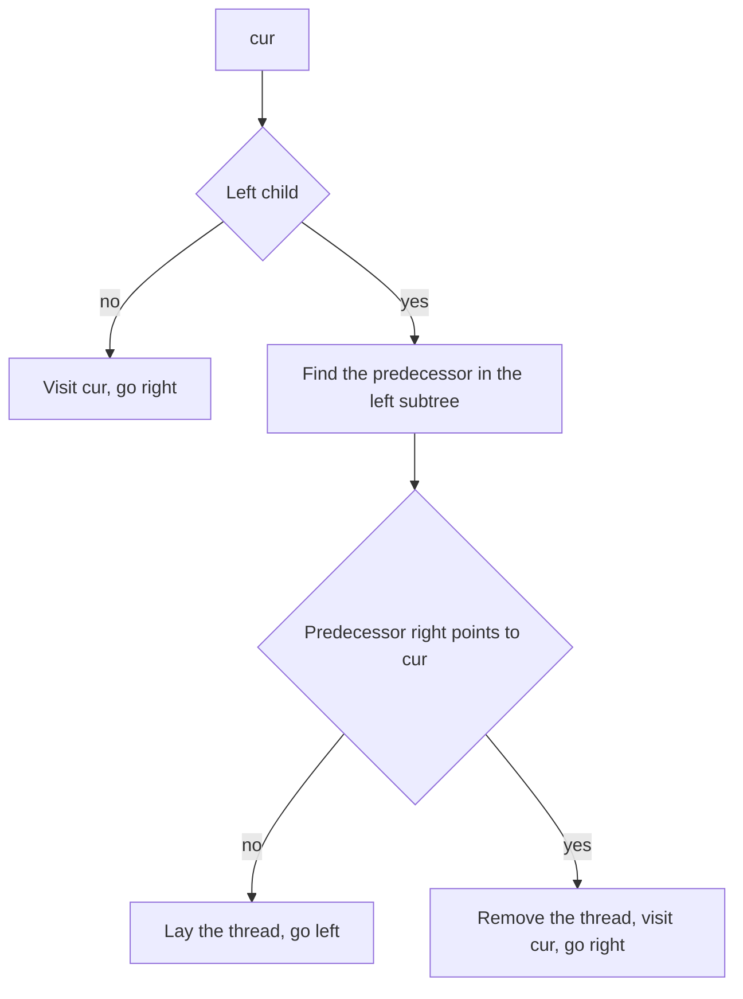

## The hook

An inorder traversal normally needs memory: the recursion stack, or an explicit stack, holding the ancestors you still have to come back to. For a tree of height h, that is O(h) extra space, O(n) for a chain. Can a traversal visit every node in order using only a couple of pointers?

In 1979 Joseph Morris showed that it can. The trick is to borrow the tree's own empty pointers to leave a way back, and to take every borrowed pointer back afterwards so the tree ends exactly as it started. It is rarely the first answer in an interview, but it is the standard reply to "can you do it in O(1) space?".

## The intuition

:::analogy
Picture exploring a cave system that branches downwards, with no way to remember the route. Before you climb down into a left passage, you tie a rope from the deepest point you will reach on the far right of that passage back to where you are standing. When you finish exploring the passage, you find the rope, climb back up it, untie it, and carry on to the right. You never needed a notebook of where you have been; the ropes are the notebook, and you remove each one as soon as you have used it.
:::

The rope is a [[thread]]. For a node with a left subtree, the last node visited in that subtree is its [[inorder predecessor]], the rightmost node of the left subtree. That node's right pointer is empty, because it is the rightmost. Point it back at the current node, and after finishing the left subtree the traversal follows it home.

## How it works

Keep one pointer, cur, starting at the root. While cur exists:

- **No left child:** visit cur and move to cur.right. That right pointer may be a real child or a thread back up.
- **Left child exists:** find the predecessor, the rightmost node of cur.left, stopping if its right pointer already points to cur.
  - If the predecessor's right is empty, this is the first arrival: set it to cur (lay the rope) and move to cur.left.
  - If it already points to cur, the left subtree is done: set it back to empty (untie the rope), visit cur and move to cur.right.

Every thread is laid once and removed once, so when the loop ends the tree is unchanged. This is [[Morris traversal]].

### Why it is O(n)

Finding a predecessor walks down a [[right spine]] of a left subtree, which looks expensive. But each node is on the right spine searched from exactly one ancestor, the one whose predecessor search passes through it, and that search happens twice, once to lay the thread and once to find it. So every edge is walked a small constant number of times, and the whole traversal is O(n) time with O(1) extra space.

### Using it: Recover Binary Search Tree

In a valid BST, the inorder sequence is increasing. If exactly two keys were swapped, the sequence has one [[inversion]], a value followed by a smaller one, when the two keys were neighbours in inorder, or two inversions otherwise. The swapped nodes are the larger value of the first inversion and the smaller value of the last inversion. Morris traversal finds them while tracking only the previous node, so the whole repair takes O(1) extra space.



:::insight
The rightmost node of a left subtree always has an empty right pointer, and it is exactly the node visited just before its ancestor. Pointing it back up gives the traversal a way home without a stack, and removing it on the way back leaves the tree untouched.
:::

## Walk through an example

```text
        4
       / \
      2   5
     / \
    1   3
```

| Step | cur | What happens | Visited so far |
|---|---|---|---|
| 1 | 4 | predecessor in the left subtree is 3; thread 3 → 4; go left | |
| 2 | 2 | predecessor is 1; thread 1 → 2; go left | |
| 3 | 1 | no left child: visit 1, follow the thread to 2 | 1 |
| 4 | 2 | predecessor 1 already points to 2: remove the thread, visit 2, go right | 1 2 |
| 5 | 3 | no left child: visit 3, follow the thread to 4 | 1 2 3 |
| 6 | 4 | predecessor 3 points to 4: remove the thread, visit 4, go right | 1 2 3 4 |
| 7 | 5 | no left child: visit 5, go right to empty | 1 2 3 4 5 |

The visits come out 1, 2, 3, 4, 5, the inorder sequence, and both threads were removed. In cave terms, two ropes were tied on the way down and both were untied on the way back up.

### Recovering a swapped BST

A correct BST with keys 1 to 7 has 4 at the root, 2 and 6 as its children, and 1, 3, 5, 7 as leaves. Swap the keys 2 and 6. The inorder sequence becomes 1, 6, 3, 4, 5, 2, 7.

| Adjacent pair | Inversion? |
|---|---|
| 1, 6 | no |
| 6, 3 | yes, the first: take 6 |
| 3, 4 | no |
| 4, 5 | no |
| 5, 2 | yes, the last: take 2 |
| 2, 7 | no |

Swapping the values of the nodes holding 6 and 2 restores the sorted sequence 1 to 7.

:::try-this
In the walkthrough tree, which nodes get threads, and to where? (Node 3 gets a thread to 4, and node 1 gets a thread to 2. No other node gets one, because only 4 and 2 have left subtrees.)
:::

:::warning
Common misconception: "Morris traversal modifies the tree, so it is unsafe." It does modify pointers temporarily, which matters if another thread reads the tree at the same time or if you stop the traversal halfway. Run to completion, or remove any threads you laid before stopping, and the tree is exactly as it was. In a single-threaded interview setting, that is what the O(1) space claim relies on.
:::

## The code

```pseudo
morris_inorder(root):
    cur = root
    while cur:
        if cur.left is empty:
            visit cur; cur = cur.right
        else:
            pre = cur.left
            while pre.right and pre.right != cur: pre = pre.right
            if pre.right is empty:
                pre.right = cur; cur = cur.left           # lay the thread
            else:
                pre.right = empty; visit cur; cur = cur.right   # remove it
```

```cpp
#include <bits/stdc++.h>
using namespace std;

struct Node {
    int val;
    Node *left = nullptr, *right = nullptr;
    Node(int v, Node* l = nullptr, Node* r = nullptr) : val(v), left(l), right(r) {}
};

template <class Visit>
void morris(Node* root, Visit visit) {
    Node* cur = root;
    while (cur) {
        if (!cur->left) { visit(cur); cur = cur->right; continue; }
        Node* pre = cur->left;
        while (pre->right && pre->right != cur) pre = pre->right;   // inorder predecessor
        if (!pre->right) { pre->right = cur; cur = cur->left; }      // lay the thread
        else { pre->right = nullptr; visit(cur); cur = cur->right; } // remove it, visit, go right
    }
}

void recoverTree(Node* root) {                         // two keys were swapped
    Node *prev = nullptr, *first = nullptr, *second = nullptr;
    morris(root, [&](Node* n) {
        if (prev && prev->val > n->val) {             // an inversion
            if (!first) first = prev;                  // larger value of the first inversion
            second = n;                                // smaller value of the latest inversion
        }
        prev = n;
    });
    swap(first->val, second->val);
}

void recursiveInorder(Node* n, vector<int>& out) { if (n) recursiveInorder(n->left, out), out.push_back(n->val), recursiveInorder(n->right, out); }

int main() {
    Node* t = new Node(4, new Node(2, new Node(1), new Node(3)), new Node(5));
    vector<int> seen, check;
    morris(t, [&](Node* n) { seen.push_back(n->val); });
    for (int x : seen) cout << x << ' ';
    recursiveInorder(t, check);
    cout << "| unchanged " << (seen == check && t->left->right->right == nullptr) << '\n';   // 1 2 3 4 5 | unchanged 1

    Node* b = new Node(4, new Node(6, new Node(1), new Node(3)), new Node(2, new Node(5), new Node(7)));   // 2 and 6 swapped
    recoverTree(b);
    vector<int> fixed;
    recursiveInorder(b, fixed);
    for (int x : fixed) cout << x << ' ';
    cout << '\n';                                        // 1 2 3 4 5 6 7

    int k = 3, kth = -1;
    morris(t, [&](Node* n) { if (--k == 0) kth = n->val; });
    cout << kth << '\n';                                 // 3
}
```

The first test checks that Morris and the recursive traversal agree and that the thread from 3 back to 4 was removed. The kth-smallest test keeps walking after finding the answer, because stopping early would leave a thread in place; to stop early safely, finish removing any open threads first. The recursive and stack-based versions are in [Four Ways to Tour a Family Tree](article:dsa-tree-traversals).

## Complexity

- **Time: O(n).** Each predecessor search walks a right spine of a left subtree, and every node lies on such a spine for only one ancestor, which searches it twice; so every edge is walked a constant number of times.
- **Space: O(1) extra,** just a few pointers, compared with O(h) for recursion or an explicit stack.
- **Recover Binary Search Tree: O(n) time, O(1) extra space** with Morris; O(h) with an ordinary inorder traversal.

## Common mistakes

- **Not stopping the predecessor search at cur,** so it follows the thread and loops forever.
- **Forgetting to remove the thread,** leaving the tree with a cycle.
- **Visiting the node when the thread is laid** instead of when it is removed, which gives preorder rather than inorder. That is actually the Morris preorder variant, so make sure you know which one you want.
- **Stopping early** without removing the threads still in place.
- **In Recover BST, setting second only on the first inversion;** when the swapped keys are not adjacent, the second wrong node is in the last inversion.
- **Using Morris on a tree shared with other code running at the same time,** which may see the temporary threads.

## Practice problems

*Binary Tree Inorder Traversal* is the plain traversal; solve it recursively, with a stack and with Morris, and compare. *Kth Smallest Element in a BST* is Morris with a counter. *Recover Binary Search Tree* uses Morris to find the two swapped nodes with O(1) extra space, the follow-up the problem itself asks for.

## Key takeaways

- Morris traversal performs an inorder traversal with O(1) extra space by using temporary threads instead of a stack.
- For a node with a left subtree, the thread goes from its inorder predecessor, the rightmost node of the left subtree, back to the node.
- Arriving at a node whose predecessor already points to it means the left subtree is finished, so the thread is removed and the node is visited.
- Every thread is laid once and removed once, so the traversal runs in O(n) time and leaves the tree unchanged when it completes.
- In a BST with two swapped keys, the first inversion's larger value and the last inversion's smaller value are the nodes to swap back.
