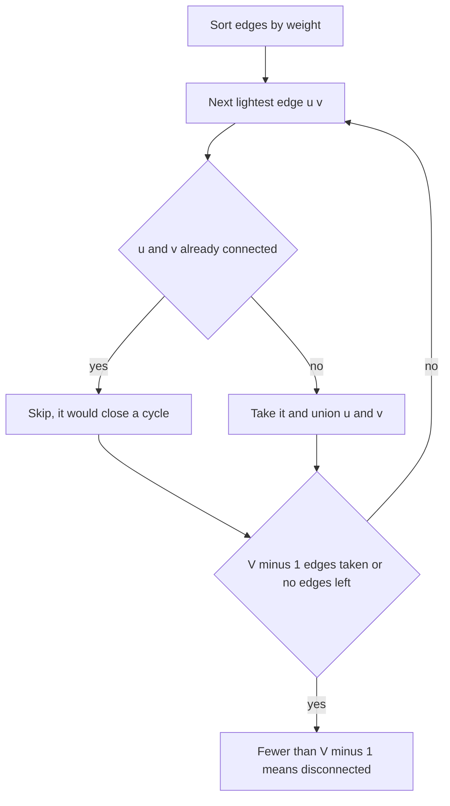

## The hook

A district has six villages and a list of possible roads, each with a building cost. The council wants every village reachable from every other, by some route, at the lowest total cost. They do not care about short trips; one long winding route is fine, as long as nobody is cut off.

Building every road wastes money, and the cheapest few roads may leave a village stranded. The answer is a [[minimum spanning tree]], and two greedy algorithms find it: one sorts the roads, the other grows outward from a single village.

## The intuition

:::analogy
Draw a line on the map that splits the villages into two groups, any two groups you like. Whatever the final road plan is, at least one road must cross that line, or the two groups would be cut off from each other. So the council might as well build the cheapest road across the line: swapping in a cheaper crossing road can never make the plan worse. Every greedy MST algorithm is just a clever way of choosing which lines to draw.
:::

A set of V - 1 roads connecting all V villages with no cycle is a [[spanning tree]]; extra roads would only create loops, which cost money and add no new connections. The line on the map is a [[cut]], and the claim in the analogy is the [[cut property]]: for any cut, a lightest edge crossing it is in some minimum spanning tree.

The proof is an exchange argument, like those in [A Bus Conductor Who Never Reseats Anyone](article:dsa-greedy-exchange). The argument in three steps:

- take an MST that does not use the lightest crossing edge e, and add e, which creates a cycle;
- that cycle must cross the line a second time, through some other edge f;
- remove f: the result is still a spanning tree, and since e weighs no more than f, it costs no more.

So some MST does use e.

The mirror image is the [[cycle property]]: the strictly heaviest edge on any cycle is in no MST, because removing it keeps everything connected and saves money.

## How it works

### Kruskal: cheapest roads first, skipping loops

- Sort all edges by weight.
- Walk through them in order. If the edge joins two villages that are not yet connected, build it; otherwise skip it.
- Stop after V - 1 edges, or when the edges run out.

"Already connected?" is exactly the question union-find answers in near-constant time, as in [Friend Groups That Merge at a Party](article:dsa-union-find). Each taken edge is safe by the cut property: draw the line around one of the two groups it joins, and it is the cheapest crossing edge, because every cheaper edge was already considered. Each skipped edge is the heaviest on the cycle it would close.

### Prim: grow one village outward

- Start with any village in the tree.
- Repeatedly add the cheapest edge with one end in the tree and the other end outside it.
- Stop when every village is in the tree.

Here the line is always drawn around the current tree, so each chosen edge is the lightest crossing edge. A min-heap of candidate edges finds it, with stale entries skipped exactly as in [Water Racing Through a Network of Pipes](article:dsa-dijkstra). Prim and Dijkstra look almost identical; the difference is the heap key. Dijkstra uses the total distance from the source, Prim only the weight of the single edge into the tree.

### Dense graphs: Prim without a heap

When every pair of vertices has an edge, as in *Min Cost to Connect All Points* where the cost is the Manhattan distance between points, E is about V²/2. Building the edge list for Kruskal is expensive. Instead, keep an array best[v] of the cheapest edge from the tree to each outside vertex, pick the smallest by a linear scan, and update best from the new vertex. That is O(V²) with no heap and no edge list.

### Disconnected maps

If some village cannot be reached by any road, no spanning tree exists. Kruskal finishes with fewer than V - 1 edges, and Prim's tree stops growing before reaching every vertex. *Road Reparation* asks you to print IMPOSSIBLE in that case. If you continue Kruskal over all edges anyway, the result is a [[minimum spanning forest]]: one MST per component.

| | Kruskal | Prim with heap | Prim with array |
|---|---|---|---|
| Idea | Sort edges, skip cycles | Grow from one vertex | Grow from one vertex |
| Data structure | Union-find | Min-heap | Distance array |
| Time | O(E log E) | O(E log V) | O(V²) |
| Best for | Edge lists, sparse graphs | Adjacency lists | Complete or dense graphs |



:::insight
Every spanning tree must cross every cut, so the cheapest edge across any cut is always a safe choice. Kruskal and Prim are two ways of picking cuts: Kruskal around whichever groups the next cheapest edge joins, Prim around the tree grown so far.
:::

## Walk through an example

Villages A to F, possible roads: A–B 7, A–C 3, B–C 4, B–D 2, C–D 6, C–E 8, D–E 5, D–F 9, E–F 1.

### Kruskal

| Edge (sorted) | Already connected? | Action | Total |
|---|---|---|---|
| E–F 1 | no | take | 1 |
| B–D 2 | no | take | 3 |
| A–C 3 | no | take | 6 |
| B–C 4 | no, joins {A, C} and {B, D} | take | 10 |
| D–E 5 | no, joins {A, B, C, D} and {E, F} | take | 15 |
| C–D 6 | yes | skip | 15 |
| A–B 7 | yes | skip | 15 |
| C–E 8 | yes | skip | 15 |
| D–F 9 | yes | skip | 15 |

Five edges for six villages, total 15. The loop could have stopped right after D–E, once V - 1 edges were taken.

### Prim from A

| Add | Via edge | Candidate edges in the heap afterwards |
|---|---|---|
| A | start | A–C 3, A–B 7 |
| C | A–C 3 | C–B 4, C–D 6, A–B 7, C–E 8 |
| B | C–B 4 | B–D 2, C–D 6, A–B 7, C–E 8 |
| D | B–D 2 | D–E 5, C–D 6, A–B 7, C–E 8, D–F 9 |
| E | D–E 5 | E–F 1, C–D 6, A–B 7, C–E 8, D–F 9 |
| F | E–F 1 | the rest are stale: both ends are in the tree |

Same total, 15, and here the same set of edges, built in a different order. When all weights are distinct, the MST is unique, so both algorithms must agree.

### Connecting points, dense Prim

Points (0, 0), (1, 3), (4, 1), (5, 5), (2, 6) with Manhattan distances. Prim from (0, 0) adds (1, 3) at cost 4, then (2, 6) at 4, then (5, 5) at 4, then (4, 1) at 5. Total 17, found by scanning a five-entry array five times, with no edge list built at all.

:::try-this
In the village map, lower the price of C–D from 6 to 1. What is the new MST total? (Sorted: E–F 1 and C–D 1, then B–D 2, A–C 3, then B–C 4 is skipped because C and B are now connected through D, then D–E 5. Taken: 1 + 1 + 2 + 3 + 5 = 12.)
:::

:::warning
Common misconception: "The minimum spanning tree contains the shortest path between every pair of villages." It does not. In the example, the only MST route from A to E is A–C–B–D–E, costing 3 + 4 + 2 + 5 = 14, while A–C–E costs 3 + 8 = 11 using a road the MST left out. An MST minimises the total cost of the whole network, not any individual trip; shortest trips need Dijkstra.
:::

## The code

```pseudo
kruskal(n, edges):
    sort edges by weight; dsu = n singletons; total = 0; taken = 0
    for (w, u, v) in edges:
        if dsu.find(u) != dsu.find(v):
            dsu.union(u, v); total += w; taken += 1
    return total if taken == n - 1 else "IMPOSSIBLE"

prim(adj, start):
    in_tree = [false] * n; heap = [(0, start)]; total = 0
    while heap:
        (w, u) = heap.pop()
        if in_tree[u]: continue               # stale
        in_tree[u] = true; total += w
        for (v, wv) in adj[u]: if not in_tree[v]: heap.push((wv, v))
    return total
```

```cpp
#include <bits/stdc++.h>
using namespace std;
using ll = long long;

struct DSU {
    vector<int> p, sz;
    explicit DSU(int n) : p(n), sz(n, 1) { iota(p.begin(), p.end(), 0); }
    int find(int x) { return p[x] == x ? x : p[x] = find(p[x]); }
    bool unite(int a, int b) {
        a = find(a), b = find(b);
        if (a == b) return false;
        if (sz[a] < sz[b]) swap(a, b);
        p[b] = a, sz[a] += sz[b];
        return true;
    }
};

ll kruskal(int n, vector<array<int, 3>> edges) {                // {w, u, v}
    sort(edges.begin(), edges.end());
    DSU d(n);
    ll total = 0;
    int taken = 0;
    for (auto& [w, u, v] : edges)
        if (d.unite(u, v)) total += w, taken++;                 // skip edges inside one group
    return taken == n - 1 ? total : -1;                         // -1: disconnected
}

ll prim(int n, const vector<vector<pair<int, int>>>& adj) {    // adj[u] = {v, w}
    vector<bool> inTree(n, false);
    priority_queue<pair<int, int>, vector<pair<int, int>>, greater<>> pq;
    pq.push({0, 0});
    ll total = 0;
    int added = 0;
    while (!pq.empty()) {
        auto [w, u] = pq.top();
        pq.pop();
        if (inTree[u]) continue;                                // stale candidate
        inTree[u] = true, total += w, added++;
        for (auto [v, wv] : adj[u]) if (!inTree[v]) pq.push({wv, v});
    }
    return added == n ? total : -1;
}

ll densePrim(const vector<array<int, 2>>& pts) {               // complete graph, Manhattan cost
    int n = pts.size();
    vector<ll> best(n, LLONG_MAX);
    vector<bool> used(n, false);
    best[0] = 0;
    ll total = 0;
    for (int it = 0; it < n; it++) {
        int u = -1;
        for (int v = 0; v < n; v++) if (!used[v] && (u == -1 || best[v] < best[u])) u = v;
        used[u] = true, total += best[u];
        for (int v = 0; v < n; v++)
            if (!used[v]) best[v] = min(best[v], (ll)abs(pts[u][0] - pts[v][0]) + abs(pts[u][1] - pts[v][1]));
    }
    return total;
}

int main() {
    // villages A..F = 0..5
    vector<array<int, 3>> e = {{7, 0, 1}, {3, 0, 2}, {4, 1, 2}, {2, 1, 3}, {6, 2, 3},
                               {8, 2, 4}, {5, 3, 4}, {9, 3, 5}, {1, 4, 5}};
    vector<vector<pair<int, int>>> adj(6);
    for (auto& [w, u, v] : e) adj[u].push_back({v, w}), adj[v].push_back({u, w});
    cout << kruskal(6, e) << ' ' << prim(6, adj) << '\n';                        // 15 15
    cout << kruskal(4, {{1, 0, 1}, {2, 2, 3}}) << '\n';                          // -1
    cout << densePrim({{0, 0}, {1, 3}, {4, 1}, {5, 5}, {2, 6}}) << '\n';         // 17
}
```

## Complexity

- **Kruskal: O(E log E)** for the sort, plus near-constant time per union-find operation; O(V + E) space.
- **Prim with a heap: O(E log V),** with up to E heap entries because of lazy deletion; O(V + E) space.
- **Dense Prim: O(V²) time, O(V) space,** the best choice when E is close to V².
- **Disconnected check: free,** by counting edges taken or vertices added.

## Common mistakes

- **Forgetting the disconnected case** and printing a total for a forest when a tree was required.
- **Not using union-find in Kruskal,** and checking connectivity with a fresh DFS per edge, which is O(V × E).
- **Using Dijkstra's key in Prim,** the total distance from the start, instead of the single edge weight.
- **Building all V² edges for a complete graph** and sorting them, when dense Prim needs no edge list.
- **Overflow in the total** on large inputs such as Road Reparation; sum in 64-bit.
- **Assuming the MST gives shortest paths** between pairs of vertices.

## Practice problems

*Road Reparation* is Kruskal with an IMPOSSIBLE check. *Min Cost to Connect All Points* is the dense case, where O(V²) Prim beats sorting every pair. LeetCode's *Connecting Cities With Minimum Cost* is the same as Road Reparation but premium, so the CSES problem is the free substitute. *Find Critical and Pseudo-Critical Edges in Minimum Spanning Tree* tests real understanding: an edge is critical if removing it raises the MST weight, and pseudo-critical if forcing it in keeps the weight unchanged.

## Key takeaways

- A minimum spanning tree connects all vertices with V - 1 edges at the lowest total weight, and it has no cycles.
- The cut property makes greedy safe: for any split of the vertices, a lightest edge crossing it belongs to some minimum spanning tree.
- Kruskal sorts edges and takes each one that joins two different union-find groups, skipping edges that would close a cycle.
- Prim grows one tree, always adding the cheapest edge leaving it, using a heap for sparse graphs and a plain array for dense ones.
- If fewer than V - 1 edges are taken, the graph is disconnected and no spanning tree exists.
