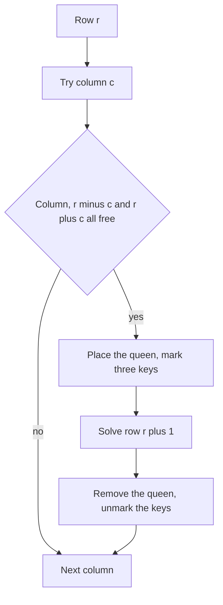

## The hook

A host is seating eight guests at a square banquet laid out like a chessboard, and every guest is a rival of every other. Two rivals must never be able to see each other: not along a row, not along a column and not along a diagonal. How many ways are there to seat them?

That is the eight queens puzzle, and its general form, N-Queens, is the textbook backtracking problem. A careless solution re-checks the whole board after every move. A careful one answers "is this square attacked?" in O(1) with three small sets, and the bookkeeping, not the search, is what the interview is really about.

## The problem

Place n queens on an n by n board so that no two [[attack]] each other. *N-Queens* asks for every solution as a board drawing; *N-Queens II* asks only how many there are; *Chessboard and Queens* on CSES counts placements of 8 queens on an 8 by 8 board where some squares are reserved and cannot be used.

| n | Number of solutions |
|---|---|
| 1 | 1 |
| 2 | 0 |
| 3 | 0 |
| 4 | 2 |
| 5 | 10 |
| 6 | 4 |
| 7 | 40 |
| 8 | 92 |

## The obvious approach

Try every way to put n queens on n² squares and test each placement. For n = 8 that is the number of ways to choose 8 of 64 squares, over four billion boards, each checked in O(n²). Even placing one queen per row and trying every column gives 8⁸ ≈ 16.8 million full boards before checking. The search must stop much earlier.

## The key insight

:::analogy
Picture the host seating rivals one table row at a time. Each row gets exactly one guest. Before seating someone, the host glances at three lists pinned to the wall: columns already taken, diagonals already watched in one direction, and diagonals watched in the other direction. If any list contains the seat's column or diagonal, she moves on to the next seat at once. When she leaves a row to try a different seat, she crosses that guest off all three lists.
:::

Two facts make the lists cheap:

- **[[Row-by-row placement]].** Two queens in the same row attack, so a solution has exactly one queen per row. Place them row by row and rows can never conflict.
- **Diagonals have keys.** Along a top-left to bottom-right diagonal, r and c increase together, so r − c is constant: that is the [[diagonal key]]. Along the other direction, r + c is constant: the [[anti-diagonal key]].

So a square (r, c) is safe exactly when column c, key r − c and key r + c are all unused. Three O(1) lookups replace a scan of the board. When you place a queen, add its three keys; when you backtrack, remove them.



### Counting faster with bitmasks

For counting, store the three sets as [[bitmask|bitmasks]]: bit c of `cols` says column c is taken, and so on, with r − c shifted by n − 1 so it is never negative. Testing a square is three bit operations, and the recursion passes new masks by value, so "undo" is free: the caller's masks were never changed.

:::insight
Reduce "is this square attacked?" to three keys, the column, r − c and r + c, and keep each in a set or bitmask. Each placement is then checked in O(1), and the search only grows along branches that are still legal.
:::

## Walk through an example

n = 4. Place row by row; the table shows each attempt for the first queen's column and where it leads.

| Row 0 column | What happens next | Outcome |
|---|---|---|
| 0 | row 1 can use only column 2 or 3; column 2 leaves row 2 nothing; column 3 lets row 2 use column 1, then row 3 has nothing | dead end |
| 1 | row 1 column 3, row 2 column 0, row 3 column 2 | solution [1, 3, 0, 2] |
| 2 | row 1 column 0, row 2 column 3, row 3 column 1 | solution [2, 0, 3, 1] |
| 3 | mirror image of column 0 | dead end |

Check the first solution's keys. Queens at (0, 1), (1, 3), (2, 0) and (3, 2) use columns 1, 3, 0, 2, diagonal keys r − c of −1, −2, 2, 1 and anti-diagonal keys r + c of 1, 4, 2, 5. All twelve values are distinct within each group, so no two queens attack.

Drawn as a board:

```text
. Q . .
. . . Q
Q . . .
. . Q .
```

:::try-this
Can queens sit at (0, 0) and (2, 1) on a 4 by 4 board? Compute their three keys. (Columns 0 and 1 differ. r − c is 0 and 1, different. r + c is 0 and 3, different. So they do not attack; a knight's-move apart is always safe.)
:::

:::warning
Common misconception: "Check for attacks by scanning the board every time." Scanning the column and both diagonals costs O(n) per check, and it is easy to forget a direction. The keys make each check O(1) and leave nothing to forget, as long as you remove all three keys when you backtrack.
:::

## The code

```pseudo
solve(r):
    if r == n: record the board; return
    for c in 0 .. n - 1:
        if c in cols or (r - c) in diag or (r + c) in anti: continue
        place queen at (r, c); add c, r - c, r + c to the sets
        solve(r + 1)
        remove the queen and the three keys

count(r, colsMask, diagMask, antiMask):   # bitmask version, nothing to undo
    if r == n: return 1
    total = 0
    for each free column c: total += count(r + 1, masks with c's bits set)
    return total
```

```cpp
#include <bits/stdc++.h>
using namespace std;

vector<vector<string>> solveNQueens(int n) {
    vector<vector<string>> res;
    vector<string> board(n, string(n, '.'));
    vector<bool> col(n), diag(2 * n - 1), anti(2 * n - 1);
    function<void(int)> go = [&](int r) {
        if (r == n) { res.push_back(board); return; }
        for (int c = 0; c < n; c++) {
            if (col[c] || diag[r - c + n - 1] || anti[r + c]) continue;   // three O(1) checks
            board[r][c] = 'Q', col[c] = diag[r - c + n - 1] = anti[r + c] = true;
            go(r + 1);
            board[r][c] = '.', col[c] = diag[r - c + n - 1] = anti[r + c] = false;   // undo
        }
    };
    go(0);
    return res;
}

long long countQueens(int n, const vector<string>& blocked, int r = 0, int cols = 0, int d1 = 0, int d2 = 0) {
    if (r == n) return 1;
    long long total = 0;
    for (int c = 0; c < n; c++) {
        if (!blocked.empty() && blocked[r][c] == '*') continue;           // reserved square
        if ((cols >> c & 1) || (d1 >> (r - c + n - 1) & 1) || (d2 >> (r + c) & 1)) continue;
        total += countQueens(n, blocked, r + 1, cols | 1 << c, d1 | 1 << (r - c + n - 1), d2 | 1 << (r + c));
    }
    return total;
}

int main() {
    auto sols = solveNQueens(4);
    cout << sols.size() << '\n';                       // 2
    for (auto& row : sols[0]) cout << row << '\n';     // .Q.. / ...Q / Q... / ..Q.
    for (int n = 1; n <= 8; n++) cout << countQueens(n, {}) << ' ';
    cout << '\n';                                      // 1 0 0 2 10 4 40 92
    vector<string> board = {"........", "........", "..*.....", "........",
                            "........", ".......*", "........", "........"};
    cout << countQueens(8, board) << '\n';             // 73
}
```

The last test is the *Chessboard and Queens* setting with two reserved squares, at (2, 2) and (5, 7), of our own choosing: 73 of the 92 standard solutions avoid both. The diagonal arrays have 2n − 1 entries because r − c ranges from −(n − 1) to n − 1 and r + c from 0 to 2n − 2.

## Complexity

- **Time:** exponential, but far below n^n. Each row tries at most n columns, and the three checks prune most of them, so for n = 8 the whole search makes 2,057 recursive calls, compared with 8⁸ ≈ 16.8 million boards for blind row-by-row guessing. Producing every board costs an extra O(n²) per solution.
- **Space:** O(n) for the three sets or masks, the board row choices and the recursion depth.
- **Bitmask counting** fits n up to about 30 in 32-bit or 64-bit masks; beyond small n, the number of solutions itself grows too fast to enumerate.

## Common mistakes

- **Forgetting one diagonal direction,** usually r + c.
- **Negative indices** for r − c; shift by n − 1 to index an array.
- **Not undoing all three marks** when backtracking, which wrongly blocks squares in later branches.
- **Scanning the board for every check,** which is slower and easy to get wrong.
- **Ignoring reserved squares** in the CSES version, or treating them as attacking; they only block placement.
- **Returning after the first solution** in N-Queens, which asks for all of them.

## Practice problems

*N-Queens* asks for every solution as a drawing, the set version above. *N-Queens II* counts them, where the bitmask version shines. *Chessboard and Queens* on CSES adds reserved squares, one extra test in the loop. The template behind all three is [Chalk Marks You Rub Out on the Way Back](article:dsa-backtracking-template), and the r − c and r + c keys reappear in grid problems such as those in [Peeling a Grid Like an Onion](article:dsa-matrix-traversal).

## Key takeaways

- Place one queen per row, because a solution can never have two queens in the same row, which removes row conflicts entirely.
- A square (r, c) is attacked exactly when its column, its r − c diagonal key or its r + c anti-diagonal key is already used.
- Keeping those three keys in sets or bitmasks makes every safety check O(1), and backtracking must remove all three when it undoes a placement.
- Passing bitmasks by value in the recursion makes undoing free, which suits counting problems like N-Queens II.
- The 8 by 8 board has 92 solutions, and the same search handles reserved squares by skipping them in the loop.
