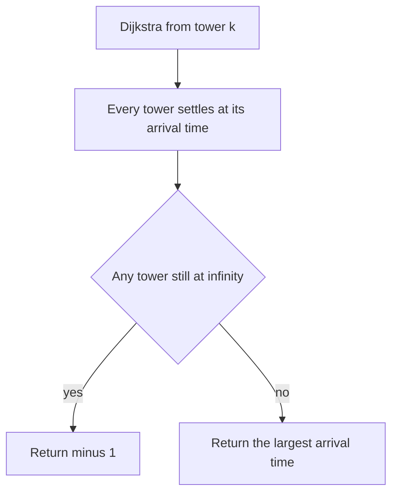

## The hook

A control centre sends an alert to one relay tower. Each tower passes the alert on to the towers it has links to, and every link takes a known number of milliseconds. Towers forward the alert the instant they receive it, along every outgoing link at once. How long until every tower in the network has the alert?

It sounds like a question about one long route. It is really about many routes at once, and the answer falls straight out of shortest paths.

## The problem

There are n towers labelled 1 to n, and directed links (u, v, w): a signal at u reaches v after w time units. A signal starts at tower k at time 0. Return the time when all n towers have received it, or -1 if some tower never does.

For towers 1 to 5 with links 1 → 2 (4), 1 → 3 (2), 3 → 2 (1), 2 → 4 (1), 3 → 4 (5), 4 → 5 (3), 3 → 5 (9), and k = 1, the answer is 7.

## The obvious approach

Try every route. A DFS from k explores every path and records the earliest time each tower is reached, revisiting a tower whenever a faster route turns up. On small inputs this works, but the number of paths can grow exponentially, and a tower may be revisited many times.

Plain BFS is the other tempting choice, and it is wrong here: BFS counts links, not milliseconds. In the example, BFS reaches tower 2 directly in one hop at time 4, while the two-hop route 1 → 3 → 2 arrives at time 3.

## The key insight

:::analogy
Picture the alert spreading like a ripple of light through the towers. Each tower lights up at the first moment any route delivers the alert, and that moment is the shortest route's delay. Later copies of the alert arriving by slower routes change nothing; the tower is already lit. The network is fully lit when the last tower lights up.
:::

Each tower's [[arrival time]] is its shortest distance from k. Links all forward in parallel, so the [[broadcast time]] is the largest of those distances:

- run Dijkstra from k, as in [Water Racing Through a Network of Pipes](article:dsa-dijkstra), because link delays are non-negative;
- if any tower still has infinite distance, it is an [[unreachable vertex]], and the answer is -1;
- otherwise return the largest distance.

Dijkstra is the natural fit because it settles towers in increasing order of arrival time, exactly the order the light would show. The last tower it settles is the answer, so you can even read the answer as "the distance of the last vertex popped", once you have checked that all n were popped.

### Small inputs: other tools work too

LeetCode limits this problem to 100 towers and 6,000 links. At that size, Bellman-Ford's O(V × E) is about 600,000 relaxations, and Floyd-Warshall's O(V³) is a million, both fine. Dijkstra is the answer interviewers expect, and it scales to the CSES limits of 10⁵ towers, where the others do not.

### Variant: Path with Maximum Probability

*Path with Maximum Probability* gives undirected edges with success probabilities between 0 and 1. A path succeeds with the product of its edges' probabilities, a [[multiplicative path cost]]. Find the most probable path from start to end.

Run Dijkstra with three changes: a max-heap instead of a min-heap, multiplication instead of addition, and "larger is better" in the relaxation test. It is correct because multiplying by a probability of at most 1 can only keep or lower a path's value, so the most probable unsettled vertex can never be improved later. An equivalent view: taking -log of each probability turns products into sums of non-negative numbers, which is plain Dijkstra.

| Problem | Path value | Heap | Relax when | Unreachable |
|---|---|---|---|---|
| Network Delay Time | Sum of delays | Min-heap | d[u] + w < d[v] | Return -1 |
| Shortest Routes I | Sum of lengths | Min-heap | d[u] + w < d[v] | Not in the input |
| Path with Maximum Probability | Product of probabilities | Max-heap | p[u] × q > p[v] | Return 0 |



:::insight
When a signal spreads along every link at once, each vertex receives it at its shortest distance, so the time for everyone is the largest shortest distance. One Dijkstra run gives all of them, and an infinite one means the broadcast never finishes.
:::

## Walk through an example

Links: 1 → 2 (4), 1 → 3 (2), 3 → 2 (1), 2 → 4 (1), 3 → 4 (5), 4 → 5 (3), 3 → 5 (9). Source 1.

| Settle | Arrival time | Relaxations |
|---|---|---|
| 1 | 0 | 2 = 4, 3 = 2 |
| 3 | 2 | 2 = 2 + 1 = 3, 4 = 2 + 5 = 7, 5 = 2 + 9 = 11 |
| 2 | 3 | 4 = 3 + 1 = 4 |
| 4 | 4 | 5 = 4 + 3 = 7 |
| 5 | 7 | |

Arrival times: tower 1 at 0, 3 at 2, 2 at 3, 4 at 4, 5 at 7. The broadcast time is 7. The direct-looking routes, 1 → 2 at 4 and 3 → 5 at 11, both lost to longer chains of faster links.

If the link 1 → 3 were removed, tower 3 would never receive the signal, because no other link points into it, and the answer would be -1.

### Maximum probability

Undirected edges with probabilities: 0–1 0.5, 1–2 0.5, 0–2 0.2, 2–3 0.9, 1–3 0.3. Start 0, end 3.

| Path to 3 | Product |
|---|---|
| 0 → 1 → 3 | 0.5 × 0.3 = 0.15 |
| 0 → 2 → 3 | 0.2 × 0.9 = 0.18 |
| 0 → 1 → 2 → 3 | 0.5 × 0.5 × 0.9 = 0.225 |

The longest path wins, because its edges are individually reliable. Max-heap Dijkstra settles 0 (1.0), then 1 (0.5), then 2 (0.25, beating the direct 0.2), then 3 (0.225).

:::try-this
In the tower example, add a link 1 → 5 with delay 6. What is the new broadcast time, and which tower finishes last? (Tower 5 now receives the signal at 6 instead of 7. The arrival times are 0, 3, 2, 4 and 6, so the broadcast time is 6, and tower 5 is still last.)
:::

:::warning
Common misconception: "The answer is the length of the longest path from k." Longest paths are the wrong thing entirely: a tower receives the signal by its fastest route, and slower routes are irrelevant. In the example, the slowest route to tower 5, 1 → 3 → 5, takes 11, but tower 5 has the signal at 7. The answer is the largest of the shortest distances.
:::

## The code

```pseudo
network_delay(times, n, k):
    dist = [inf] * (n + 1); dist[k] = 0; heap = [(0, k)]
    while heap:
        (d, u) = heap.pop()
        if d > dist[u]: continue
        for (v, w) in adj[u]:
            if d + w < dist[v]: dist[v] = d + w; heap.push((dist[v], v))
    answer = max(dist[1..n])
    return -1 if answer == inf else answer
```

```cpp
#include <bits/stdc++.h>
using namespace std;

int networkDelayTime(const vector<array<int, 3>>& times, int n, int k) {
    vector<vector<pair<int, int>>> adj(n + 1);
    for (auto& [u, v, w] : times) adj[u].push_back({v, w});
    vector<long long> dist(n + 1, LLONG_MAX);
    priority_queue<pair<long long, int>, vector<pair<long long, int>>, greater<>> pq;
    dist[k] = 0, pq.push({0, k});
    while (!pq.empty()) {
        auto [d, u] = pq.top(); pq.pop();
        if (d > dist[u]) continue;
        for (auto [v, w] : adj[u])
            if (d + w < dist[v]) dist[v] = d + w, pq.push({dist[v], v});
    }
    long long ans = *max_element(dist.begin() + 1, dist.end());
    return ans == LLONG_MAX ? -1 : (int)ans;                  // someone never hears it
}

double maxProbability(int n, const vector<array<int, 2>>& edges, const vector<double>& prob, int s, int t) {
    vector<vector<pair<int, double>>> adj(n);
    for (size_t i = 0; i < edges.size(); i++) {
        auto [a, b] = edges[i];
        adj[a].push_back({b, prob[i]}), adj[b].push_back({a, prob[i]});
    }
    vector<double> best(n, 0.0);
    priority_queue<pair<double, int>> pq;                     // max-heap: most probable first
    best[s] = 1.0, pq.push({1.0, s});
    while (!pq.empty()) {
        auto [p, u] = pq.top(); pq.pop();
        if (p < best[u]) continue;                            // stale
        if (u == t) return p;
        for (auto [v, q] : adj[u])
            if (p * q > best[v]) best[v] = p * q, pq.push({best[v], v});
    }
    return 0.0;
}

int main() {
    vector<array<int, 3>> times = {{1, 2, 4}, {1, 3, 2}, {3, 2, 1}, {2, 4, 1}, {3, 4, 5}, {4, 5, 3}, {3, 5, 9}};
    cout << networkDelayTime(times, 5, 1) << ' ';
    times.push_back({1, 5, 6});
    cout << networkDelayTime(times, 5, 1) << ' ';
    cout << networkDelayTime({{1, 2, 4}, {3, 2, 1}}, 3, 1) << '\n';        // 7 6 -1
    cout << fixed << setprecision(3)
         << maxProbability(4, {{0, 1}, {1, 2}, {0, 2}, {2, 3}, {1, 3}}, {0.5, 0.5, 0.2, 0.9, 0.3}, 0, 3) << '\n';  // 0.225
}
```

## Complexity

- **Network Delay Time: O((V + E) log V)** with a binary heap, O(V + E) space.
- **Path with Maximum Probability:** the same, with floating-point products.
- **For tiny inputs,** Bellman-Ford at O(V × E) or Floyd-Warshall at O(V³) also pass, but they do not scale.

## Common mistakes

- **Returning the largest finite distance** when some tower is unreachable; the answer must be -1.
- **Using BFS,** which counts hops rather than total delay.
- **Including index 0** in the maximum when towers are numbered from 1, which picks up an unused infinite entry and returns -1 for every input.
- **Adding links in both directions;** Network Delay Time is directed, Path with Maximum Probability is undirected.
- **Using a min-heap for probabilities,** which settles the least likely paths first.

## Practice problems

*Network Delay Time* is this walkthrough. *Path with Maximum Probability* swaps sums for products and the min-heap for a max-heap. *Shortest Routes I* is the same Dijkstra at a scale where O(V × E) would time out, so it checks that you really used a heap and 64-bit distances. For weights that can be negative, see [A Rumour Spreading Round by Round](article:dsa-bellman-ford-floyd).

## Key takeaways

- When every vertex forwards a signal along all its edges at once, each vertex receives it at its shortest distance from the source.
- The time for the whole network to receive the signal is the largest of those shortest distances.
- If any vertex's distance is still infinite after Dijkstra, the broadcast never completes and the answer is -1.
- BFS is wrong here because it counts edges, not total delay.
- Maximum-probability paths use the same Dijkstra with a max-heap and multiplication, which is valid because probabilities never exceed 1.
