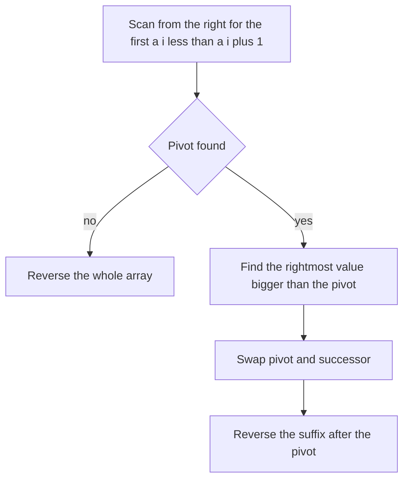

## The hook

Write the permutations of 1, 2, 3 in dictionary order: 123, 132, 213, 231, 312, 321. Now someone hands you 1 3 5 4 2 and asks for the one that comes right after it, without listing the hundred-odd arrangements before it. And they want it in place, using no extra memory.

You could generate all permutations and search, but that costs n! steps. The real answer is a short procedure you can do by hand on paper, and once you see why it works, you will never need to memorise it again.

## The problem

Given an array, rearrange it into the next permutation in [[lexicographic order]]: the smallest arrangement that is strictly larger than the current one. If the array is already the largest arrangement, wrap around to the smallest one, which is the array sorted ascending. Do it in place with O(1) extra memory.

Related questions use the same machine:

- the next larger number with the same digits (*Next Greater Element III*);
- the k-th permutation of 1 to n directly (*Permutation Sequence*);
- the previous permutation, which is the mirror image.

## The obvious approach

Generate every permutation, sort them, find the current one and return the next. That is O(n · n!) time and memory: hopeless beyond n of about 10. Even calling next on a generator from the beginning is O(n!) in the worst case.

The key question is: how little of the array do you actually need to change?

## The key insight

:::analogy
Think of a car's odometer. To go from 12,999 to 13,000, the right-hand digits that are already at their maximum, the three 9s, cannot go any higher. So the first digit to their left that can still increase, the 2, ticks up by one, and every digit to its right resets to its smallest value. The odometer never touches more digits than it must.
:::

Next permutation works the same way, with one twist: you cannot invent digits, you can only rearrange the ones you have.

- **Find the maxed-out tail.** Scan from the right while the values do not increase. That [[suffix]] is in descending order, which is its largest possible arrangement, like the row of 9s. No rearrangement of it alone can make the array bigger.
- **Find the digit that can tick up.** The element just left of that suffix is the [[pivot]]: the rightmost i with a[i] < a[i + 1]. To get the very next permutation, you must increase position i, and by as little as possible.
- **Tick it up by the smallest step.** Swap the pivot with its [[successor]]: the smallest value in the suffix that is larger than a[i]. Because the suffix is descending, that is the rightmost value greater than a[i].
- **Reset the tail to its smallest.** The suffix is still descending after the swap. Reverse it so it becomes ascending, the smallest arrangement, like resetting the 9s to 0s.

If there is no pivot, the whole array is descending: it is the last permutation, and reversing everything wraps it to the first.



:::insight
The next permutation changes as little as possible: the rightmost position that can grow grows by the smallest available amount, and everything after it is reset to its smallest order. Every step of the algorithm follows from that one sentence.
:::

Why is reversing enough, instead of sorting? Before the swap, the suffix is non-increasing. The successor was chosen as the rightmost value bigger than the pivot, so everything to its right is no bigger than the pivot. Dropping the pivot value into the successor's spot therefore keeps the suffix non-increasing. Reversing a non-increasing run makes it non-decreasing in O(n), with no sort.

## Walk through an example

### Next permutation of [1, 3, 5, 4, 2]

**Find the pivot.** Compare neighbours from the right:

| i | a[i] | a[i + 1] | a[i] < a[i + 1]? |
|---|---|---|---|
| 3 | 4 | 2 | no |
| 2 | 5 | 4 | no |
| 1 | 3 | 5 | yes: pivot is index 1, value 3 |

The suffix [5, 4, 2] is descending, the maxed-out part of the odometer.

**Find the successor.** Scan from the right for the first value bigger than 3: 2 is not, 4 is. Successor is index 3, value 4.

**Swap and reverse.**

| Stage | Array |
|---|---|
| Start | 1 3 5 4 2 |
| Swap index 1 and index 3 | 1 4 5 3 2 |
| Reverse indices 2 to 4 | 1 4 2 3 5 |

The answer is [1, 4, 2, 3, 5]. Check it against a brute-force list of all permutations in sorted order: it is indeed the next one.

### The edge cases

| Input | Pivot | Result | Why |
|---|---|---|---|
| [3, 2, 1] | none | [1, 2, 3] | the whole array is the maxed-out tail, so wrap around |
| [1, 5, 1] | index 0, value 1 | [5, 1, 1] | successor is the 5; the suffix after the swap is [1, 1] |
| [1, 1, 5] | index 1, value 1 | [1, 5, 1] | with duplicates, the scans use ≥ and ≤ so equal values are skipped |
| [5] | none | [5] | one element: wrapping changes nothing |

Duplicates are handled by using non-strict comparisons: the pivot needs a[i] < a[i + 1] strictly, so scan past a[i] ≥ a[i + 1]; the successor must be strictly bigger, so scan past a[j] ≤ a[i].

:::try-this
Find the next permutation of [2, 3, 6, 5, 4, 1]. (The pivot is 3 at index 1. The successor is 4, the rightmost value bigger than 3. Swapping gives [2, 4, 6, 5, 3, 1]; reversing the suffix gives [2, 4, 1, 3, 5, 6].)
:::

### Jumping straight to the k-th permutation

*Permutation Sequence* asks for the k-th permutation of 1 to n directly. Stepping next permutation k times is O(n · k), too slow for large k.

Counting is faster: with n items, each choice of first item starts a block of (n − 1)! permutations. Dividing tells you which block, and so which first item; the remainder repeats the question for the rest. This is the [[factorial number system]].

For n = 4 and k = 9, count from zero, so k becomes 8:

| Items left | Block size | k | k / block | Pick | k after |
|---|---|---|---|---|---|
| 1 2 3 4 | 3! = 6 | 8 | 1 | 2 | 8 mod 6 = 2 |
| 1 3 4 | 2! = 2 | 2 | 1 | 3 | 0 |
| 1 4 | 1! = 1 | 0 | 0 | 1 | 0 |
| 4 | 0! = 1 | 0 | 0 | 4 | 0 |

The 9th permutation is 2314. In odometer terms, you read off all the digits at once instead of clicking the counter forward nine times.

:::warning
Common misconception: "After the swap you must sort the suffix." Sorting works but costs O(n log n) and hides the reason the algorithm is correct. The suffix is already in descending order after the swap, so a reversal sorts it in O(n). An interviewer who asks "why reverse?" is checking whether you understand that invariant.
:::

## The code

```pseudo
next_permutation(a):
    i = n - 2
    while i >= 0 and a[i] >= a[i + 1]: i -= 1     # skip the descending tail
    if i < 0: reverse(a); return                   # last permutation, wrap around
    j = n - 1
    while a[j] <= a[i]: j -= 1                     # rightmost value bigger than the pivot
    swap a[i], a[j]
    reverse a[i + 1 .. n - 1]

kth_permutation(n, k):
    items = [1 .. n]; k = k - 1
    for left from n down to 1:
        block = (left - 1)!
        pick items[k / block]; remove it from items
        k = k mod block
```

```cpp
#include <bits/stdc++.h>
using namespace std;

// Rearrange a into the next larger permutation; wrap to the smallest if a is the largest.
bool nextPerm(vector<int>& a) {
    int n = a.size(), i = n - 2;
    while (i >= 0 && a[i] >= a[i + 1]) i--;        // longest non-increasing suffix starts at i + 1
    if (i < 0) { reverse(a.begin(), a.end()); return false; }   // last permutation: wrap around
    int j = n - 1;
    while (a[j] <= a[i]) j--;                      // rightmost value just bigger than the pivot
    swap(a[i], a[j]);
    reverse(a.begin() + i + 1, a.end());           // suffix was descending; make it ascending
    return true;
}

// k-th permutation (1-indexed) of 1..n with the factorial number system.
string kthPermutation(int n, int k) {
    vector<int> fact(n + 1, 1), digits;
    for (int i = 1; i <= n; i++) fact[i] = fact[i - 1] * i, digits.push_back(i);
    string s;
    k--;                                           // count from 0
    for (int left = n; left >= 1; left--) {
        int block = fact[left - 1];                // permutations per choice of the next digit
        int idx = k / block;
        s += char('0' + digits[idx]);
        digits.erase(digits.begin() + idx);
        k %= block;
    }
    return s;
}

// Next Greater Element III: smallest larger number with the same digits, or -1 if none fits in 32 bits.
long long nextGreaterNumber(long long x) {
    string s = to_string(x);
    vector<int> d(s.begin(), s.end());
    if (!nextPerm(d)) return -1;
    long long y = stoll(string(d.begin(), d.end()));
    return y > INT_MAX ? -1 : y;
}

int main() {
    vector<int> a = {1, 3, 5, 4, 2};
    nextPerm(a);
    for (int x : a) cout << x << ' ';
    cout << '\n';                                  // 1 4 2 3 5
    vector<int> b = {3, 2, 1};
    nextPerm(b);
    for (int x : b) cout << x << ' ';
    cout << '\n';                                  // 1 2 3
    vector<int> c = {1, 5, 1};
    nextPerm(c);
    for (int x : c) cout << x << ' ';
    cout << '\n';                                  // 5 1 1
    cout << kthPermutation(4, 9) << '\n';          // 2314
    cout << nextGreaterNumber(12443322) << ' ' << nextGreaterNumber(21) << ' '
         << nextGreaterNumber(2147483486) << '\n';   // 13222344 -1 -1
}
```

`nextGreaterNumber` stores the digit characters themselves, so comparing them compares the digits. Its last test shows the overflow trap: the next arrangement of 2147483486 is 2147483648, which is one more than the largest 32-bit signed integer, so the answer is −1.

In contests, `std::next_permutation(a.begin(), a.end())` does exactly this and returns false when it wraps. It is the easiest way to loop through all distinct permutations of a sorted array, duplicates included; [Take It or Leave It: Generating Every Subset](article:dsa-subsets-permutations) shows the recursive alternative.

### The mirror image: previous permutation

Swap every comparison. Find the rightmost i with a[i] > a[i + 1], swap it with the largest value smaller than it in the suffix, and reverse the suffix. *Previous Permutation With One Swap* is a variant: there you may only swap once and cannot reverse, so you pick the leftmost copy of the largest smaller value instead.

## Complexity

- **Next permutation: O(n) time, O(1) space.** Each of the three scans, the pivot search, the successor search and the reversal, touches each element at most once.
- **Amortised O(1) per step** when you call it repeatedly to list all permutations: most calls change only the last few elements.
- **k-th permutation: O(n²) time, O(n) space** with a simple list, because removing an item from the middle costs O(n). With n ≤ 9, as in the LeetCode problem, that is tiny.

## Common mistakes

- **Strict comparisons with duplicates.** Using `a[i] > a[i + 1]` for the tail scan stops at equal values and picks a wrong pivot. Skip while `a[i] >= a[i + 1]`.
- **Taking the leftmost bigger value as the successor.** You need the smallest value bigger than the pivot, which is the rightmost one in a descending suffix.
- **Reversing the wrong range.** Reverse from i + 1 to the end, not from i, and not the whole array unless no pivot was found.
- **Forgetting the wrap-around** for a fully descending array.
- **Sorting the suffix** instead of reversing it: correct but slower, and it suggests you missed the invariant.
- **Overflow** in *Next Greater Element III*: build the answer in a 64-bit integer and compare with the 32-bit limit.
- **Off-by-one in the k-th permutation:** convert k to zero-based before dividing.

## Practice problems

Start with *Next Permutation* and trace it by hand on [1, 3, 5, 4, 2] and [1, 1, 5] before coding. *Next Greater Element III* is the same algorithm on digits plus the overflow check. *Permutation Sequence* replaces stepping with the factorial counting table. *Previous Permutation With One Swap* tests whether you can mirror the reasoning under a different constraint. *Creating Strings* on CSES lists all distinct rearrangements of a string in order, which is a loop over next permutation starting from the sorted string.

## Key takeaways

- The next permutation changes the rightmost position that can still grow, by the smallest possible amount, and resets everything after it to its smallest order.
- Find the pivot as the rightmost i with a[i] < a[i + 1]; if none exists, the array is the last permutation and reversing it wraps to the first.
- Swap the pivot with the rightmost suffix value bigger than it, then reverse the suffix, which is still descending, to make it ascending.
- All three steps are linear scans, so the algorithm runs in O(n) time with O(1) extra space and handles duplicates with non-strict comparisons.
- To jump straight to the k-th permutation, divide by factorials to pick each position's item instead of stepping k times.
