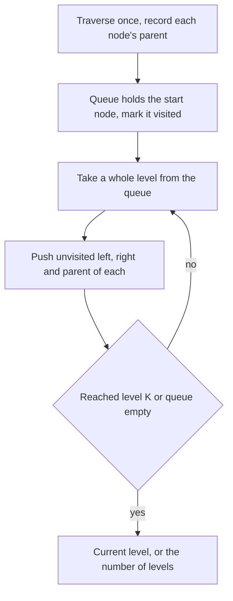

## The hook

A rumour starts with one cousin in a big family and spreads one generation per day, to parents, children, everyone directly related. Who hears it on day two? How long until the whole family knows? In a tree drawn on paper you would just spread outwards in rings. But in code, a tree node only knows its children; it has no idea who its parent is.

*All Nodes Distance K in Binary Tree* and *Amount of Time for Binary Tree to Be Infected* are both this rumour. The fix is the same for both: give every node a way to reach its parent, then the tree is just a small graph and a breadth-first search does the rest.

## The problem

```text
           1
         /   \
        2     3
       / \     \
      4   5     6
         / \
        7   8
```

| Question | Start | Answer |
|---|---|---|
| nodes at distance 2 | 5 | 1 and 4 |
| nodes at distance 3 | 5 | 3 |
| minutes to burn the whole tree, spreading one edge per minute | 5 | 4, because 6 is 4 edges away |

## The obvious approach

Recurse downwards from the target to find nodes k levels below it, then handle "upwards" cases separately: for each ancestor at distance d, look for nodes k − d levels down its other branch. That works, and it is a valid O(n) answer, but the bookkeeping, which branch to avoid at each ancestor, is fiddly and easy to get wrong.

## The key insight

:::analogy
Picture a fire starting at one node of the tree, spreading along every branch to every neighbour each minute, upwards to the parent as well as down to the children. To simulate it you need two things: for every node, a list of all its neighbours including the parent, and a record of which nodes have already burnt, so the fire never goes back where it has been.
:::

That is the whole plan:

- **Build a [[parent map]]** with one traversal, so every node knows its parent. Now each node has up to three neighbours: left, right and parent. This is the [[undirected view]] of the tree.
- **BFS from the start node,** level by level. Level d contains exactly the nodes at [[distance]] d. Keep a [[visited set]] so you never step back onto a node you came from.
- **For distance K,** stop after K levels and return the current level.
- **For burning time,** run the BFS to the end; the number of levels minus one is the start node's [[eccentricity]], the minute the last node catches fire.



:::insight
A binary tree with parent links is just an undirected graph. Breadth-first search from the start node then finds every node at each distance in rings, and a visited set stops it from walking back the way it came.
:::

## Walk through an example

Start at 5. BFS level by level, with every neighbour including the parent:

| Minute (distance) | Nodes burning now | Neighbours added to the next ring |
|---|---|---|
| 0 | 5 | 2 (parent), 7, 8 |
| 1 | 2, 7, 8 | from 2: 1 (parent), 4 (5 is already burnt) |
| 2 | 1, 4 | from 1: 3 (2 is already burnt) |
| 3 | 3 | 6 |
| 4 | 6 | none |

- The nodes at distance 2 are 1 and 4.
- The nodes at distance 3 are just 3.
- The whole tree has burnt after 4 minutes, when 6 catches fire.

Look at minute 1. From node 2, the fire could go to its parent 1, its left child 4 and its right child 5. Node 5 is already burnt, so the visited set stops the fire there. Without it, the search would bounce between 2 and 5 forever.

### The same shape on a grid: Rotting Oranges

*Rotting Oranges* is the burning tree on a grid: every rotten orange rots its four neighbours each minute. It is a multi-source BFS, starting with all rotten oranges in the queue at minute 0, and the answer is the number of levels until no fresh orange is left, or −1 if some can never be reached.

:::try-this
In the same tree, start the fire at 4 instead. How long does it take to burn everything, and which node burns last? (Distances from 4: 2 at 1, then 1 and 5 at 2, then 3, 7 and 8 at 3, then 6 at 4. So it takes 4 minutes, and 6 burns last.)
:::

:::warning
Common misconception: "Nodes at distance K are the nodes K levels below the target." That only covers the target's own subtree. Nodes above it, and nodes in its parent's other subtrees, can be at distance K too: in the example, node 1 is at distance 2 from node 5 by going up twice, and node 3 is at distance 3 by going up twice and down once.
:::

## The code

```pseudo
nodes_at_distance(root, target, k):
    parent = map built by a traversal (root's parent is none)
    visited = {target}; level = [target]
    repeat k times:
        next = []
        for node in level:
            for nb in (node.left, node.right, parent[node]):
                if nb exists and nb not in visited: visited.add(nb); next.append(nb)
        level = next
    return values of level

burn_time(root, start): same BFS until the queue is empty; return number of levels - 1
```

```cpp
#include <bits/stdc++.h>
using namespace std;

struct Node {
    int val;
    Node *left = nullptr, *right = nullptr;
    Node(int v, Node* l = nullptr, Node* r = nullptr) : val(v), left(l), right(r) {}
};

void buildParents(Node* n, Node* p, unordered_map<Node*, Node*>& parent) {
    if (!n) return;
    parent[n] = p;
    buildParents(n->left, n, parent), buildParents(n->right, n, parent);
}

vector<vector<Node*>> rings(Node* root, Node* start) {      // BFS levels from start
    unordered_map<Node*, Node*> parent;
    buildParents(root, nullptr, parent);
    unordered_set<Node*> seen{start};
    vector<vector<Node*>> levels{{start}};
    while (true) {
        vector<Node*> next;
        for (Node* n : levels.back())
            for (Node* nb : {n->left, n->right, parent[n]})  // down, down and up
                if (nb && seen.insert(nb).second) next.push_back(nb);
        if (next.empty()) break;
        levels.push_back(next);
    }
    return levels;
}

vector<int> distanceK(Node* root, Node* target, int k) {
    auto levels = rings(root, target);
    vector<int> out;
    if (k < (int)levels.size())
        for (Node* n : levels[k]) out.push_back(n->val);
    sort(out.begin(), out.end());
    return out;
}

int burnTime(Node* root, Node* start) { return (int)rings(root, start).size() - 1; }

int main() {
    Node *n4 = new Node(4), *n5 = new Node(5, new Node(7), new Node(8)), *n6 = new Node(6);
    Node* root = new Node(1, new Node(2, n4, n5), new Node(3, nullptr, n6));
    for (int k : {1, 2, 3}) {
        for (int v : distanceK(root, n5, k)) cout << v << ' ';
        cout << "| ";
    }
    cout << '\n';                                             // 2 7 8 | 1 4 | 3 |
    cout << burnTime(root, n5) << ' ' << burnTime(root, n4) << ' ' << burnTime(root, root) << '\n';   // 4 4 3
}
```

The answers are sorted only to make the output easy to compare; the problem accepts any order. Burning from the root takes 3 minutes here, the tree's height in edges, because from the root every path goes down. The level-by-level BFS is the one from [Ripples on a Pond: Breadth-First Search](article:dsa-bfs).

## Complexity

- **Time: O(n).** One traversal builds the parent map, and the BFS visits every node and edge at most once.
- **Space: O(n)** for the parent map, the visited set and the queue.
- **The parent-free recursive alternative** is also O(n) time but avoids the map, at the cost of trickier code.

## Common mistakes

- **Searching only downwards** from the target, missing ancestors and their other subtrees.
- **No visited set,** which bounces between a node and its parent forever.
- **Comparing node values instead of node pointers,** which breaks with duplicate values.
- **Off-by-one in burning time:** count edges, not nodes; a single node burns in 0 minutes.
- **Returning an empty list incorrectly** when K is larger than the start node's eccentricity; that is correct, but make sure the code does not crash reading a level that does not exist.
- **Using DFS** for distance levels without tracking depth carefully; BFS gives rings directly.

## Practice problems

*All Nodes Distance K in Binary Tree* is the walkthrough. *Amount of Time for Binary Tree to Be Infected* runs the same BFS to the end; there the start is given as a value, so find its node during the parent-map traversal. *Rotting Oranges* is the same spreading process on a grid with several starting points at once, a good check that the idea is "BFS on whatever the neighbours are", not something specific to trees.

## Key takeaways

- Nodes at distance K from a target can be above it or in other subtrees, so the search must be able to move upwards as well as down.
- One traversal that records each node's parent turns the tree into an undirected graph with up to three neighbours per node.
- A breadth-first search from the start node visits nodes in rings, so the K-th ring is exactly the set of nodes at distance K.
- A visited set keeps the search from stepping back to the node it came from.
- The time for a fire to burn the whole tree is the number of BFS levels minus one, the largest distance from the start node.
