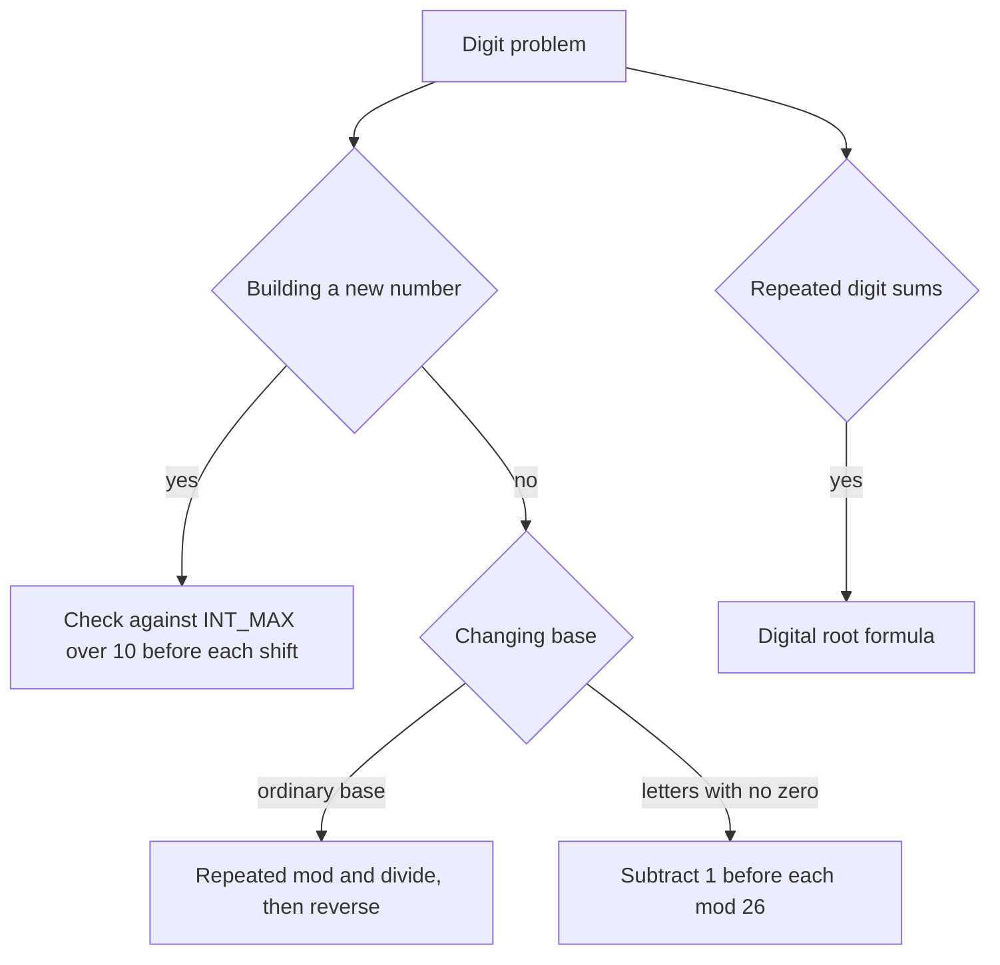

## The hook

"Reverse the digits of a 32-bit integer" sounds like a warm-up, until the reversed number does not fit. 1534236469 reversed is 9646324351, which is bigger than any signed 32-bit int. Many first attempts compute it anyway, watch it overflow into a negative number and then try to detect the damage afterwards, which is already undefined behaviour in C++.

Digit problems are small, but they test care with edge cases: negative numbers, trailing zeros, overflow and bases without a zero digit. A single loop shape, plus one overflow check, handles all of them.

## The intuition

:::analogy
Picture a car's odometer. The rightmost wheel shows the last digit; when you want to know the number, you can read the wheels from right to left. To build a new number digit by digit, you shift every wheel one place to the left and set the empty rightmost wheel to the new digit. And an odometer has a fixed number of wheels: push past its last wheel and it rolls over to a wrong reading.
:::

Every trick below is that odometer:

- **Reading digits right to left** is the [[digit loop]]: `n % 10` is the rightmost wheel, `n / 10` removes it.
- **Building a number** is `result = result * 10 + digit`: shift the wheels left and set the new last wheel.
- **Rolling over** is overflow. The fix is an [[overflow check]] before shifting: if one more shift would pass the last wheel, stop.

Other bases are odometers with different wheels: base 2 wheels show 0 or 1, base 7 wheels show 0 to 6. Spreadsheet columns are an odd odometer whose wheels show 1 to 26, with no zero at all.

## How it works

### The digit loop

```cpp partial
while (n != 0) {
    int d = n % 10;   // last digit
    n /= 10;          // drop it
}
```

It runs once per digit, so O(log₁₀ n) times. In C++, `%` and `/` truncate towards zero, so for negative n the digits come out negative: −123 gives −3, −2, −1. That is convenient for reversing, because building from negative digits produces the negative reversed number automatically.

### Reversing without overflow

Before computing `rev * 10 + d`, check that it stays inside [INT_MIN, INT_MAX]:

- if rev > INT_MAX / 10, or rev equals INT_MAX / 10 and d > 7, it would pass 2147483647;
- if rev < INT_MIN / 10, or rev equals INT_MIN / 10 and d < −8, it would pass −2147483648.

The 7 and −8 are the last digits of the two limits. Some solutions build in a 64-bit integer and compare at the end, which is fine when the problem allows 64-bit arithmetic; the problem statement for Reverse Integer says to assume you cannot, so the check-first version is the expected answer.

### Palindrome numbers by reversing half

A negative number is never a palindrome, and neither is a positive number ending in 0. Otherwise, move digits from the end of n onto a reversed number until the reversed part is at least as large as what is left. Then compare: equal for even length, or equal after dropping the middle digit (rev / 10) for odd length. Only half the digits are reversed, so the reversed part never overflows.

### Converting between bases

To write n in a [[positional base]] b, take n % b for the last digit and repeat with n / b, then reverse the digits you collected. To read a string in base b, use `value = value * b + digit` from left to right. Base 7 of 100 is 202, because 100 = 2 × 49 + 0 × 7 + 2.

### Spreadsheet columns: base 26 with no zero

Columns go A to Z, then AA, AB, and so on. There is no digit for zero: after Z comes AA, not "A0". That is [[bijective base 26]], and the fix is to subtract 1 before each step. Take n − 1, then (n − 1) % 26 picks the letter (0 is A, 25 is Z), and (n − 1) / 26 is the rest of the number. Reading a title back is easier: `value = value * 26 + (letter − 'A' + 1)`.



### Digital roots

*Add Digits* asks you to sum the digits of n repeatedly until one digit remains. 38 becomes 3 + 8 = 11, then 1 + 1 = 2.

Because 10 leaves remainder 1 when divided by 9, a number and its digit sum leave the same remainder mod 9. So the final digit is n mod 9, except that multiples of 9 give 9, not 0. The [[digital root]] is therefore 1 + (n − 1) mod 9 for positive n, and 0 for n = 0. For 38: 1 + 37 mod 9 = 1 + 1 = 2.

:::insight
Digits are read with `% base` and `/ base` from the right and built with `* base + digit` from the left. Every digit problem is a variation of these two loops, plus a check for the edges: overflow, negatives, trailing zeros and bases without a zero.
:::

## Walk through an example

### Reversing 120, −123 and 1534236469

| Input | Digits read, right to left | Reversed value | Result |
|---|---|---|---|
| 120 | 0, 2, 1 | 0, then 2, then 21 | 21 (the trailing zero disappears) |
| −123 | −3, −2, −1 | −3, −32, −321 | −321 |
| 1534236469 | 9, 6, 4, 6, 3, 2, 4, 3, 5 so far | 964632435 | next digit 1 would make 9646324351, and 964632435 > 214748364 = INT_MAX / 10, so return 0 |

The overflow is caught one step before it would happen. On the odometer, you notice that the next shift would push a digit off the last wheel, so you stop.

### Palindrome check of 12321

| Step | n | Reversed half |
|---|---|---|
| start | 12321 | 0 |
| 1 | 1232 | 1 |
| 2 | 123 | 12 |
| 3 | 12 | 123 |

Now the reversed half, 123, is at least n, 12. The length is odd, so drop the middle digit: 123 / 10 = 12 equals n. It is a palindrome.

### Column titles

| n | n − 1 | (n − 1) mod 26 | Letter | Next n = (n − 1) / 26 |
|---|---|---|---|---|
| 28 | 27 | 1 | B | 1 |
| 1 | 0 | 0 | A | 0 |

Reading the letters back to front gives AB. For 701 the steps give Y and then Z, so the title is ZY, and reading it back, 26 × 26 + 25 = 701.

:::try-this
What are the column titles for 26 and 52, and what number is the title "AZ"? (26: n − 1 = 25 gives Z, then 25 / 26 = 0, so "Z". 52: 51 mod 26 = 25 gives Z, then 51 / 26 = 1, and 0 gives A, so "AZ". And "AZ" reads back as 1 × 26 + 26 = 52.)
:::

:::warning
Common misconception: "Treat spreadsheet columns as ordinary base 26." In ordinary base 26 with digits 0 to 25, the number after "Z" would be "BA", and 26 itself would need a zero digit. Columns have no zero, so you must subtract 1 before each step; skipping it gives answers like "A@" or shifts every title by one letter.
:::

## The code

```pseudo
reverse(x):
    rev = 0
    while x != 0:
        d = x mod 10 (keeping the sign); x = x / 10
        if rev > MAX / 10 or (rev == MAX / 10 and d > 7): return 0
        if rev < MIN / 10 or (rev == MIN / 10 and d < -8): return 0
        rev = rev * 10 + d
    return rev

is_palindrome(x):
    if x < 0 or (x mod 10 == 0 and x != 0): return false
    rev = 0
    while x > rev: rev = rev * 10 + x mod 10; x = x / 10
    return x == rev or x == rev / 10

column_title(n):
    s = ""
    while n > 0: n -= 1; s = letter(n mod 26) + s; n = n / 26
```

```cpp
#include <bits/stdc++.h>
using namespace std;

int reverseInt(int x) {
    int rev = 0;
    while (x != 0) {
        int d = x % 10;                                     // keeps the sign of x
        x /= 10;
        if (rev > INT_MAX / 10 || (rev == INT_MAX / 10 && d > 7)) return 0;   // would pass the top wheel
        if (rev < INT_MIN / 10 || (rev == INT_MIN / 10 && d < -8)) return 0;
        rev = rev * 10 + d;
    }
    return rev;
}

bool isPalindrome(int x) {
    if (x < 0 || (x % 10 == 0 && x != 0)) return false;
    int rev = 0;
    while (x > rev) { rev = rev * 10 + x % 10; x /= 10; }   // reverse only half
    return x == rev || x == rev / 10;                      // even or odd length
}

string toBase(int n, int b) {                               // b from 2 to 10
    if (n == 0) return "0";
    bool neg = n < 0;
    long long v = llabs((long long)n);
    string s;
    while (v) { s += char('0' + v % b); v /= b; }
    if (neg) s += '-';
    reverse(s.begin(), s.end());
    return s;
}

string columnTitle(int n) {
    string s;
    while (n > 0) { n--; s += char('A' + n % 26); n /= 26; }   // no zero digit: shift by one
    reverse(s.begin(), s.end());
    return s;
}

long long columnNumber(const string& s) {
    long long v = 0;
    for (char c : s) v = v * 26 + (c - 'A' + 1);
    return v;
}

int digitalRoot(int n) { return n == 0 ? 0 : 1 + (n - 1) % 9; }

int main() {
    cout << reverseInt(120) << ' ' << reverseInt(-123) << ' ' << reverseInt(1534236469) << '\n';   // 21 -321 0
    cout << isPalindrome(12321) << isPalindrome(-121) << isPalindrome(10) << '\n';                 // 100
    cout << toBase(100, 7) << ' ' << toBase(-7, 7) << ' ' << toBase(10, 2) << '\n';                // 202 -10 1010
    cout << columnTitle(28) << ' ' << columnTitle(701) << ' ' << columnTitle(52) << ' '
         << columnNumber("ZY") << '\n';                                                            // AB ZY AZ 701
    cout << digitalRoot(38) << ' ' << digitalRoot(18) << '\n';                                     // 2 9
}
```

For the integer square root, the cleanest method is a binary search over the answer, covered in [Binary Search Without the Off-by-One Fear](article:dsa-binary-search). Bit-level tricks with numbers, such as counting set bits or checking powers of two, are in [A Row of Light Switches Inside Every Number](article:dsa-bit-basics).

## Complexity

- **All digit loops: O(d) time, where d is the number of digits,** that is O(log n) in base 10 or O(log_b n) in base b. O(1) extra space, apart from output strings.
- **Digital root: O(1)** with the formula, or O(log n) per round of summing.
- **Column title and number: O(log₂₆ n),** a handful of steps for any 32-bit input.

## Common mistakes

- **Detecting overflow after it happens.** Signed overflow is undefined behaviour in C++; check before multiplying by 10.
- **Forgetting negatives,** either in the overflow check (the lower limit ends in 8, not 7) or by taking `abs` of INT_MIN, which itself overflows.
- **Calling numbers ending in 0 palindromes.** 10 reversed is 1; only 0 itself is a palindrome among those.
- **Skipping the "subtract 1" step** for spreadsheet columns.
- **Forgetting to reverse the collected digits** after base conversion, which prints them backwards.
- **Returning 0 for the digital root of 9, 18, 27, ...** instead of 9.

## Practice problems

*Palindrome Number* and *Add Digits* are quick digit-loop drills; solve Add Digits once with a loop and once with the formula. *Base 7* is ordinary base conversion with a sign. *Excel Sheet Column Number* and *Excel Sheet Column Title* are the two directions of bijective base 26. *Reverse Integer* is the overflow check that interviewers watch most closely.

## Key takeaways

- Read digits from the right with n % 10 and n / 10, and build numbers from the left with result * 10 + digit.
- Check for overflow before each multiply and add, comparing with INT_MAX / 10 and the limit's last digit, rather than detecting it afterwards.
- A palindrome check only needs to reverse half of the digits, which also avoids overflow.
- Spreadsheet columns are base 26 with digits 1 to 26 and no zero, so subtract 1 before each mod-and-divide step.
- The digital root of a positive n is 1 + (n − 1) mod 9, because a number and its digit sum leave the same remainder mod 9.
