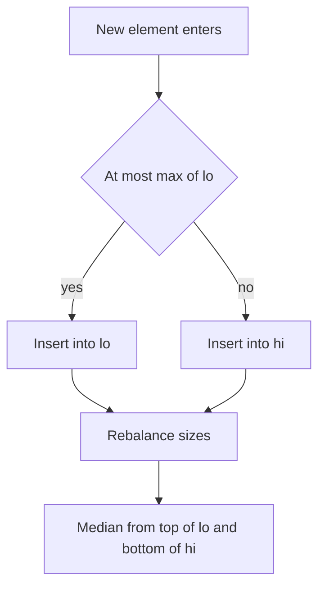

## The hook

A sliding window answers "the best block of consecutive elements" in one pass, as long as you can update the window's summary cheaply. A sum is easy: add the new element and subtract the old one. But what if the question needs the window's maximum, minimum, median or "is anything within 3 of this value"? You cannot subtract your way out of a maximum, because when the biggest element leaves, which one is next?

Rescanning the window every time costs O(k) per step. The fix is to keep the window's contents sorted at all times, in a structure that accepts arrivals and departures in O(log k).

## The intuition

:::analogy
Picture a library shelf that keeps its books sorted by height. Books arrive at one end of the library's conveyor and leave from the other, but the shelf always holds exactly the books currently in the window, each slotted into its sorted place. Want the tallest book? Look at the right end of the shelf. The shortest? The left end. The middle one? Count to the middle. A book whose height is close to 20 cm? Run your finger to where 20 would go.
:::

That sorted shelf is a [[multiset]], `std::multiset` in C++. It is a balanced tree that keeps every copy of equal values, which matters because windows often contain duplicates. Insert and erase cost O(log k), and the smallest and largest elements are at `begin()` and `rbegin()`.

Combine it with the usual [[window]] mechanics from [The Caterpillar That Reads Arrays in One Pass](article:dsa-sliding-window): the right edge advances and its element joins the shelf; the left edge advances and its element leaves. The shelf always matches the window, so any order question about the window is a quick look at the shelf.

## How it works

### The loop

- **Grow:** move the right edge and insert `a[r]` into the multiset.
- **Shrink:** while the window breaks the rule, or is bigger than k for fixed windows, erase `a[l]` and move the left edge.
- **Read:** take the answer off the multiset, such as the min, the max, a [[lower_bound]] query or the middle element.

### Erasing one copy, not all of them

This is the bug that catches almost everyone once. `s.erase(x)` removes every element equal to x. If the window holds two 4s and one leaves, you must remove only one:

```cpp partial
s.erase(s.find(a[l]));   // erase exactly one copy of a[l]
```

That is [[iterator erase]]. On the shelf, it is taking one specific book down, not every book of that height.

### Three question types

| Question about the window | What to read from the multiset |
|---|---|
| Max minus min within a limit? | `*s.rbegin() - *s.begin()` |
| Any value within t of x? | `it = s.lower_bound(x - t)`, then check `it != s.end() && *it <= x + t` |
| Median? | the middle element, maintained with two multisets or a tracked iterator |

### Running medians with two shelves

For the [[running median]], split the window into two multisets: `lo` holds the smaller half and `hi` the larger half, with every element of `lo` no bigger than every element of `hi`, and `lo` holding the extra element when the window size is odd. The median is then `*lo.rbegin()`, or the average of `*lo.rbegin()` and `*hi.begin()` for an even size.

To add x, put it in `lo` if it is no bigger than `lo`'s maximum, otherwise in `hi`. To remove x, erase one copy from whichever half contains it. After either, rebalance by moving one element across so the sizes differ by at most one in `lo`'s favour.



:::insight
A sliding window needs a summary you can update when one element enters and one leaves. Sums and counts subtract cleanly; order statistics like min, max and median do not, so keep the window itself sorted and read them off in O(log k).
:::

### When something faster exists

For the window maximum or minimum alone, a monotonic deque does it in O(n) total, the same idea as [Who Can See Over the Crowd](article:dsa-monotonic-stack) applied to a queue. For Contains Duplicate III, bucketing values into blocks of width t + 1 gives O(n) expected time. The multiset is the general tool: one structure answers min, max, nearest value and median, and it is quick to write correctly. In an interview, start with the multiset and mention the faster special cases.

## Walk through an example

### Longest subarray with max − min ≤ 5 in [10, 1, 2, 4, 7, 2]

| r | a[r] | Shelf after insert | max − min | Shrink? | Window | Length |
|---|---|---|---|---|---|---|
| 0 | 10 | {10} | 0 | no | [0, 0] | 1 |
| 1 | 1 | {1, 10} | 9 | erase a[0] = 10 → {1} | [1, 1] | 1 |
| 2 | 2 | {1, 2} | 1 | no | [1, 2] | 2 |
| 3 | 4 | {1, 2, 4} | 3 | no | [1, 3] | 3 |
| 4 | 7 | {1, 2, 4, 7} | 6 | erase a[1] = 1 → {2, 4, 7} | [2, 4] | 3 |
| 5 | 2 | {2, 2, 4, 7} | 5 | no | [2, 5] | 4 |

The answer is 4, for the block [2, 4, 7, 2]. Notice the shelf at r = 5 holds two copies of 2. A plain `set` would have stored one, and when the left edge later passed the first 2, erasing it would have wrongly removed both.

### Contains Duplicate III: any i ≠ j with |i − j| ≤ 3 and |a[i] − a[j]| ≤ 0 in [1, 2, 3, 1]?

Keep a shelf of the last k = 3 values. For each x, ask `lower_bound(x − 0)` and check it is at most x + 0.

| i | x | Shelf before | lower_bound(x) | Within [x, x]? |
|---|---|---|---|---|
| 0 | 1 | {} | end | no |
| 1 | 2 | {1} | end | no |
| 2 | 3 | {1, 2} | end | no |
| 3 | 1 | {1, 2, 3} | 1 | yes: return true |

For [1, 5, 9, 1, 5, 9] with k = 2 and t = 3, every query fails: equal values are always 3 indices apart, and values within the window differ by 4, so the answer is false.

### Sliding window median of [1, 3, −1, −3, 5, 3, 6, 7] with k = 3

| Window | lo (smaller half) | hi (larger half) | Median |
|---|---|---|---|
| 1 3 −1 | {−1, 1} | {3} | 1 |
| 3 −1 −3 | {−3, −1} | {3} | −1 |
| −1 −3 5 | {−3, −1} | {5} | −1 |
| −3 5 3 | {−3, 3} | {5} | 3 |
| 5 3 6 | {3, 5} | {6} | 5 |
| 3 6 7 | {3, 6} | {7} | 6 |

With an odd k, the median is always the largest element of `lo`.

:::try-this
With limit 4, find the longest subarray of [8, 2, 4, 7] whose max − min is at most 4. (Windows: {8}, then {2, 8} breaks the limit, so 8 leaves; {2, 4} has difference 2, length 2; {2, 4, 7} has difference 5, so 2 leaves, leaving {4, 7}, length 2. The answer is 2.)
:::

:::warning
Common misconception: "A set is a multiset without the duplicates problem, so it is safer." It is the opposite. A `set` silently drops the second copy of a value, so when the first copy leaves the window, the shelf loses a value that is still inside. Use `multiset` and erase with `s.erase(s.find(x))`.
:::

## The code

```pseudo
longest_within_limit(a, limit):
    S = empty multiset; l = 0; best = 0
    for r in 0 .. n-1:
        insert a[r] into S
        while max(S) - min(S) > limit:
            erase one copy of a[l] from S; l += 1
        best = max(best, r - l + 1)
    return best

nearby_almost_duplicate(a, k, t):
    S = empty multiset
    for i in 0 .. n-1:
        it = first element of S that is >= a[i] - t
        if it exists and it <= a[i] + t: return true
        insert a[i]
        if size(S) > k: erase one copy of a[i - k]
    return false

window_median(a, k):
    lo, hi = empty multisets            # lo keeps the extra element
    for i in 0 .. n-1:
        add a[i] to lo or hi; if i >= k: remove one copy of a[i - k]
        rebalance so size(lo) is size(hi) or size(hi) + 1
        if i >= k - 1: report max(lo), or the average of max(lo) and min(hi)
```

```cpp
#include <bits/stdc++.h>
using namespace std;

// Longest window whose max - min stays within limit.
int longestWithinLimit(const vector<int>& a, int limit) {
    multiset<int> s;
    int best = 0;
    for (int l = 0, r = 0; r < (int)a.size(); r++) {
        s.insert(a[r]);
        while (*s.rbegin() - *s.begin() > limit) s.erase(s.find(a[l++]));   // one copy only
        best = max(best, r - l + 1);
    }
    return best;
}

// Contains Duplicate III: i != j, |i - j| <= k, |a[i] - a[j]| <= t.
bool nearbyAlmostDuplicate(const vector<int>& a, int k, long long t) {
    multiset<long long> s;                       // long long: a[i] - t may overflow int
    for (int i = 0; i < (int)a.size(); i++) {
        auto it = s.lower_bound((long long)a[i] - t);
        if (it != s.end() && *it <= (long long)a[i] + t) return true;
        s.insert(a[i]);
        if ((int)s.size() > k) s.erase(s.find(a[i - k]));
    }
    return false;
}

// Sliding window median with two multisets; lo holds the extra element.
vector<double> windowMedian(const vector<int>& a, int k) {
    multiset<int> lo, hi;
    vector<double> res;
    auto rebalance = [&]() {
        if (lo.size() > hi.size() + 1) { hi.insert(*lo.rbegin()); lo.erase(prev(lo.end())); }
        if (hi.size() > lo.size()) { lo.insert(*hi.begin()); hi.erase(hi.begin()); }
    };
    for (int i = 0; i < (int)a.size(); i++) {
        if (lo.empty() || a[i] <= *lo.rbegin()) lo.insert(a[i]);
        else hi.insert(a[i]);
        if (i >= k) {                            // a[i - k] leaves the window
            int out = a[i - k];
            if (out <= *lo.rbegin()) lo.erase(lo.find(out));
            else hi.erase(hi.find(out));
        }
        rebalance();
        if (i >= k - 1)
            res.push_back(k % 2 ? *lo.rbegin() : ((double)*lo.rbegin() + *hi.begin()) / 2.0);
    }
    return res;
}

int main() {
    cout << longestWithinLimit({10, 1, 2, 4, 7, 2}, 5) << ' '
         << longestWithinLimit({8, 2, 4, 7}, 4) << '\n';                 // 4 2
    cout << nearbyAlmostDuplicate({1, 2, 3, 1}, 3, 0) << ' '
         << nearbyAlmostDuplicate({1, 5, 9, 1, 5, 9}, 2, 3) << '\n';      // 1 0
    for (double m : windowMedian({1, 3, -1, -3, 5, 3, 6, 7}, 3)) cout << m << ' ';
    cout << '\n';                                                        // 1 -1 -1 3 5 6
    for (double m : windowMedian({1, 2, 3, 4, 2, 3, 1, 4, 2}, 4)) cout << m << ' ';
    cout << '\n';                                                        // 2.5 2.5 3 2.5 2.5 2.5
}
```

The removal step in `windowMedian` decides which half holds the leaving value by comparing it with `lo`'s maximum. That works because every value in `lo` is no bigger than every value in `hi`. If a value equal to `lo`'s maximum also sits in `hi`, removing it from `lo` instead is still correct: the two copies are interchangeable, and the rebalance restores the sizes.

For Contains Duplicate III, the window holds the previous k values, so the check runs before inserting `a[i]`, and the oldest value leaves after insertion. Values are stored as `long long` because `a[i] - t` and `a[i] + t` can overflow a 32-bit int.

If you are on a GCC judge and need the k-th element of the window directly, the ordered set from [A Sorted Shelf That Knows Every Book's Position](article:cp-pbds-ordered-set) gives `find_by_order(k / 2)` in one call.

## Complexity

- **Time: O(n log k).** Each element is inserted once and erased at most once, and every operation on a balanced tree of at most k elements costs O(log k). Reading `begin()`, `rbegin()` or a `lower_bound` is O(1) or O(log k).
- **Space: O(k)** for the elements currently in the window.
- **For variable-size windows** such as the limit problem, k can grow to n, so the bound is O(n log n).
- **Compared with rescanning,** which is O(n · k), the multiset is the difference between passing and timing out once k is in the thousands.

## Common mistakes

- **`s.erase(value)` instead of `s.erase(s.find(value))`,** which removes every copy and corrupts the window.
- **Using `set` instead of `multiset`,** which drops duplicates on insert.
- **Overflow in `x - t` or `x + t`** in Contains Duplicate III; use 64-bit values.
- **Checking before or after insertion inconsistently.** In Contains Duplicate III, query before inserting `a[i]`, or it will always match itself.
- **Averaging medians in int,** which overflows for large values and truncates halves. Convert to double first, or compute `lo + (hi - lo) / 2.0`.
- **Forgetting to rebalance after removal** as well as after insertion, so the halves drift apart.
- **Dereferencing `rbegin()` of an empty multiset** at the start of the loop.

## Practice problems

Start with *Longest Continuous Subarray With Absolute Diff Less Than or Equal to Limit*, the cleanest use of min and max from a multiset in a variable window. *Contains Duplicate III* adds `lower_bound` and an overflow trap. *Sliding Window Median* on LeetCode and on CSES is the two-shelf technique; the CSES version also rewards the ordered set from the CP track. *Sliding Window Maximum* is solvable with a multiset in O(n log k), but solve it a second time with a monotonic deque in O(n), which is the answer interviewers usually expect for that problem.

## Key takeaways

- When a sliding window needs order statistics such as min, max, median or nearest value, keep the window's elements in a multiset so they stay sorted.
- Every element enters and leaves the multiset once, so the window runs in O(n log k) instead of O(n · k).
- Always remove a leaving element with s.erase(s.find(x)), because erasing by value deletes every copy.
- lower_bound(x − t) finds the smallest window value at least x − t, which answers "is anything within t of x" in O(log k).
- A running median uses two multisets for the smaller and larger halves, kept balanced so the median is at the top of the lower half.
