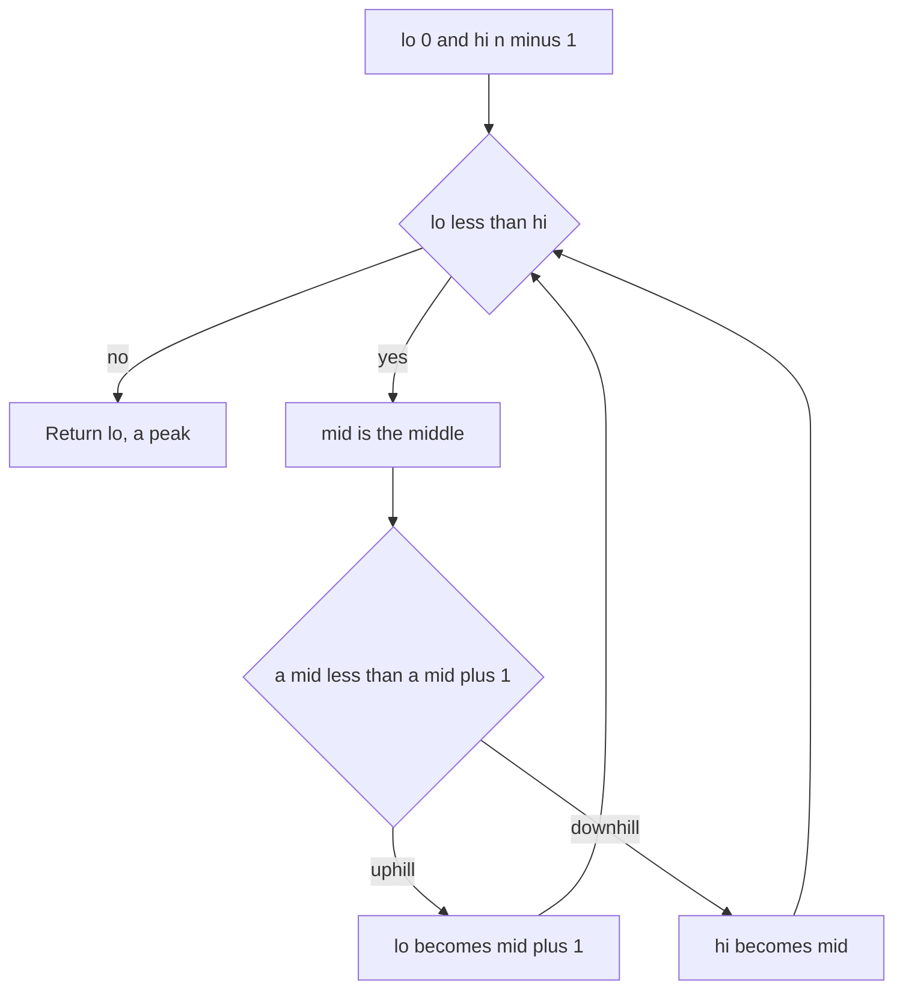

## The hook

You are standing on a hillside in fog so thick you can see only the ground under your feet. You want to reach a summit, any summit. You cannot see the whole hill, but you can feel whether the ground rises to your left or to your right. Walk uphill, and you are guaranteed to reach a top.

That is the whole idea behind finding a peak in O(log n). The surprising part for most people: the array is **not sorted**, yet binary search still works. It is a lesson in what binary search really needs, which is not sorted data but a test that tells you which half is safe to keep.

## The problem

A [[peak]] is an element strictly greater than its neighbours. Treat positions outside the array as minus infinity, so the first and last elements need to beat only one neighbour. Adjacent elements are never equal. Return the index of any peak in O(log n).

| Array | Peaks (index: value) | Any of these is a correct answer |
|---|---|---|
| [1, 2, 3, 1] | 2: 3 | 2 |
| [1, 2, 1, 3, 5, 6, 4] | 1: 2 and 5: 6 | 1 or 5 |
| [5, 4, 3] | 0: 5 | 0 |

## The obvious approach

Scan left to right and return the first i with a[i] > a[i + 1]; if there is none, the last element is a peak. That is O(n), correct and simple. Even simpler: the maximum element is always a peak. Both are good first answers. The follow-up is "do it in O(log n)".

## The key insight

:::analogy
In the fog, you test the ground between where you stand and one step to your right. If it rises, keep going right: either the hill keeps rising until the edge of the map, and the edge itself is a summit because beyond it is a drop, or at some point the ground starts falling, and the spot just before that fall is a summit. You never need to see the whole hill to know a summit lies in that direction.
:::

That is the [[slope]] test. At position mid, compare a[mid] with a[mid + 1]:

- **Uphill,** a[mid] < a[mid + 1]: some peak lies in [mid + 1, hi]. Set lo = mid + 1.
- **Downhill,** a[mid] > a[mid + 1]: some peak lies in [lo, mid], and mid itself might be it. Set hi = mid.

The [[search invariant]] is "the range [lo, hi] contains a peak". It holds at the start, because the whole array always contains a peak (its maximum, at least). Each step keeps it true and shrinks the range. When lo equals hi, the one remaining index is a peak.



Why does the uphill case guarantee a peak on the right? Walk right from mid + 1. The values cannot rise forever inside a finite array, so either they rise all the way to the last element, which is then a peak since beyond it is minus infinity, or they fall at some first point, and the element just before that fall is higher than both neighbours. The downhill case is the mirror image, walking left.

:::insight
Binary search does not need sorted data. It needs a test that, at every midpoint, proves one half still contains an answer. For peaks, comparing a[mid] with a[mid + 1] is that test, so O(log n) works on unsorted arrays.
:::

## Walk through an example

[1, 2, 1, 3, 5, 6, 4], indices 0 to 6.

| lo | hi | mid | a[mid] | a[mid + 1] | Slope | New range |
|---|---|---|---|---|---|---|
| 0 | 6 | 3 | 3 | 5 | uphill | [4, 6] |
| 4 | 6 | 5 | 6 | 4 | downhill | [4, 5] |
| 4 | 5 | 4 | 5 | 6 | uphill | [5, 5] |

The search returns index 5, value 6, a peak. It ignored the other peak at index 1 completely: the first comparison found an uphill step at index 3, and from then on the right side was guaranteed to contain a summit. In fog terms, you went uphill from where you happened to stand and reached the nearest top in that direction.

Note that mid + 1 never goes out of range, because the loop runs only while lo < hi, so mid < hi.

### Mountain arrays

A [[mountain array]] rises to one top and then falls. *Peak Index in a Mountain Array* is the same search; there is just one peak to find. For [0, 2, 4, 7, 5, 3, 1], the search compares 7 and 5 at mid = 3, finds downhill, shrinks to [0, 3], then climbs to index 3.

### Searching for a value in a mountain

*Find in Mountain Array* asks for the smallest index holding a target, using few reads. A mountain is [[bitonic]]: increasing up to the peak, decreasing after it. So:

- find the peak with the slope search;
- binary search the increasing left part [0, peak] as usual;
- if not found, binary search the decreasing right part with the comparison reversed.

Searching the left part first guarantees the smallest index when the target appears on both sides. For [0, 2, 4, 7, 5, 3, 1] and target 5, the left part 0, 2, 4, 7 does not contain 5, and the right part 7, 5, 3, 1 has it at index 4.

### A peak in a grid

*Find a Peak Element II* asks for a cell larger than its four neighbours. Binary search over **rows**: in the middle row, find the column of its maximum. If the cell above or below is larger, a peak must lie in that direction, by the same "keep walking uphill" argument; otherwise this row maximum is a peak. Each round costs O(n) to scan a row of n columns, and there are O(log m) rounds.

For the grid

```text
10 20 15
21 30 14
 7 16 32
```

the middle row's maximum is 30 at column 1. Above it is 20 and below it is 16, both smaller, and its left and right neighbours are smaller because 30 is the row maximum. So (1, 1) is a peak.

:::try-this
Run the slope search on [5, 4, 3, 2, 1]. Which index does it return? (lo = 0, hi = 4, mid = 2: 3 > 2, downhill, hi = 2. mid = 1: 4 > 3, hi = 1. mid = 0: 5 > 4, hi = 0. It returns index 0, where 5 beats its only neighbour.)
:::

:::warning
Common misconception: "Binary search only works on sorted arrays." It works whenever one comparison can safely discard half of the remaining candidates. Sorted order is the most common reason that is true, but slopes, monotonic yes-or-no tests and the cut condition in two sorted arrays are others.
:::

## The code

```pseudo
find_peak(a):
    lo = 0; hi = n - 1
    while lo < hi:
        mid = (lo + hi) / 2
        if a[mid] < a[mid + 1]: lo = mid + 1     # uphill: a peak is to the right
        else: hi = mid                           # downhill: a peak is here or to the left
    return lo

find_in_mountain(a, target):
    p = find_peak(a)
    i = binary search for target in a[0 .. p] (increasing)
    if found: return i
    return binary search for target in a[p .. n-1] (decreasing), or -1
```

```cpp
#include <bits/stdc++.h>
using namespace std;

int findPeak(const vector<int>& a) {
    int lo = 0, hi = a.size() - 1;
    while (lo < hi) {
        int mid = lo + (hi - lo) / 2;
        if (a[mid] < a[mid + 1]) lo = mid + 1;       // uphill: keep climbing right
        else hi = mid;                               // downhill: summit here or to the left
    }
    return lo;
}

int searchSide(const vector<int>& a, int lo, int hi, int target, bool increasing) {
    while (lo <= hi) {
        int mid = lo + (hi - lo) / 2;
        if (a[mid] == target) return mid;
        bool goRight = increasing ? a[mid] < target : a[mid] > target;
        if (goRight) lo = mid + 1;
        else hi = mid - 1;
    }
    return -1;
}

int findInMountain(const vector<int>& a, int target) {
    int p = findPeak(a);
    int i = searchSide(a, 0, p, target, true);       // left side first: smallest index
    return i != -1 ? i : searchSide(a, p, a.size() - 1, target, false);
}

pair<int, int> peakInGrid(const vector<vector<int>>& g) {
    int lo = 0, hi = g.size() - 1;
    while (lo <= hi) {
        int r = lo + (hi - lo) / 2;
        int c = max_element(g[r].begin(), g[r].end()) - g[r].begin();   // row maximum
        int up = r > 0 ? g[r - 1][c] : INT_MIN, down = r + 1 < (int)g.size() ? g[r + 1][c] : INT_MIN;
        if (g[r][c] > up && g[r][c] > down) return {r, c};
        if (up > g[r][c]) hi = r - 1;                // climb towards the larger neighbour
        else lo = r + 1;
    }
    return {-1, -1};
}

int main() {
    cout << findPeak({1, 2, 1, 3, 5, 6, 4}) << ' ' << findPeak({1, 2, 3, 1}) << ' '
         << findPeak({5, 4, 3, 2, 1}) << '\n';                                  // 5 2 0
    vector<int> m = {0, 2, 4, 7, 5, 3, 1};
    cout << findPeak(m) << ' ' << findInMountain(m, 5) << ' ' << findInMountain(m, 9) << '\n';   // 3 4 -1
    auto [r, c] = peakInGrid({{10, 20, 15}, {21, 30, 14}, {7, 16, 32}});
    cout << r << ' ' << c << '\n';                                              // 1 1
}
```

## Complexity

- **Find Peak Element and mountain peak: O(log n) time, O(1) space.** Each step halves the range [lo, hi].
- **Find in Mountain Array: O(log n),** three binary searches, which matters there because the problem limits how many times you may read the array.
- **Peak in an m by n grid: O(n log m),** a row scan of n per round and O(log m) rounds. Binary searching over columns instead gives O(m log n); pick the smaller.

## Common mistakes

- **Reading a[mid + 1] out of range.** With `while (lo < hi)` and mid rounded down, mid + 1 ≤ hi always holds. Changing the loop to `lo <= hi` breaks that.
- **Setting hi = mid − 1 on a downhill step,** which can throw away the peak itself when mid is the summit.
- **Comparing with a[mid − 1] while rounding mid down,** which can read a[−1] when lo = 0. Pick one neighbour and round accordingly.
- **Assuming the answer is the global maximum.** The search returns some peak, not necessarily the highest; if the maximum is required, it is an O(n) scan.
- **Equal neighbours.** The guarantee needs adjacent values to differ. With plateaus, the slope test cannot tell which way is up, and the worst case becomes O(n).
- **Searching the right side of a mountain first** when the smallest index is required.

## Practice problems

Start with *Peak Index in a Mountain Array*, where there is exactly one peak, then *Find Peak Element*, where any of several peaks is accepted and the edges count as minus infinity. *Find in Mountain Array* combines the peak search with two ordinary binary searches, one with reversed comparisons. *Find a Peak Element II* lifts the argument to a grid by searching over rows. For the general skill of deciding what a binary search should test, compare with [Binary Search on a Clock Whose 12 Moved](article:dsa-rotated-array-search), another search on data that is not fully sorted.

## Key takeaways

- A peak can be found in O(log n) without sorted data by comparing a[mid] with a[mid + 1] and moving towards the larger value.
- From an uphill step, a peak must exist on that side: the values either rise to the edge, which is then a peak, or fall at some point just after a peak.
- The search keeps the invariant that [lo, hi] contains a peak, setting lo = mid + 1 uphill and hi = mid downhill until one index remains.
- A mountain array is increasing then decreasing, so after finding its peak each side can be searched with ordinary binary search, with the comparison flipped on the falling side.
- Binary search only needs a test that proves one half still contains an answer, which is why it also works for peaks in grids by searching over rows.
