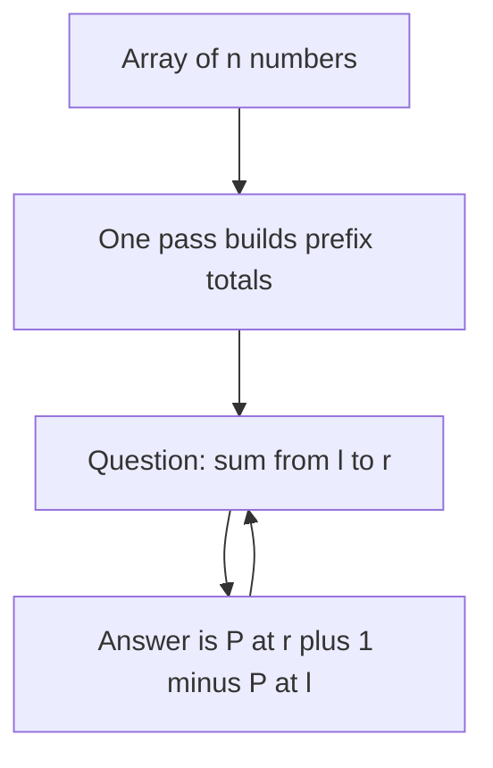
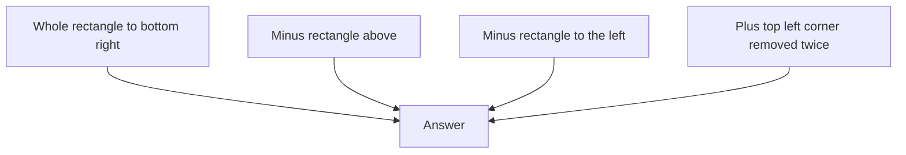

## The hook

Your interviewer hands you an array of 100,000 numbers and then asks 100,000 questions: "What is the sum from index 3,120 to index 88,004?" If you add up each range from scratch, you could be doing ten billion additions. Your program times out before the third coffee.

There is a trick that answers every one of those questions with a single subtraction. It takes one pass to set up, and it is one of the most reused ideas in all of algorithms: it hides inside range queries, grid problems, "count the subarrays whose sum is..." questions and even bulk updates.

## The intuition

:::analogy
Think of a car's odometer. It does not tell you how far you drove on Tuesday; it tells you the total distance since the car was new. Yet if you wrote down the reading at the start and end of Tuesday's trip, one subtraction gives you Tuesday's distance. You never re-drive the road to measure it.
:::

A [[prefix sum]] array is an odometer for your data. Position $i$ stores "the total of everything before this point." Any [[range query]] then becomes "reading at the end minus reading at the start."

The cost moves. Instead of paying for every question, you pay once, up front. That is [[precomputation]], and it is worth it whenever questions outnumber the setup.



### Cues that should make you think of prefix sums

- "sum, count or XOR over a range", asked many times on data that does not change;
- "add v to every element from l to r", many times, with the result needed only at the end;
- "count or find subarrays whose sum equals, or is divisible by, k", especially with negative numbers;
- "an index where the left side balances the right side";
- any rectangle sum in a grid.

## How it works

Define an array $P$ with one extra slot:

$$P[0] = 0, \qquad P[i] = a[0] + a[1] + \dots + a[i-1]$$

- $a$ is your original array, indexed from 0.
- $P[i]$ is the sum of the **first $i$ elements**. Note the "first $i$": $P[3]$ covers $a[0], a[1], a[2]$.
- The leading $P[0] = 0$ is a [[sentinel]]. It means "before anything, the total is zero."

Each $P[i]$ is just the previous total plus one new element: $P[i] = P[i-1] + a[i-1]$. So the whole array takes one pass.

Now the sum of $a[l..r]$ (inclusive) is:

$$\text{sum}(l, r) = P[r+1] - P[l]$$

$P[r+1]$ counts everything from index 0 through $r$. $P[l]$ counts everything before $l$. Subtract, and only $a[l..r]$ is left. Same as the odometer: end reading minus start reading.

:::insight
Prefix sums turn a range into the difference of two points. Whenever a problem asks about "the total over a contiguous stretch," ask yourself whether two running totals can answer it.
:::

### Which operations work

The subtraction step only works for an [[invertible operation]]: one whose effect you can undo.

| Operation | Prefix array stores | Range answer | Works? |
|---|---|---|---|
| Sum | running sums | P[r+1] − P[l] | yes |
| Count of some property | running counts | C[r+1] − C[l] | yes, a count is a sum of 0s and 1s |
| XOR | running XORs | X[r+1] XOR X[l] | yes, XOR undoes itself |
| Product | running products | Q[r+1] / Q[l] | only without zeros, and with care for overflow |
| Minimum or maximum | running minima | none | no, a minimum cannot be "subtracted" |

Counting is the quiet workhorse. "How many vowels are in s[l..r]?" is a prefix sum over an array that has 1 at vowels and 0 elsewhere. With 26 letters, keep 26 prefix arrays and answer "how many of each letter in this range" in O(26).

## Walk through an example

### Building and querying

Take `a = [3, 1, 4, 1, 5, 9]`.

| $i$ | 0 | 1 | 2 | 3 | 4 | 5 | 6 |
|---|---|---|---|---|---|---|---|
| $a[i-1]$ added | none | 3 | 1 | 4 | 1 | 5 | 9 |
| $P[i]$ | 0 | 3 | 4 | 8 | 9 | 14 | 23 |

Question: what is the sum of `a[2..4]`, that is $4 + 1 + 5$?

- End reading: $P[4+1] = P[5] = 14$ (that is $3+1+4+1+5$).
- Start reading: $P[2] = 4$ (that is $3+1$).
- Answer: $14 - 4 = 10$. Check by hand: $4 + 1 + 5 = 10$. Correct.

The XOR version works the same way. The prefix XORs of this array are 0, 3, 2, 6, 7, 2, 11, and the XOR of `a[2..4]` is $X[5] \oplus X[2] = 2 \oplus 2 = 0$, which matches $4 \oplus 1 \oplus 5 = 0$.

:::try-this
Using the same table, find the sum of `a[0..5]` and of `a[3..3]`. (You should get 23 and 1. Notice that the range starting at index 0 needed no special handling, because $P[0] = 0$ is already there.)
:::

### Balance points: Find Pivot Index

A pivot index has equal sums on its left and right. With the total $T$ known, the left sum $L$ is a running prefix, and the right sum is $T - L - a[i]$. For `[1, 7, 3, 6, 5, 6]`, $T = 28$:

| i | a[i] | Left sum L | Right sum T − L − a[i] | Balanced? |
|---|---|---|---|---|
| 0 | 1 | 0 | 27 | no |
| 1 | 7 | 1 | 20 | no |
| 2 | 3 | 8 | 17 | no |
| 3 | 6 | 11 | 11 | yes |

The pivot is index 3, found in one pass with no prefix array at all: the running total is the prefix sum.

### Going sideways: the difference array

Prefix sums have a mirror image. Suppose you are not asked questions but given updates: "add v to every element from l to r", thousands of times, and only at the end must you print the array.

A [[difference array]] `d` records each update with two edits: `d[l] += v` and `d[r+1] -= v`. In odometer terms, you tell it "start counting v extra here" and "stop counting it here". After all updates, one prefix-sum pass over `d` produces the final array.

Start with six zeros and apply three updates:

| Update | Edits to d | d after (indices 0 to 6) |
|---|---|---|
| add 5 to [1, 3] | d[1] += 5, d[4] −= 5 | 0 5 0 0 −5 0 0 |
| add 2 to [2, 5] | d[2] += 2, d[6] −= 2 | 0 5 2 0 −5 0 −2 |
| add −1 to [0, 1] | d[0] −= 1, d[2] += 1 | −1 5 3 0 −5 0 −2 |

Running totals of d for indices 0 to 5 give the final array: −1, 4, 7, 7, 2, 2. Check index 2 by hand: it got +5 and +2, so 7. Each update cost two edits instead of up to n.

### Going up a dimension

On a grid, let $S[r][c]$ be the sum of the rectangle from the top-left corner to cell $(r-1, c-1)$, again with a row and column of zeros as sentinels. Build it with [[inclusion-exclusion]]:

$$S[r+1][c+1] = g[r][c] + S[r][c+1] + S[r+1][c] - S[r][c]$$

The cell itself, plus the rectangle above, plus the rectangle to the left, minus the corner block that both of those counted. Any rectangle from $(r_1, c_1)$ to $(r_2, c_2)$ is then four lookups:

$$S[r_2+1][c_2+1] - S[r_1][c_2+1] - S[r_2+1][c_1] + S[r_1][c_1]$$



For the grid

```text
3 0 1 4
5 6 3 2
1 2 0 1
```

the prefix table, with its zero border, is:

| S | c = 0 | 1 | 2 | 3 | 4 |
|---|---|---|---|---|---|
| r = 0 | 0 | 0 | 0 | 0 | 0 |
| 1 | 0 | 3 | 3 | 4 | 8 |
| 2 | 0 | 8 | 14 | 18 | 24 |
| 3 | 0 | 9 | 17 | 21 | 28 |

The rectangle from (1, 1) to (2, 2) holds 6, 3, 2 and 0. The formula gives $S[3][3] - S[1][3] - S[3][1] + S[1][1] = 21 - 4 - 9 + 3 = 11$, and $6 + 3 + 2 + 0 = 11$.

### Prefix sums plus a hash map

The most important follow-up turns "range sum" around. Instead of being given l and r, you are asked how many subarrays have some property. A subarray $a[i..j-1]$ has sum $P[j] - P[i]$, so "sum equals k" means "an earlier prefix equals $P[j] - k$". Walk left to right, keep a hash map from prefix value to how many times it has appeared, and look up what you need. That is the whole of [Counting Subarrays That Add Up to K](article:dsa-subarray-sum-k), and it works with negative numbers, unlike a sliding window.

The divisible version uses remainders: $P[j] - P[i]$ is divisible by k exactly when both prefixes leave the same remainder. For `[4, 5, 0, −2, −3, 1]` and k = 5, start with remainder 0 seen once:

| x | Prefix P | P mod 5 | Earlier prefixes with that remainder | Running count |
|---|---|---|---|---|
| 4 | 4 | 4 | 0 | 0 |
| 5 | 9 | 4 | 1 | 1 |
| 0 | 9 | 4 | 2 | 3 |
| −2 | 7 | 2 | 0 | 3 |
| −3 | 4 | 4 | 3 | 6 |
| 1 | 5 | 0 | 1 | 7 |

There are 7 subarrays whose sum is divisible by 5. In C++, `%` can return a negative remainder for negative prefixes, so normalise with `((P % k) + k) % k`.

## The code

```pseudo
build(a):
    P = array of size n + 1, P[0] = 0
    for i from 1 to n: P[i] = P[i - 1] + a[i - 1]
    return P

range_sum(P, l, r): return P[r + 1] - P[l]      # inclusive, 0-indexed

apply_updates(n, updates):                       # difference array
    d = zeros of size n + 1
    for (l, r, v) in updates: d[l] += v; d[r + 1] -= v
    running prefix sums of d[0 .. n-1] give the final array

rect_sum(S, r1, c1, r2, c2):
    return S[r2+1][c2+1] - S[r1][c2+1] - S[r2+1][c1] + S[r1][c1]

count_divisible(a, k):
    seen = map with seen[0] = 1; P = 0; count = 0
    for x in a:
        P = P + x; m = P mod k (made non-negative)
        count += seen[m]; seen[m] += 1
    return count
```

```cpp
#include <bits/stdc++.h>
using namespace std;

int main() {
    // 1D prefix sums with a leading zero.
    vector<long long> a = {3, 1, 4, 1, 5, 9};
    int n = a.size();
    vector<long long> P(n + 1, 0);
    for (int i = 1; i <= n; i++) P[i] = P[i - 1] + a[i - 1];
    auto rangeSum = [&](int l, int r) { return P[r + 1] - P[l]; };
    cout << rangeSum(2, 4) << ' ' << rangeSum(0, 5) << ' ' << rangeSum(3, 3) << '\n';  // 10 23 1

    // Pivot index: the running total is the left sum.
    vector<int> b = {1, 7, 3, 6, 5, 6};
    long long total = accumulate(b.begin(), b.end(), 0LL), left = 0;
    int pivot = -1;
    for (int i = 0; i < (int)b.size(); i++) {
        if (left == total - left - b[i]) { pivot = i; break; }
        left += b[i];
    }
    cout << pivot << '\n';                                                  // 3

    // Difference array: three range updates, then one prefix pass.
    vector<long long> d(7, 0);
    for (auto [l, r, v] : vector<tuple<int, int, int>>{{1, 3, 5}, {2, 5, 2}, {0, 1, -1}})
        d[l] += v, d[r + 1] -= v;
    long long run = 0;
    for (int i = 0; i < 6; i++) cout << (run += d[i]) << ' ';
    cout << '\n';                                                           // -1 4 7 7 2 2

    // 2D prefix sums with a zero border.
    vector<vector<int>> g = {{3, 0, 1, 4}, {5, 6, 3, 2}, {1, 2, 0, 1}};
    int R = g.size(), C = g[0].size();
    vector<vector<long long>> S(R + 1, vector<long long>(C + 1, 0));
    for (int r = 0; r < R; r++)
        for (int c = 0; c < C; c++) S[r + 1][c + 1] = g[r][c] + S[r][c + 1] + S[r + 1][c] - S[r][c];
    auto rect = [&](int r1, int c1, int r2, int c2) {
        return S[r2 + 1][c2 + 1] - S[r1][c2 + 1] - S[r2 + 1][c1] + S[r1][c1];
    };
    cout << rect(1, 1, 2, 2) << ' ' << rect(0, 0, 2, 3) << '\n';            // 11 28

    // Subarrays with sum divisible by k: equal remainders of prefixes.
    vector<int> e = {4, 5, 0, -2, -3, 1};
    int k = 5;
    unordered_map<int, int> seen{{0, 1}};
    long long pre = 0, cnt = 0;
    for (int x : e) {
        pre += x;
        int m = ((pre % k) + k) % k;                    // C++ % can be negative
        cnt += seen[m]++;
    }
    cout << cnt << '\n';                                                    // 7
}
```

## Complexity

- **Build:** O(n) time, one pass. In 2D, O(R · C).
- **Each query:** O(1), two array reads and a subtraction, or four in 2D.
- **Difference array:** O(1) per update and O(n) for the final pass, so q updates cost O(n + q) instead of O(n · q).
- **Prefix sums with a hash map:** O(n) expected time and O(n) space.
- **Space:** O(n) for the extra array, or O(1) when only a running total is needed, as in the pivot index.

For $n$ elements and $q$ queries, the total drops from O(n·q) to O(n + q). With $n = q = 10^5$, that is the difference between about $10^{10}$ operations and about $2 \times 10^5$.

## Common mistakes

:::warning
Common misconception: "prefix sums work for any range question." They work when the operation can be undone, like sums, counts and XOR. They do **not** work for range minimum or maximum, because you cannot "subtract" a minimum. Those need sparse tables or segment trees.
:::

- **Off-by-one errors.** Decide once whether $P[i]$ includes $a[i]$ or not, and stick to it. The "first $i$ elements" convention with a leading zero avoids most bugs.
- **Overflow.** Sums of many large numbers exceed 32-bit integers quickly. Use `long long` for the prefix array.
- **Forgetting d[r + 1] can be one past the end.** Size the difference array n + 1.
- **The 2D sign pattern.** It is plus the big block, minus two strips, plus the corner. Getting one sign wrong still passes some tests, so check a 1 by 1 rectangle.
- **Negative remainders.** In C++ and Java, `-3 % 5` is `-3`, so remainders of negative prefixes must be normalised before using them as keys.
- **Changing data.** If elements keep changing between queries, rebuilding $P$ every time costs O(n) per update. That is the job of a Fenwick tree or a segment tree, such as [A Tournament Bracket for Your Array](article:cp-segment-tree).
- **Negative numbers and windows.** Prefix sums handle negatives fine. Sliding windows often do not, which is why "count subarrays with sum k" uses prefix sums plus a hash map instead.

## Practice problems

Start with *Range Sum Query - Immutable* and *Static Range Sum Queries* to lock in the formula, then *Find Pivot Index*, which needs only a running total. *Range Sum Query 2D - Immutable* is the four-term rectangle formula. *Corporate Flight Bookings* is a difference array in disguise: each booking adds seats to a range of flights. *Subarray Sums Divisible by K* combines prefix sums, remainders and a hash map, including the negative-remainder trap. After that, [Everyone's Product but Your Own, Without Dividing](article:dsa-product-except-self) shows the same left-and-right running idea with products.

## Key takeaways

- A prefix sum stores running totals, so the sum of any range is the end total minus the start total.
- Adding a leading zero as a sentinel makes one formula, $P[r+1] - P[l]$, work for every range.
- The trick works for any operation you can undo, such as sums, counts and XOR, but not for minimum or maximum.
- The difference array is the mirror trick: each range update becomes two edits, and one prefix-sum pass at the end rebuilds the array.
- Combining prefix sums with a hash map of earlier prefixes counts subarrays with a target sum or remainder in O(n), even with negative numbers.
