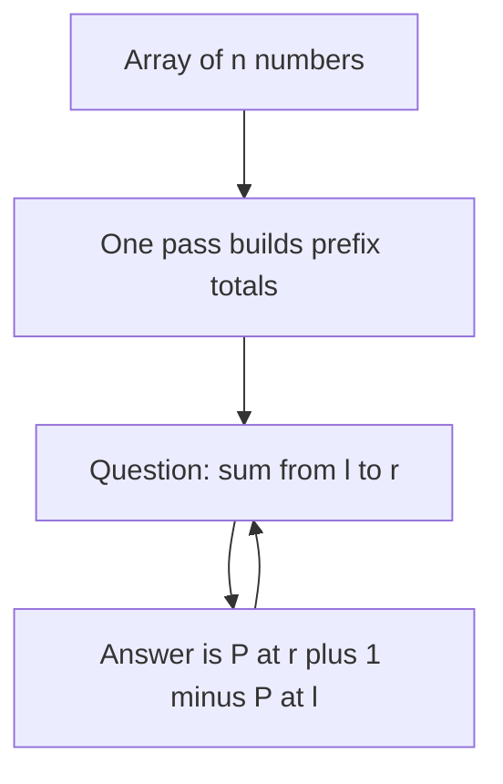
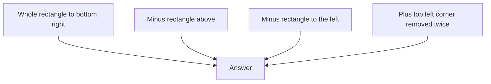

## The hook

Your interviewer hands you an array of 100,000 numbers and then asks 100,000 questions: "What is the sum from index 3,120 to index 88,004?" If you add up each range from scratch, you could be doing ten billion additions. Your program times out before the third coffee.

There is a trick that answers every one of those questions with a single subtraction. It takes one pass to set up, and it is one of the most reused ideas in all of algorithms.

## The intuition

:::analogy
Think of a car's odometer. It does not tell you how far you drove on Tuesday; it tells you the total distance since the car was new. Yet if you wrote down the reading at the start and end of Tuesday's trip, one subtraction gives you Tuesday's distance. You never re-drive the road to measure it.
:::

A [[prefix sum]] array is an odometer for your data. Position $i$ stores "the total of everything before this point." Any [[range query]] then becomes "reading at the end minus reading at the start."

The cost moves. Instead of paying for every question, you pay once, up front. That is [[precomputation]], and it is worth it whenever questions outnumber the setup.



## How it works

Define an array $P$ with one extra slot:

$$P[0] = 0, \qquad P[i] = a[0] + a[1] + \dots + a[i-1]$$

- $a$ is your original array, indexed from 0.
- $P[i]$ is the sum of the **first $i$ elements**. Note the "first $i$": $P[3]$ covers $a[0], a[1], a[2]$.
- The leading $P[0] = 0$ is a [[sentinel]]. It means "before anything, the total is zero."

Each $P[i]$ is just the previous total plus one new element: $P[i] = P[i-1] + a[i-1]$. So the whole array takes one pass.

Now the sum of $a[l..r]$ (inclusive) is:

$$\text{sum}(l, r) = P[r+1] - P[l]$$

$P[r+1]$ counts everything from index 0 through $r$. $P[l]$ counts everything before $l$. Subtract, and only $a[l..r]$ is left. Same as the odometer: end reading minus start reading.

:::insight
Prefix sums turn a range into the difference of two points. Whenever a problem asks about "the total over a contiguous stretch," ask yourself whether two running totals can answer it.
:::

## Walk through an example

Take `a = [3, 1, 4, 1, 5, 9]`.

| $i$ | 0 | 1 | 2 | 3 | 4 | 5 | 6 |
|---|---|---|---|---|---|---|---|
| $a[i-1]$ added | — | 3 | 1 | 4 | 1 | 5 | 9 |
| $P[i]$ | 0 | 3 | 4 | 8 | 9 | 14 | 23 |

Question: what is the sum of `a[2..4]`, that is $4 + 1 + 5$?

- End reading: $P[4+1] = P[5] = 14$ (that is $3+1+4+1+5$).
- Start reading: $P[2] = 4$ (that is $3+1$).
- Answer: $14 - 4 = 10$. Check by hand: $4 + 1 + 5 = 10$. Correct.

:::try-this
Using the same table, find the sum of `a[0..5]` and of `a[3..3]`. You should get 23 and 1. Notice that the range starting at index 0 needed no special handling, because $P[0] = 0$ is already there.
:::

### Going sideways: the difference array

Prefix sums have a mirror image. Suppose you are not asked questions, but given updates: "add 7 to every element from index 2 to 5," thousands of times, and only at the end must you print the array.

A [[difference array]] `d` records each update with two edits: `d[l] += 7` and `d[r+1] -= 7`. Think of it as telling the odometer "start counting 7 extra here" and "stop counting it here." After all updates, one prefix-sum pass over `d` rebuilds the final changes. Each update costs O(1) instead of O(length of range).

### Going up a dimension

The same idea works on a grid. Let $S[r][c]$ be the sum of the rectangle from the top-left corner to cell $(r-1, c-1)$. Any rectangle's sum is then four lookups: the big rectangle, minus the strip above, minus the strip to the left, plus the corner you subtracted twice.



## The code

The idea first, in pseudocode:

```pseudo
build(a):
    P = array of size n + 1, P[0] = 0
    for i from 1 to n:
        P[i] = P[i - 1] + a[i - 1]
    return P

range_sum(P, l, r):          // inclusive, 0-indexed
    return P[r + 1] - P[l]
```

And a compact C++ version you could write in an interview:

```cpp
#include <bits/stdc++.h>
using namespace std;

int main() {
    vector<long long> a = {3, 1, 4, 1, 5, 9};
    int n = a.size();
    vector<long long> P(n + 1, 0);
    for (int i = 1; i <= n; i++) P[i] = P[i - 1] + a[i - 1];

    auto rangeSum = [&](int l, int r) { return P[r + 1] - P[l]; };
    cout << rangeSum(2, 4) << '\n';  // 10
}
```

## Complexity

- **Build:** O(n) time, one pass.
- **Each query:** O(1), two array reads and a subtraction.
- **Space:** O(n) for the extra array.

For $n$ elements and $q$ queries, the total drops from O(n·q) to O(n + q). With $n = q = 10^5$, that is the difference between about $10^{10}$ operations and about $2 \times 10^5$.

## Common mistakes

:::warning
Common misconception: "prefix sums work for any range question." They work when the operation can be undone by subtraction, like sums and XOR. They do **not** work for range minimum or maximum, because you cannot "subtract" a minimum. Those need sparse tables or segment trees, which come later.
:::

- **Off-by-one errors.** Decide once whether $P[i]$ includes $a[i]$ or not, and stick to it. The "first $i$ elements" convention with a leading zero avoids most bugs.
- **Overflow.** Sums of many large numbers exceed 32-bit integers quickly. Use `long long` for the prefix array.
- **Changing data.** If elements keep changing between queries, rebuilding $P$ every time costs O(n) per update. That is the job of a Fenwick tree, covered later in this subject.
- **Negative numbers and windows.** Prefix sums handle negatives fine. Sliding windows often do not, which is why "count subarrays with sum k" uses prefix sums plus a hash map instead.

## Practice problems

Start with the two direct ones to lock in the formula, then the 2D version. *Corporate Flight Bookings* is a difference array in disguise. *Subarray Sum Equals K* combines prefix sums with a hash map: for each $P[j]$, count how many earlier $P[i]$ equal $P[j] - k$.

## Key takeaways

- A prefix sum stores running totals, so the sum of any range is the end total minus the start total.
- Adding a leading zero as a sentinel makes one formula, $P[r+1] - P[l]$, work for every range.
- Precomputation pays off whenever there are many questions about data that does not change.
- The difference array is the mirror trick: many range updates become two edits each, followed by one prefix-sum pass.
- Prefix sums need an operation you can undo, such as addition or XOR; minimum and maximum need different structures.
