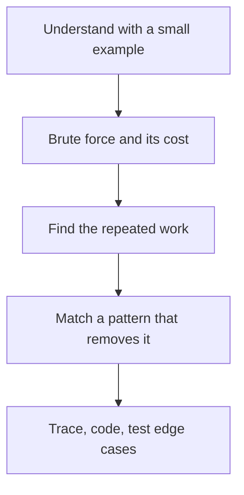

## The hook

The interviewer finishes reading the problem. You have never seen it before. The silence starts, and so does the panic: is it DP? A graph? Something you never studied?

Strong candidates feel that same jolt. The difference is that they have a routine for the next five minutes, and the routine does the thinking while the nerves settle. This article gives you that routine.

## The intuition

:::analogy
A good doctor facing a new patient does not guess the disease from the first sentence. They follow a checklist: listen, examine, consider the common causes first, run a cheap test, then decide. Problem solving works the same way. The checklist feels slow, but it is the fastest route to the right answer, and it shows the interviewer how you think.
:::

The checklist has five steps. Understand, brute force, find the [[bottleneck]], match a [[pattern]], then verify. You will use it on every problem in this subject.



## Let's build it up

### Step 1: understand it with your hands

Restate the problem in one sentence of your own. Then work a tiny example on paper, including the expected output. Ask about the input: can it be empty? Negative? Are values distinct? How large is n?

That last question matters most. As you saw in [Reading Constraints Like a Pro](article:dsa-big-o), n up to 10⁵ means you need about O(n log n), while n up to 20 invites trying all subsets.

### Step 2: say the brute force out loud

Describe the most direct solution, even if it is slow, and give its complexity. "Try every pair: O(n²)." This is not wasted time. A [[brute force]] proves you understand the problem, it is a correct fallback, and it shows you where the time goes.

### Step 3: find the repeated work

Look at the brute force and ask: what am I computing again and again? Almost every optimisation in this subject removes repeated work.

- Recomputing range sums? Store prefix sums.
- Searching for "the partner of this value"? Remember what you have seen in a hash map.
- Re-solving the same smaller problem? Store answers in a DP table.
- Scanning everything to find the smallest? Keep a heap.

### Step 4: match the cues to a pattern

Problem statements leave fingerprints. Learn to spot them:

| If the problem says... | Think about... |
|---|---|
| sorted array, pair or triple with a target | two pointers, binary search |
| contiguous subarray or substring, longest or shortest | sliding window, prefix sums |
| "minimum maximum" or "smallest value that works" | binary search on the answer |
| next greater or smaller element | monotonic stack |
| top k, k-th largest, merge sorted things | heap |
| all combinations, permutations, placements | backtracking |
| shortest steps in an unweighted grid or graph | BFS |
| dependencies, ordering of tasks | topological sort |
| connected groups that merge | union-find |
| count ways, or best value over choices | dynamic programming |

:::insight
You rarely invent an algorithm in an interview. You recognise which known pattern removes the repeated work in your brute force. Building that recognition is what this whole subject is for.
:::

### Step 5: trace, then code, then test

Before writing code, run your idea by hand on the small example. Write down the [[invariant]], the fact your loop keeps true, such as "everything left of `i` is already processed." Then code it cleanly, and test it on [[edge case]]s. Keep a short checklist and run through it every time:

- Empty input, and a single element.
- All values equal, or already sorted, or sorted in reverse.
- Negative numbers and zero, if the problem allows them.
- The largest values allowed, where sums can overflow a 32-bit `int`.
- Duplicates, when your logic quietly assumes distinct values.

Saying "let me check the edge cases" before the interviewer asks is one of the cheapest ways to look senior.

:::warning
Common misconception: "silence while thinking looks smart." In interviews it usually looks like being stuck. Think out loud: say what you are trying, why it might work, and what worries you. Interviewers grade your reasoning, and they often nudge you when they can hear it.
:::

## A tiny example

Problem: given an array of positive integers and a target, find the length of the shortest contiguous subarray whose sum is at least the target.

**Understand.** `[2, 3, 1, 2, 4, 3]`, target 7. The subarray `[4, 3]` sums to 7 with length 2, and nothing shorter works. Answer: 2.

**Brute force.** Try every start and every end, summing as you go: O(n²). Too slow for n = 10⁵.

**Repeated work.** When the start moves right by one, we throw away a whole running sum and rebuild it. But the new sum is just the old one minus one element.

**Pattern.** "Contiguous subarray" plus "all positive" plus "shortest" is the fingerprint of a sliding window: grow the right end until the sum is big enough, then shrink the left end while it stays big enough.

```pseudo
left = 0, sum = 0, best = infinity
for right in 0 .. n-1:
    sum += a[right]
    while sum >= target:
        best = min(best, right - left + 1)
        sum -= a[left]; left += 1
return best (or 0 if never found)
```

**Verify.** Each element enters the window once and leaves once, so it is O(n). Edge case: no subarray reaches the target, so return 0.

:::try-this
Trace the pseudocode on `[2, 3, 1, 2, 4, 3]` with target 7. Write `left`, `right`, `sum` and `best` after each step. You should see `best` drop to 4 at `[2, 3, 1, 2]`, then 3 at `[1, 2, 4]`, then 2 at `[4, 3]`.
:::

## Where you'll see this again

Every pattern article in this subject starts from a brute force and removes its repeated work, beginning with [prefix sums](article:dsa-prefix-sums). The cue table above is your index to the patterns. Before an interview, the night-before revision sheet in the advanced track condenses all of them onto one page.

## Key takeaways

- Follow the same five steps every time: understand, brute force, find the repeated work, match a pattern, then trace and test.
- Read the constraints first, because the input size tells you which complexity, and therefore which ideas, are allowed.
- A spoken brute force with its complexity is a strong start, because it proves understanding and shows where to optimise.
- Most optimisations remove repeated work by storing something once: prefix sums, a hash map, a heap or a DP table.
- Thinking out loud lets the interviewer follow and help you, which matters as much as the final code.
