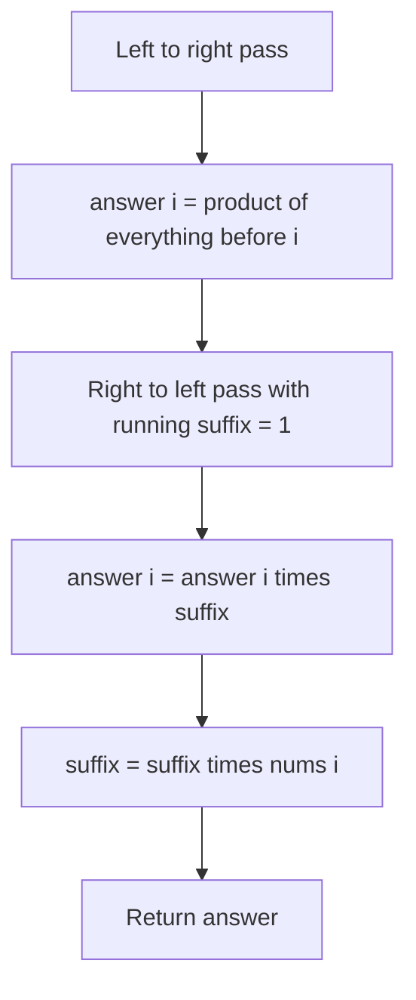

## The hook

"For each position, return the product of every other number in the array. No division. O(n) time." It is one of the most asked medium questions at large tech companies, and it is a perfect test of one idea: splitting "everything except me" into "everything before me" and "everything after me".

Candidates who know prefix sums often get it in minutes. Candidates who reach for division get stuck on the zero case, and then on the "no division" rule.

## The problem

Given an integer array `nums` of length n, return an array `answer` where `answer[i]` is the product of all elements of `nums` except `nums[i]`. Do not use division, and run in O(n) time. The product of any prefix or suffix fits in a 32-bit integer. A follow-up asks for O(1) extra space, where the [[output array]] does not count.

Example: `nums = [1, 2, 3, 4]` gives `[24, 12, 8, 6]`.

## The obvious approach

For each i, multiply every other element: two nested loops, O(n²). Too slow for n = 10⁵.

The tempting shortcut: multiply everything once, then divide by `nums[i]`. It is O(n), but division is forbidden, and it breaks with zeros: if one element is 0, the total is 0, and dividing tells you nothing.

## The key insight

:::analogy
Imagine people standing in a queue, each holding a number. To tell each person the product of everyone else's numbers, you walk the line twice. Walking from the front, you tell each person the product of everyone ahead of them. Walking back from the end, you tell each person the product of everyone behind them. Each person multiplies their two whispers, and never needed to hear their own number at all.
:::

"Everyone except me" is "everyone before me" times "everyone after me":

$$\text{answer}[i] = \underbrace{\text{nums}[0] \cdots \text{nums}[i-1]}_{\text{prefix product}} \times \underbrace{\text{nums}[i+1] \cdots \text{nums}[n-1]}_{\text{suffix product}}$$

- The [[prefix product]] of position 0 is 1 (nothing before it).
- The [[suffix product]] of the last position is 1 (nothing after it).

Both can be built in one pass each, like the running totals in [prefix sums](article:dsa-prefix-sums). That is the [[two-pass technique]].

:::insight
When a problem asks about "everything except position i", split it into a left part and a right part, compute each with a running value from its own direction, and combine. No subtraction or division is needed, so zeros and other awkward values cause no trouble.
:::



## Walk through an example

`nums = [1, 2, 3, 4]`.

**Pass 1, left to right** (answer[i] = product of everything before i):

| i | prefix before i | answer after pass 1 |
|---|---|---|
| 0 | 1 | [1, _, _, _] |
| 1 | 1 | [1, 1, _, _] |
| 2 | 1 × 2 = 2 | [1, 1, 2, _] |
| 3 | 2 × 3 = 6 | [1, 1, 2, 6] |

**Pass 2, right to left** (suffix starts at 1):

| i | suffix after i | answer[i] = answer[i] × suffix | suffix updated |
|---|---|---|---|
| 3 | 1 | 6 × 1 = 6 | 1 × 4 = 4 |
| 2 | 4 | 2 × 4 = 8 | 4 × 3 = 12 |
| 1 | 12 | 1 × 12 = 12 | 12 × 2 = 24 |
| 0 | 24 | 1 × 24 = 24 | 24 × 1 = 24 |

Result: `[24, 12, 8, 6]`, with no division and only one extra variable.

:::try-this
Run both passes on `[2, 0, 3]`. (Pass 1 gives [1, 2, 0]. Pass 2: i = 2 keeps 0 × 1 = 0, suffix becomes 3; i = 1 gives 2 × 3 = 6, suffix becomes 0; i = 0 gives 1 × 0 = 0. Answer: [0, 6, 0]. The zero is handled naturally.)
:::

### Why this works for operations you cannot undo

Prefix sums answer "sum of a range" by subtraction, which needs an operation you can undo. Here nothing is ever undone: each answer is built by combining a left part and a right part. So the same two passes work for operations that have no inverse at all, like maximum or greatest common divisor.

For `[12, 18, 8, 6]`, the GCD of everything except each position:

| i | GCD of everything before | GCD of everything after | Answer |
|---|---|---|---|
| 0 | none, treated as 0 | gcd(18, 8, 6) = 2 | 2 |
| 1 | 12 | gcd(8, 6) = 2 | 2 |
| 2 | gcd(12, 18) = 6 | 6 | 6 |
| 3 | gcd(12, 18, 8) = 2 | none, treated as 0 | 2 |

The value 0 plays the role that 1 plays for products: gcd(0, x) = x, so it is the "nothing here yet" value, the [[identity element]] for GCD. Swap in max with minus infinity, or min with plus infinity, and the same queue-whispering works.

### The same shape with constraints: Candy

*Candy* gives each child a rating. Every child gets at least one candy, and a child with a higher rating than a neighbour must get more than that neighbour. Constraints come from both sides, so handle each side in its own pass:

- Left to right: if a child beats the left neighbour, give one more than that neighbour.
- Right to left: if a child beats the right neighbour, make sure they have at least one more than that neighbour, keeping the larger value.

| Ratings | After the left pass | After the right pass | Total |
|---|---|---|---|
| 1 0 2 | 1 1 2 | 2 1 2 | 5 |
| 1 2 2 | 1 2 1 | 1 2 1 | 4 |

In the first row, the left pass cannot see that the first child beats the second; the right pass fixes it. Neither pass alone is enough, just as neither the prefix nor the suffix alone gives the product of everyone else.

### Why the brute force is a trap in interviews

Interviewers often wait to see whether you reach for division. Mentioning it, then explaining why it fails with zeros and why the rules forbid it, shows you understand the problem's edges. Then propose the two-array version, with a separate prefix array and suffix array, and finally compress it into the output array. Walking through that progression out loud, from O(n²) to O(n) with O(n) space to O(n) with O(1) extra space, is exactly the reasoning the question is designed to test.

## The code

```pseudo
product_except_self(nums):
    n = len(nums)
    answer = array of n
    answer[0] = 1
    for i in 1 .. n-1:
        answer[i] = answer[i-1] * nums[i-1]       // prefix product
    suffix = 1
    for i in n-1 down to 0:
        answer[i] = answer[i] * suffix
        suffix = suffix * nums[i]
    return answer
```

```cpp
#include <bits/stdc++.h>
using namespace std;

vector<int> productExceptSelf(const vector<int>& nums) {
    int n = nums.size();
    vector<int> ans(n, 1);
    for (int i = 1; i < n; i++) ans[i] = ans[i - 1] * nums[i - 1];
    int suffix = 1;
    for (int i = n - 1; i >= 0; i--) {
        ans[i] *= suffix;
        suffix *= nums[i];
    }
    return ans;
}

vector<int> gcdExceptSelf(const vector<int>& a) {         // same passes, no inverse needed
    int n = a.size();
    vector<int> ans(n, 0);
    for (int i = 1; i < n; i++) ans[i] = gcd(ans[i - 1], a[i - 1]);
    int suffix = 0;                                       // gcd(0, x) = x
    for (int i = n - 1; i >= 0; i--) {
        ans[i] = gcd(ans[i], suffix);
        suffix = gcd(suffix, a[i]);
    }
    return ans;
}

int candy(const vector<int>& r) {
    int n = r.size();
    vector<int> c(n, 1);
    for (int i = 1; i < n; i++) if (r[i] > r[i - 1]) c[i] = c[i - 1] + 1;
    for (int i = n - 2; i >= 0; i--) if (r[i] > r[i + 1]) c[i] = max(c[i], c[i + 1] + 1);
    return accumulate(c.begin(), c.end(), 0);
}

int main() {
    for (int x : productExceptSelf({1, 2, 3, 4})) cout << x << ' ';  // 24 12 8 6
    cout << '\n';
    for (int x : productExceptSelf({2, 0, 3})) cout << x << ' ';     // 0 6 0
    cout << '\n';
    for (int x : gcdExceptSelf({12, 18, 8, 6})) cout << x << ' ';    // 2 2 6 2
    cout << '\n';
    cout << candy({1, 0, 2}) << ' ' << candy({1, 2, 2}) << '\n';     // 5 4
}
```

## Complexity

- **Time:** O(n), two linear passes.
- **Space:** O(1) extra, because prefix products live in the output array and the suffix is a single variable. A straightforward version with separate prefix and suffix arrays uses O(n) extra and is a fine first answer before optimising.

## Common mistakes

:::warning
Common misconception: "handle zeros by counting them and dividing carefully." That works but violates the no-division rule and adds special cases for one zero versus two. The prefix-suffix method needs no special cases at all.
:::

- **Including nums[i] in its own prefix**: the prefix for i must stop at i − 1, so initialise answer[0] = 1.
- **Updating the suffix before using it**: multiply answer[i] by the suffix first, then fold nums[i] into it.
- **Overflow** when the problem does not guarantee small products; use long long or a modulus.
- **Using the wrong "nothing yet" value** for other operations: 1 for products, 0 for sums and GCD, minus infinity for max, plus infinity for min.
- **Taking the right pass's value without a max** in Candy, which can undo what the left pass established.

## Practice problems

*Product of Array Except Self* is the walkthrough above. *Find Pivot Index* uses the same left-and-right idea with sums. *Trapping Rain Water* computes the tallest bar to the left and to the right of each position, a two-pass max instead of a product. *Candy* runs a left pass and a right pass to satisfy constraints from both neighbours.

## Key takeaways

- "Everything except position i" equals the product of everything before i times the product of everything after i.
- Compute prefix products in a left-to-right pass and suffix products in a right-to-left pass, then multiply.
- Storing prefixes in the output array and carrying the suffix in one variable gives O(1) extra space.
- The method needs no division, so zeros need no special handling.
- Because nothing is undone, the same two passes work for operations with no inverse, such as GCD and maximum, and they solve pivot index, trapping rain water and Candy.
