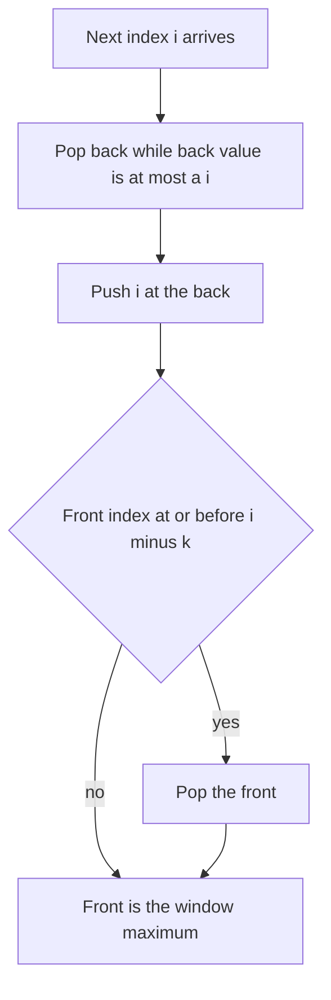

## The hook

A window of size k slides across an array, and after every step you must report the largest value inside it. A multiset does it in O(n log k). Rescanning the window does it in O(n · k). Yet the classic answer is O(n), with nothing more than a double-ended queue and one rule about who gets thrown out.

Queues are usually the humble container behind breadth-first search and task processing. Give the queue two open ends and a sorting rule, though, and it becomes one of the sharpest tools for window and DP problems.

## The intuition

:::analogy
Picture a queue outside a club where the bouncer lets in whoever is tallest at the moment. A tall latecomer joins at the back and every shorter person in front of him who arrived earlier realises they have no chance: they will reach their time limit before he does, and while he is around they will never be the tallest. So they leave. The queue is always arranged tallest at the front, shortest at the back, and the bouncer only ever looks at the front.
:::

That queue is a [[monotonic deque]], and the people in it are [[candidate|candidates]] for being the window's maximum:

- **New arrival** at the back: pop everyone at the back who is shorter or equal, then join.
- **Time limit:** each person may stay only k steps. When the front person's index leaves the window, pop them from the front.
- **Answer:** the front of the deque is the tallest person still allowed to be there.

It needs a [[deque]], because people leave from both ends: the shorter ones from the back, the expired one from the front.

## How it works

### Plain queues and circular buffers

A [[queue]] processes things in arrival order. *Number of Recent Calls* keeps the timestamps of calls in a queue; when a call arrives at time t, pop every timestamp older than t − 3000 from the front, and the queue's size is the answer.

When the capacity is fixed, a [[circular buffer]] implements a queue in an array: keep the index of the front and the current size. The back is (front + size) mod capacity. Pushing writes there and increases size; popping moves front forward by one, mod capacity. Nothing ever shifts, so every operation is O(1). *Design Circular Queue* is exactly this.

### The monotonic deque for window maximum

For each index i:

- **Pop from the back** while the value at the back index is at most a[i]. They can never be a maximum again.
- **Push i** at the back.
- **Pop from the front** if its index is at or before i − k, because it has left the window.
- **Report** a[front] once i ≥ k − 1.

The values along the deque decrease from front to back, so the front is the window maximum. Each index enters once and leaves once, so the total work is O(n), even though there are while loops inside the for loop.

For the window minimum, flip the comparison: pop while the back value is at least a[i].

### Beyond windows: the deque as a DP accelerator

*Jump Game VI*: you start at index 0 and may jump forward up to k steps; your score is the sum of the values you land on. The DP is dp[i] = a[i] + max(dp[i − k], ..., dp[i − 1]): the best score to reach i is its value plus the best of the previous k scores. That max over a sliding window of dp values is exactly what the deque gives, so the DP runs in O(n) instead of O(n · k).

### Beyond windows: prefix sums with negative numbers

*Shortest Subarray with Sum at Least K* allows negative numbers, which breaks the ordinary sliding window. Use prefix sums P instead: a subarray from i to j − 1 has sum P[j] − P[i], and you want the shortest j − i with P[j] − P[i] ≥ K. Keep a deque of prefix indices with **increasing** P values:

- **From the front:** while P[j] − P[front] ≥ K, record j − front and pop the front; any later j would give a longer subarray from that start.
- **From the back:** while P[back] ≥ P[j], pop the back; a later start with a smaller or equal prefix is always at least as good, because it is shorter and its sum is no smaller.



:::insight
A monotonic deque keeps only the candidates that could still win in some future window. Anything that is both older and no better than a newcomer is discarded for good, which is why each element is handled at most twice and the scan is linear.
:::

## Walk through an example

Sliding window maximum of [1, 3, −1, −3, 5, 3, 6, 7] with k = 3. The deque holds indices; the table shows their values.

| i | a[i] | Popped from back | Deque values after push | Front expired? | Window max |
|---|---|---|---|---|---|
| 0 | 1 | | 1 | no | |
| 1 | 3 | 1 | 3 | no | |
| 2 | −1 | | 3, −1 | no | 3 |
| 3 | −3 | | 3, −1, −3 | no | 3 |
| 4 | 5 | −3, −1, 3 | 5 | no | 5 |
| 5 | 3 | | 5, 3 | no | 5 |
| 6 | 6 | 3, 5 | 6 | no | 6 |
| 7 | 7 | 6 | 7 | no | 7 |

The answer is [3, 3, 5, 5, 6, 7]. At i = 4, the 5 arrived and three shorter people left the queue at once. In this run the front never expired by itself, because a taller newcomer always cleared the old front first; with a decreasing input such as [5, 4, 3, 2, 1], the front expiry step is what removes each old maximum.

### Jump Game VI on [1, −1, −2, 4, −7, 3] with k = 2

| i | a[i] | Best of the previous 2 dp values | dp[i] |
|---|---|---|---|
| 0 | 1 | start | 1 |
| 1 | −1 | 1 | 0 |
| 2 | −2 | max(1, 0) = 1 | −1 |
| 3 | 4 | max(0, −1) = 0 | 4 |
| 4 | −7 | max(−1, 4) = 4 | −3 |
| 5 | 3 | max(4, −3) = 4 | 7 |

The best score is 7, via indices 0, 1, 3 and 5: 1 − 1 + 4 + 3. The "best of the previous k" column is the deque's front each time.

### Shortest subarray with sum at least 3 in [2, −1, 2]

The prefix sums are P = [0, 2, 1, 3]. At j = 2, P = 1 is smaller than the back value 2, so index 1 is popped: starting after the dip is never worse. At j = 3, P[3] − P[0] = 3 ≥ 3, giving length 3. The answer is 3, the whole array, and a plain sliding window would have been fooled by the −1.

:::try-this
Run the window minimum, with k = 2, on [4, 2, 5, 1]. What does the deque hold after each step, and what are the minima? (Values in the deque: 4; then 2, after popping 4; then 2, 5; then 1, after popping 5 and 2. The minima for the three windows are 2, 2 and 1.)
:::

:::warning
Common misconception: "Store the values in the deque, it is simpler." With values alone you cannot tell when the front has left the window, and with duplicates you might remove the wrong copy. Store indices, compare their values, and expire the front when its index is at or before i − k.
:::

## The code

```pseudo
window_max(a, k):
    dq = empty deque of indices; out = []
    for i in 0 .. n - 1:
        while dq not empty and a[dq.back] <= a[i]: dq.pop_back()
        dq.push_back(i)
        if dq.front <= i - k: dq.pop_front()
        if i >= k - 1: out.append(a[dq.front])
    return out

circular_queue(capacity):
    buf = array of capacity; front = 0; size = 0
    push(x): if size == capacity: fail; buf[(front + size) mod capacity] = x; size += 1
    pop(): if size == 0: fail; front = (front + 1) mod capacity; size -= 1
```

```cpp
#include <bits/stdc++.h>
using namespace std;

vector<int> windowMax(const vector<int>& a, int k) {
    deque<int> dq;                                     // indices, values decreasing from front
    vector<int> out;
    for (int i = 0; i < (int)a.size(); i++) {
        while (!dq.empty() && a[dq.back()] <= a[i]) dq.pop_back();   // shorter and older: leave
        dq.push_back(i);
        if (dq.front() <= i - k) dq.pop_front();      // time limit reached
        if (i >= k - 1) out.push_back(a[dq.front()]);
    }
    return out;
}

struct CircularQueue {
    vector<int> buf;
    int front = 0, size = 0;
    CircularQueue(int cap) : buf(cap) {}
    bool push(int x) {
        if (size == (int)buf.size()) return false;
        buf[(front + size) % buf.size()] = x, size++;
        return true;
    }
    bool pop() {
        if (size == 0) return false;
        front = (front + 1) % buf.size(), size--;
        return true;
    }
    int rear() const { return size ? buf[(front + size - 1) % buf.size()] : -1; }
};

int maxJumpScore(const vector<int>& a, int k) {       // Jump Game VI
    int n = a.size();
    vector<long long> dp(n);
    deque<int> dq;                                     // indices of dp, values decreasing
    for (int i = 0; i < n; i++) {
        while (!dq.empty() && dq.front() < i - k) dq.pop_front();
        dp[i] = a[i] + (dq.empty() ? 0 : dp[dq.front()]);
        while (!dq.empty() && dp[dq.back()] <= dp[i]) dq.pop_back();
        dq.push_back(i);
    }
    return dp[n - 1];
}

int shortestAtLeastK(const vector<int>& a, long long K) {
    int n = a.size(), best = INT_MAX;
    vector<long long> P(n + 1, 0);
    for (int i = 0; i < n; i++) P[i + 1] = P[i] + a[i];
    deque<int> dq;                                     // prefix indices, P increasing
    for (int j = 0; j <= n; j++) {
        while (!dq.empty() && P[j] - P[dq.front()] >= K) best = min(best, j - dq.front()), dq.pop_front();
        while (!dq.empty() && P[dq.back()] >= P[j]) dq.pop_back();   // a later, lower start is better
        dq.push_back(j);
    }
    return best == INT_MAX ? -1 : best;
}

int main() {
    for (int x : windowMax({1, 3, -1, -3, 5, 3, 6, 7}, 3)) cout << x << ' ';
    cout << '\n';                                            // 3 3 5 5 6 7
    CircularQueue q(3);
    cout << q.push(1) << q.push(2) << q.push(3) << q.push(4) << ' ' << q.rear() << ' ';
    cout << q.pop() << q.push(4) << ' ' << q.rear() << '\n';  // 1110 3 11 4
    cout << maxJumpScore({1, -1, -2, 4, -7, 3}, 2) << '\n';    // 7
    cout << shortestAtLeastK({2, -1, 2}, 3) << ' ' << shortestAtLeastK({84, -37, 32, 40, 95}, 167) << ' '
         << shortestAtLeastK({1, 2}, 4) << '\n';              // 3 3 -1
}
```

The circular queue test pushes three items into a queue of capacity 3, fails on the fourth, pops one and then succeeds, so the rear changes from 3 to 4. In C++, `std::deque` gives O(1) pushes and pops at both ends, and `std::queue` is a thin wrapper around it.

## Complexity

- **Sliding window maximum or minimum: O(n) time, O(k) space.** n pushes and at most n pops in total.
- **Circular queue: O(1) per operation, O(capacity) space.**
- **Jump Game VI: O(n) time** instead of O(n · k) for the plain DP.
- **Shortest subarray with sum at least K: O(n) time and space,** with each prefix index pushed and popped at most once.

## Common mistakes

- **Storing values instead of indices,** which loses track of when the front expires.
- **Mixing strict and non-strict pops.** Popping back values that are ≤ a[i] or only those < a[i] both give correct maxima; ≤ keeps the deque smaller. Pick one and keep the comparisons consistent across the maximum and minimum versions.
- **Expiring the front with the wrong bound.** The window ending at i covers indices i − k + 1 to i, so remove the front when its index is at most i − k.
- **Reporting before the first window is full.** Start output at i = k − 1.
- **Shifting elements in a circular queue** instead of moving the front index, which makes pops O(n).
- **Applying the ordinary sliding window to negative numbers** in *Shortest Subarray with Sum at Least K*; use prefix sums with the increasing deque.

## Practice problems

*Number of Recent Calls* is a plain queue warm-up. *Design Circular Queue* is the circular buffer.

*Sliding Window Maximum* is the monotonic deque in its purest form, and the faster answer to the multiset approach in [A Sliding Window That Stays Sorted](article:dsa-ordered-set-windows). *Jump Game VI* uses the deque to speed up a DP.

*Shortest Subarray with Sum at Least K* combines it with prefix sums and is one of the hardest common interview questions on this pattern. The deque is the queue version of the stack in [Who Can See Over the Crowd](article:dsa-monotonic-stack).

## Key takeaways

- A queue processes items in arrival order, and a fixed-capacity queue fits in a circular buffer with a front index and a size.
- A monotonic deque of indices keeps the window's candidates in decreasing value order, so its front is always the window maximum.
- Before pushing a new index, pop every back element that is no larger, and pop the front once its index leaves the window.
- Each index is pushed and popped at most once, so the whole scan is O(n) despite the nested loops.
- The same deque speeds up DPs that take the best of the last k states and, on prefix sums, finds the shortest subarray with sum at least K even with negative numbers.
