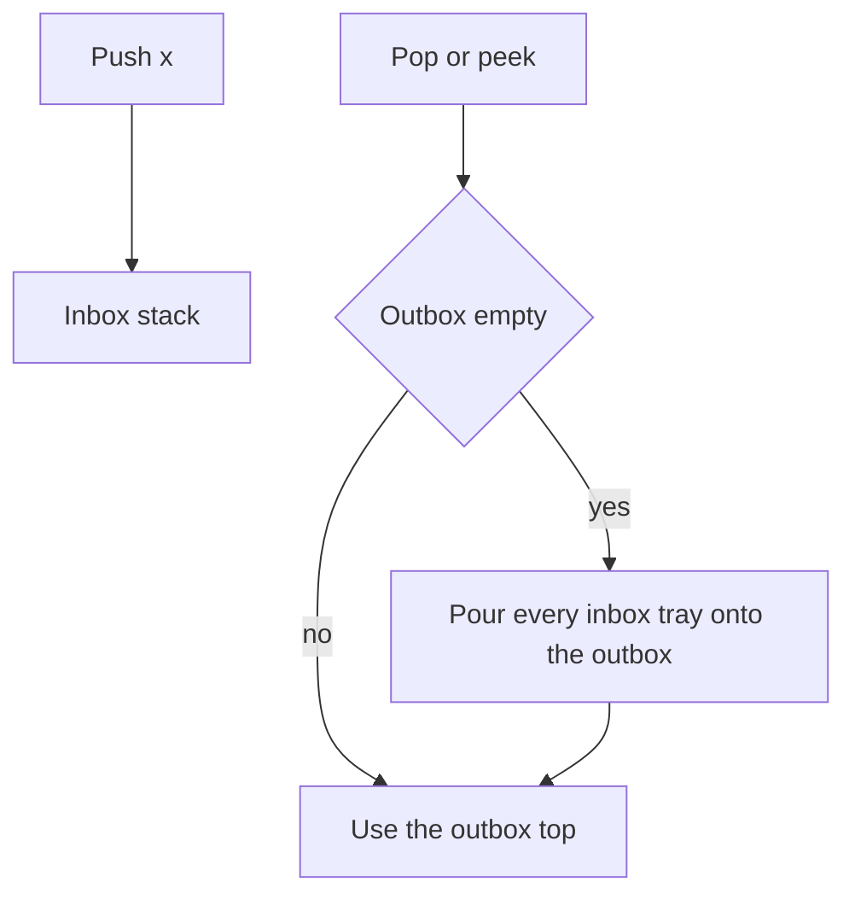

## The hook

A canteen has a stack of clean trays. New trays go on top, and people take trays from the top: last in, first out. The manager wants the opposite, so the oldest trays get used first and none sit at the bottom for weeks. She has room for exactly two stacks. Can she serve the oldest tray first using only "put on top" and "take from top"?

Yes, and the trick is a favourite interview question because it is simple to code and has a subtle cost argument. Asked carelessly it is O(n) per operation; asked well it is O(1), "on average", in a precise sense.

## The problem

Implement a first-in, first-out queue with push, pop, peek and empty, using only stack operations: push to the top, peek or pop from the top, size and empty. Then the reverse: a stack using only queue operations. A related design question asks for a deque in a fixed-size array.

| Operations on the queue | Results |
|---|---|
| push 1, push 2, peek, pop, empty | peek 1, pop 1, empty false |
| push 3, pop, pop, empty | pop 2, pop 3, empty true |

## The obvious approach

Keep everything in one stack, with the oldest element at the bottom. To pop, move all elements to a second stack, take the top (the oldest), and move everything back. Every pop costs O(n), and so does every peek.

The waste is moving everything back. Once the elements are in the second stack, they are already in the order you want to serve them.

## The key insight

:::analogy
Picture the two tray stacks. New trays always go onto the inbox stack. When someone wants a tray and the outbox stack is empty, the manager lifts the whole inbox stack, tray by tray, onto the outbox; this flips the order, so the oldest tray is now on top of the outbox. She serves from the outbox until it runs out, and only then pours again. Trays that arrive meanwhile wait on the inbox.
:::

That is [[lazy transfer]] between an [[inbox stack]] and an [[outbox stack]]:

- **push(x):** push onto the inbox.
- **pop or peek:** if the outbox is empty, pour the whole inbox into it; then use the outbox's top.
- **empty:** both stacks are empty.

Why is the outbox's top always the oldest element? Everything in the outbox arrived before everything in the inbox, because the outbox was filled by an earlier pour. And within the outbox, the pour reversed the inbox, putting the oldest on top.

### The cost argument

A single pop can be expensive: after a million pushes, the first pop pours a million trays.

But follow one tray instead of one operation. It is pushed onto the inbox once, poured into the outbox once and popped once. It never moves again. So any sequence of n operations does at most about 3n stack operations in total. That is an [[amortised cost]] of O(1) per operation.

### The reverse: a stack from one queue

To make the newest element come out first, rotate after each push: push x at the back of the queue, then move the k older elements one by one from the front to the back. Now x is at the front. Pop and top read the front in O(1); push costs O(n). This direction has no lazy trick that makes everything O(1); you choose which operation pays.



:::insight
Lazy transfer makes each element pay for its own moves exactly once: one push, one pour and one pop. An occasional expensive pour is spread over the cheap operations that came before it, which is what amortised O(1) means.
:::

## Walk through an example

Operations: push 1, push 2, push 3, pop, push 4, pop, pop, pop.

| Operation | Inbox (bottom → top) | Outbox (bottom → top) | Result |
|---|---|---|---|
| push 1 | 1 | | |
| push 2 | 1 2 | | |
| push 3 | 1 2 3 | | |
| pop | | 3 2 1, then pop 1 → 3 2 | 1 |
| push 4 | 4 | 3 2 | |
| pop | 4 | 3 | 2 |
| pop | 4 | | 3 |
| pop | | 4, then pop → empty | 4 |

The first pop poured three trays, and the last pop poured one. Every element was moved exactly once from inbox to outbox. The output 1, 2, 3, 4 is first-in, first-out, as a queue should be.

### The stack from one queue

push 1: queue 1. push 2: queue 1 2, rotate the 1 to the back: 2 1. push 3: queue 2 1 3, rotate two elements: 3 2 1. Now pop returns 3, then 2, then 1: last in, first out.

### A circular deque in an array

A [[circular deque]] of capacity k keeps a front index and a size. Insert at the back at (front + size) mod k. Insert at the front by moving front one step back, (front − 1 + k) mod k, and writing there. Delete from either end by moving front forward or decreasing size.

With capacity 3: insertLast 1, insertLast 2, insertFront 3 gives the order 3 1 2 and the deque is full; another insertFront fails; deleteLast removes 2; insertFront 4 gives 4 3 1. Every operation is O(1), with no shifting.

:::try-this
Run the two-stack queue on: push 5, push 6, peek, push 7, pop, pop, pop. What does each peek or pop return, and how many pours happen? (peek pours [5, 6] and returns 5; pop returns 5; pop returns 6; the outbox is then empty, so the last pop pours [7] and returns 7. Two pours.)
:::

:::warning
Common misconception: "Pour the inbox into the outbox on every pop." If the outbox still has elements, pouring new ones on top of them puts newer trays above older ones and breaks the queue order. Pour only when the outbox is empty. Pouring on every push is the other common mistake, which makes each push O(n).
:::

## The code

```pseudo
queue from two stacks:
    push(x): inbox.push(x)
    peek(): if outbox empty: while inbox not empty: outbox.push(inbox.pop())
            return outbox.top
    pop():  x = peek(); outbox.pop(); return x
    empty(): inbox empty and outbox empty

stack from one queue:
    push(x): q.push(x); repeat size - 1 times: q.push(q.pop_front())
    pop(): return q.pop_front()
```

```cpp
#include <bits/stdc++.h>
using namespace std;

class MyQueue {
    stack<int> in, out;
    void pourIfNeeded() {
        if (out.empty())                                  // lazy: only when the outbox is empty
            while (!in.empty()) out.push(in.top()), in.pop();
    }
public:
    void push(int x) { in.push(x); }
    int peek() { pourIfNeeded(); return out.top(); }
    int pop() { int x = peek(); out.pop(); return x; }
    bool empty() const { return in.empty() && out.empty(); }
};

class MyStack {
    queue<int> q;
public:
    void push(int x) {
        q.push(x);
        for (size_t i = 1; i < q.size(); i++) q.push(q.front()), q.pop();   // newest to the front
    }
    int pop() { int x = q.front(); q.pop(); return x; }
    int top() const { return q.front(); }
    bool empty() const { return q.empty(); }
};

class CircularDeque {
    vector<int> buf;
    int front = 0, size = 0;
public:
    CircularDeque(int k) : buf(k) {}
    bool insertFront(int x) {
        if (size == (int)buf.size()) return false;
        front = (front - 1 + buf.size()) % buf.size();   // step back, wrapping
        buf[front] = x, size++;
        return true;
    }
    bool insertLast(int x) {
        if (size == (int)buf.size()) return false;
        buf[(front + size) % buf.size()] = x, size++;
        return true;
    }
    bool deleteLast() { if (!size) return false; size--; return true; }
    bool deleteFront() { if (!size) return false; front = (front + 1) % buf.size(), size--; return true; }
    string contents() const {
        string s;
        for (int i = 0; i < size; i++) s += to_string(buf[(front + i) % buf.size()]) + (i + 1 < size ? " " : "");
        return s;
    }
};

int main() {
    MyQueue q;
    q.push(1), q.push(2), q.push(3);
    cout << q.pop() << ' ';
    q.push(4);
    cout << q.pop() << ' ' << q.pop() << ' ' << q.pop() << ' ' << q.empty() << '\n';   // 1 2 3 4 1

    MyStack s;
    s.push(1), s.push(2), s.push(3);
    cout << s.pop() << ' ' << s.pop() << ' ' << s.top() << '\n';                      // 3 2 1

    CircularDeque d(3);
    cout << d.insertLast(1) << d.insertLast(2) << d.insertFront(3) << d.insertFront(9) << ' ';
    cout << d.contents() << " | ";
    d.deleteLast();
    d.insertFront(4);
    cout << d.contents() << '\n';                                                     // 1110 3 1 2 | 4 3 1
}
```

The queue is exactly the one in the walkthrough table, and the deque test matches the circular deque example. For the deque that keeps window maxima, see [The Queue Where Taller Latecomers Push In](article:dsa-queue-deque).

## Complexity

- **Queue from two stacks: amortised O(1) per operation,** worst case O(n) for a single pop or peek that pours. O(n) space.
- **Stack from one queue: O(n) push, O(1) pop and top.** O(n) space.
- **Circular deque: O(1) worst case per operation,** O(capacity) space.

## Common mistakes

- **Pouring when the outbox is not empty,** which interleaves new and old elements in the wrong order.
- **Pouring on every push or every operation,** which makes the queue O(n) per operation.
- **Calling an operation "O(1)" without saying amortised.** A single pop can be O(n); the guarantee is about sequences.
- **Moving everything back** after each pop, the O(n) version.
- **Negative indices** in the circular deque: in C++, (front − 1) % k is negative when front is 0; add k first.
- **Confusing full and empty** in a circular buffer that stores only front and back indices; storing the size avoids the ambiguity.

## Practice problems

*Implement Queue using Stacks* is the two-stack queue with lazy transfer; be ready to explain the amortised argument out loud. *Implement Stack using Queues* is the rotation trick, where push pays. *Design Circular Deque* is a fixed-size array with wrap-around at both ends, like the circular queue in [The Queue Where Taller Latecomers Push In](article:dsa-queue-deque).

## Key takeaways

- A queue can be built from two stacks: push onto an inbox stack, and serve pops from an outbox stack that is refilled by pouring the whole inbox only when it is empty.
- Pouring reverses the order, which puts the oldest element on top of the outbox.
- Each element is pushed, poured and popped exactly once, so the two-stack queue costs amortised O(1) per operation even though a single pop can be O(n).
- A stack can be built from one queue by rotating the older elements behind each newly pushed element, making push O(n) and pop O(1).
- A circular deque in a fixed array keeps a front index and a size, wrapping indices with modulo arithmetic in both directions.
