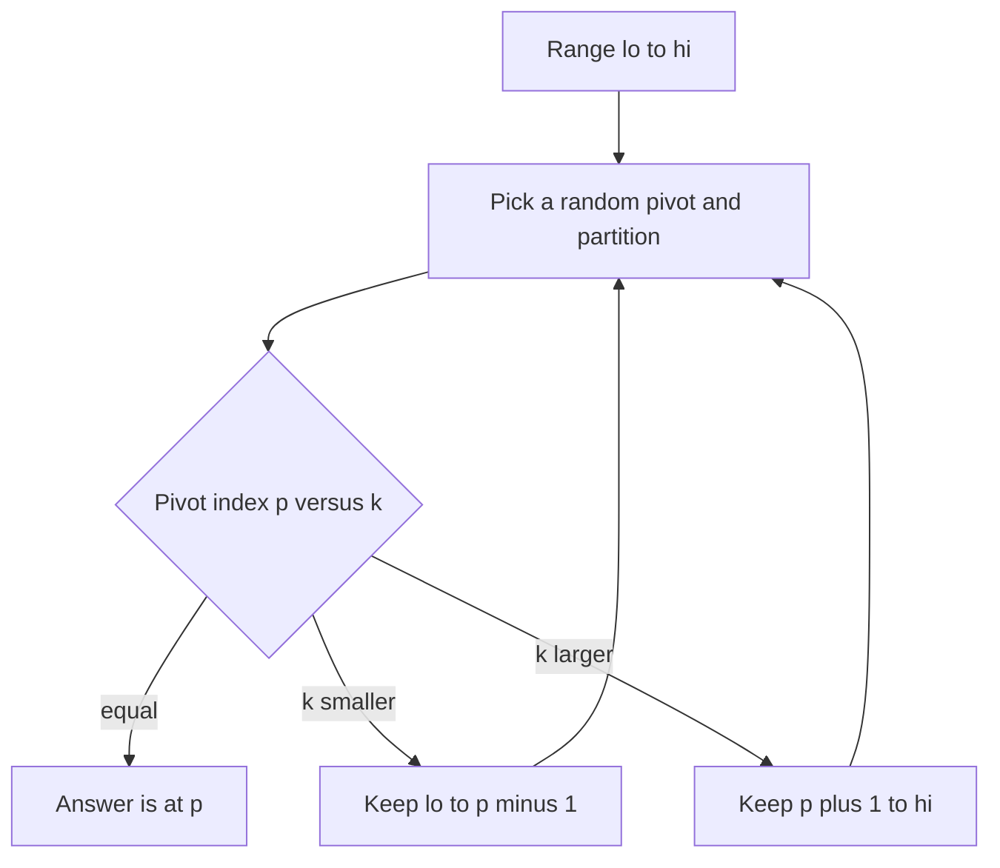

## The hook

A thousand students stand on a field, and the coach wants the student of median height. One way is to line everyone up by height, which is a full sort. There is a lazier way. Pick any student, send everyone shorter to the left and everyone taller to the right, and count. If 600 people went left, the median is somewhere among them, so the right side can go home.

Repeat with the group that is left, and in a few rounds you have the median, having never fully sorted anyone. That is quickselect, and it is the standard answer to "find the k-th largest element" in O(n) on average.

## The intuition

:::analogy
Picture the coach splitting the crowd around one chosen student. Everyone shorter steps left, everyone taller steps right, and the chosen student now stands exactly where they would be in a sorted line. The coach does not care how the left group or the right group is arranged inside. She only checks which group contains position k, sends the other group home, and repeats with a smaller crowd.
:::

This is the [[selection problem]]: find the element that sorted order would place at index k. Sorting solves it in O(n log n), but sorting does far more work than needed. You only need the k-th element, not the order of everyone else.

The chosen student is the [[pivot]], and splitting the crowd is a [[partition]]. After one partition:

- the pivot sits at its final sorted index p;
- if p equals k, you are done;
- if k < p, the answer is on the left; if k > p, it is on the right.

Quicksort partitions and then recurses into **both** sides. Quickselect recurses into **one**. That one difference turns O(n log n) into O(n) on average.



## How it works

### Translating "k-th largest" into an index

In ascending order, the k-th largest element sits at index n − k. The k-th smallest sits at index k − 1. Convert once, at the start, and search for that index.

### The Lomuto partition

Use the last element of the range as the pivot (after swapping a random element there). Keep a "store" index s at the start of the range. Walk i through the range; whenever a[i] is smaller than the pivot, swap it into position s and advance s. Finally swap the pivot into position s. Now everything left of s is smaller than the pivot and everything right of it is not.

### Why random pivots

The analysis depends on the pivot landing somewhere in the middle. If you always pick the last element and the array is already sorted, the pivot is the largest every time, and each round removes only one element: n + (n − 1) + ... is O(n²). Choosing the pivot at random makes such bad luck vanishingly unlikely for any input, which is what [[expected time]] means: the average over the algorithm's own coin flips, not over friendly inputs.

### Why the average is linear

With a random pivot, a typical partition keeps a fraction of the range, say about half. The work is then about n + n/2 + n/4 + ..., which never exceeds 2n. Even if a pivot only ever lands somewhere in the middle half, the kept part is at most three quarters of the range, and n + 3n/4 + 9n/16 + ... still sums to 4n. A constant times n either way.

:::insight
Quickselect is quicksort that refuses to do unnecessary work. Each partition puts one element in its final place and tells you which side holds the answer, so you throw the other side away instead of sorting it.
:::

### Duplicates

With many equal values, the Lomuto partition sends all copies of the pivot to the right, and the range can shrink slowly. A three-way partition into "less than", "equal to" and "greater than" fixes this: if k falls inside the equal block, you are done at once. It is the loop from [Sorting Three Colours in a Single Sweep](article:dsa-dutch-national-flag) with a pivot in place of the colour 1.

## Walk through an example

Find the 2nd largest element of [3, 2, 1, 5, 6, 4]. With n = 6, that is index 6 − 2 = 4 in ascending order. For a reproducible trace, use the last element of each range as the pivot.

| Round | Range | Pivot | Partitioned array | Pivot lands at | Compare with 4 |
|---|---|---|---|---|---|
| 1 | 0 to 5 | 4 | 3 2 1 **4** 6 5 | 3 | 4 > 3, keep the right part 4 to 5 |
| 2 | 4 to 5 | 5 | 3 2 1 4 **5** 6 | 4 | equal, answer is 5 |

In round 1, the store index collected 3, 2 and 1 (all smaller than 4) into positions 0 to 2, and the pivot moved to index 3. The coach then sent the three shorter students home; they could not contain the answer. Two rounds, and the larger elements 6 and 5 were never fully sorted against the rest. The answer is 5.

:::try-this
Find the element at index 3 in sorted order of [7, 1, 9, 4, 4, 8, 2], using the last element of each range as the pivot. (Round 1, pivot 2: [1, 2, 9, 4, 4, 8, 7], pivot at 1, go right. Round 2 on indices 2 to 6, pivot 7: [1, 2, 4, 4, 7, 8, 9], pivot at 4, go left. Round 3 on indices 2 to 3, pivot 4: no smaller element, pivot stays at 2, go right. Round 4 on index 3 alone: the answer is 4.)
:::

### Choosing between quickselect, a heap and sorting

| Method | Time | Extra space | Good when |
|---|---|---|---|
| Sort, then index | O(n log n) | O(1) to O(n) | simplicity matters, or you need the rest sorted too |
| Heap of size k | O(n log k) | O(k) | data arrives as a stream, or k is small |
| Quickselect | O(n) expected | O(1) | all data is in memory and you may reorder it |
| [[nth_element]] in C++ | O(n) average | O(1) | contest code; it is quickselect with safeguards |

Interviewers often accept the heap answer first and then ask for something faster: that is the moment for quickselect. The heap approach is covered in [The Triage Nurse Who Always Knows Who Is Next](article:dsa-heap-basics).

:::warning
Common misconception: "Quickselect returns the k largest elements in sorted order." It returns the k-th element and leaves the array partitioned: everything before index k is no larger, and everything after is no smaller, but neither side is sorted. If you need the top k in order, sort just those k afterwards, costing an extra O(k log k).
:::

## The code

```pseudo
quickselect(a, k):                  # element that sorted order puts at index k
    lo = 0; hi = n - 1
    while true:
        swap a[random index in lo..hi] with a[hi]
        p = partition(a, lo, hi)    # pivot ends at its sorted index p
        if p == k: return a[p]
        if k < p: hi = p - 1
        else: lo = p + 1

partition(a, lo, hi):               # Lomuto, pivot is a[hi]
    pivot = a[hi]; s = lo
    for i in lo .. hi - 1:
        if a[i] < pivot: swap a[i], a[s]; s += 1
    swap a[s], a[hi]
    return s
```

```cpp
#include <bits/stdc++.h>
using namespace std;

mt19937 rng(12345);                                     // fixed seed so runs are repeatable

int partitionRange(vector<int>& a, int lo, int hi) {    // Lomuto, pivot is a[hi]
    int pivot = a[hi], s = lo;
    for (int i = lo; i < hi; i++)
        if (a[i] < pivot) swap(a[i], a[s++]);
    swap(a[s], a[hi]);
    return s;
}

int quickselect(vector<int> a, int k) {                 // element at sorted index k
    int lo = 0, hi = a.size() - 1;
    while (true) {
        int r = lo + rng() % (hi - lo + 1);
        swap(a[r], a[hi]);                              // random pivot defeats bad inputs
        int p = partitionRange(a, lo, hi);
        if (p == k) return a[p];
        if (k < p) hi = p - 1;
        else lo = p + 1;
    }
}

int kthLargest(const vector<int>& a, int k) { return quickselect(a, a.size() - k); }

// K closest points: select by squared distance with the library's quickselect.
vector<array<int, 2>> kClosest(vector<array<int, 2>> pts, int k) {
    auto d = [](const array<int, 2>& p) { return (long long)p[0] * p[0] + (long long)p[1] * p[1]; };
    nth_element(pts.begin(), pts.begin() + k - 1, pts.end(),
                [&](const array<int, 2>& x, const array<int, 2>& y) { return d(x) < d(y); });
    pts.resize(k);
    sort(pts.begin(), pts.end());                       // only to print in a fixed order
    return pts;
}

int main() {
    cout << kthLargest({3, 2, 1, 5, 6, 4}, 2) << '\n';                  // 5
    cout << quickselect({7, 1, 9, 4, 4, 8, 2}, 3) << '\n';              // 4
    cout << kthLargest({3, 2, 3, 1, 2, 4, 5, 5, 6}, 4) << '\n';         // 4
    for (auto& p : kClosest({{3, 3}, {5, -1}, {-2, 4}}, 2)) cout << p[0] << ',' << p[1] << ' ';
    cout << '\n';                                                       // -2,4 3,3
}
```

`kClosest` compares squared distances, so it never takes a square root and stays exact in integers. The same `nth_element` call solves *Top K Frequent Elements* once you have the counts: select the k entries with the largest counts.

## Complexity

- **Expected time: O(n).** With random pivots, the kept range shrinks geometrically on average, so the total partition work is a constant times n.
- **Worst case: O(n²),** when every pivot is an extreme value. Random pivots make it extremely unlikely; the median-of-medians method guarantees O(n) in the worst case but is slower in practice and rarely asked.
- **Space: O(1) extra** for the iterative version above. A recursive version uses stack space proportional to the number of rounds, O(log n) expected.
- **It modifies the array.** Copy it first if the original order must survive, as the code does by taking the vector by value.

## Common mistakes

- **Converting k wrongly.** The k-th largest is at ascending index n − k; the k-th smallest is at k − 1. Mixing them up is the most common bug.
- **Always choosing the first or last element as pivot** on inputs that may be sorted, which triggers the O(n²) case and times out on adversarial tests.
- **Partition boundary bugs:** forgetting to swap the pivot into place at the end, or recursing on ranges that still include the pivot.
- **Infinite loops with duplicates** in some Hoare-style partitions; if many values repeat, use a three-way partition.
- **Expecting sorted output** for the top k, as the warning above explains.
- **Overflow in distances** for K Closest Points; square in 64-bit.

## Practice problems

Start with *Kth Largest Element in an Array*: solve it with a heap of size k, then with quickselect, and compare. *K Closest Points to Origin* is the same selection on squared distances; `nth_element` is the contest shortcut. *Top K Frequent Elements* combines counting with selection on the counts, or with bucketing. *Find the Kth Largest Integer in the Array* stores numbers as strings, so the comparison itself must compare lengths first and then digits, a good check that your partition only depends on a comparator.

## Key takeaways

- Quickselect finds the element at sorted index k by partitioning around a pivot and keeping only the side that contains index k.
- Recursing into one side instead of both makes the expected work about n + n/2 + n/4 + ..., which is O(n).
- Random pivots protect against the O(n²) worst case that sorted inputs cause with a fixed pivot choice.
- Convert "k-th largest" to ascending index n − k before searching, and remember the result leaves the array partitioned, not sorted.
- Choose a heap of size k for streams or small k, quickselect or nth_element for in-memory data, and sorting when you need everything in order anyway.
