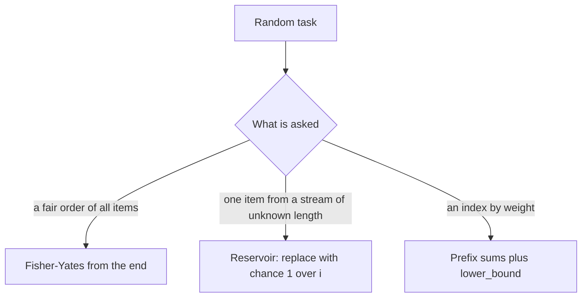

## The hook

Shuffling a playlist sounds trivial: for each song, swap it with a random song. Run that on three songs sixty thousand times and count how often each order appears. Some orders turn up about 11,100 times and others only about 8,900. The "obvious" shuffle is unfair, and an interviewer who asks you to shuffle is often waiting to see whether you know why.

Randomness questions come in a few classic shapes: shuffle an array fairly, pick a random element from a stream you can read only once, or pick an index with probability proportional to its weight. Each has a short, exact answer.

## The intuition

:::analogy
Picture a raffle where tickets keep arriving in a box whose bottom you cannot see, and you do not know how many will come. You are allowed to hold just one ticket at a time. When the first ticket arrives you hold it. When the second arrives you flip a fair coin and maybe swap. When the tenth arrives you swap with chance one in ten. At the end, every ticket that ever arrived has had exactly the same chance of being the one in your hand.
:::

That is [[reservoir sampling]], and the same thinking explains the other two tools:

- **Fair shuffle:** draw tickets one at a time from the remaining ones, never from those already placed. That is the [[Fisher-Yates shuffle]].
- **Weighted pick:** give each item a number of tickets proportional to its weight, draw one ticket, and see whose it is. Running totals, the [[prefix sum of weights]], tell you whose it is with a binary search.

The goal every time is a [[uniform]] result: each outcome with the right probability, no [[bias]].

## How it works

### Fisher-Yates

For i from n − 1 down to 1, pick j uniformly from 0 to i and swap a[i] with a[j]. Positions above i are already fixed; position i receives a uniformly random element from the part not yet fixed.

Why is it fair? The last position gets each of the n elements with probability 1/n. Given that, the second-last gets each of the remaining n − 1 with probability 1/(n − 1), and so on. Every order arises from exactly one sequence of choices, with probability 1/n × 1/(n − 1) × ... = 1/n!.

The method dates from Ronald Fisher and Frank Yates's statistical tables in 1938, done by hand; the in-place computer version was later popularised by Donald Knuth.

### Why the naive shuffle is biased

The naive loop swaps each a[i] with a position chosen from the **whole** array. It makes n choices with n options each, so there are n^n equally likely runs.

For n = 3 that is 27 runs and 6 orders. Since 27 is not a multiple of 6, the runs cannot be spread evenly: three orders come from 5 runs each and three from 4. For larger n the mismatch persists, because n! has prime factors that n^n does not.

### Reservoir sampling

To pick one item uniformly from a stream of unknown length, keep a single "chosen" item. When the i-th item arrives (counting from 1), replace the chosen item with probability 1/i. Item i ends up chosen if it is picked on arrival and then survives every later replacement:

$$P(\text{item } i \text{ chosen}) = \frac{1}{i} \times \frac{i}{i+1} \times \frac{i+1}{i+2} \times \dots \times \frac{n-1}{n} = \frac{1}{n}$$

Each fraction $\frac{j-1}{j}$ is the chance that item j does not replace it, and the product telescopes to 1/n. For k items, keep the first k, then let the i-th item replace a random one of them with probability k/i.

### Weighted picks

With weights [1, 3, 2], build running totals [1, 4, 6]. Draw r uniformly from 1 to 6, the total, and return the first index whose running total is at least r. Index 0 owns r = 1; index 1 owns r = 2 to 4; index 2 owns r = 5 and 6. Each index owns as many values of r as its weight, so it is picked with probability weight / total. The lookup is a `lower_bound`, O(log n).



:::insight
A random procedure is fair when every outcome comes from the same number of equally likely choices. Fisher-Yates has exactly one choice sequence per order, and reservoir sampling's 1/i rule makes every item's survival chances multiply out to 1/n.
:::

## Walk through an example

### Fisher-Yates on [A, B, C, D] with chosen random values

| i | Random j in [0, i] | Swap | Array after |
|---|---|---|---|
| 3 | 1 | a[3] and a[1] | A D C B |
| 2 | 2 | a[2] with itself | A D C B |
| 1 | 0 | a[1] and a[0] | D A C B |

Every position, once fixed, is never touched again. Different random values give different orders, and each of the 24 orders comes from exactly one choice of (j₃, j₂, j₁), out of 4 × 3 × 2 = 24 possibilities.

### Counting the naive shuffle's bias for three items

Listing all 27 runs of the naive loop on [1, 2, 3] gives:

| Order | 123 | 132 | 213 | 231 | 312 | 321 |
|---|---|---|---|---|---|---|
| Runs producing it | 4 | 5 | 5 | 5 | 4 | 4 |

So 132, 213 and 231 are each 25% more likely than the other three. The simulation in the code below shows the same pattern.

### Reservoir sampling with four tickets

| Ticket | Chance it replaces the held ticket | Chance a ticket held after this step survives it |
|---|---|---|
| 1 | 1 (always taken) | |
| 2 | 1/2 | 1/2 |
| 3 | 1/3 | 2/3 |
| 4 | 1/4 | 3/4 |

Ticket 1 ends in your hand with probability 1 × 1/2 × 2/3 × 3/4 = 1/4. Ticket 3: 1/3 × 3/4 = 1/4. Ticket 4: 1/4. Every ticket has the same chance, even though you never knew how many were coming.

:::try-this
With weights [2, 5, 3], what are the running totals, and which values of r from 1 to 10 pick index 1? (The totals are [2, 7, 10]. Index 1 owns r = 3, 4, 5, 6 and 7: five values out of ten, matching its weight of 5.)
:::

:::warning
Common misconception: "Any shuffle that swaps every element with a random one is fair." Only choosing from the not-yet-fixed part, as Fisher-Yates does, gives every order the same probability. A related trap is sorting with a random comparator, such as returning a random true or false; it is biased and can even break the sort's assumptions.
:::

## The code

```pseudo
fisher_yates(a):
    for i from n - 1 down to 1:
        j = random integer in [0, i]
        swap a[i], a[j]

reservoir_one(stream):
    chosen = none; i = 0
    for x in stream:
        i += 1
        if random integer in [1, i] == 1: chosen = x
    return chosen

weighted_pick(prefix):                 # prefix = running totals of weights
    r = random integer in [1, total]
    return first index with prefix[index] >= r
```

```cpp
#include <bits/stdc++.h>
using namespace std;

mt19937 rng(2026);                                       // fixed seed: the same run every time
int randBelow(int n) { return rng() % n; }               // tiny modulo bias, fine for small n

void fisherYates(vector<int>& a) {
    for (int i = (int)a.size() - 1; i > 0; i--) {
        int j = randBelow(i + 1);                        // j in [0, i], the unshuffled part
        swap(a[i], a[j]);
    }
}

void naiveShuffle(vector<int>& a) {                      // biased: j over the whole array
    for (int i = 0; i < (int)a.size(); i++) swap(a[i], a[randBelow(a.size())]);
}

int reservoirPick(const vector<int>& stream) {           // one item, uniformly, in one pass
    int chosen = -1;
    for (int i = 0; i < (int)stream.size(); i++)
        if (randBelow(i + 1) == 0) chosen = stream[i];   // keep the i-th item with chance 1 / (i + 1)
    return chosen;
}

struct WeightedPicker {
    vector<long long> prefix;
    WeightedPicker(const vector<int>& w) {
        long long s = 0;
        for (int x : w) prefix.push_back(s += x);
    }
    int pick() {
        long long r = rng() % prefix.back() + 1;         // r in [1, total]
        return lower_bound(prefix.begin(), prefix.end(), r) - prefix.begin();
    }
};

int main() {
    const int T = 60000;
    map<vector<int>, int> fy, naive;
    for (int t = 0; t < T; t++) {
        vector<int> a = {1, 2, 3}, b = {1, 2, 3};
        fisherYates(a), naiveShuffle(b);
        fy[a]++, naive[b]++;
    }
    for (auto& [p, c] : fy) cout << c << ' ';
    cout << '\n';                     // 10017 9920 9917 10030 9926 10190
    for (auto& [p, c] : naive) cout << c << ' ';
    cout << '\n';                     // 8783 11176 11121 10995 9014 8911
    vector<int> cnt(4, 0);
    for (int t = 0; t < T; t++) cnt[reservoirPick({10, 20, 30, 40}) / 10 - 1]++;
    for (int c : cnt) cout << c << ' ';
    cout << '\n';                     // 14824 14981 14961 15234
    WeightedPicker wp({1, 3, 2});
    vector<int> wc(3, 0);
    for (int t = 0; t < T; t++) wc[wp.pick()]++;
    for (int c : wc) cout << c << ' ';
    cout << '\n';                     // 9913 30127 19960
}
```

The counts are one run with a fixed seed. Fisher-Yates gives all six orders close to the fair 10,000. The naive shuffle gives about 11,100 for three orders and about 8,900 for the others, matching 5/27 and 4/27 of 60,000. Reservoir sampling gives each of four items close to 15,000, and the weighted picker gives close to 10,000, 30,000 and 20,000 for weights 1, 3 and 2.

In real code, prefer `std::shuffle(a.begin(), a.end(), rng)` and `uniform_int_distribution`, which avoid the small modulo bias of `rng() % n`. The explicit loop is what interviews ask for.

## Complexity

- **Fisher-Yates: O(n) time, O(1) extra space.** One random number and one swap per position.
- **Reservoir sampling: O(n) time for the stream, O(1) space for one item, O(k) for k items.** It never needs the stream's length.
- **Weighted picks: O(n) to build the prefix array, then O(log n) per pick** with binary search.
- **Random Pick Index:** reservoir sampling over the positions of the target gives O(n) per pick with O(1) space; a hash map of positions gives O(1) per pick with O(n) space.

## Common mistakes

- **The naive shuffle,** choosing j from the whole array instead of [0, i].
- **Off-by-one in Fisher-Yates:** j must include i itself, so an element may stay put; picking from [0, i − 1] is a different, biased algorithm.
- **Reservoir counting from 0 incorrectly.** With 0-based i, keep the item with probability 1/(i + 1).
- **Using r in [0, total)** with `lower_bound` on running totals, which shifts every range by one; either use r in [1, total] with `lower_bound`, or r in [0, total) with `upper_bound`.
- **Seeding the generator inside the function,** so repeated calls in the same second give the same "random" result.
- **Overflow in totals** of many large weights; use 64-bit prefix sums.

## Practice problems

*Shuffle an Array* is Fisher-Yates with a reset to the original order. *Linked List Random Node* is reservoir sampling over a list you walk once. *Random Pick Index* is reservoir sampling restricted to positions holding the target. *Random Pick with Weight* is prefix sums with a binary search, the same running totals as in [Answering a Million Range Questions Instantly](article:dsa-prefix-sums).

## Key takeaways

- Fisher-Yates walks from the last position to the first and swaps each with a uniformly random position not yet fixed, giving every order probability 1/n!.
- Swapping each element with a random position in the whole array is biased, because n^n runs cannot be divided evenly among n! orders.
- Reservoir sampling keeps the i-th item of a stream with probability 1/i, so every item ends up chosen with probability 1/n without knowing n in advance.
- A weighted pick builds running totals of the weights, draws a random number up to the total and finds its owner with binary search.
- Check fairness by counting: an outcome's probability is the number of equally likely choice sequences that produce it, divided by the total.
