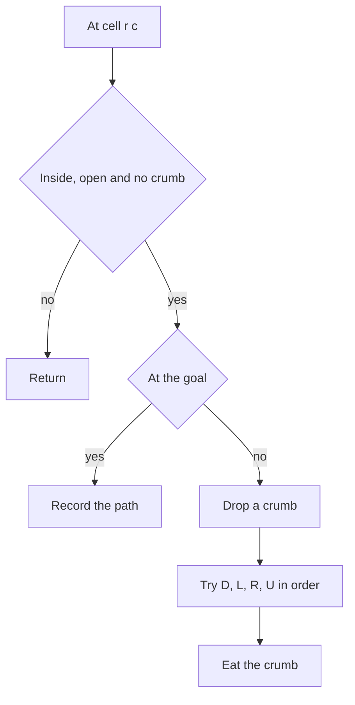

## The hook

A mouse in a maze wants every possible route from the entrance to the cheese, not just one. As it walks, it drops breadcrumbs so it never runs in a circle. When it hits a dead end, it walks back, eating the breadcrumbs it passes, so the next route it tries can use those squares again.

*Rat in a Maze*, *Unique Paths III* and *Path with Maximum Gold* are versions of that walk. They look like graph problems, and breadth-first search is the usual reflex for grids, but BFS finds one shortest path; listing or counting every path is a job for backtracking.

## The problem

In a square grid, 1 is an open cell and 0 is a wall. Starting at the top-left, list every path to the bottom-right that moves Down, Left, Right or Up and never visits a cell twice, in alphabetical order of the move strings.

```text
1 1 1 0
1 0 1 0
1 1 1 1
0 0 1 1
```

| Path | Moves |
|---|---|
| 1 | DDRRDR |
| 2 | DDRRRD |
| 3 | RRDDDR |
| 4 | RRDDRD |

Variants: count paths that visit every open cell exactly once (*Unique Paths III*), or find the path that collects the most value (*Path with Maximum Gold*).

## The obvious approach

Generate every sequence of moves up to the number of cells and check each one: 4^k sequences for k moves, almost all of them walking into walls or back on themselves. A BFS from the start finds the shortest path quickly but marks each cell once for good, so it cannot list different routes that share cells.

## The key insight

:::analogy
Picture the mouse leaving a breadcrumb on every square it stands on. It never steps on a square with a crumb, so it never loops. When it reaches the cheese, it remembers the route. When it reaches a dead end, it steps back and eats the crumb behind it, so that square is free for the next route it tries. It always tries directions in the same order, Down, Left, Right, Up.
:::

That is [[path enumeration]] by backtracking, with [[breadcrumb|breadcrumbs]] as the visited marks:

- **Step in:** if the next cell is inside the grid, open and has no crumb, move there and drop a crumb.
- **Goal:** at the target, record the path.
- **Explore:** try the four directions in a fixed [[move order]].
- **Step back:** remove the crumb before returning.

The fixed order D, L, R, U makes the paths come out in alphabetical order, because depth-first search finishes every path that starts with D before any that starts with L, and so on.

### Covering every cell: Unique Paths III

*Unique Paths III* counts paths from the start to the end that walk over every non-obstacle cell exactly once, a [[Hamiltonian path]] on the grid. Count the open cells first. Carry "cells left to visit" down the recursion and count a path only if it reaches the end with exactly one cell left, the end itself.

Two prunings make such searches fast enough:

- **Count before you search.** If the arithmetic makes the goal impossible, such as a colouring argument showing start and end must differ in some parity, stop immediately.
- **[[Dead-end pruning]].** If the path splits the remaining open cells into two regions, it can never visit both, so back off at once. *Grid Paths* on CSES, which counts 48-step paths on a 7 by 7 grid, is famous for needing exactly this kind of pruning to finish in time.



:::insight
To list or count every route, mark a cell only while it is on the current path and unmark it on the way back. That one difference from BFS, a temporary mark instead of a permanent one, lets different routes share cells.
:::

## Walk through an example

The maze above, trying D, L, R, U at each cell.

| Path so far | At cell | What happens |
|---|---|---|
| D | (1,0) | (1,1) is a wall, so continue down |
| DD | (2,0) | down is a wall, left is outside, so go right |
| DDR, DDRR | (2,2) | try D first |
| DDRRD | (3,2) | right reaches (3,3): record **DDRRDR** |
| DDRRR | (2,3) | down reaches (3,3): record **DDRRRD** |
| R, RR | (0,2) | right is a wall, so go down |
| RRDD | (2,2) | try D first |
| RRDDD | (3,2) | right: record **RRDDDR** |
| RRDDR | (2,3) | down: record **RRDDRD** |

Four paths, in alphabetical order. Each time a path was recorded or a dead end reached, the mouse ate its way back to the last junction and tried the next direction from there.

### Unique Paths III on an open 3 by 3 grid

Start at the top-left and end at the bottom-right, with no obstacles: 9 cells to cover. Only two paths cover every cell, one starting right and snaking down and one starting down and snaking right. Add a single obstacle in the middle or at (1, 2) and the count drops to 0, which you can verify by hand: the remaining cells can no longer be threaded in one line from start to end.

:::try-this
In the maze above, which direction does the mouse try first from the start, and why is the first recorded path DDRRDR rather than one starting with R? (It tries D first because the order is D, L, R, U. Every path beginning with D is finished before any beginning with R, so the D paths come out first.)
:::

:::warning
Common misconception: "Use a global visited array and mark cells once." That is BFS or plain DFS thinking, which finds whether the goal is reachable. For listing or counting every route, a permanent mark hides all the other paths through that cell. The mark must be removed when the path backs off.
:::

## The code

```pseudo
paths(r, c, moves):
    if (r, c) is outside, a wall, or has a crumb: return
    if (r, c) is the goal: record moves; return
    drop a crumb on (r, c)
    for (letter, dr, dc) in [D, L, R, U]:
        paths(r + dr, c + dc, moves + letter)
    remove the crumb

count_cover_all(r, c, left):
    if (r, c) is outside or blocked: return 0
    if (r, c) is the end: return 1 if left == 1 else 0
    block (r, c); total = sum over four neighbours of count_cover_all(.., left - 1); unblock
    return total
```

```cpp
#include <bits/stdc++.h>
using namespace std;

const string LETTER = "DLRU";
const int DR[] = {1, 0, 0, -1}, DC[] = {0, -1, 1, 0};   // alphabetical move order

void ratPaths(vector<vector<int>>& m, int r, int c, string& moves, vector<string>& out) {
    int n = m.size();
    if (r < 0 || c < 0 || r >= n || c >= n || m[r][c] != 1) return;   // wall, outside or crumb
    if (r == n - 1 && c == n - 1) { out.push_back(moves); return; }
    m[r][c] = 2;                                         // drop a breadcrumb
    for (int d = 0; d < 4; d++) {
        moves.push_back(LETTER[d]);
        ratPaths(m, r + DR[d], c + DC[d], moves, out);
        moves.pop_back();
    }
    m[r][c] = 1;                                         // eat it on the way back
}

int coverAll(vector<vector<int>>& g, int r, int c, int left) {   // Unique Paths III
    if (r < 0 || c < 0 || r >= (int)g.size() || c >= (int)g[0].size() || g[r][c] == -1) return 0;
    if (g[r][c] == 2) return left == 1;                  // the end must be the last unvisited cell
    int saved = g[r][c], total = 0;
    g[r][c] = -1;
    for (int d = 0; d < 4; d++) total += coverAll(g, r + DR[d], c + DC[d], left - 1);
    g[r][c] = saved;
    return total;
}

int uniquePathsIII(vector<vector<int>> g) {
    int open = 0, sr = 0, sc = 0;
    for (int r = 0; r < (int)g.size(); r++)
        for (int c = 0; c < (int)g[0].size(); c++) {
            if (g[r][c] != -1) open++;
            if (g[r][c] == 1) sr = r, sc = c;
        }
    return coverAll(g, sr, sc, open);
}

int main() {
    vector<vector<int>> maze = {{1, 1, 1, 0}, {1, 0, 1, 0}, {1, 1, 1, 1}, {0, 0, 1, 1}};
    vector<string> out;
    string moves;
    ratPaths(maze, 0, 0, moves, out);
    for (auto& p : out) cout << p << ' ';
    cout << '\n';                                        // DDRRDR DDRRRD RRDDDR RRDDRD
    cout << uniquePathsIII({{1, 0, 0}, {0, 0, 0}, {0, 0, 2}}) << ' '
         << uniquePathsIII({{1, 0, 0}, {0, -1, 0}, {0, 0, 2}}) << ' '
         << uniquePathsIII({{1, 0, 0, 0}, {0, 0, 0, 0}, {0, 0, 0, 2}}) << '\n';   // 2 0 4
}
```

The maze uses 2 as the breadcrumb value, so "open and not yet visited" is simply `m[r][c] == 1`. The same template collects gold in *Path with Maximum Gold* and matches letters in [Tracing a Word Across the Grid With Your Finger](article:dsa-word-search).

## Complexity

- **Time: exponential in the number of open cells** in the worst case. Each step has at most three new directions after the first, so a path of length L costs at most about 3^L branches; walls and crumbs cut this down a lot in practice.
- **Space: O(rows × cols)** for the grid marks and a recursion as deep as the longest path.
- **Unique Paths III:** exponential, which is why the problem keeps the grid to 20 cells.

## Common mistakes

- **Not removing breadcrumbs,** so only the first path is ever found.
- **Using BFS** for "all paths", which finds one route per cell.
- **A move order that is not alphabetical** when the problem asks for sorted output.
- **Marking the start cell as visited before the call** and then rejecting it inside the call.
- **Off-by-one in "cells left"** for Unique Paths III: count the start and the end, and require exactly one cell left on arriving at the end.
- **No pruning on large grids,** which turns a feasible search into one that never finishes.

## Practice problems

Start with *Word Search*, the same grid backtracking with letters instead of open cells. *Path with Maximum Gold* adds a value to maximise. *Unique Paths III* requires covering every open cell, a small Hamiltonian path search. *Grid Paths* on CSES counts long paths on a 7 by 7 grid and only runs in time with careful dead-end pruning, a good stretch problem. For reachability and shortest paths, where you do not need every route, use [Ripples on a Pond: Breadth-First Search](article:dsa-bfs) instead.

## Key takeaways

- Listing or counting every path in a grid is backtracking: step into an open cell, mark it, explore the four directions, then unmark it.
- A temporary mark lets different routes share cells; a permanent visited mark, as in BFS, only answers whether the goal is reachable.
- Trying directions in alphabetical order, such as D, L, R, U, makes depth-first search produce paths in lexicographic order.
- Paths that must cover every open cell carry a count of cells left and succeed only when the end is the last unvisited cell.
- These searches are exponential, so prune any partial path that can no longer reach the goal or cover the remaining cells.
