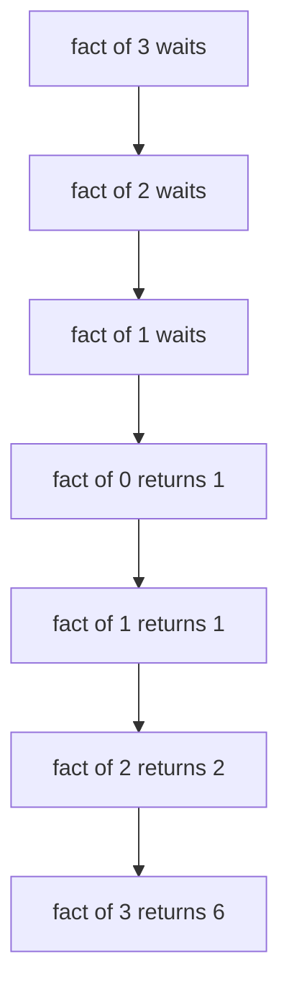

## The hook

Ask a beginner to reverse a linked list, list every subset of a set, or walk a tree, and they often reach for loops and get tangled in indices. Ask someone comfortable with recursion, and the solution is often three or four lines that look almost too simple to be right.

The difference is not cleverness. It is one mental move, the "leap of faith": trusting a function you have not finished writing. Once that move feels natural, trees, backtracking, divide and conquer and dynamic programming all become far easier.

## The intuition

:::analogy
Think of a set of Russian dolls. To find out how many dolls there are, you do not need to understand all of them at once. You open the outer doll and ask: "how many dolls are inside this one?" Then you add one for the doll in your hands. The innermost doll is solid and cannot be opened: that is where the counting stops, and its answer is simply 1.
:::

That is [[recursion]]. "How many dolls inside this one?" is the same question on a smaller doll. The solid innermost doll is the [[base case]]. Opening one doll and adding one is the [[recursive case]].

## Let's build it up

### Two parts, always

Every correct recursive function has:

1. **A base case**: the smallest input, answered directly. Factorial of 0 is 1; the sum of an empty list is 0; a null tree has height 0.
2. **A recursive case**: reduce to a smaller input, call yourself, and combine. Factorial of n is n times factorial of n − 1.

Each call must move toward the base case, or it never ends. In the doll picture, every doll you open must be smaller than the last.

### The leap of faith

When writing the recursive case, do **not** trace every call in your head. Assume the call on the smaller input already works, and only check one thing: if it returns the right answer, does this level return the right answer?

For the height of a binary tree: assume `height(left)` and `height(right)` are correct. Then the height here is `1 + max(height(left), height(right))`. Check the base case (`height(null) = 0`) and you are done. This is proof by induction, used as a programming technique.

:::insight
Write recursion one level at a time. Get the base case right, assume the smaller calls are right, and check that this level combines them correctly. Tracing the whole call tree is for counting cost, not for convincing yourself it works.
:::

### What the computer actually does

Each call gets its own frame on the [[call stack]], holding its own copies of parameters and local variables. A call that has not finished waits on the stack while its children run. When a call returns, its frame is removed and its parent continues.



Because every unfinished call uses stack memory, very deep recursion can cause a [[stack overflow]]. A chain of 10⁵ or 10⁶ nested calls, such as recursion along a long linked list or a path-shaped tree, can crash with default stack sizes. Iterative versions or an explicit stack avoid this.

### Counting the cost with a recursion tree

To find the time, draw a [[recursion tree]]: one node per call, children for the calls it makes, and the work done in each node.

- **One call per level, constant work each** (factorial): n levels, O(n).
- **Two calls on half-size inputs, linear work each** (merge sort): log n levels, each level totalling O(n), so O(n log n).
- **Two calls on inputs only one smaller** (naive Fibonacci): the tree roughly doubles at each level, so O(2ⁿ).

## A tiny example

Naive Fibonacci: fib(n) = fib(n − 1) + fib(n − 2), with fib(0) = 0 and fib(1) = 1.

```pseudo
fib(n):
    if n <= 1: return n          // base case
    return fib(n - 1) + fib(n - 2)
```

Count the calls for fib(5) by drawing the tree level by level:

| Call | Makes calls to | Calls in its subtree |
|---|---|---|
| fib(1), fib(0) | none | 1 each |
| fib(2) | fib(1), fib(0) | 3 |
| fib(3) | fib(2), fib(1) | 5 |
| fib(4) | fib(3), fib(2) | 9 |
| fib(5) | fib(4), fib(3) | 15 |

Fifteen calls to compute a number we could get with four additions. fib(3) alone is computed twice and fib(2) three times. The fix, storing each answer the first time, is memoisation, and it turns this exponential function into a linear one. That idea is the doorway to dynamic programming.

:::try-this
Write the recursion for the sum of a list `a[0..n-1]` using the leap of faith. What is the base case, and what is the recursive case? (Base: an empty list sums to 0. Recursive: sum(a[0..n-1]) = a[n-1] + sum(a[0..n-2]). Assume the smaller sum is correct, add the last element, done.)
:::

```cpp
#include <bits/stdc++.h>
using namespace std;

long long fact(int n) { return n == 0 ? 1 : n * fact(n - 1); }

long long fibMemo(int n, vector<long long>& memo) {
    if (n <= 1) return n;
    if (memo[n] != -1) return memo[n];
    return memo[n] = fibMemo(n - 1, memo) + fibMemo(n - 2, memo);
}

int main() {
    cout << fact(5) << '\n';               // 120
    vector<long long> memo(91, -1);
    cout << fibMemo(90, memo) << '\n';     // instant, unlike the naive version
}
```

:::warning
Common misconception: "recursion is always slower than loops." Recursion has a small overhead per call, but the big slowdowns come from repeated work, as in naive Fibonacci, not from recursion itself. With memoisation, or when each subproblem is solved once, recursive solutions are as efficient as loops in complexity.
:::

## Where you'll see this again

Recursion is the backbone of the next tracks: generating subsets and permutations, backtracking with pruning, divide and conquer like merge sort, every tree article, and DFS on graphs. Dynamic programming is recursion plus memory. When you meet those articles, the leap of faith is the skill doing the heavy lifting. Its cost analysis connects back to [Reading Constraints Like a Pro](article:dsa-big-o).

### Interview follow-ups

**"What happens if the input is 10⁶ deep?"** Each call uses a stack frame, so a recursion 10⁶ levels deep can overflow the default stack and crash. Convert it to a loop with an explicit stack, or make sure the depth is logarithmic, as in balanced divide and conquer.

**"Recursion or iteration: which is faster?"** Same complexity; recursion pays a small cost per call. Choose recursion when it mirrors the problem (trees, backtracking) and iteration when depth could be large or the loop is just as clear.

**"Your recursive Fibonacci is slow. Why, and how do you fix it?"** It recomputes the same subproblems, giving about 2ⁿ calls. Cache results (memoisation) to get O(n), or build bottom-up. That fix is exactly where dynamic programming starts.

## Key takeaways

- A recursive function solves a problem by calling itself on smaller inputs, and needs a base case that stops the calls.
- Write recursion one level at a time: trust the smaller calls, check this level combines them correctly, and verify the base case.
- Each unfinished call occupies a stack frame, so very deep recursion can overflow the stack.
- Draw a recursion tree to count cost, from O(n) for one call per level to O(2^n) when calls branch without shrinking much.
- Repeated subproblems, as in naive Fibonacci, are fixed by memoisation, which leads directly to dynamic programming.
