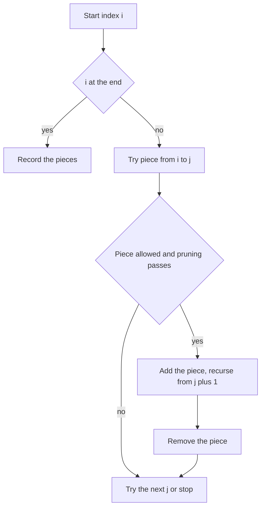

## The hook

A tailor has a ribbon printed with letters and wants to cut it into pieces where every piece reads the same backwards and forwards. She could cut after the first letter, or after the second, or the third, and each choice leaves a shorter ribbon with the same question. Listing every way to do it is a perfect fit for backtracking: the choice at each step is simply where to cut next.

Three popular interview problems are this ribbon with different rules: palindrome pieces, pieces that form an IP address, and digits joined by + − * to hit a target. The template is the same; each problem has one trap that catches most first attempts, and the third adds a neat trick for operator precedence.

## The problem

| Problem | Input | Rule for a piece | Answers |
|---|---|---|---|
| Palindrome Partitioning | "aabb" | every piece is a palindrome | a·a·b·b, a·a·bb, aa·b·b, aa·bb |
| Restore IP Addresses | "11211" | exactly 4 pieces, each 0 to 255, no leading zeros | 1.1.2.11, 1.1.21.1, 1.12.1.1, 11.2.1.1 |
| Expression Add Operators | "222", target 6 | numbers joined by + − *, no leading zeros, value equals target | 2+2+2, 2+2*2, 2*2+2 |

## The obvious approach

A string of n characters has n − 1 gaps, and each gap is cut or not: 2^(n − 1) [[partition|partitions]]. Generating all of them and then checking each one works for tiny strings. The waste is checking pieces late: a cut whose first piece is invalid can never lead to an answer, so its whole subtree should be skipped at once.

## The key insight

:::analogy
Picture the tailor holding the ribbon at its start. She looks at the first one, two, three letters and so on, and cuts off a first piece only if that piece obeys the rule. Then she does the same with what remains. If a piece breaks the rule, she does not even try cutting the rest of the ribbon after it. When the ribbon is used up exactly, the pieces in her hand are one answer, and she puts the last piece back to try a longer one.
:::

The choice at each step is the next [[cut position]], and the template is:

- for each end position j after the current start i, take the piece s[i..j];
- if the piece is allowed, record it, recurse from j + 1, then remove it;
- when the start reaches the end of the string, the pieces form one answer.

Each problem adds its own check and pruning:

- **Palindromes:** checking a piece by scanning it costs O(length). Precompute a [[palindrome table]] once with the rule pal[i][j] = (s[i] == s[j]) and pal[i + 1][j − 1], filled for longer and longer ranges, so every check in the search is O(1).
- **IP addresses:** a piece has 1 to 3 digits, its value is at most 255, and it has no leading zero unless it is exactly "0". [[Length pruning]] helps a lot: with k pieces still needed, the remaining characters must number between k and 3k, or the branch is dead.
- **Expressions:** pieces are numbers, and between them you choose +, − or *. Keep the running value and the [[last operand]]. Adding x makes value + x with last operand x; subtracting makes value − x with last operand −x. Multiplying is the trick: * binds tighter than + and −, so undo the last operand and multiply it instead: value − last + last × x, with new last operand last × x.



:::insight
Partition problems are backtracking where each choice is "where does the next piece end". Check each piece the moment it is cut, and precompute anything that makes that check cheap, so invalid prefixes end their branch immediately.
:::

## Walk through an example

### Palindrome partitions of "aabb"

| Pieces so far | Next pieces tried | Result |
|---|---|---|
| a | a, ab (not a palindrome), abb (no) | continue with a·a |
| a, a | b, bb | a·a·b·b and a·a·bb |
| aa | b, bb | aa·b·b and aa·bb |
| aab, aabb | not palindromes | pruned at the first cut |

Four partitions. The table pal[i][j] answered every "is this piece a palindrome?" in O(1); for instance pal[0][3] for "aabb" is false because s[0] = a ≠ s[3] = b.

### Restoring IPs from "11211"

Five digits into four pieces means exactly one piece has two digits and the rest have one, or the pieces would not fit: length pruning cuts every branch where a three-digit piece leaves too few characters. The four answers are 1.1.2.11, 1.1.21.1, 1.12.1.1 and 11.2.1.1.

For "2560101", a first piece of "256" is rejected because it exceeds 255, and "0101" can never be a piece. The valid answers are 2.5.60.101, 2.56.0.101, 25.6.0.101 and 25.60.10.1. Notice "0" appears as a piece on its own, but never "01".

### Inserting operators into "222" to reach 6

| Expression | value | last operand | Step |
|---|---|---|---|
| 2 | 2 | 2 | first number |
| 2+2 | 4 | 2 | add: value + 2 |
| 2+2*2 | 4 − 2 + 2 × 2 = 6 | 4 | multiply: undo 2, add 2 × 2 |
| 2*2 | 2 − 2 + 2 × 2 = 4 | 4 | multiply the first number |
| 2*2+2 | 6 | 2 | add |

The answers are 2+2+2, 2+2*2 and 2*2+2. Without the last-operand trick, the code would compute 2+2*2 left to right as (2 + 2) × 2 = 8 and miss it.

For "305" with target 8, the answers are 3+0+5 and 3−0+5. The piece "05" is never used, because a multi-digit number cannot start with 0, so the loop over j stops as soon as the piece starts with a 0 and has more than one digit.

:::try-this
Restore IP addresses from "100100". Which first pieces survive, and what are the answers? (First pieces 1, 10 and 100 are all valid. The answers are 1.0.0.100, 10.0.10.0 and 100.1.0.0. Pieces such as "00" and "010" are rejected for leading zeros.)
:::

:::warning
Common misconception: "Leading zeros only matter for the first piece." In IP addresses and in Expression Add Operators, every multi-digit piece is checked, wherever it appears. "1.01.2.3" is invalid because of the second piece, and "1+05" is invalid because of the "05". The check belongs inside the loop that builds each piece.
:::

## The code

```pseudo
partitions(s, i, pieces):
    if i == n: record pieces; return
    for j from i to n - 1:
        if allowed(s[i..j]):               # palindrome, IP part, or number
            pieces.add(s[i..j]); partitions(s, j + 1, pieces); pieces.remove_last()

add_operators(num, i, expr, value, last):
    if i == n: if value == target: record expr; return
    for j from i to n - 1:
        piece = num[i..j]; if it has a leading zero and length > 1: stop
        x = value of piece
        if i == 0: recurse with (piece, x, x)
        else:
            recurse with (expr + "+" + piece, value + x, x)
            recurse with (expr + "-" + piece, value - x, -x)
            recurse with (expr + "*" + piece, value - last + last * x, last * x)
```

```cpp
#include <bits/stdc++.h>
using namespace std;

vector<vector<string>> palindromePartitions(const string& s) {
    int n = s.size();
    vector<vector<bool>> pal(n, vector<bool>(n, false));
    for (int len = 1; len <= n; len++)                       // shorter ranges first
        for (int i = 0; i + len - 1 < n; i++) {
            int j = i + len - 1;
            pal[i][j] = s[i] == s[j] && (len <= 2 || pal[i + 1][j - 1]);
        }
    vector<vector<string>> res;
    vector<string> cur;
    function<void(int)> go = [&](int i) {
        if (i == n) { res.push_back(cur); return; }
        for (int j = i; j < n; j++)
            if (pal[i][j]) {                                  // O(1) check from the table
                cur.push_back(s.substr(i, j - i + 1));
                go(j + 1);
                cur.pop_back();
            }
    };
    go(0);
    return res;
}

vector<string> restoreIp(const string& s) {
    vector<string> res, parts;
    function<void(int)> go = [&](int i) {
        int need = 4 - parts.size(), rem = s.size() - i;
        if (need == 0) {
            if (rem == 0) res.push_back(parts[0] + "." + parts[1] + "." + parts[2] + "." + parts[3]);
            return;
        }
        if (rem < need || rem > 3 * need) return;             // length pruning
        for (int len = 1; len <= 3 && i + len <= (int)s.size(); len++) {
            string t = s.substr(i, len);
            if ((len > 1 && t[0] == '0') || stoi(t) > 255) continue;   // leading zero or too big
            parts.push_back(t);
            go(i + len);
            parts.pop_back();
        }
    };
    go(0);
    return res;
}

vector<string> addOperators(const string& num, long long target) {
    vector<string> res;
    function<void(int, string, long long, long long)> go = [&](int i, string expr, long long val, long long last) {
        if (i == (int)num.size()) { if (val == target) res.push_back(expr); return; }
        for (int j = i; j < (int)num.size(); j++) {
            if (j > i && num[i] == '0') break;                // no multi-digit number starting with 0
            string t = num.substr(i, j - i + 1);
            long long x = stoll(t);
            if (i == 0) { go(j + 1, t, x, x); continue; }
            go(j + 1, expr + "+" + t, val + x, x);
            go(j + 1, expr + "-" + t, val - x, -x);
            go(j + 1, expr + "*" + t, val - last + last * x, last * x);   // multiply the last operand only
        }
    };
    go(0, "", 0, 0);
    return res;
}

int main() {
    for (auto& p : palindromePartitions("aabb")) {
        for (size_t k = 0; k < p.size(); k++) cout << p[k] << (k + 1 < p.size() ? "|" : " ");
    }
    cout << '\n';                                            // a|a|b|b a|a|bb aa|b|b aa|bb
    for (auto& ip : restoreIp("11211")) cout << ip << ' ';
    cout << '\n';                                            // 1.1.2.11 1.1.21.1 1.12.1.1 11.2.1.1
    for (auto& ip : restoreIp("100100")) cout << ip << ' ';
    cout << '\n';                                            // 1.0.0.100 10.0.10.0 100.1.0.0
    for (auto& e : addOperators("222", 6)) cout << e << ' ';
    cout << '\n';                                            // 2+2+2 2+2*2 2*2+2
    for (auto& e : addOperators("305", 8)) cout << e << ' ';
    cout << '\n';                                            // 3+0+5 3-0+5
}
```

The palindrome table is the same idea as expanding around centres in [Mirrors, Anagrams and Letter Counts](article:dsa-string-patterns), stored for every range at once so that the search can ask in O(1).

## Complexity

- **Palindrome Partitioning: O(n × 2ⁿ) in the worst case,** for a string like "aaaa...", where every cut pattern works; the table costs O(n²) time and space once.
- **Restore IP Addresses: O(1) in effect,** because the input is at most 12 digits and there are at most 3⁴ = 81 ways to choose four piece lengths.
- **Expression Add Operators: O(4ⁿ × n) in the worst case,** since each gap is no operator or one of three, and each answer costs O(n) to build.
- **Space: O(n) recursion depth** for all three, plus the output.

## Common mistakes

- **Checking palindromes by scanning** inside the search, which multiplies the cost by n; precompute the table.
- **Allowing leading zeros** in IP parts or in operands.
- **Forgetting length pruning** for IP addresses, which explores hopeless branches.
- **Evaluating left to right** in Expression Add Operators, ignoring that * binds tighter.
- **Overflow** in Expression Add Operators: 10-digit operands and products need 64-bit integers.
- **Not handling the first number specially,** which prepends an operator to the expression.

## Practice problems

*Palindrome Partitioning* is the cleanest version of the template, with the palindrome table as the speed-up. *Restore IP Addresses* adds a fixed number of pieces, value limits, the leading-zero rule and length pruning. *Expression Add Operators* is the hard one, mainly for the last-operand trick that gives * its precedence. The general template is in [Chalk Marks You Rub Out on the Way Back](article:dsa-backtracking-template).

## Key takeaways

- Partitioning a string is backtracking over cut positions: take a valid next piece, recurse on the rest, then remove the piece.
- Check each piece as soon as it is cut, so an invalid prefix ends its branch without exploring the rest of the string.
- A precomputed palindrome table, pal[i][j] = (s[i] == s[j]) and pal[i + 1][j − 1], makes every palindrome check O(1).
- IP address pieces need 1 to 3 digits, a value of at most 255 and no leading zero, and the remaining length must fit the pieces still needed.
- To insert * correctly, keep the last operand and update the value as value − last + last × x, which applies multiplication before addition.
