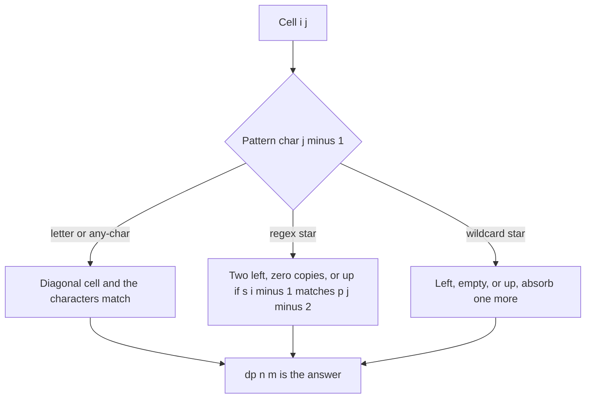

## The hook

A locksmith makes a key with a few flexible teeth. A normal tooth must match its notch exactly. A tooth marked "any" fits any single notch. A spring-loaded tooth can stretch across several notches, or fold away to nothing. Does this key open this lock?

That is pattern matching with '.', '?' and '*', and both famous LeetCode versions are Hard for one reason: a star can absorb any number of characters, and choosing that number greedily goes wrong. A table over prefixes tries every choice at once in O(n × m).

## The problem

There are two versions, and their stars differ:

| | Regular Expression Matching | Wildcard Matching |
|---|---|---|
| Any single character | '.' | '?' |
| Star | '*' = zero or more of the **previous** character | '*' = any sequence, on its own |
| Example match | "abbbc" with "ab*.c" | "hello" with "h*l?" |

In both, the whole text must match the whole pattern, not just part of it.

## The obvious approach

Walk both strings together and, at each star, take as many characters as possible. For regex "a*a" against "aaa", the greedy star eats all three a's and leaves the final 'a' of the pattern with nothing, reporting no match, though "a*" taking two and 'a' taking the last one works. Taking as few as possible fails on other inputs.

The correct brute force tries every possible length for every star, recursively. It is right, but without memory it can be exponential, because the same (text position, pattern position) pairs are reached many ways.

## The key insight

:::analogy
Slide the key into the lock one notch at a time and keep a chart: for every "first i notches of the lock" and "first j teeth of the key", can those teeth fill exactly those notches? A rigid tooth needs the previous chart entry, one notch and one tooth earlier, plus a match. A spring-loaded tooth either folds away, so you look at the chart without it, or stretches over one more notch, so you look one notch earlier with the spring still in place. The chart never needs to know how far each spring stretched, only whether some way works.
:::

The chart is a [[prefix table]]: dp[i][j] is true when s[0..i) matches p[0..j). dp[0][0] = true, since empty matches empty.

### Regular expressions

The [[regex star]] belongs to the character before it, so look at p[j-1] and, if it is '*', at the unit p[j-2]p[j-1]:

- **p[j-1] is a letter or '.':** dp[i][j] = dp[i-1][j-1] and (p[j-1] = '.' or p[j-1] = s[i-1]).
- **p[j-1] is '*':** either the unit takes zero copies, dp[i][j-2], or it takes one more copy, which requires s[i-1] to match p[j-2] and dp[i-1][j].

The [[base row]] for empty text: dp[0][j] is true only when p[j-1] is '*' and dp[0][j-2] is true, so patterns like "a*b*" match the empty string.

### Wildcards

The [[wildcard star]] stands alone:

- **p[j-1] is a letter or '?':** dp[i][j] = dp[i-1][j-1] and the characters match.
- **p[j-1] is '*':** dp[i][j] = dp[i][j-1] (match nothing) or dp[i-1][j] (absorb s[i-1] and keep the star).

The base row: dp[0][j] is true while every pattern character so far is '*'.

The "absorb one more and stay" move, dp[i-1][j], is what lets one star cover any length without trying each length separately.

| Pattern character | Regex | Wildcard |
|---|---|---|
| letter | diagonal and equal | diagonal and equal |
| '.' or '?' | diagonal | diagonal |
| '*' | left two (zero copies) or up, if the previous char matches | left one (empty) or up |
| empty text row | true through 'x*' units only | true through leading stars only |



:::insight
A star does not need a decision about how many characters it takes. Letting it either vanish or absorb one more character while staying in place covers every length, and the prefix table remembers which combinations work.
:::

## Walk through an example

### Regex: "abbb" against "x*ab*"

Columns are pattern prefixes: "", "x", "x*", "x*a", "x*ab", "x*ab*". Rows are text prefixes. T is true.

| text \ pattern | "" | x | x* | x*a | x*ab | x*ab* |
|---|---|---|---|---|---|---|
| "" | T | | T | | | |
| a | | | | T | | T |
| ab | | | | | T | T |
| abb | | | | | | T |
| abbb | | | | | | **T** |

Reading it:

- dp[0][2] is T because "x*" can be zero x's.
- dp[1][3]: 'a' matches 'a', and dp[0][2] was T.
- dp[1][5]: the unit "b*" takes zero copies, so look two columns left at dp[1][3], T.
- dp[4][5]: "b*" takes one more b, so look up at dp[3][5], T, which came from dp[2][5], and so on.

The answer, the bottom-right cell, is true.

### Other regex cases

| Text | Pattern | Match? | Why |
|---|---|---|---|
| "aab" | "c*a*b" | yes | c* takes zero, a* takes two |
| "abbbc" | "ab*.c" | yes | b* takes two, '.' takes the third b |
| "ab" | ".*" | yes | '.*' is any sequence |
| "a" | "ab*a" | no | two a's are required |
| "" | "a*b*" | yes | both stars take zero |

### Wildcard: "abcd" against "a*d"

| text \ pattern | "" | a | a* | a*d |
|---|---|---|---|---|
| "" | T | | | |
| a | | T | T | |
| ab | | | T | |
| abc | | | T | |
| abcd | | | T | **T** |

The star column stays true going down: once "a*" matches "a", it absorbs b, c and d one at a time. The final 'd' then needs the diagonal, dp[3][2], which is T.

:::try-this
Does "mississippi" match the regex "mis*is*ip*i"? (Yes. Split the text as m, i, ss, i, ss, i, pp, i: the letters m and i match themselves, the first "s*" takes "ss", the next i matches, the second "s*" takes "ss", then i, then "p*" takes "pp", and the final i matches the last letter. The table reaches dp[11][11] = true.)
:::

:::warning
Common misconception: "A regex star can match any characters, like a wildcard." In Regular Expression Matching, '*' only repeats the character just before it: "a*" matches "aaa" but not "abc". Only ".*" means "anything". Mixing up the two stars is the most common reason a correct-looking solution fails.
:::

## The code

```pseudo
regex_match(s, p):
    dp[0][0] = true
    for j in 2..m: dp[0][j] = p[j-1] == '*' and dp[0][j-2]
    for i in 1..n: for j in 1..m:
        if p[j-1] == '*':
            dp[i][j] = dp[i][j-2] or (matches(s[i-1], p[j-2]) and dp[i-1][j])
        else:
            dp[i][j] = matches(s[i-1], p[j-1]) and dp[i-1][j-1]
    return dp[n][m]

wildcard_match(s, p):
    dp[0][0] = true
    for j in 1..m: dp[0][j] = dp[0][j-1] and p[j-1] == '*'
    for i in 1..n: for j in 1..m:
        if p[j-1] == '*': dp[i][j] = dp[i][j-1] or dp[i-1][j]
        else: dp[i][j] = (p[j-1] == '?' or p[j-1] == s[i-1]) and dp[i-1][j-1]
    return dp[n][m]
```

```cpp
#include <bits/stdc++.h>
using namespace std;

bool regexMatch(const string& s, const string& p) {
    int n = s.size(), m = p.size();
    vector<vector<bool>> dp(n + 1, vector<bool>(m + 1, false));
    dp[0][0] = true;
    for (int j = 2; j <= m; j++) dp[0][j] = p[j - 1] == '*' && dp[0][j - 2];   // only x* units
    auto same = [&](char a, char b) { return b == '.' || a == b; };
    for (int i = 1; i <= n; i++)
        for (int j = 1; j <= m; j++) {
            if (p[j - 1] == '*')
                dp[i][j] = dp[i][j - 2] || (same(s[i - 1], p[j - 2]) && dp[i - 1][j]);
            else
                dp[i][j] = same(s[i - 1], p[j - 1]) && dp[i - 1][j - 1];
        }
    return dp[n][m];
}

bool wildcardMatch(const string& s, const string& p) {
    int n = s.size(), m = p.size();
    vector<vector<bool>> dp(n + 1, vector<bool>(m + 1, false));
    dp[0][0] = true;
    for (int j = 1; j <= m; j++) dp[0][j] = dp[0][j - 1] && p[j - 1] == '*';   // leading stars
    for (int i = 1; i <= n; i++)
        for (int j = 1; j <= m; j++) {
            if (p[j - 1] == '*') dp[i][j] = dp[i][j - 1] || dp[i - 1][j];        // empty, or absorb one
            else dp[i][j] = (p[j - 1] == '?' || p[j - 1] == s[i - 1]) && dp[i - 1][j - 1];
        }
    return dp[n][m];
}

int main() {
    vector<pair<string, string>> rx = {{"abbb", "x*ab*"}, {"aab", "c*a*b"}, {"abbbc", "ab*.c"},
                                       {"ab", ".*"}, {"a", "ab*a"}, {"", "a*b*"}, {"mississippi", "mis*is*ip*i"}};
    for (auto& [s, p] : rx) cout << regexMatch(s, p);
    cout << '\n';                                              // 1111011
    vector<pair<string, string>> wc = {{"abcd", "a*d"}, {"hello", "h*l?"}, {"abc", "a*d"}, {"", "*"}, {"ab", "*?*"}};
    for (auto& [s, p] : wc) cout << wildcardMatch(s, p);
    cout << '\n';                                              // 11011
}
```

LeetCode guarantees that a regex '*' always follows a real character, so p[j - 2] exists whenever p[j - 1] is '*'.

## Complexity

- **Both problems: O(n × m) time and space** for text length n and pattern length m.
- **Space can drop to O(m)** by keeping only the previous row, since every transition looks at row i or i - 1.
- **Memoised recursion** over (i, j) gives the same bound and is a fine alternative in an interview.

## Common mistakes

- **Treating a regex star as a wildcard star,** or the other way round.
- **Forgetting the base row,** so "a*" fails to match the empty string.
- **Reading p[j - 2] for a star at the very start of a wildcard pattern;** that lookup only belongs to the regex version.
- **Greedy star matching,** which fails on patterns like "a*a".
- **Matching only a prefix of the text** instead of requiring dp[n][m], the whole of both.
- **Off-by-one between string indices and table indices:** dp[i][j] talks about s[i - 1] and p[j - 1].

## Practice problems

*Regular Expression Matching* is the regex table with the "two columns left" rule. *Wildcard Matching* is the simpler star with "left or up". *Interleaving String* is a good warm-up for both: the same kind of boolean prefix table, where each cell asks whether the next character came from the first string or the second. Both grow from the two-string tables in [Lining Up Two DNA Strands](article:dsa-lcs-edit-distance).

## Key takeaways

- Both matching problems use dp[i][j], whether the first i text characters match the first j pattern characters, with dp[0][0] true.
- A regex star repeats the previous character, so it either takes zero copies by looking two columns left or takes one more by looking one row up.
- A wildcard star matches any sequence, so it either matches nothing by looking one column left or absorbs one more character by looking one row up.
- The empty-text row decides which patterns match nothing: 'x*' units for regex and leading stars for wildcards.
- Greedy star matching fails on inputs like "a*a", while the table tries every star length at once in O(n × m).
