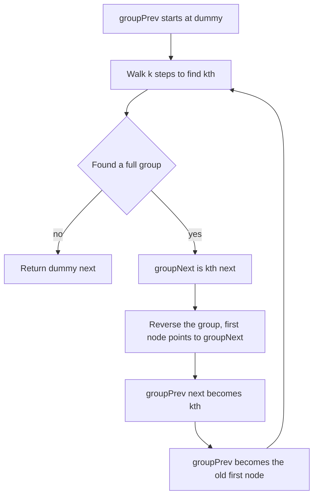

## The hook

A cook stacks pancakes on a plate in a line, and every few minutes she flips the next three over as a block with her spatula, then moves on. Any leftover pancakes at the end, fewer than three, stay as they are. Doing that with a linked list, where you can only follow arrows and every flip must reconnect the stack around it, is one of the most common "hard" linked list questions.

It is not hard because of a clever idea. It is hard because four pointers change at once and losing any one of them breaks the list. With a plan for which pointer to save first, it becomes routine.

## The problem

Given the head of a linked list and a positive integer k, reverse the nodes k at a time and return the new head. If the number of nodes left at the end is less than k, leave them as they are. You may only change links, not node values, and should use O(1) extra memory.

| List | k | Result |
|---|---|---|
| 1 2 3 4 5 | 2 | 2 1 4 3 5 |
| 1 2 3 4 5 | 3 | 3 2 1 4 5 |
| 1 2 3 4 5 | 1 | 1 2 3 4 5 |

Two easier cousins use the same machinery: reversing the whole list, and reversing only positions left to right (*Reverse Linked List II*). *Swap Nodes in Pairs* is the case k = 2.

## The obvious approach

Copy the values into an array, reverse each block of k in the array, and write the values back. It is O(n) time but O(n) space, and it changes values instead of links, which the problem forbids. Another tempting route is recursion, which is elegant but uses O(n / k) stack frames.

The iterative version needs only a few pointers. The work is in keeping them straight.

## The key insight

:::analogy
Picture the pancakes threaded on a string, each pointing to the next. To flip a block of three, you hold the pancake just before the block in your left hand and the pancake just after it in your right hand. Flip the three so their arrows point backwards, then tie the left hand to the new first pancake of the block and the old first pancake, now last, to the right hand. Then move your left hand to that old first pancake and repeat.
:::

That is the whole plan. For each group:

- **Look ahead** k nodes from groupPrev to find the group's last node, kth. If fewer than k nodes remain, stop. This is the [[lookahead]].
- **Remember** groupNext = kth.next, the node just after the group.
- **Reverse** the k nodes in place, pointing the first one at groupNext so the reversed group already links to the rest.
- **Reconnect:** groupPrev.next = kth, the new first node of the group. The old first node is now the group's last node.
- **Advance:** groupPrev becomes that old first node.

The [[group boundary]], groupPrev and groupNext, is the two hands in the analogy. The [[dummy head]] gives the very first group a groupPrev, so it needs no special case, and the answer is dummy.next.

### Reversing k nodes in place

The [[in-place reversal]] of a segment uses the classic [[three-pointer loop]]. Start with prev = groupNext, so the reversed segment points onward, and cur = the group's first node:

- next = cur.next (save it before it is overwritten);
- cur.next = prev (point backwards);
- prev = cur, cur = next (move on).

After k iterations, prev is the group's new first node, which is kth.



:::insight
Every linked list rewiring follows the same discipline: before you overwrite a pointer, save whatever it pointed to. Reversing in groups is just plain reversal plus two extra saved nodes, the one before the group and the one after it.
:::

## Walk through an example

List 1 → 2 → 3 → 4 → 5, k = 2, with a dummy D in front: D → 1 → 2 → 3 → 4 → 5.

| Group | groupPrev | kth | groupNext | After reversing and reconnecting |
|---|---|---|---|---|
| 1 | D | 2 | 3 | D → 2 → 1 → 3 → 4 → 5 |
| 2 | 1 | 4 | 5 | D → 2 → 1 → 4 → 3 → 5 |
| 3 | 3 | only 5 is left, fewer than 2 | | stop |

The result is 2 → 1 → 4 → 3 → 5.

Zoom into group 1, reversing nodes 1 and 2 with prev starting at groupNext = 3:

| Step | cur | Save next | Set cur.next | prev after | cur after |
|---|---|---|---|---|---|
| 1 | 1 | 2 | 1 → 3 | 1 | 2 |
| 2 | 2 | 3 | 2 → 1 | 2 | 3 |

Now 2 → 1 → 3, and groupPrev D is tied to kth = 2. In pancake terms, node 1 was the first pancake of the block and is now its last, so it becomes the left hand for the next flip.

For k = 3, the first group 1, 2, 3 becomes 3 → 2 → 1 → 4, and the lookahead from node 1 finds only 4 and 5, so they stay: 3 → 2 → 1 → 4 → 5.

### Reversing one segment: Reverse Linked List II

To reverse positions left to right, walk a pointer to the node before position left, then reverse exactly right − left + 1 nodes with the same loop and reconnect. For 1 → 2 → 3 → 4 → 5 with left = 2 and right = 4, the node before the segment is 1, the segment 2, 3, 4 becomes 4, 3, 2, and the result is 1 → 4 → 3 → 2 → 5. It is one round of the k-group loop.

:::try-this
Apply the k-group method with k = 4 to 1 → 2 → 3 → 4 → 5 → 6. What is the result, and how many groups are reversed? (The first four nodes form a full group and become 4 → 3 → 2 → 1. Only 5 and 6 remain, fewer than 4, so the result is 4 → 3 → 2 → 1 → 5 → 6, with one group reversed.)
:::

:::warning
Common misconception: "Reverse the group, then fix up the links." If you reverse first without having saved groupNext, the last node of the group has been redirected and the rest of the list is unreachable. Find kth and save groupNext before touching any pointer, and start the reversal with prev = groupNext so the group is already attached to what follows.
:::

## The code

```pseudo
reverse_k_group(head, k):
    dummy.next = head; groupPrev = dummy
    loop:
        kth = groupPrev
        repeat k times: kth = kth.next; if kth is null: return dummy.next
        groupNext = kth.next
        prev = groupNext; cur = groupPrev.next
        while cur != groupNext:
            next = cur.next; cur.next = prev; prev = cur; cur = next
        oldFirst = groupPrev.next
        groupPrev.next = kth
        groupPrev = oldFirst
```

```cpp
#include <bits/stdc++.h>
using namespace std;

struct Node {
    int val;
    Node* next;
    Node(int v, Node* n = nullptr) : val(v), next(n) {}
};

Node* build(const vector<int>& v) {
    Node* head = nullptr;
    for (int i = (int)v.size() - 1; i >= 0; i--) head = new Node(v[i], head);
    return head;
}

void print(Node* h) {
    for (; h; h = h->next) cout << h->val << (h->next ? " " : "");
    cout << '\n';
}

Node* reverseList(Node* head) {
    Node* prev = nullptr;
    while (head) {
        Node* next = head->next;        // save before overwriting
        head->next = prev;
        prev = head, head = next;
    }
    return prev;
}

Node* reverseKGroup(Node* head, int k) {
    Node dummy(0, head);
    Node* groupPrev = &dummy;
    while (true) {
        Node* kth = groupPrev;
        for (int i = 0; i < k && kth; i++) kth = kth->next;   // lookahead
        if (!kth) break;                                     // fewer than k nodes left
        Node* groupNext = kth->next;
        Node *prev = groupNext, *cur = groupPrev->next;      // reversed group points onward
        while (cur != groupNext) {
            Node* next = cur->next;
            cur->next = prev;
            prev = cur, cur = next;
        }
        Node* oldFirst = groupPrev->next;
        groupPrev->next = kth;                               // tie the left hand to the new first
        groupPrev = oldFirst;                                // the old first is now the group's last
    }
    return dummy.next;
}

Node* reverseBetween(Node* head, int left, int right) {
    Node dummy(0, head);
    Node* before = &dummy;
    for (int i = 1; i < left; i++) before = before->next;
    Node* stop = before;
    for (int i = left; i <= right + 1 && stop; i++) stop = stop->next;   // node after the segment
    Node *prev = stop, *cur = before->next;
    while (cur != stop) {
        Node* next = cur->next;
        cur->next = prev;
        prev = cur, cur = next;
    }
    before->next = prev;
    return dummy.next;
}

int main() {
    print(reverseList(build({1, 2, 3, 4, 5})));            // 5 4 3 2 1
    print(reverseKGroup(build({1, 2, 3, 4, 5}), 2));       // 2 1 4 3 5
    print(reverseKGroup(build({1, 2, 3, 4, 5}), 3));       // 3 2 1 4 5
    print(reverseKGroup(build({1, 2, 3, 4, 5, 6}), 4));    // 4 3 2 1 5 6
    print(reverseBetween(build({1, 2, 3, 4, 5}), 2, 4));   // 1 4 3 2 5
}
```

The demo leaks its nodes, which is fine for a short program; in production code you would free them or use smart pointers. The node and dummy-head ideas are introduced in [Pointer Surgery Without Losing the Patient](article:dsa-linked-list-basics).

## Complexity

- **Time: O(n).** Each node is visited once by a lookahead and once by a reversal, so about 2n steps.
- **Space: O(1).** A fixed number of pointers, whatever n and k are. The recursive version uses O(n / k) stack frames.

## Common mistakes

- **Losing the rest of the list** by overwriting cur.next before saving it.
- **Not saving groupNext** before reversing, so the reversed group points nowhere.
- **Reversing a final short group.** The problem keeps fewer than k trailing nodes as they are; check with the lookahead first.
- **Forgetting the dummy head,** which forces a special case for the first group and often loses the new head.
- **Advancing groupPrev to kth** instead of to the old first node. After reversal, kth is at the front of the group, not the back.
- **Off-by-one in Reverse Linked List II** when finding the node before position left, especially when left = 1; the dummy head handles that case.

## Practice problems

Start with *Reverse Linked List*, iteratively and then recursively. *Swap Nodes in Pairs* is k = 2 with the same group loop. *Reverse Linked List II* is one group at a chosen position. *Reverse Nodes in k-Group* is the full problem; draw the four pointers for k = 2 and k = 3 before you code. The middle-finding trick for related problems is in [The Tortoise and the Hare on a Circular Track](article:dsa-fast-slow-pointers).

## Key takeaways

- Reversing a linked list in place redirects each node's next pointer to the previous node, saving the old next first so the rest of the list is not lost.
- Reversing in groups of k adds two saved nodes per group: the one before the group and the one after it.
- Look ahead k nodes before changing anything, and leave a final group of fewer than k nodes untouched.
- Start each group's reversal with prev set to the node after the group, so the reversed group is already attached to the rest of the list.
- A dummy head before the list makes the first group behave like every other group and makes the new head simply dummy.next.
