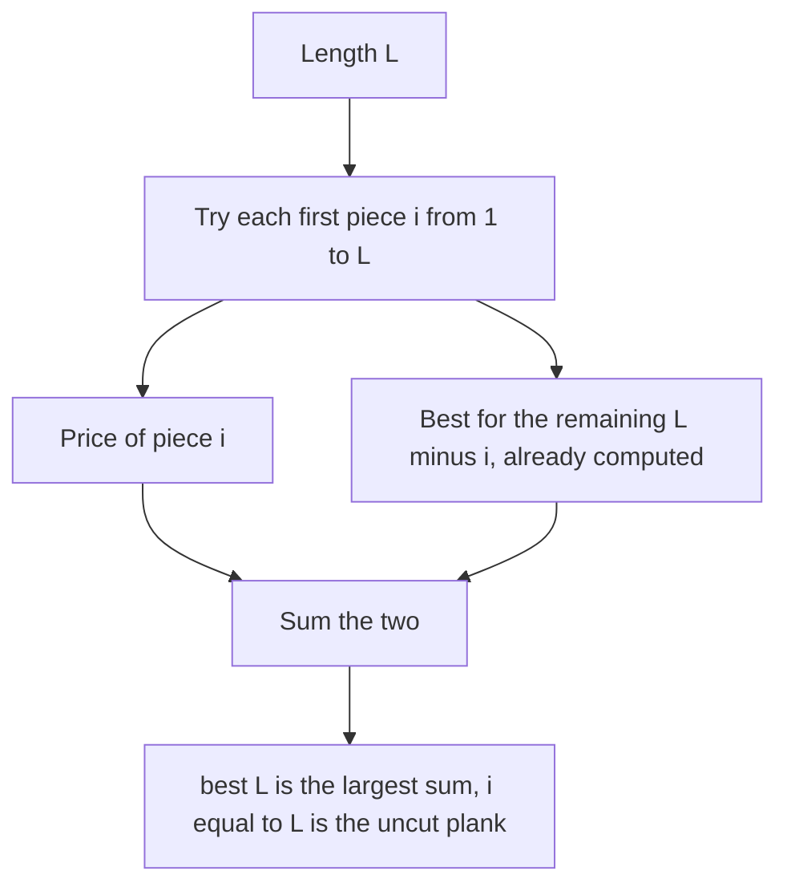

## The hook

A carpenter has a 6-foot plank and a price list: a 1-foot piece sells for 2, a 2-foot piece for 5, a 3-foot piece for 7, up to 14 for the full 6 feet. Selling it whole earns 14. Cutting it into three 2-foot pieces earns 15. Is there anything better?

There are 2⁵ = 32 ways to cut a 6-foot plank at its foot marks, and the number doubles with every extra foot. Yet one short DP finds the best cut, and the same idea solves breaking numbers, summing squares and buying travel passes.

## The problem

*[[Rod cutting]]*: a rod of length n can be cut into pieces of integer lengths. A piece of length i sells for price[i]. Find the maximum total price.

With prices 2, 5, 7, 8, 11, 14 for lengths 1 to 6, the best for n = 6 is 15.

## The obvious approach

Try every subset of the n - 1 cut positions, and add up the prices of the resulting pieces. That is 2ⁿ⁻¹ plans, fine for 10 feet and hopeless for 50.

A smarter recursion picks the length of the [[first piece]], i, and recursively cuts the remaining n - i. That covers every plan, because every plan has some first piece. But without memory it recomputes the same remainders again and again: the remainder 3 is reached after first pieces 3, or 1 then 2, or 2 then 1, and so on.

## The key insight

:::analogy
The carpenter writes a small price card for every shorter plank: "the best I can get from a 1-foot plank, a 2-foot plank, and so on". To price the 6-foot plank, they try each length for the first piece, sell it at list price, and read the best price for what is left from the card already written. The whole plank, sold uncut, is just the case where the first piece is the full 6 feet.
:::

That is unbounded knapsack from [A Vending Machine With Endless Stock](article:dsa-unbounded-knapsack), with piece lengths as reusable items and the rod length as capacity:

- best[0] = 0;
- best[L] = max over i in 1..L of price[i] + best[L - i].

The i = L term is the [[uncut option]]: selling the rod whole. Recording which i wins at each L lets you rebuild the cut plan. The work is O(n²).

### Integer Break: when cutting is mandatory

*Integer Break* asks you to split n (at least 2) into at least two positive integers and maximise their product. Two differences from rod cutting:

- the "price" of a part is the part itself, and pieces multiply rather than add;
- the whole number cannot stay uncut, but each part inside it may.

So dp[i] = max over j in 1..i-1 of max(j, dp[j]) × (i - j): the part j can stay whole or be broken further, and i - j stays whole (other splits are covered by other j). There is also a maths shortcut: use as many 3s as possible, but replace a final 3 + 1 by 2 + 2. That works because 3 × 3 > 2 × 2 × 2 and any part of 5 or more is improved by splitting off a 3, while a 1 never helps a product.

### Perfect Squares: fewest pieces

*Perfect Squares* asks for the fewest perfect squares that sum to n. The "pieces" are 1, 4, 9, 16, ..., reusable, and the objective is the fewest pieces:

dp[i] = min over squares s ≤ i of dp[i - s] + 1.

There are √i squares to try for each i, so O(n √n).

### Minimum Cost For Tickets: covering days

*Minimum Cost For Tickets* gives travel days and the prices of 1-day, 7-day and 30-day passes. This is a [[covering DP]] over calendar days: dp[d] is the cheapest way to cover every travel day up to day d.

- On a day you do not travel, dp[d] = dp[d - 1].
- On a travel day, the pass that covers d either is a 1-day pass, dp[d - 1] + c1, a 7-day pass bought to cover d - 6 to d, dp[d - 7] + c7, or a 30-day pass, dp[d - 30] + c30, with negative indices treated as 0.

| Problem | Items | Objective | Recurrence |
|---|---|---|---|
| Rod cutting | piece lengths 1..n | maximise sum of prices | max of price[i] + best[L - i] |
| Integer Break | parts 1..n - 1 | maximise product | max of max(j, dp[j]) × (i - j) |
| Perfect Squares | squares 1, 4, 9, ... | fewest pieces | min of dp[i - s] + 1 |
| Tickets | 1, 7 and 30-day passes | cheapest cover | min over the three passes |



:::insight
Every cut plan has a first piece, and what remains is the same problem on a shorter rod. Trying each first piece against a table of shorter answers turns 2ⁿ plans into n² steps, and the same "choose the first block, reuse the table for the rest" idea covers products, square sums and travel passes.
:::

## Walk through an example

### Rod cutting, prices 2, 5, 7, 8, 11, 14

| Length L | Best first piece | Calculation | best[L] |
|---|---|---|---|
| 1 | 1 | 2 + 0 | 2 |
| 2 | 2 | 5 + 0, beats 2 + 2 | 5 |
| 3 | 1 | 2 + 5 = 7, ties selling whole at 7 | 7 |
| 4 | 2 | 5 + 5 = 10, beats 8 whole | 10 |
| 5 | 1 | 2 + 10 = 12, beats 11 whole and ties 5 + 7 | 12 |
| 6 | 2 | 5 + 10 = 15, beats 14 whole | **15** |

Rebuilding from L = 6: first piece 2, then from 4 another 2, then 2. Three 2-foot pieces for 15. The 6-foot price of 14 was tempting but loses.

### Integer Break up to 10

| n | 2 | 3 | 4 | 5 | 6 | 7 | 8 | 9 | 10 |
|---|---|---|---|---|---|---|---|---|---|
| Best product | 1 | 2 | 4 | 6 | 9 | 12 | 18 | 27 | 36 |
| Split | 1 + 1 | 1 + 2 | 2 + 2 | 2 + 3 | 3 + 3 | 3 + 4 | 3 + 3 + 2 | 3 + 3 + 3 | 3 + 3 + 4 |

The pattern follows the 3s rule exactly. n = 2 and 3 are the odd ones out: the forced split makes them worse than staying whole, which is why max(j, dp[j]) matters when they appear as parts.

### Perfect Squares

dp for 0 to 13: 0, 1, 2, 3, 1, 2, 3, 4, 2, 1, 2, 3, 3, 2. So 12 = 4 + 4 + 4 needs 3 squares, while 13 = 4 + 9 needs only 2.

### Tickets

Travel days 1, 2, 3, 5, 9, 10, 11, 20; passes cost 3 (1 day), 10 (7 days), 25 (30 days).

| Day | Choice | dp |
|---|---|---|
| 1, 2, 3 | single tickets | 3, 6, 9 |
| 5 | 7-day pass covering days 1 to 5 and beyond | 10 |
| 9 | single | 13 |
| 10 | single | 16 |
| 11 | single (16 + 3), or a 7-day pass for days 5 to 11 on top of dp[4] = 9: both 19 | 19 |
| 20 | single | **22** |

The 30-day pass would cost 25 for everything, more than 22. One 7-day pass and four singles win.

:::try-this
Change the rod price for length 6 from 14 to 16. What is the new best for n = 6? (Selling whole now gives 16, which beats three 2-foot pieces at 15, so the best is 16, with no cuts. This is exactly the case a DP that forgets the uncut option would get wrong.)
:::

:::warning
Common misconception: "Integer Break is the same as rod cutting with price[i] = i." With additive prices i, every plan sums to n, so cutting never matters; Integer Break multiplies. And unlike rod cutting, the whole number must be split, while its parts need not be. Using dp[j] instead of max(j, dp[j]) gives wrong answers for every n whose best split contains a 2 or a 3.
:::

## The code

```pseudo
rod_cutting(price, n):
    best[0] = 0
    for L in 1..n:
        for i in 1..L:                        # i = L is the uncut option
            if price[i] + best[L - i] > best[L]: best[L] = price[i] + best[L - i]; first[L] = i
    return best[n]

integer_break(n):
    dp[1] = 1
    for i in 2..n: dp[i] = max over j in 1..i-1 of max(j, dp[j]) * (i - j)
    return dp[n]
```

```cpp
#include <bits/stdc++.h>
using namespace std;

pair<int, vector<int>> rodCutting(const vector<int>& price, int n) {   // price[i] for length i
    vector<int> best(n + 1, 0), first(n + 1, 0);
    for (int L = 1; L <= n; L++)
        for (int i = 1; i <= L; i++)
            if (price[i] + best[L - i] > best[L]) best[L] = price[i] + best[L - i], first[L] = i;
    vector<int> pieces;
    for (int L = n; L > 0; L -= first[L]) pieces.push_back(first[L]);
    return {best[n], pieces};
}

long long integerBreak(int n) {
    vector<long long> dp(n + 1, 0);
    dp[1] = 1;
    for (int i = 2; i <= n; i++)
        for (int j = 1; j < i; j++) dp[i] = max(dp[i], max<long long>(j, dp[j]) * (i - j));
    return dp[n];
}

long long integerBreakMaths(int n) {                     // as many 3s as possible, no trailing 1
    if (n <= 3) return n - 1;
    long long p = 1;
    while (n > 4) p *= 3, n -= 3;
    return p * n;                                        // n is now 2, 3 or 4
}

int perfectSquares(int n) {
    vector<int> dp(n + 1, INT_MAX);
    dp[0] = 0;
    for (int i = 1; i <= n; i++)
        for (int s = 1; s * s <= i; s++) dp[i] = min(dp[i], dp[i - s * s] + 1);
    return dp[n];
}

int minCostTickets(const vector<int>& days, const vector<int>& c) {
    int last = days.back();
    vector<int> dp(last + 1, 0);
    vector<bool> travel(last + 1, false);
    for (int d : days) travel[d] = true;
    for (int d = 1; d <= last; d++) {
        if (!travel[d]) { dp[d] = dp[d - 1]; continue; }
        dp[d] = min({dp[d - 1] + c[0], dp[max(0, d - 7)] + c[1], dp[max(0, d - 30)] + c[2]});
    }
    return dp[last];
}

int main() {
    auto [value, pieces] = rodCutting({0, 2, 5, 7, 8, 11, 14}, 6);
    cout << value << ':';
    for (int p : pieces) cout << ' ' << p;
    cout << '\n';                                                         // 15: 2 2 2
    cout << rodCutting({0, 2, 5, 7, 8, 11, 16}, 6).first << '\n';         // 16
    cout << integerBreak(10) << ' ' << integerBreakMaths(10) << ' ' << integerBreakMaths(58) << '\n';   // 36 36 1549681956
    cout << perfectSquares(12) << ' ' << perfectSquares(13) << '\n';      // 3 2
    cout << minCostTickets({1, 2, 3, 5, 9, 10, 11, 20}, {3, 10, 25}) << '\n';   // 22
}
```

`integerBreakMaths(58)` shows why the shortcut uses `long long`: 58 = 3 × 18 + 4, so the product is 3¹⁸ × 4 = 1,549,681,956, just under the 32-bit limit, and slightly larger inputs would overflow.

## Complexity

- **Rod cutting: O(n²) time, O(n) space.**
- **Integer Break: O(n²)** with the DP, O(n) or O(log n) with the 3s rule.
- **Perfect Squares: O(n √n) time, O(n) space.**
- **Tickets: O(last day) time and space,** independent of how many passes are bought.

## Common mistakes

- **Dropping the uncut option,** letting i run only up to L - 1 in rod cutting.
- **Using dp[j] instead of max(j, dp[j])** in Integer Break.
- **Treating rod cutting as 0/1 knapsack,** looping lengths backwards so each length is used at most once.
- **Overflow in products** for Integer Break with larger n.
- **In Tickets, forgetting that a pass may cover days before the first travel day,** which the max(0, d - 7) handles.
- **Taking the largest square first** in Perfect Squares, which gives 9 + 1 + 1 + 1 for 12 instead of 4 + 4 + 4.

## Practice problems

*Integer Break* is rod cutting with products and a forced split. *Perfect Squares* is unbounded "fewest coins" with square coins. *Minimum Cost For Tickets* is a covering DP over the calendar. The base pattern is in [A Vending Machine With Endless Stock](article:dsa-unbounded-knapsack), and the closely related fewest-coins problem in [Making Change at the Counter](article:dsa-coin-change).

## Key takeaways

- Rod cutting is unbounded knapsack: best[L] is the maximum over first pieces i of price[i] + best[L - i].
- Letting the first piece be the whole rod keeps the uncut option, which can be the best answer.
- Integer Break multiplies parts and forces at least one split, so each part j contributes max(j, dp[j]).
- The largest product for Integer Break uses as many 3s as possible without leaving a 1.
- Perfect Squares and Minimum Cost For Tickets reuse the same "choose the first block, look up the rest" structure with different blocks and objectives.
