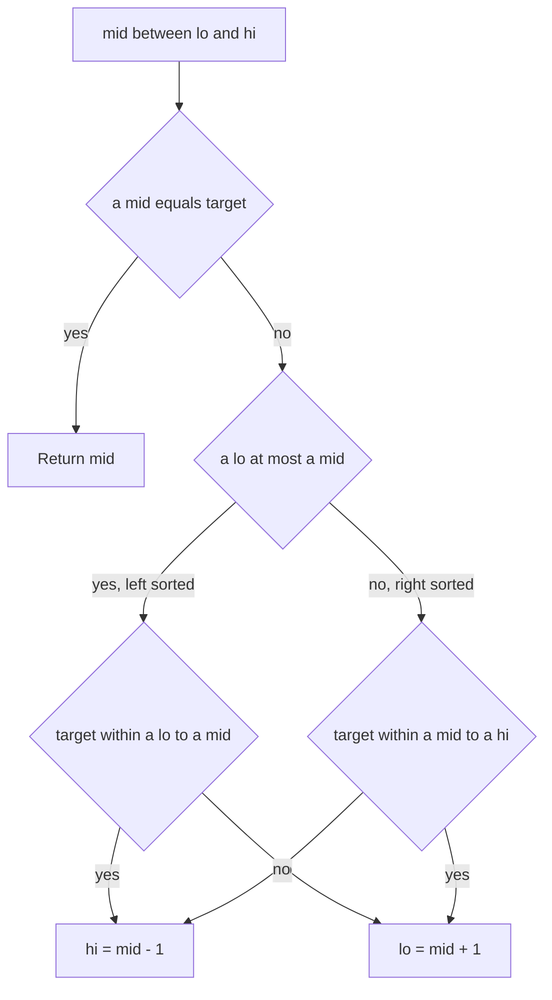

## The hook

A sorted list of ticket numbers was stored in a circular buffer, and now it starts in the middle: [15, 18, 22, 3, 6, 9, 12]. You need to find 6, and you are told to do it in O(log n), not by scanning.

Plain binary search fails here: comparing 6 with the middle value no longer tells you which side it is on, because the array is not sorted end to end. This problem is one of the most asked binary search variations in interviews because it tests whether you understand *why* binary search works, not just its template.

## The problem

You are given an array of distinct integers that was sorted in increasing order and then rotated at an unknown [[pivot]], plus a target value. Return the target's index, or −1 if it is absent, in O(log n) time. Two follow-ups often come next: find the minimum element, and handle duplicates.

## The obvious approach

Scan every element: O(n). Or find the pivot with a scan, then binary search the correct piece: still O(n) because of the scan. Both ignore that the array is "almost sorted". We need a way to throw away half the [[search space]] at every step, as normal binary search does.

## The key insight

:::analogy
Imagine a clock face where someone moved the 12 to a different position, so the numbers still increase going around but the starting point shifted. Pick any position and look both ways. The wrap-around point, where a big number is followed by a small one, can only be on one side of you. The other side is a normal, increasing run of numbers, and on a normal run you can instantly tell whether a value belongs there by checking its two ends.
:::

That is the whole trick. At every step:

1. Compute mid. At least one of [lo..mid] and [mid..hi] is a [[sorted half]], because the array has only one break point.
2. Identify it: if a[lo] ≤ a[mid], the left half is sorted; otherwise the right half is.
3. Check whether the target lies within the sorted half's range, which is easy because its smallest and largest values are its two ends.
4. If yes, search there. If no, the target can only be in the other half.

:::insight
You never need the whole array to be sorted. You need, at each step, one half whose contents you can describe exactly. In a [[rotated sorted array]] one half always qualifies, so every comparison still discards half the candidates.
:::



### Finding the minimum

The minimum is the pivot. Compare a[mid] with a[hi]:

- If a[mid] > a[hi], the break is to the right of mid, so the minimum is in [mid + 1, hi].
- Otherwise, [mid, hi] is sorted and the minimum is at mid or to its left: [lo, mid].

Loop while lo < hi; when they meet, lo is the minimum's index. Comparing with a[hi] instead of a[lo] avoids a special case for arrays that are not rotated at all.

## Walk through an example

Array **[15, 18, 22, 3, 6, 9, 12]**, target **6**:

| lo | hi | mid | a[mid] | sorted half | target in it? | action |
|---|---|---|---|---|---|---|
| 0 | 6 | 3 | 3 | right, [3..12] | 6 in [3, 12]: yes | lo = 4 |
| 4 | 6 | 5 | 9 | left, [6..9] | 6 in [6, 9): yes | hi = 4 |
| 4 | 4 | 4 | 6 | — | found | return 4 |

Target **18**: first step mid = 3, right half [3..12] is sorted and 18 is not in [3, 12], so hi = 2. Next mid = 1, a[1] = 18: found at index 1.

Target **10**: the search moves to the right half, then past 9 to index 6 (value 12), and then lo passes hi: −1.

Minimum: lo = 0, hi = 6, mid = 3, a[3] = 3 ≤ a[6] = 12, so hi = 3. mid = 1, a[1] = 18 > a[3] = 3, so lo = 2. mid = 2, a[2] = 22 > 3, so lo = 3. lo = hi = 3: the minimum is 3 at index 3.

:::try-this
Search for 22 in the same array. Which half is sorted at each step? (Step 1: mid = 3, right half sorted, 22 not in [3, 12], so hi = 2. Step 2: mid = 1, a[1] = 18, left half [15, 18] sorted, 22 not in [15, 18), so lo = 2. Step 3: mid = 2, found.)
:::

## The code

```pseudo
search(a, target):
    lo = 0; hi = n - 1
    while lo <= hi:
        mid = lo + (hi - lo) / 2
        if a[mid] == target: return mid
        if a[lo] <= a[mid]:                       // left half sorted
            if a[lo] <= target < a[mid]: hi = mid - 1
            else: lo = mid + 1
        else:                                     // right half sorted
            if a[mid] < target <= a[hi]: lo = mid + 1
            else: hi = mid - 1
    return -1

find_min(a):
    lo = 0; hi = n - 1
    while lo < hi:
        mid = lo + (hi - lo) / 2
        if a[mid] > a[hi]: lo = mid + 1
        else: hi = mid
    return a[lo]
```

```cpp
#include <bits/stdc++.h>
using namespace std;

int searchRotated(const vector<int>& a, int target) {
    int lo = 0, hi = (int)a.size() - 1;
    while (lo <= hi) {
        int mid = lo + (hi - lo) / 2;
        if (a[mid] == target) return mid;
        if (a[lo] <= a[mid]) {
            if (a[lo] <= target && target < a[mid]) hi = mid - 1;
            else lo = mid + 1;
        } else {
            if (a[mid] < target && target <= a[hi]) lo = mid + 1;
            else hi = mid - 1;
        }
    }
    return -1;
}

int findMin(const vector<int>& a) {
    int lo = 0, hi = (int)a.size() - 1;
    while (lo < hi) {
        int mid = lo + (hi - lo) / 2;
        if (a[mid] > a[hi]) lo = mid + 1;
        else hi = mid;
    }
    return a[lo];
}

int main() {
    vector<int> a = {15, 18, 22, 3, 6, 9, 12};
    cout << searchRotated(a, 6) << ' ' << searchRotated(a, 10) << ' ' << findMin(a) << '\n';  // 4 -1 3
}
```

## Complexity

- **Time:** O(log n) for distinct values: every step halves the search space.
- **Space:** O(1).
- **With duplicates:** O(n) in the worst case, because some steps can only shrink the range by one.

## Common mistakes

:::warning
Common misconception: "the same code works when values repeat." With duplicates, a[lo] ≤ a[mid] no longer proves the left half is sorted: in [3, 1, 3, 3, 3], a[lo] = a[mid] = 3 but the left half contains the break. The fix, used in *Search in Rotated Sorted Array II*, is: if a[lo] == a[mid] == a[hi], move lo up and hi down by one and continue. This is correct but can degrade to O(n), which is unavoidable for such inputs.
:::

- **Using `<` instead of `<=` in `a[lo] <= a[mid]`**: when lo == mid (two elements left), the one-element left half is sorted, and a strict comparison picks the wrong half.
- **Mixing strict and non-strict range checks**: the target equals a[mid] is already handled, so the sorted-half test excludes a[mid] on that side.
- **Comparing with a[lo] when finding the minimum**: a non-rotated array then needs a special case; comparing with a[hi] does not.
- **Finding the pivot first with a linear scan**, which silently makes the whole solution O(n).

## Practice problems

*Search in Rotated Sorted Array* is the walkthrough above. *Find Minimum in Rotated Sorted Array* is the pivot search. *Search in Rotated Sorted Array II* and *Find Minimum in Rotated Sorted Array II* add duplicates and the shrink-by-one fallback; be ready to explain in an interview why the worst case becomes O(n). The idea of deciding which half can be trusted generalises the template in [Binary Search Without the Off-by-One Fear](article:dsa-binary-search).

## Key takeaways

- A rotated sorted array has a single break point, so at any mid at least one half is fully sorted.
- If a[lo] ≤ a[mid] the left half is sorted; otherwise the right half is.
- Check whether the target lies within the sorted half's end values, and search there or in the other half accordingly.
- The minimum is found by comparing a[mid] with a[hi] and keeping the half that contains the break.
- Duplicates can hide which half is sorted, forcing a shrink-by-one step and an O(n) worst case.
